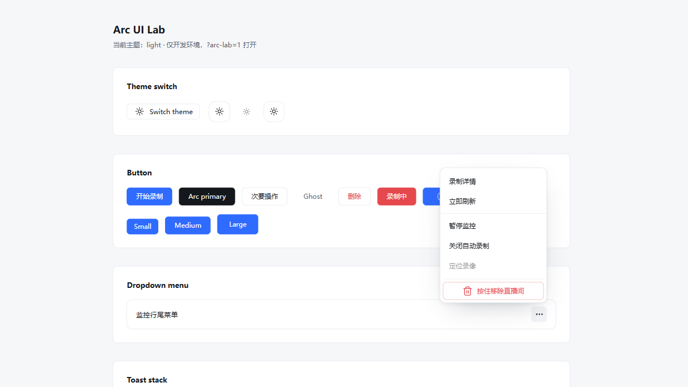
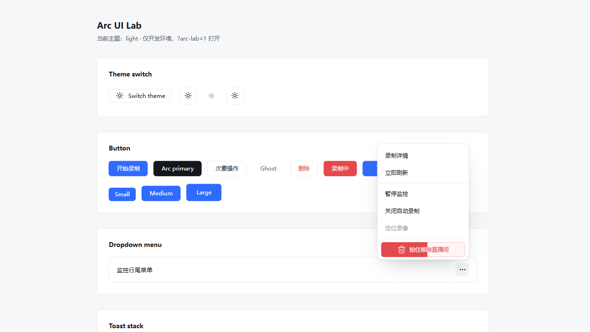
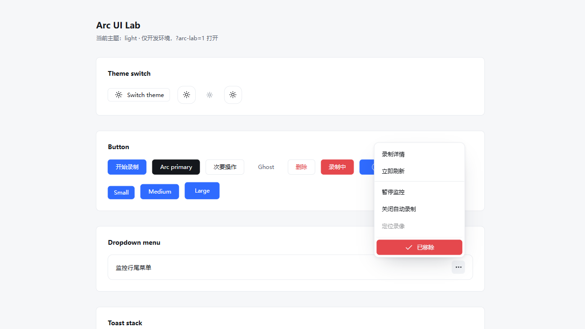

# 100-按住确认删除直播间

> 状态：v1 已实施（2026-11-09）；浏览器 ArcLab 完成部分按住、回退、完整确认验收，Tauri 真实房间删除待补。
> 范围：监控行菜单里的「移除房间」不再是二次点击菜单项，改成菜单底部的 Arc（uiarc.dev）`HoldToConfirm`。
> 前置阅读：`86-Arc-UI控件环境.md`、`98-监控行菜单统一为Arc-DropdownMenu.md`。

## 0. 结论速览

- 新增 `src/components/arc/hold-to-confirm/`，依赖 `motion`、`lucide-react`（项目已安装）。
- 监控行「⋯」菜单最后一项改为菜单 footer 里的整宽危险按钮：**按住 1.4 秒移除直播间**。
- 按住时红色填充从左向右推进，文字在填充边缘翻转颜色；提前松开会回退，完整按住后按钮变成「已移除」并画勾。
- 删除动作本身不再需要第二次点击：HoldToConfirm 就是确认；确认后 `removeRoom` 立即执行。
- 失败时恢复按钮并弹 error toast；成功时房间从列表消失，仍会显示「已移除，历史录像保留在媒体库」的 info toast。
- 移除了 DropdownMenu 上一轮临时加的 `keepOpen`，改为更通用的 `footer`，用于放自定义确认控件。

## 1. 组件

| 文件 | 作用 |
| --- | --- |
| `src/components/arc/hold-to-confirm/hold-to-confirm.tsx` | Arc HoldToConfirm 源码 |
| `src/components/arc/hold-to-confirm/hold-to-confirm.module.css` | 填充、双面文字、图标、危险色 |
| `src/features/monitor/MonitorPage.tsx` | 菜单 footer 接入，控制 `confirmed` / `busy` |

用法：

```tsx
<HoldToConfirm
  label={t("monitor.holdRemove")}
  confirmedLabel={t("monitor.removeDone")}
  duration={1400}
  tone="danger"
  confirmed={removeDone}
  disabled={busy}
  className="w-full"
  onConfirm={() => {
    setRemoveDone(true);
    void removeRoom(room).then(ok => { if (!ok) setRemoveDone(false); });
  }}
/>
```

## 2. 交互

- 指针按下并捕获；填充从当前位置线性推进，松手后按 smooth 弹簧回退。
- 按住时按钮轻微缩到 0.97；完成时恢复，标签 morph 成「已移除」，垃圾桶图标 morph 成手绘勾。
- 指针滑出按钮 24px 即取消；触摸完成时短振动（支持时）。
- 键盘 Space / Enter 按住同样有效；Tab 离开会取消。
- `prefers-reduced-motion` 下取消缩放和回退弹簧，填充仍按时间推进。
- 屏幕阅读器提示：「Press and hold for 1.4 seconds to confirm. With a keyboard, hold Space or Enter.」；完成时 role=status 宣布「已移除」。

## 3. 菜单集成

- DropdownMenu 新增 `footer?: ReactNode`：在菜单项之后渲染一条带顶部细线的自定义区域。
- 删除按钮宽度 `w-full`，在 190px 菜单里实测 180×32。
- 菜单的 radix 选择项只剩：录制详情、立即刷新、直播间设置、暂停/恢复监控、自动录制、定位录像；移除动作单独放在 footer。
- `removeRoom` 不再判断 `confirmId`，直接执行 `roomRemove`；`run` 返回成功布尔值，失败时恢复 HoldToConfirm 的 confirmed 状态。
- 菜单打开时重置 `removeDone`；删除成功后行卸载，菜单自然消失。
- 删除成功仍保留 info toast「已移除房间，历史录像仍保留在媒体库」。

## 4. 验证

- 菜单打开：footer 显示红色描边、垃圾桶图标和「按住移除直播间」，宽 180px。
- 按住约 0.7 秒：红色填充覆盖约一半，文字颜色在边缘翻转。
- 松手：填充回退到 0，按钮回到初始状态。
- 完整按住 1.4 秒：填充走满，按钮变红底「已移除」并显示勾。
- `pnpm exec tsc -b`、`pnpm build` 通过；`check:i18n` 640 keys、`check:docs` 101 files。
- 真实房间删除后的行卸载、失败回调与 info toast 需要 `pnpm tauri dev` 下补点。







## 5. 已知限制

- **删除动作嵌在 DropdownMenu 里**：它不是 Radix `menuitem`，键盘方向键不会落到它；鼠标/触摸按住正常，键盘需要先聚焦到该按钮再按住 Space/Enter。后续若要严格键盘流，可把删除单独放在详情抽屉里。
- **确认后菜单不会立即关闭**：真实房间成功删除后行卸载，菜单随行消失；ArcLab 演示里保留「已移除」状态。
- **1.4 秒是固定节奏**：比默认 1.2 秒稍长，避免误触；如需更快可调 `duration`。
- **`footer` 是本地扩展**：重新执行 `shadcn add --overwrite` 会覆盖 DropdownMenu。
