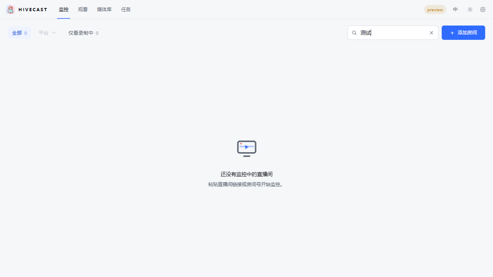

# 102-搜索清除与添加房间反馈

> 状态：v1 已实施（2026-11-09）；浏览器实测搜索清除，添加房间成功 toast 需 Tauri 真实添加复看。
> 范围：`PageSearch` 补清除按钮与 Escape 清空；监控添加房间成功后弹 success toast。
> 前置阅读：`99-刷新与按钮反馈补全.md`、`101-监控列表细节优化.md`。

## 0. 结论速览

- `PageSearch` 在输入非空时显示右侧 ×，点击清空；Escape 也可清空。
- 清空按钮有 `aria-label`，监控/媒体库分别传入 `common.clear`（清除 / Clear）。
- 输入框右侧 padding 随状态在 `pr-2.5` / `pr-8` 间切换，长占位符不被按钮压住。
- 监控添加房间成功后弹 success toast：「直播间已添加」，描述为房间主播名/标题/房间号。
- 失败仍只弹 error toast；添加中按钮保持原 loading 文案。

## 1. PageSearch 清除

- 新增 `clearLabel?: string`，默认 `Clear`。
- 输入非空时渲染 24×24 图标按钮，位于输入框右侧 6px，hover 浅底。
- 按钮 `type="button"`，不会提交表单。
- `Escape` 在输入框有值时清空，不冒泡到页面。
- 搜索框仍保持 228×36，左侧放大镜位置不变。

## 2. 添加房间成功提示

```tsx
const view = await roomAdd(value, addMonitor, addAutoRecord);
...
await load();
notify.success(t("monitor.added"), view.room.hostName || view.room.title || view.room.roomKey);
```

- 标题：`monitor.added`（直播间已添加 / Room added）
- 描述：优先主播名，其次房间标题/房间号
- 弹窗关闭、列表刷新完成后才提示，避免 toast 早于列表
- 失败时走原有 `notify.error(err)`，不会误报成功

## 3. 验证

- 监控搜索框输入「测试」：右侧出现 ×；点击后 value 变为空，× 消失。
- 媒体库搜索框同样支持清除。
- Escape 清空搜索不触发其它页面级 Escape 行为。
- `pnpm exec tsc -b`、`pnpm build` 通过；`check:i18n` 642 keys、`check:docs` 103 files。
- 添加房间成功 toast 需要 `pnpm tauri dev` 真实添加一次。



## 4. 已知限制

- **清除按钮只在有值时出现**：空搜索保持原来的 228px 输入框，不额外占位。
- **Escape 清空是输入框级行为**：焦点在搜索框时才会触发。
- **添加成功 toast 在 `load()` 之后**：如果列表刷新很慢，弹窗关闭到 toast 出现之间会有一小段间隔。
- **添加成功描述可能为空**：极端情况下房间没有主播名、标题和 roomKey，则只有标题 toast。
