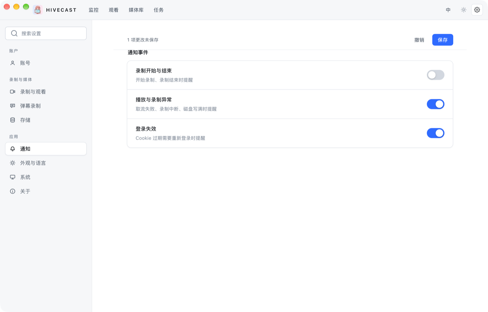
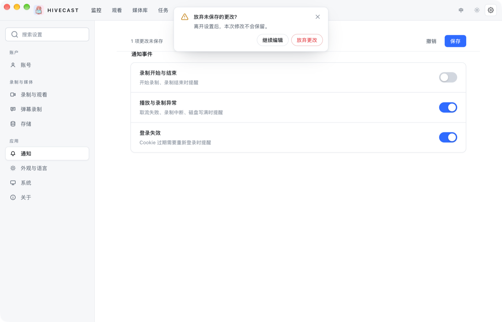
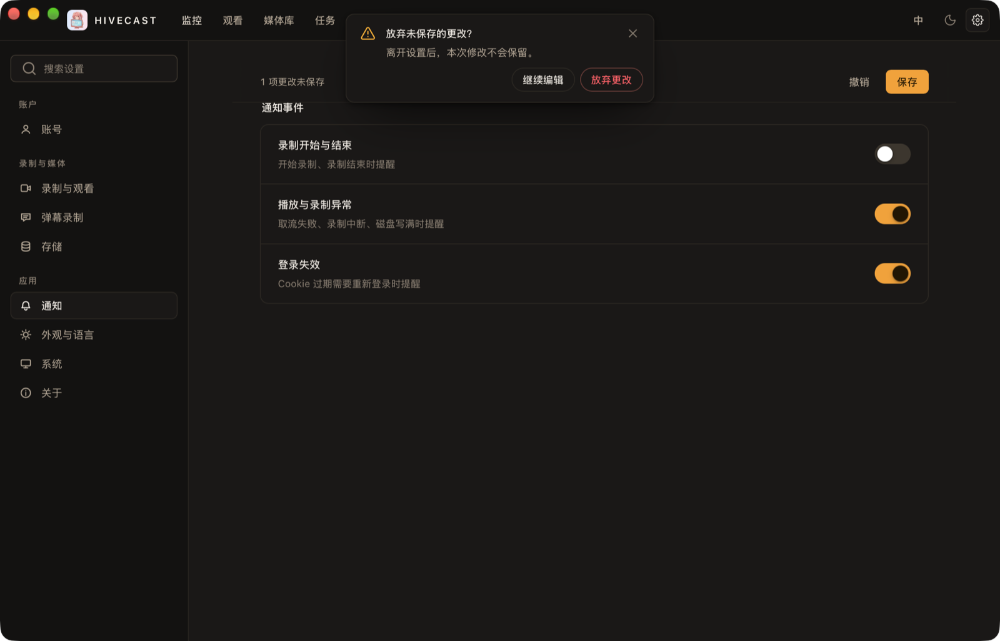

# 设置界面改为常规页签与交互迭代

> 日期：2026-11-10
> 参考：<https://uiarc.dev/components/blocks/settings-page>
> 范围：`src/App.tsx`、`src/features/settings/{SettingsView,AccountSection}.tsx`、`src/components/arc/toast-stack/*`、`src/i18n/{zh-CN,en-US}.json`
> 不改：媒体库、任务中心（按用户要求暂时不定稿）

## 1. 起点

上一版（459a240）把设置做成 `fixed inset-0 z-50` 的全屏层，视觉上像独立窗口：盖住 48px 顶栏，顶栏的 `data-tauri-drag-region` 失效，整个窗口不能拖动；侧栏带自己的标题、关闭按钮和 `⌘F`、`⌘S` 提示；底部常驻一条带琥珀圆点的浮动保存栏；离开确认框沿用默认 Dialog 的灰色方头关闭按钮。账号页则是一张 `divide-y` 列表，每行前面一个品牌色圆点。

这一轮先按七点把设置改成常规页签，再按复验反馈修掉三个问题：保存时误触发语言/主题切换、离开确认仍像整屏弹窗、每个 tab 顶部重复显示标题和副标题；最后把离开提示从底部内联 Alert 改成顶层 toast，并把两个操作按钮收进 toast。

## 2. 七项对照

| # | 用户要求 | 改法 | 结果 |
| --- | --- | --- | --- |
| 1 | 设置不再是独立界面，顶栏可以拖动窗口 | 设置变成 App 第五个 `TabKey`，渲染在 `motion.main` 内；删除全屏层和侧栏自己的标题/关闭按钮 | 顶栏、红绿灯、拖拽区始终在原位；真机拖动窗口从 (70,30) 到 (142,66) |
| 2 | 移除快捷键 | 删除 App 的 `Cmd/Ctrl+,`；删除 SettingsView 的 `Esc`/`Cmd+S`/`Cmd+F` effect；删除搜索框 `⌘F` 与页头 `⌘S` 提示 | 界面没有任何快捷键提示；只保留输入框/弹层自身的 Esc 行为 |
| 3 | 账号页按平台分卡片，扫码与 Cookie 嵌进卡片 | 四张平台卡两列排布，卡内 header 是缩写方块 + 平台名 + 状态 chip，底部操作行，扫码/Cookie 面板在卡内展开 | 账号页不再套 `Section` 行列表；扫码和 Cookie 都在对应平台卡里 |
| 4 | 设置里不要彩色小点 | 删除账号平台前的四色圆点、侧栏底部脏状态圆点和保存栏圆点；后处理模式选中态由圆点改成方形勾选 | 设置页只剩中性图标、文字 chip 和控件本身的状态色 |
| 5 | 移除右下角未保存提示 | 删除侧栏底部「有未保存的更改 / 所有更改已保存」整块，同时删除应用图标/版本 footer | 未保存信息只在内容区顶部的保存条出现 |
| 6 | 重做保存工具栏 | 删除底部 520px 浮动条，改成内容区顶部 sticky 保存条：`N 项更改未保存` + 撤销 ghost + 保存 primary；clean 时整条不渲染 | 滚动时保存操作始终可见，不再遮挡页面底部内容 |
| 7 | 重做未保存退出确认框 | 不再用 Dialog 或底部内联 Alert；改成顶部居中的 warning toast，标题、说明和「继续编辑 / 放弃更改」按钮都在 toast 内，放弃按钮用 danger 色 | 离开决定就是一条通知，不占页面布局；点继续编辑留在设置，点放弃才切页 |

## 3. 本轮三项缺陷

| # | 现象 | 原因 | 改法 |
| --- | --- | --- | --- |
| 1 | 保存后像是切换了语言/主题，页面闪一下 | `save()` 无条件调用 `setLanguage(...)`；App 的 `onSaved` 每次都重放 `applyTheme(mode)` | 语言只在 `result.language !== settings.language` 时切换；主题只在 `mode !== theme` 时应用 |
| 2 | 离开设置仍弹整屏确认，太重 | `DiscardChangesDialog` 用遮罩层 + 368px 卡片 | 删除该组件；先改成 Arc `Alert` 的底部内联卡，复验后再次改成顶层 `ToastStack` 的 warning toast，按钮在 toast 内 |
| 3 | 每个 tab 顶部又写一遍标题和副标题 | 主区仍保留 21px 标题 + 11.5px 说明，和侧栏当前项重复 | 删除主区 `header`；侧栏高亮负责定位，正文直接以第一个 `Section` 标题开始 |

## 4. 常规页签的接线

`src/App.tsx:36` 起：

```ts
type TabKey = "monitor" | "watch" | "media" | "tasks" | "settings";
```

- `openSettings(page)`（`src/App.tsx:70`）：第一次进入时把当前页记到 `lastTab`，再 `setSettingsPage(page); setTab("settings")`。
- `requestTab(next)`（`src/App.tsx:79`）：同页直接返回；当前在设置且 `settingsDirty` 时调用 `notify.toast({ id: "settings-leave", ... })`，由 toast 里的两个按钮决定是否离开。
- 「继续编辑」只 `notify.dismiss("settings-leave")`；「放弃更改」先 dismiss，再 `setSettingsDirty(false); setTab(next)`。
- `src/App.tsx:112`：`settingsDirty` 变回 false（保存或撤销）时自动 dismiss `settings-leave`，提示不残留。
- 顶栏四个 tab 都走 `requestTab`；齿轮在设置页内再次点击会回到 `lastTab`，并带 `active` 态。
- ffmpeg 缺失 toast 的「去设置」仍落到 `storage` 页，只是改为调用 `openSettings("storage")`。
- 离开设置时清空 `settingsPage`，下次进入从账号页开始。

## 5. 布局规格

| 区域 | 规格 |
| --- | --- |
| 外层 | 设置不再有 `fixed`；根节点 `flex min-h-0 flex-1 bg-canvas text-ink` |
| 顶栏 | 仍是 48px 的 `header`，`data-tauri-drag-region` 覆盖空白区；macOS 左让 78px |
| 侧栏 | 220px，`bg-canvas`，右侧 `border-line/80`；顶部只有搜索框，无标题/关闭按钮 |
| 导航组标题 | 10px semibold，0.12em 字距，`text-faint` |
| 导航项 | 32px 高，7px 圆角，14px 中性图标，12.5px 文字 |
| 活动项 | `motion.span layoutId="settings-nav-active"` 白卡 + 1px 描边 + `0 1px 2px` 阴影，spring 520/42 |
| 主区 | `bg-surface`，`max-w-[780px]` 居中，左右 32px；不再有页头标题 |
| 滚动区 | `min-h-0 flex-1 overflow-auto px-8 py-6`，内容 `space-y-7` |
| 保存条 | sticky `top-0 z-20`，48px 高，`-mx-8` 抵消内容内边距，底边 `border-line/60`，`bg-surface/90 backdrop-blur-sm` |
| 设置卡 | 10px 圆角，`border-line`，`0 1px 2px rgba(16,24,40,.04)`；卡头无底色 |
| 账号卡 | 12px 圆角，内容高度，两列 `gap-3`；窄窗口回落单列 |
| 离开提示 | `ToastStack` 顶部居中，宽 22.5rem；warning 图标 + 标题 + 说明，两个按钮在 toast 第二行右对齐；danger 按钮红字描边 |

## 6. 账号卡

- 平台名沿用 `platformName.*`，不做品牌色；缩写方块用 `BL/DY/HY/DO`，36px、mono 10px、`bg-raised`。
- 状态只出现一次：右上角文字 chip（`已登录` / `登录已失效` / `未登录`），不再在卡身重复写「未登录」。
- 已登录时卡身显示账号名与 Cookie 数；未登录时只显示对应提示，不再放两个「—」占位。
- 底部操作行用一条 `border-t` 与内容分开：B 站是「扫码登录 / 粘贴 Cookie」，其余是「粘贴 Cookie」；已登录追加「退出登录」，二次点击才真正退出。
- 扫码面板（`src/features/settings/AccountSection.tsx:222`）在卡内展开：128px 二维码 + 状态、倒计时、提示、刷新；1.6 秒轮询逻辑不变。
- Cookie 面板（`src/features/settings/AccountSection.tsx:181`）同样在卡内展开：3 行 textarea + 取消/保存，保存时仍走后端校验。

## 7. 脏状态与保存

- `changedCount`（`src/features/settings/SettingsView.tsx:320`）按字段比较 `settings` 与 `initial`，`dirty = changedCount > 0`。
- `onDirtyChange`（`src/features/settings/SettingsView.tsx:338`）把脏状态上报给 App，用于离开提示。
- 保存条（`src/features/settings/SettingsView.tsx:1571`）只在 dirty 时渲染；文本 `text-muted`，撤销 ghost，保存 primary；保存成功后 `initial` 更新、计数归零、保存条收起。
- `save()`（`src/features/settings/SettingsView.tsx:419`）先比较语言：只有用户真的改了语言才 `setLanguage`。`onSaved` 的主题守卫（`src/App.tsx:485`）先比较主题：只有 `mode !== theme` 才 `applyTheme`。两条守卫一起消除保存时的语言/主题闪动。
- 主题选择本身是“暂存后保存”的：切换浅/深色只改本地 settings，点保存才应用；这也是看到“未保存”时页面仍是旧主题的原因。

## 8. 离开提示

- 旧 `DiscardChangesDialog` 与底部 560px 内联 `Alert` 都已删除；不再有遮罩、独立卡片或页面底部浮层。
- 触发点在 `requestTab`（`src/App.tsx:79`）：设置页有未保存改动时调用 `notify.toast`，id 固定为 `settings-leave`，重复点页签只会更新同一条 toast。
- toast 内容：`type: "warning"`、`duration: Infinity`，标题 `settings.discardTitle`，正文 `settings.discardBody`，操作按钮 `settings.keepEditing` / `settings.discard`。
- `ToastStack`（`src/App.tsx:507`）仍是全局顶部居中；`settings-leave` 只是其中一条。
- 为支持这条确认，`src/components/arc/toast-stack/toast-stack.tsx` 扩展了 `ToastAction.tone` 与 `ToastOptions.actions`：可以放多个按钮，`tone: "danger"` 用红色描边/文字；两个按钮通过 `data-multi` 换到 toast 内第二行并右对齐。
- 行为：
  - 「继续编辑」：dismiss，留在设置，脏状态不变。
  - 「放弃更改」：dismiss，清空 `settingsDirty`，切到目标页。
  - 右上角 X / 滑动关闭：只关提示，仍留在设置；再点页签会重新弹出。
  - 保存或撤销后：`settingsDirty` 变 false，`src/App.tsx:112` 的 effect 自动 dismiss，不会残留「未保存」提示。
- 不再向 `SettingsView` 传 `leavePending/onStay/onLeave`；`SettingsView` 只负责脏状态上报，离开决策集中在 App 与 ToastStack。

## 9. 真机验收

环境：macOS，窗口 1166×749，release bundle，真实数据库。

| 场景 | 结果 |
| --- | --- |
| 拖动顶栏 | 从空白区拖动，窗口 (70,30) → (142,66)，再拖回 |
| 设置页签 | 齿轮进入，顶栏保持可见；再次点齿轮回到进入前的页 |
| 账号页 | 两列四卡，状态 chip、缩写方块、底部操作行正常；无品牌色圆点 |
| 扫码面板 | B 站卡内展开二维码、倒计时与刷新，不再跳出整页 |
| 重复标题 | 账号、通知、外观页都直接从第一个 Section 开始，没有 21px 页标题和说明 |
| 保存条 | 改动通知开关后内容区顶部出现「1 项更改未保存 / 撤销 / 保存」；保存后整条消失 |
| 保存不误切 | 只改通知开关后保存，界面仍是中文浅色；语言与主题只在真的改动时变化 |
| 主题暂存 | 外观页选深色后页面仍保持原主题，点保存才整体变暗；再选浅色保存恢复 |
| 离开提示 | 有未保存改动时点监控，顶部居中弹出 warning toast；标题、说明与「继续编辑 / 放弃更改」都在 toast 内；继续编辑留在设置，放弃更改回监控 |
| 浅/深色 | 两套主题下侧栏、卡片、保存条、toast 底色与 danger 按钮对比正常 |
| 离开设置 | 重进回到账号页；未保存状态不跨页残留 |

验证命令：

```bash
pnpm exec tsc -b
pnpm run check:i18n   # 739 keys
pnpm run check:docs   # 129 files
pnpm app:build        # bundle 30.34 MiB
```

## 10. 未改与后续

- 媒体库、任务中心未动，仍等待单独定稿。
- 不实现快捷键系统；搜索框和 Radix 弹层自身的 Esc 行为保留，这是输入/弹层语义，不是应用级快捷键。
- 账号仍是每个平台一个凭据、B 站额外支持扫码；没有多账号切换。
- 设置行仍是「左说明右控件」，与监控/媒体库保持同一套行式布局。
- 窄窗口下账号卡回落单列，二维码固定 128px；若窗口更窄，后续可把二维码与文案改成上下堆叠。

## 11. 截图









