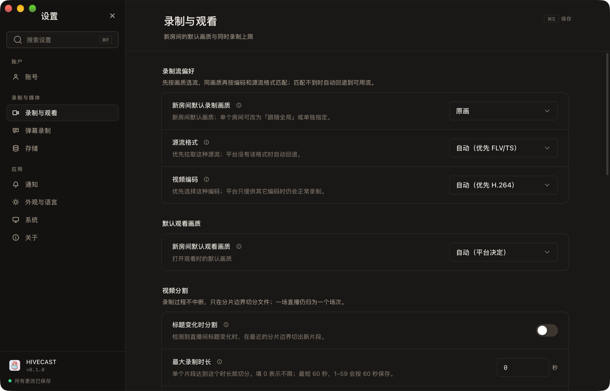

# 设置界面按 UIArc settings-page 重做

> 日期：2026-11-10
> 参考：<https://uiarc.dev/components/blocks/settings-page>
> 范围：`src/features/settings/SettingsView.tsx`、`src/i18n/{zh-CN,en-US}.json`
> 不改：媒体库、任务中心（按用户要求暂时不定稿）

## 1. 目标

设置页原来的问题是：彩色图标底、卡片头带底色、侧栏与主区都用白色、底部常驻保存栏，整体像后台模板；页面标题旁还有 40px 彩色方块，和其他页面的页头不统一。

这次以 UIArc 的 settings-page 为参考，只借它的结构与克制感，不照搬字段布局：

- 左侧窄导航 + 右侧内容区；侧栏灰、主区白。
- 页标题 + 一句说明，不再放彩色图标 tile。
- 导航活动项是一张滑动的白卡；图标全部回到中性色。
- 只有字段改动后才浮出保存栏，显示「N 项更改未保存」、撤销、保存。
- 分区标题与说明移到卡片外，卡片只承载设置行。

## 2. 参考块的取舍

采用：

- 240px 左右侧栏、浅灰底，主区纯白。
- 侧栏顶部是「Settings + 关闭」，不是品牌头。
- 导航项 32px 高、圆角 7px，活动项白底 + 1px 描边 + 极轻阴影。
- 页标题 20px 级别、说明 12px 级、低对比。
- 编辑后才出现的保存栏，带 changed fields 计数与撤销。

没有采用：

- **两列字段、label 在输入框上方**：本项目设置行的既有模式是「左侧标题/说明 + 右侧控件」，所有页面（含监控、媒体库筛选）都按这个模式。只改设置页会立刻和其他界面脱节，所以保留行式。
- **顶部横向 tab**：那是参考块在 651px 窄容器里的响应式形态；桌面应用有完整高度，纵向导航更合适。
- **账号头像区**：本项目设置不是账号中心；侧栏底部保留应用图标、版本和保存状态。
- **方向键/Home/End 导航**：参考块有，这次没有做；需要键盘完整可达时再加。

## 3. 布局规格

| 区域 | 规格 |
| --- | --- |
| 全屏层 | `fixed inset-0 z-50`，`bg-canvas` |
| 侧栏 | 240px，`bg-canvas`，右侧 1px `border-line/80` |
| 侧栏标题 | 高 60px，17px semibold；macOS 左侧留 78px 给红绿灯 |
| 搜索框 | 侧栏内 `px-3`，保留 `⌘F` 提示 |
| 导航组标题 | 10px semibold，0.12em 字距，`text-faint` |
| 导航项 | 32px 高，7px 圆角，14px 线性图标，12.5px 文字 |
| 活动项 | `motion.span layoutId="settings-nav-active"` 白卡，spring 520/42；reduced motion 时 0ms |
| 主区 | `bg-surface`，内容宽 780px 居中，左右 40px |
| 页头 | `pt-6 pb-5`，标题 21px semibold，说明 11.5px；右上 `⌘S 保存` |
| 分区标题 | 卡片外，12.5px semibold；说明 11.5px / 17px 行高 |
| 设置卡 | 10px 圆角，1px `border-line`，`0 1px 2px` 阴影；行 58px 起 |
| 保存栏 | 仅 dirty 时出现；520px 宽，12px 圆角，底部 20px，`0 12px 32px` 阴影 |

## 4. 代码落点

### 4.1 图标与页元数据

- `PageMeta` 删除 `tint` 字段；`PAGES` 不再为每页配品牌色。
- `PageIcon` 改为纯 `currentColor` 容器，不再画 `color-mix(... 13%)` 底色。
- 页头不再渲染 40px 彩色 tile；搜索结果的页面分组也改为中性小图标。

### 4.2 脏状态与撤销

不再用整串 JSON 比较，改为按字段计数：

```ts
const changedCount = useMemo(() => {
  if (!settings || !initial) return 0;
  const base = JSON.parse(initial) as Record<string, unknown>;
  const current = settings as unknown as Record<string, unknown>;
  return Object.keys(current).filter(
    (key) => JSON.stringify(current[key]) !== JSON.stringify(base[key]),
  ).length;
}, [settings, initial]);
const dirty = changedCount > 0;
```

撤销直接把 `settings` 回填为 `JSON.parse(initial)`；保存成功后 `initial` 更新，计数归零，保存栏自动退场。

### 4.3 保存栏

`AnimatePresence` 包裹，只在 `dirty` 时挂载：

- 左侧琥珀点 + `settings.unsavedCount`（`{{n}} 项更改未保存` / `{{n}} unsaved changes`）。
- 「撤销」调用 `revert`。
- 「保存」调用原 `save`；`⌘S` 仍走同一个 `save`。
- 内容区在 dirty 时加 `pb-28`，避免最后一行被浮层挡住。

### 4.4 分区与行

`Section` 改为：

```tsx
<section className="space-y-2.5">
  <div className="px-0.5">
    <h3 className="text-[12.5px] font-semibold ...">{title}</h3>
    {desc ? <p className="mt-1 text-[11.5px] leading-[17px] text-muted">{desc}</p> : null}
  </div>
  <div className="overflow-hidden rounded-[10px] border border-line bg-surface ...">
    <div className="divide-y divide-line">{children}</div>
  </div>
</section>
```

卡头不再有 `bg-raised/35` 底色，标题移到卡片外。`Row` 的 58px 高度、左说明右控件保持不变。

### 4.5 i18n

新增两个键：

| key | 中文 | English |
| --- | --- | --- |
| `settings.unsavedCount` | `{{n}} 项更改未保存` | `{{n}} unsaved changes` |
| `settings.undo` | `撤销` | `Undo` |

## 5. 真机验收

环境：macOS，窗口 1167×749，真实应用 bundle。

| 场景 | 结果 |
| --- | --- |
| 账号页（浅色） | 240px 侧栏、白卡活动项、页标题 21px、分区标题在卡外；无彩色 tile |
| 外观与语言（浅/深） | 分段控件与卡片在暖黑主题下对比正常；侧栏活动卡仍可辨 |
| 录制与观看 / 存储 | 多分区长页滚动正常，卡片圆角与行分隔一致 |
| 搜索「画质」 | 页头变「搜索设置」，3 个匹配项按页面分组，活动导航清空 |
| 修改主题 | 保存栏浮出「1 项更改未保存」，撤销/保存可点；保存后计数归零并退场 |
| 保存后主题 | 深色保存后立即切换；随后恢复浅色并再次保存，状态回「所有更改已保存」 |

验证命令：

```bash
pnpm exec tsc -b
pnpm run check:i18n   # 739 keys
pnpm app:build        # 2697 modules；bundle 30.34 MiB
```

截图：




## 6. 未改与后续

- 媒体库、任务中心未动；两者仍等待单独定稿。
- 设置行仍是「左说明右控件」，没有改成参考块的两列表单；这是为了与监控/媒体库控件保持一致。
- 侧栏键盘方向键导航未实现；如果后续要做完整无障碍，可以补 roving tabindex + Home/End。
- 窄窗口下右控件固定 208px，说明文字会先换行；如果未来支持更小窗口，再把行式布局降级为上下堆叠。
