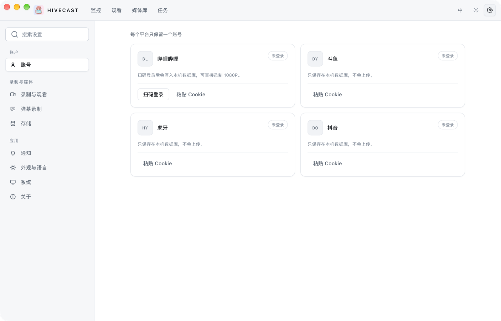
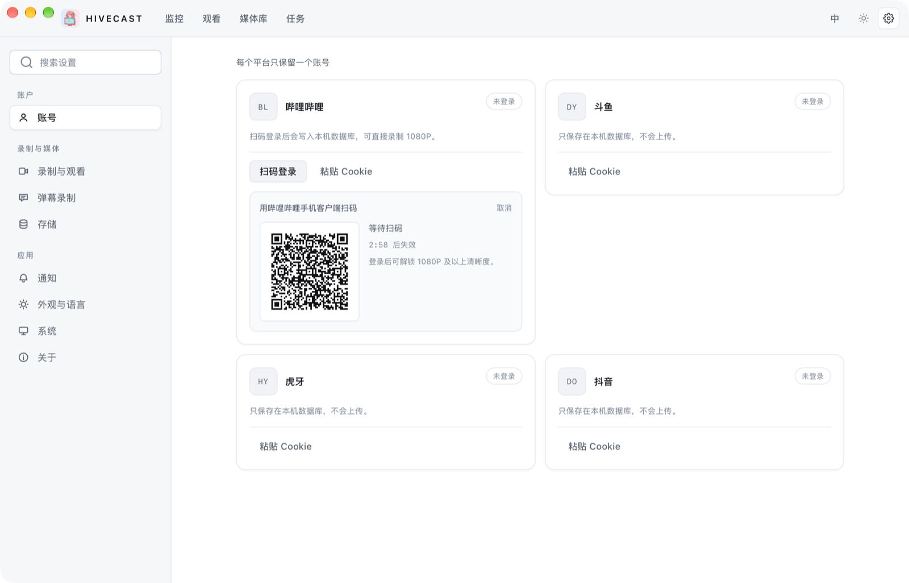
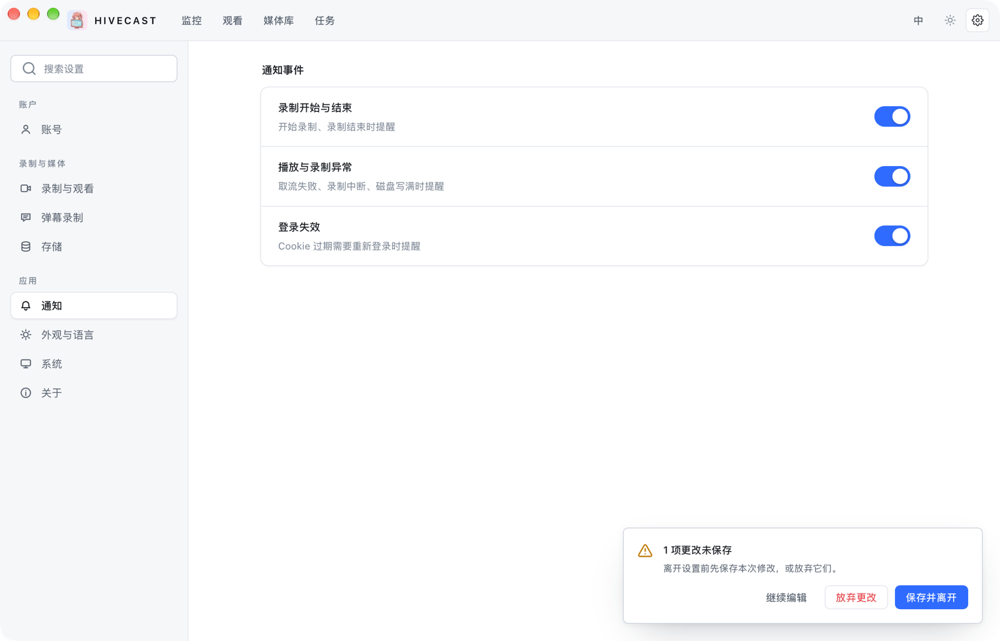
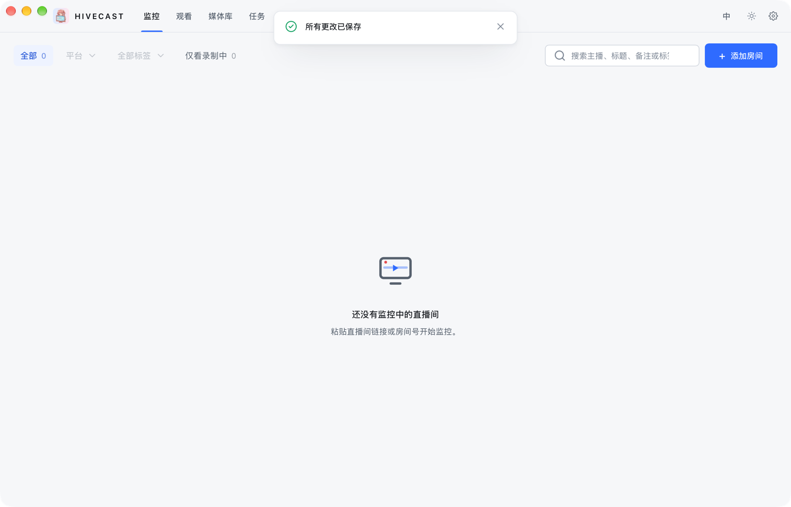
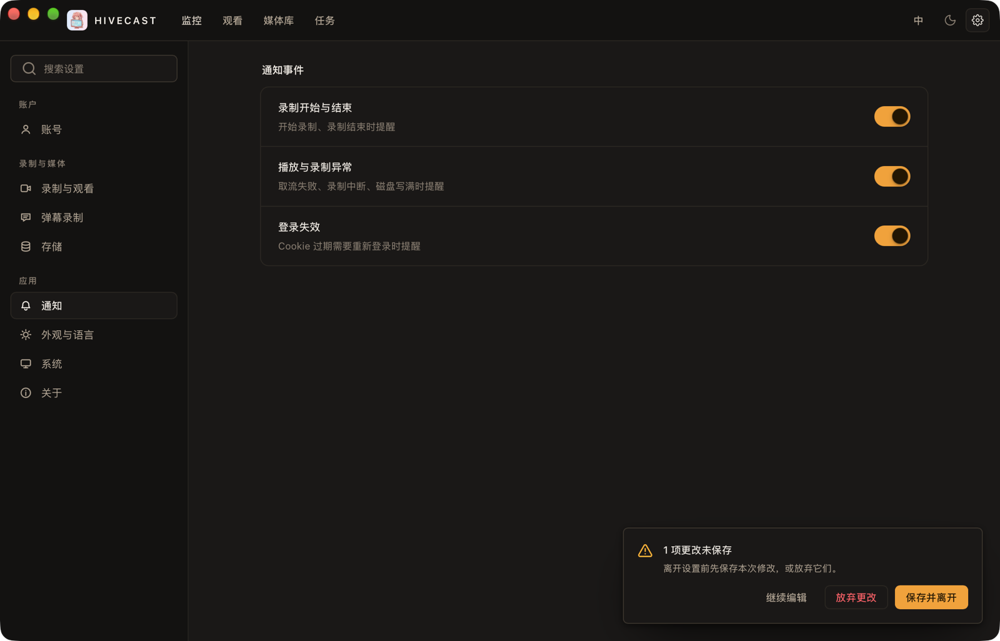

# 设置界面 UIArc 重做与离开确认

> 日期：2026-11-10
> 参考：<https://uiarc.dev/components/blocks/settings-page>、<https://uiarc.dev/components/alert>
> 范围：`src/App.tsx`、`src/features/settings/{SettingsView,AccountSection}.tsx`、`src/components/arc/alert/*`、`src/lib/notify.ts`、`src/styles/index.css`、`src/i18n/{zh-CN,en-US}.json`
> 不改：媒体库、任务中心（按用户要求暂时不定稿）

## 1. 起点与最终形态

上一版（459a240）把设置做成 `fixed inset-0 z-50` 的全屏层，视觉上像独立窗口：盖住 48px 顶栏，顶栏的 `data-tauri-drag-region` 失效，整个窗口不能拖动；侧栏有自己的标题、关闭按钮和 `⌘F`、`⌘S` 提示；底部常驻一条带琥珀圆点的浮动保存栏；离开确认沿用默认 Dialog 的灰色方头关闭按钮。账号页是一张 `divide-y` 列表，每行前面一个品牌色圆点。

这一轮先把设置改成普通页签，再连续按反馈迭代：删除内容区顶部的 sticky 保存条，把保存动作并入离开确认；离开确认从整屏 Dialog 改为右下角 Arc Alert；修掉保存时语言/主题被旧值覆盖、语言切换冲掉未保存改动两个隐蔽问题。最终形态：

- 设置是 App 第五个 `TabKey`，在 `motion.main` 内渲染，顶栏始终在原位、窗口可拖动。
- 220px 暖灰侧栏 + 780px 白主区；没有页标题、没有保存条、没有常驻保存按钮。
- 设置页的保存入口只有一个：离开设置时右下角的 warning Alert。
- Alert 不铺遮罩、不挡整页，继续编辑 / 放弃更改 / 保存并离开三个动作都在卡片底部。
- 顶栏的主题/语言与设置页本地副本、脏状态基线保持同步，保存不会把顶栏刚写入的值覆盖回去。

## 2. 七项对照

| # | 用户要求 | 改法 | 结果 |
| --- | --- | --- | --- |
| 1 | 设置不再是独立界面，顶栏可以拖动窗口 | 设置变成 App 第五个 `TabKey`，渲染在 `motion.main` 内；删除全屏层和侧栏自己的标题/关闭按钮 | 顶栏、红绿灯、拖拽区始终在原位；真机拖动窗口从 (70,30) 到 (142,66) |
| 2 | 移除快捷键 | 删除 App 的 `Cmd/Ctrl+,`；删除 SettingsView 的 `Esc`/`Cmd+S`/`Cmd+F` effect；删除搜索框 `⌘F` 与页头 `⌘S` 提示 | 界面没有应用级快捷键提示；只保留输入框/弹层自身的 Esc 行为 |
| 3 | 账号页按平台分卡片，扫码与 Cookie 嵌进卡片 | 四张平台卡两列排布，卡内 header 是缩写方块 + 平台名 + 状态 chip，底部操作行，扫码/Cookie 面板在卡内展开 | 账号页不再套 `Section` 行列表；扫码和 Cookie 都在对应平台卡里 |
| 4 | 设置里不要彩色小点 | 删除账号平台前的四色圆点、侧栏底部脏状态圆点和保存栏圆点；后处理模式选中态由圆点改成方形勾选 | 设置页只剩中性图标、文字 chip 和控件本身的状态色 |
| 5 | 移除右下角未保存提示 | 删除侧栏底部「有未保存的更改 / 所有更改已保存」整块，同时删除应用图标/版本 footer | 未保存信息只在离开设置的 Alert 标题出现，不再常驻 |
| 6 | 重做保存工具栏 | 先删底部 520px 浮动条改成顶部 sticky 保存条；复验后按反馈删掉保存条，保存动作只保留在离开设置的 Alert 里 | 设置页内容区不再被保存条撑开，滚动区域从页面顶部开始 |
| 7 | 重做未保存退出确认框 | 不再用 Dialog 或内联 Alert；改成右下角 Arc warning Alert，标题、说明和三个动作都在卡片内，放弃 danger、保存 primary；不显示 X | 离开决定是一张非模态浮层；继续编辑留在设置，放弃不保存直接切页，保存成功后才切页 |

## 3. 本轮修掉的四个问题

### 3.1 保存时不再重放语言/主题

旧实现有两个无条件写入：

- `SettingsView.save()` 每次保存都调用 `setLanguage(...)`；
- `App` 的 `onSaved` 每次都 `applyTheme(mode)`。

顶栏是设置页之外的另一个写入口：在设置页打开时用顶栏切语言/主题，App 的全局值立即变化并 persist，但 `SettingsView` 的本地 `settings` 仍是旧值。下一次保存把旧值写回数据库，随后 `onSaved` 又应用旧主题，看起来就是「点保存触发了语言/主题切换」。

现在的守卫：

```ts
// SettingsView.save()
const currentLanguage = i18n.resolvedLanguage?.startsWith("zh") ? "zh-CN" : "en-US";
const nextLanguage = result.language === "system" ? detectLanguage() : (result.language as Language);
if (nextLanguage !== currentLanguage) setLanguage(nextLanguage);
```

- 语言和**当前界面实际语言**比较，而不是和保存前的本地副本比较。这样设置页里主动把语言改成中文，保存时能生效；顶栏已经切过语言时又不会重放。
- `App` 的 `onSaved` 只在 `mode !== theme` 时应用主题；主题没变就不再走一次 `applyTheme`。
- 设置页保存后仍然更新 `setSettings(result)` 与 `setInitial(JSON.stringify(result))`，脏状态归零。

### 3.2 顶栏写入口同步到设置页基线

只有 `save()` 的守卫还不够：如果设置页本地仍是旧主题/旧语言，保存仍会把旧值写进 `settingsUpdate`。为此增加了反向同步：

- `SettingsView` 新增 `onRegisterSync?: (sync: ((patch: Partial<Settings>) => void) | null) => void`；
- `syncExternal(patch)` 同时更新本地 `settings` 和 `initial` 基线；
- `App` 保存 `settingsSyncRef`，在 `pickLanguage` 中调用 `settingsSyncRef.current?.({ language: code })`，在 `changeTheme` 中调用 `settingsSyncRef.current?.({ theme: next })`。

同步 `initial` 的结果是：顶栏改语言/主题不算「未保存项」，Alert 的计数只统计真正的表单改动；保存时提交的也是顶栏刚写的值。

### 3.3 语言切换不再冲掉未保存设置

这是本轮最隐蔽的问题：

1. 设置页把「录制开始与结束」关掉，未保存计数为 1；
2. 点顶栏中/EN 切换语言；
3. 开关自动回到开，未保存计数消失，随后点监控也不弹 Alert。

根因不在设置页的字段逻辑，而在 `src/lib/notify.ts`：`useNotify()` 的返回值依赖 `useTranslation().t`，语言一换，`t` 换身份，`notify` 对象也跟着换身份。`SettingsView` 的 `load` 是 `useCallback(..., [notify])`，加载 effect 的依赖是 `[load, loadLogs, loadFfmpeg]`；`notify` 一变，effect 重新执行，`settingsGet()` 把数据库值写回本地并重置 `initial`，脏状态被直接冲掉。

修复方式：

```ts
const tRef = useRef(t);
tRef.current = t;

return useMemo(() => ({
  error: (message, title) => toast({ ..., title: title ?? tRef.current("toast.errorTitle") }),
  warning: (message, title) => toast({ ..., title: title ?? tRef.current("toast.warningTitle") }),
  // ...
}), [dismiss, toast, update]);
```

`notify` 现在跨语言保持稳定；错误/警告文案仍读最新的 `t`。这同时避免了其他页面因语言切换而重跑依赖 `notify` 的 effect。

### 3.4 离开确认从整屏 Dialog 改成 Arc Alert

旧 `DiscardChangesDialog` 是遮罩 + 368px 卡片；中途还试过底部内联 Alert 和顶部 toast，前者占内容布局，后者离设置页太远且按钮和正文挤在一起。最终改为右下角 Arc Alert：

- 非模态，没有遮罩；设置页仍可操作，只是离开被挂起。
- 卡片固定在视口右下，不参与内容排版；内容区不会因为提示出现而向下跳。
- 三个动作在说明下方右对齐，不再塞进 `description` 段落里。

## 4. 常规页签的接线

`src/App.tsx`：

```ts
type TabKey = "monitor" | "watch" | "media" | "tasks" | "settings";
```

- `openSettings(page)`：第一次进入时把当前页记到 `lastTab`，再 `setSettingsPage(page); setTab("settings")`。
- `requestTab(next)`：同页直接返回；当前在设置且 `settingsDirty` 时只 `setSettingsLeave(next)`，不切页、不写库。目标页先记在 `settingsLeave`，等 Alert 的动作决定。
- `closeSettingsLeave()`：清空目标页和 `settingsSaving`，留在设置。
- `discardSettingsLeave()`：清空目标页、把 `settingsDirty` 置 false，再 `setTab(next)`；不调用保存。
- `saveSettingsLeave()`：置 `settingsSaving`，await `settingsSaveRef.current?.()`；成功才清 dirty、关 Alert、切页；失败只恢复按钮，留在设置页，错误由 `save()` 内的 `notify.error` 发出。
- `settingsDirty` 变回 false 的 effect 会关闭 Alert，避免保存或撤销后提示残留。
- 顶栏四个 tab 都走 `requestTab`；齿轮在设置页内再次点击会回到 `lastTab`，并带 active 态。
- ffmpeg 缺失 toast 的「去设置」仍落到 `storage` 页，只是改为 `openSettings("storage")`。
- 离开设置时清空 `settingsPage`，下次进入从账号页开始。

`SettingsView` 通过两个注册函数把能力交给 App：

- `onRegisterSave`：注册唯一的 `save()`，卸载时置空；Alert 的「保存并离开」直接复用。
- `onRegisterSync`：注册 `syncExternal`，供顶栏写主题/语言时同步本地副本与基线。

## 5. 布局规格

| 区域 | 规格 |
| --- | --- |
| 外层 | 设置不再有 `fixed`；根节点 `flex min-h-0 flex-1 bg-canvas text-ink` |
| 顶栏 | 仍是 48px 的 `header`，`data-tauri-drag-region` 覆盖空白区；macOS 左让 78px |
| 侧栏 | 220px，`bg-canvas`，右侧 `border-line/80`；顶部只有搜索框，无标题/关闭按钮 |
| 导航组标题 | 10px semibold，0.12em 字距，`text-faint` |
| 导航项 | 32px 高，7px 圆角，14px 中性图标，12.5px 文字 |
| 活动项 | `motion.span layoutId="settings-nav-active"` 白卡 + 1px 描边 + `0 1px 2px` 阴影，spring 520/42 |
| 主区 | `bg-surface`，`max-w-[780px]` 居中，左右 32px；不再有页头标题 |
| 滚动区 | `min-h-0 flex-1 overflow-auto px-8 py-6`，内容 `space-y-7` |
| 保存入口 | 设置页内没有保存条或常驻保存按钮；保存只在离开 Alert 中 |
| 设置卡 | 10px 圆角，`border-line`，`0 1px 2px rgba(16,24,40,.04)`；卡头无底色 |
| 账号卡 | 12px 圆角，内容高度，两列 `gap-3`；窄窗口回落单列 |
| 离开 Alert | 右下角，距视口右/下 20px；卡片宽 `min(420px, calc(100vw - 40px))`；warning 图标 + 标题 + 说明 + 右对齐按钮行；无遮罩、无 X |

## 6. 账号卡

- 平台名沿用 `platformName.*`，不做品牌色；缩写方块用 `BL/DY/HY/DO`，36px、mono 10px、`bg-raised`。
- 状态只出现一次：右上角文字 chip（`已登录` / `登录已失效` / `未登录`），不在卡身重复写「未登录」。
- 已登录时卡身显示账号名与 Cookie 数；未登录时只显示对应提示，不放两个「—」占位。
- 底部操作行用一条 `border-t` 与内容分开：B 站是「扫码登录 / 粘贴 Cookie」，其余是「粘贴 Cookie」；已登录追加「退出登录」，二次点击才真正退出。
- 扫码面板（`src/features/settings/AccountSection.tsx`）在卡内展开：128px 二维码 + 状态、倒计时、提示、刷新；1.6 秒轮询逻辑不变。
- Cookie 面板同样在卡内展开：3 行 textarea + 取消/保存，保存时仍走后端校验。

## 7. 脏状态、保存与双写同步

- `changedCount` 按字段比较 `settings` 与 `initial`，`dirty = changedCount > 0`。
- `onDirtyChange(dirty, changedCount)` 把两个值一起上报给 App；App 用计数生成 Alert 标题，用 dirty 决定是否拦截切页。
- 设置页不渲染任何保存条；界面里没有常驻的「保存」按钮，内容区不会被撑开。
- `save()` 签名是 `() => Promise<boolean>`：成功时更新 `initial`、计数归零、调用 `onSaved`、`loadLogs()`/`loadFfmpeg()` 并 `notify.success`，返回 true；失败时 `notify.error(err)` 并返回 false。
- `onRegisterSave` effect 把同一个 `save` 交给 App；App 的 `settingsSaveRef` 只保存这一个函数。
- 保存的唯一入口是离开 Alert；当前没有「保存但不离开」的按钮，这是按反馈做的取舍，避免出现第二套保存逻辑。
- 顶栏语言 `pickLanguage(code)`：先 `setLanguage(code)`，再 `settingsSyncRef.current?.({ language: code })`，最后 `persist({ language: code })`。
- 顶栏明暗 `changeTheme(next)`：先更新 App 的 `theme/appearance` 并同步设置页本地副本，320ms 后 `applyTheme` + `persist({ theme: next })`。
- 设置页自己的主题选择是「暂存后保存」：选浅/深色只改本地 `settings`，保存后才应用；顶栏切换是立即应用并同步基线。两种入口写的是同一个字段，但交互语义不同。

## 8. 离开 Alert 的实现

- Arc Alert 手动安装自 `https://uiarc.dev/r/alert.json`，文件在 `src/components/arc/alert/{alert.tsx,alert.module.css}`。
- 本地给 `AlertProps` 增加 `footer?: ReactNode`，footer 渲染在 `HeightFrame` 内部、说明之后；如果直接作为 `children` 传给 Alert，会被塞进说明段落，按钮跑到文案右侧。
- `App` 状态：`settingsLeave: TabKey | null` 与 `settingsSaving: boolean`；不再用 toast id，也不再需要 dismiss 同一条通知。
- 放置：

```tsx
<div className="pointer-events-none fixed inset-x-0 bottom-5 z-[70] flex justify-end px-5">
  <Alert
    open={settingsLeave !== null}
    tone="warning"
    title={settingsSaving ? t("settings.saving") : t("settings.unsavedCount", { n: settingsChangedCount })}
    className="alert-float pointer-events-auto w-[min(420px,calc(100vw-40px))]"
    footer={settingsSaving ? null : (/* 三个 Button */}
  >
    {settingsSaving ? null : t("settings.leaveBody")}
  </Alert>
</div>
```

- `.alert-float` 在 `src/styles/index.css`：`border-color: var(--c-line-strong)`、`background: var(--c-surface)`、`box-shadow: var(--shadow-floating)`。它把 Alert 从设置面板同色的表面里分离出来，浅色是白卡，深色是暖黑卡。
- 三个动作：
  - 「继续编辑」：ghost，关闭 Alert，留在设置，表单与脏状态不变。
  - 「放弃更改」：danger，关闭 Alert、清 dirty、切到目标页，不写数据库。
  - 「保存并离开」：primary，await 唯一的 `save()`；成功才切页，失败留在设置页并恢复三个按钮。
- 保存中：标题换成 `settings.saving`，正文和 footer 都为空，Alert 通过 `HeightFrame` 收缩，不会闪出旧按钮；保存通常很快，这个状态不一定能被截到。
- Alert 没有 `onDismiss`，因此不渲染右上角 X；也没有遮罩。它不是模态框，设置页仍可继续编辑，只是离开动作被挂起。
- 同一时间只存在一张 Alert；在 Alert 打开时再点其他页签，只更新 `settingsLeave` 的目标页，不会叠加第二张。
- 没有为 Alert 加应用级 Esc；键盘用户通过三个按钮操作，Tab 焦点留在页面内。

## 9. 真机验收

环境：macOS，窗口 1167×749 @ (70,30)，release bundle，真实数据库；浅色蓝、深色暖琥珀两套主题均保留。

| 场景 | 结果 |
| --- | --- |
| 拖动顶栏 | 从空白区拖动，窗口 (70,30) → (142,66)，再拖回 |
| 设置页签 | 齿轮进入，顶栏保持可见；再次点齿轮回到进入前的页 |
| 账号页 | 两列四卡，状态 chip、缩写方块、底部操作行正常；无品牌色圆点 |
| 扫码面板 | B 站卡内展开二维码、倒计时与刷新，不跳出整页 |
| 重复标题 | 账号、通知、外观页都直接从第一个 Section 开始，没有页标题和说明 |
| 设置页初始 | 内容区顶部没有保存条、没有保存按钮，页面从第一个字段直接开始 |
| 脏状态（浅色） | 改动通知开关后点监控，右下角 warning Alert 显示「1 项更改未保存」与三个按钮；无遮罩、无 X |
| 脏状态（深色） | 同一状态切深色，Alert 是暖黑卡、警示图标和琥珀 primary，和设置面板边界清楚 |
| 继续编辑 | 点「继续编辑」Alert 关闭，仍在设置页，开关保持修改后的状态 |
| 放弃更改 | 再改一个开关后离开，点「放弃更改」直接回监控；数据库仍是旧值，未写入 |
| 保存并离开（主题同步） | 设置页打开时用顶栏切深色，再改通知并离开；保存后切监控、显示「所有更改已保存」，DB `ui.theme=dark`、`ui.notify=true`，页面没有闪回浅色 |
| 保存不误切语言 | 设置页为英文，改通知开关后走「Save and leave」；DB `ui.language=en-US`、`ui.notify=false`、`ui.theme=light`，界面保持英文浅色，没有重放中文 |
| 语言切换保留脏状态 | 关掉「录制开始与结束」后点顶栏中/EN；开关保持关闭，Alert 仍显示 1 项更改，不再被数据库值冲掉 |
| 设置内改语言 | 外观页选「中文」，此时 Alert 仍是英文（草稿未保存）；点「Save and leave」后界面变中文，DB `ui.language=zh-CN` |
| Alert 打开时切主题 | 保持脏状态切换浅/深色，页面与 Alert 一起换主题，计数仍为 1；保存后主题保持 |
| 成功提示 | 保存成功后在监控页顶部显示「所有更改已保存」，与离开 Alert 不重复 |
| 浅/深色 | 两套主题下侧栏、卡片、Alert 底色与三个按钮对比正常；深色 primary 为琥珀实心 |
| 离开设置 | 重进回到账号页；未保存状态不跨页残留 |

验证命令：

```bash
pnpm exec tsc -b
pnpm run check:i18n   # 736 keys
pnpm run check:docs   # 129 files
pnpm build
pnpm app:build        # bundle 30.35 MiB
```

## 10. 未改与后续

- 保存动作只在离开设置的 Alert 中出现，没有「保存但不离开」的入口；若以后要加，必须复用 `settingsSaveRef`，不能再写第二套按钮逻辑。
- 媒体库、任务中心未动，仍等待单独定稿。
- 不实现应用级快捷键系统；搜索框和 Arc 弹层自身的 Esc 行为保留，这是输入/弹层语义。
- 账号仍是每个平台一个凭据、B 站额外支持扫码；没有多账号切换。
- 设置行仍是「左说明右控件」，与监控页的筛选/列表保持同一套行式语言。
- 窄窗口下账号卡回落单列，二维码固定 128px；若窗口更窄，后续可把二维码与文案改成上下堆叠。
- Alert 是浮层，内容很长时仍可能盖住页面底部的控件；这是非模态的代价。当前设置页用大留白和卡片布局，实际窗口 1167×749 下不挡表单。

## 11. 截图












