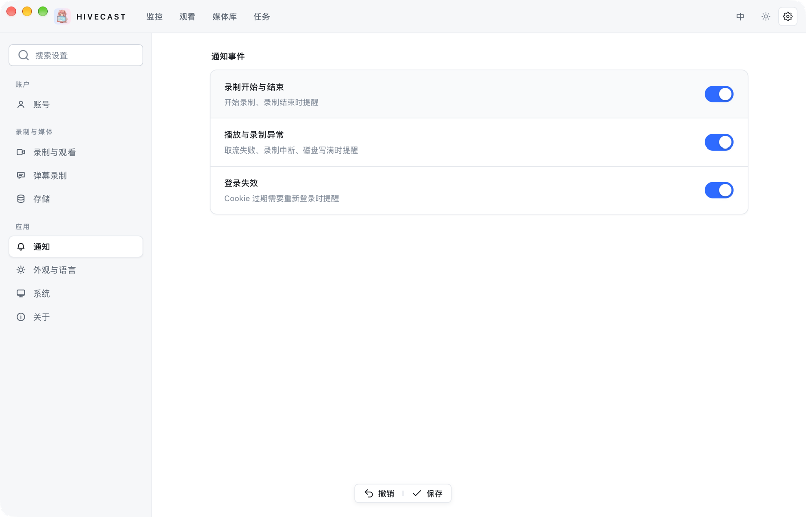
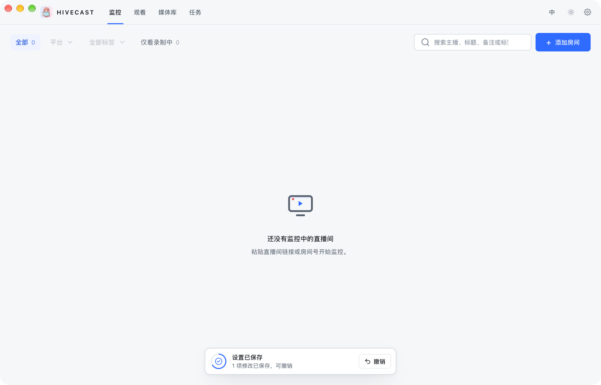
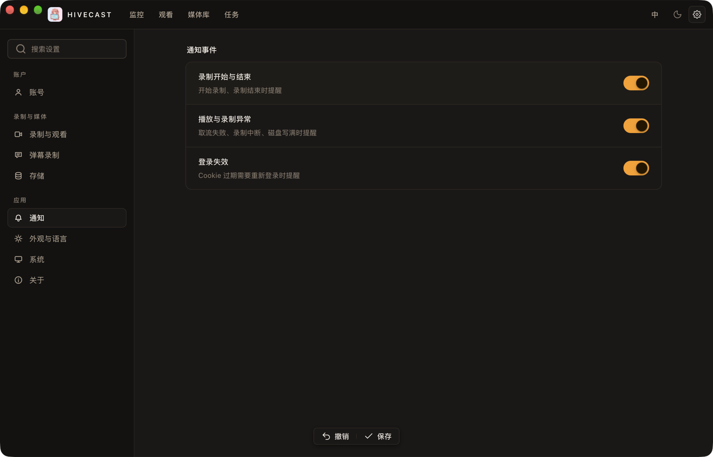
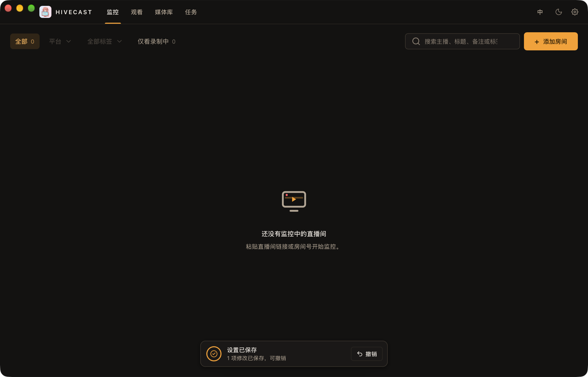

# 设置界面 UIArc 重做、浮层保存与撤销

> 日期：2026-11-10
> 参考：<https://uiarc.dev/components/blocks/settings-page>、<https://uiarc.dev/components/button-group>、<https://uiarc.dev/components/undo-toast>
> 范围：`src/App.tsx`、`src/features/settings/{SettingsView,AccountSection}.tsx`、`src/components/arc/button-group/*`、`src/components/arc/undo-toast/*`、`src/lib/notify.ts`、`src/styles/index.css`、`src/i18n/{zh-CN,en-US}.json`
> 不改：媒体库、任务中心（按用户要求暂时不定稿）

## 1. 起点与最终形态

上一版（459a240）把设置做成 `fixed inset-0 z-50` 的全屏层，视觉上像独立窗口：盖住 48px 顶栏，顶栏的 `data-tauri-drag-region` 失效，整个窗口不能拖动；侧栏有自己的标题、关闭按钮和 `⌘F`、`⌘S` 提示；底部常驻一条带琥珀圆点的浮动保存栏；离开确认沿用默认 Dialog 的灰色方头关闭按钮。账号页是一张 `divide-y` 列表，每行前面一个品牌色圆点。

这一轮先把设置改成普通页签，再按连续反馈收敛保存交互。最终形态：

- 设置是 App 第五个 `TabKey`，在 `motion.main` 内渲染，顶栏始终在原位、窗口可拖动。
- 220px 暖灰侧栏 + 780px 主区；没有页标题、没有保存条、没有常驻保存按钮。
- 设置变脏时，内容区底部浮出一枚 `ButtonGroup`，只有「撤销」「保存」两个动作；浮层不参与内容排版，不会把页面撑开。
- 未保存时离开设置：默认先保存，再切页；底部出现 8 秒的 `UndoToast`，点「撤销」把本次保存回滚，超时或不点则保留保存结果。
- 显式点浮层「保存」：留在设置页，顶部出现「所有更改已保存」；这条路径没有撤销。
- 顶栏的主题/语言与设置页本地副本、脏状态基线保持同步，保存不会把顶栏刚写入的值覆盖回去。

## 2. 交互对照

| 场景 | 行为 | 结果 |
| --- | --- | --- |
| 修改任意设置项 | 底部居中浮出 `ButtonGroup`：Undo / Save | 内容区只增加底部留白，不被横向或纵向撑开 |
| 点浮层「撤销」 | 只把本地草稿回滚到 `initial`，不写库 | 控件恢复保存前状态，浮层随脏状态消失 |
| 点浮层「保存」 | `settingsUpdate(settings)`，成功后重置基线 | 留在设置页，顶部成功 toast，浮层消失 |
| 未保存时切页 | 先 `await save({ quiet: true })`，成功才切页 | 目标页出现，顶部不弹成功 toast |
| 默认保存后 | 底部 `UndoToast`：Settings saved / 1 change saved. Undo available. | 8 秒内可撤销，超时自动收起 |
| 点 UndoToast「撤销」 | 把保存前快照 `before` 写回，并同步主题/语言/通知/ffmpeg | 页面出现「已撤销本次保存」，数据库回到保存前 |
| 保存失败 | 不切页，留在设置页 | 错误由 `save()` 内的 `notify.error` 报出 |
| 设置已保存时切页 | 正常切页，不出现浮层或 toast | 没有多余的保存入口 |
| 顶栏改主题/语言 | 同步设置页本地值与 `initial` | 不算未保存项，也不会在保存时被旧值覆盖 |

## 3. 常规页签的接线

`src/App.tsx`：

```ts
type TabKey = "monitor" | "watch" | "media" | "tasks" | "settings";
```

- `openSettings(page)`：第一次进入时把当前页记到 `lastTab`，清空 `settingsUndo`，再 `setSettingsPage(page); setTab("settings")`。
- `requestTab(next)` 是 async：同页直接返回；当前在设置且 `settingsDirty` 时，置 `settingsSaving`，`await settingsSaveRef.current?.({ quiet: true })`；成功才 `setSettingsDirty(false)`、`setTab(next)`、`setSettingsUndo({ before, count })`；失败留在设置页。
- `settingsSaving` 期间再次点页签直接返回，避免并发保存。
- 顶栏四个 tab 都走 `requestTab`；齿轮在设置页内再次点击会回到 `lastTab`，并带 active 态。
- ffmpeg 缺失 toast 的「去设置」仍落到 `storage` 页，只是改为 `openSettings("storage")`。
- 离开设置时清空 `settingsPage`，下次进入从账号页开始。

`SettingsView` 通过两个注册函数把能力交给 App：

- `onRegisterSave`：注册唯一的 `save(options?: { quiet?: boolean })`，卸载时置空。
- `onRegisterSync`：注册 `syncExternal`，供顶栏写主题/语言时同步本地副本与基线。

## 4. 浮层保存（ButtonGroup）

`ButtonGroup` 是 UIArc 免费组件，手动安装自 `https://uiarc.dev/r/button-group.json`，文件在 `src/components/arc/button-group/{button-group.tsx,button-group.module.css}`。API：

```ts
<ButtonGroup
  label={t("settings.pendingChanges")}
  size="sm"
  variant="outline"
  items={[
    { id: "undo", label: t("settings.undo"), icon: <Undo2 />, onSelect: undoChanges },
    { id: "save", label: t("settings.saveChanges"), icon: <Check />, onSelect: () => void save() },
  ]}
/>
```

放置细节：

- 设置根节点在有 dirty 时是 `relative`，浮层是 `absolute inset-x-0 bottom-5 z-[60] flex justify-center`，外层 `pointer-events-none`，卡片本身 `pointer-events-auto`。
- 用 `absolute` 而不是 `fixed`：WebView 里 `fixed` 的落点会比预期高约 25px，`absolute` 相对设置页定位更稳定。
- 内容滚动区在 dirty 时加 `pb-24`，保证最后一行不会被浮层盖住；不 dirty 时没有这块留白。
- 浮层带 `shadow-floating`，在浅色暖白与深色暖黑面板上都能分离出来。
- 保存中 `disabled`，两个按钮都不可点；保存成功后 dirty 归零，浮层自动消失。
- 浮层是设置页内唯一的「保存」入口，不再有顶部 sticky 保存条或底部常驻保存栏。

## 5. 默认保存与 UndoToast

### 5.1 保存的返回值与基线

`SettingsView.save()` 的签名是：

```ts
(options?: { quiet?: boolean }): Promise<Settings | null>
```

- 入库参数必须是当前 `settings`：`const result = await settingsUpdate(settings)`。
- 保存前先把 `initial` 解析成 `previous`，作为「撤销本次保存」的快照返回给 App；失败返回 `null`。
- 成功后 `setSettings(result)`、`setInitial(JSON.stringify(result))`，并按当前界面语言比较，只在真的变化时 `setLanguage`。
- `quiet: true` 时跳过顶部 `settings.savedAll`，用于「离开设置自动保存」；显式保存仍会提示。
- `savingRef` 去重：同一时间只有一个保存 Promise，重复点击复用同一个结果。

### 5.2 UndoToast

UIArc 的 UndoToast 是 Pro 块，registry `https://uiarc.dev/r/undo-toast.json` 返回 404，无法取源码。这里按同一交互用 Arc token 自建：

- 文件：`src/components/arc/undo-toast/{undo-toast.tsx,undo-toast.module.css}`。
- 位置：视口底部居中，宽 `min(372px, calc(100vw - 32px))`，`z-index: 90`。
- 结构：30px 倒计时环 + CircleCheck、标题/说明、右侧 Undo2「撤销」按钮；`role="status"`、`aria-live="polite"`。
- 倒计时环用 `conic-gradient` + `--progress` 变量，默认 8000ms。
- 鼠标进入或键盘焦点进入时暂停；离开后从剩余时间继续。
- `Cmd/Ctrl+Z` 可撤销，但输入框、textarea、contenteditable 内不拦截。
- 除 rAF 倒计时外再加一个 `setTimeout` 兜底：WebView 失焦时 rAF 可能暂停，不能留下永远不消失的 toast。
- 视觉：`surface-raised` 底、`border-strong` 边、`shadow-floating`，深色下是暖黑卡、琥珀色环。

### 5.3 撤销本次保存

`App.undoSettingsSave()`：

1. 取出 `settingsUndo.before`；
2. `settingsUpdate(before)`；
3. 更新 `notifyRef`；
4. 若主题变了，`setTheme` + `applyTheme`；
5. 按 `result.language` 重新 `setLanguage`；
6. `refreshFfmpeg()`；
7. `notify.success(t("settings.undoDone"))`。

撤销写的是数据库，不只是本地状态；用户之后重新进设置，看到的是保存前的值。

## 6. 布局规格

| 区域 | 规格 |
| --- | --- |
| 外层 | 设置不再有 `fixed`；根节点 `flex min-h-0 flex-1 bg-canvas text-ink` |
| 顶栏 | 仍是 48px 的 `header`，`data-tauri-drag-region` 覆盖空白区；macOS 左让 78px |
| 侧栏 | 220px，`bg-canvas`，右侧 `border-line/80`；顶部只有搜索框，无标题/关闭按钮 |
| 导航组标题 | 10px semibold，0.12em 字距，`text-faint` |
| 导航项 | 32px 高，7px 圆角，14px 中性图标，12.5px 文字 |
| 活动项 | `motion.span layoutId="settings-nav-active"` 白卡 + 1px 描边 + `0 1px 2px` 阴影，spring 520/42 |
| 主区 | `bg-surface`，`max-w-[780px]` 居中，左右 32px；不再有页头标题 |
| 滚动区 | `min-h-0 flex-1 overflow-auto px-8 py-6`，内容 `space-y-7`；dirty 时 `pb-24` |
| 保存浮层 | 底部居中，ButtonGroup `size="sm"`，`shadow-floating`，不参与内容排版 |
| 撤销 toast | 底部居中，372px，8 秒；与浮层不同时出现（保存后已离开设置） |
| 设置卡 | 10px 圆角，`border-line`，`0 1px 2px rgba(16,24,40,.04)`；卡头无底色 |
| 账号卡 | 12px 圆角，内容高度，两列 `gap-3`；窄窗口回落单列 |

## 7. 账号卡

- 平台名沿用 `platformName.*`，不做品牌色；缩写方块用 `BL/DY/HY/DO`，36px、mono 10px、`bg-raised`。
- 状态只出现一次：右上角文字 chip（`已登录` / `登录已失效` / `未登录`），不在卡身重复写「未登录」。
- 已登录时卡身显示账号名与 Cookie 数；未登录时只显示对应提示，不放两个「—」占位。
- 底部操作行用一条 `border-t` 与内容分开：B 站是「扫码登录 / 粘贴 Cookie」，其余是「粘贴 Cookie」；已登录追加「退出登录」，二次点击才真正退出。
- 扫码面板（`src/features/settings/AccountSection.tsx`）在卡内展开：128px 二维码 + 状态、倒计时、提示、刷新；1.6 秒轮询逻辑不变。
- Cookie 面板同样在卡内展开：3 行 textarea + 取消/保存，保存时仍走后端校验。

## 8. 脏状态与双写同步

- `changedCount` 按字段比较 `settings` 与 `initial`，`dirty = changedCount > 0`。
- `onDirtyChange(dirty, changedCount)` 把两个值一起上报给 App；App 用计数生成 UndoToast 文案，用 dirty 决定是否拦截切页。
- `initial` 是脏状态基线，也是撤销快照的来源；保存成功后必须整体替换成新结果。
- 设置页不渲染任何保存条；界面里没有常驻的「保存」按钮，内容区不会被撑开。
- 顶栏语言 `pickLanguage(code)`：先 `setLanguage(code)`，再 `settingsSyncRef.current?.({ language: code })`，最后 `persist({ language: code })`。
- 顶栏明暗 `changeTheme(next)`：先更新 App 的 `theme/appearance` 并同步设置页本地副本，320ms 后 `applyTheme` + `persist({ theme: next })`。
- 设置页自己的主题选择是「暂存后保存」：选浅/深色只改本地 `settings`，保存后才应用；顶栏切换是立即应用并同步基线。两种入口写的是同一个字段，但交互语义不同。

## 9. 本轮修掉的隐蔽问题

### 9.1 保存时不再重放语言/主题

旧实现有两个无条件写入：

- `SettingsView.save()` 每次保存都调用 `setLanguage(...)`；
- `App` 的 `onSaved` 每次都 `applyTheme(mode)`。

顶栏是设置页之外的另一个写入口：在设置页打开时用顶栏切语言/主题，App 的全局值立即变化并 persist，但 `SettingsView` 的本地 `settings` 仍是旧值。下一次保存把旧值写回数据库，随后 `onSaved` 又应用旧主题，看起来就是「点保存触发了语言/主题切换」。

现在的守卫：

```ts
// SettingsView.save()
const currentLanguage = i18n.resolvedLanguage?.startsWith("zh") ? "zh-CN" : "en-US";
const nextLanguage = result.language === "system" ? detectLanguage() : (result.language as Language);
if (nextLanguage !== currentLanguage) setLanguage(nextLanguage);
```

语言和当前界面实际语言比较，而不是和保存前的本地副本比较。这样设置页里主动把语言改成中文，保存时能生效；顶栏已经切过语言时又不会重放。

### 9.2 顶栏写入口同步到设置页基线

只有 `save()` 的守卫还不够：如果设置页本地仍是旧主题/旧语言，保存仍会把旧值写进 `settingsUpdate`。为此增加反向同步：

- `SettingsView` 新增 `onRegisterSync?: (sync: ((patch: Partial<Settings>) => void) | null) => void`；
- `syncExternal(patch)` 同时更新本地 `settings` 和 `initial` 基线；
- `App` 保存 `settingsSyncRef`，在 `pickLanguage` 中调用 `settingsSyncRef.current?.({ language: code })`，在 `changeTheme` 中调用 `settingsSyncRef.current?.({ theme: next })`。

同步 `initial` 的结果是：顶栏改语言/主题不算「未保存项」，脏计数只统计真正的表单改动；保存时提交的也是顶栏刚写的值。

### 9.3 语言切换不再冲掉未保存设置

1. 设置页把「录制开始与结束」关掉，未保存计数为 1；
2. 点顶栏中/EN 切换语言；
3. 开关自动回到开，未保存计数消失。

根因在 `src/lib/notify.ts`：`useNotify()` 的返回值依赖 `useTranslation().t`，语言一换，`t` 换身份，`notify` 对象也跟着换身份。`SettingsView` 的 `load` 是 `useCallback(..., [notify])`，加载 effect 的依赖是 `[load, loadLogs, loadFfmpeg]`；`notify` 一变，effect 重新执行，`settingsGet()` 把数据库值写回本地并重置 `initial`，脏状态被直接冲掉。

修复：

```ts
const tRef = useRef(t);
tRef.current = t;

return useMemo(() => ({
  error: (message, title) => toast({ ..., title: title ?? tRef.current("toast.errorTitle") }),
  warning: (message, title) => toast({ ..., title: title ?? tRef.current("toast.warningTitle") }),
  // ...
}), [dismiss, toast, update]);
```

`notify` 现在跨语言保持稳定；错误/警告文案仍读最新的 `t`。

### 9.4 一次误写 previous 的回归

`save()` 在引入撤销快照时曾把 `settingsUpdate(previous)` 写进入库位置，症状是：界面开关已经打开，离开设置后数据库仍是旧值。已改回 `settingsUpdate(settings)`，`previous` 只作为返回值给 App。这个回归靠真机对比 UI 与 DB 才抓到，单测没有覆盖。

## 10. 真机验收

环境：macOS，窗口 1167×749，release bundle，真实数据库；浅色蓝、深色暖琥珀两套主题均保留。

| 场景 | 结果 |
| --- | --- |
| 拖动顶栏 | 从空白区拖动，窗口可移动；顶栏保持 48px |
| 设置页签 | 齿轮进入，顶栏保持可见；再次点齿轮回到进入前的页 |
| 账号页 | 两列四卡，状态 chip、缩写方块、底部操作行正常；无品牌色圆点 |
| 扫码面板 | B 站卡内展开二维码、倒计时与刷新，不跳出整页 |
| 脏状态（浅色） | 改动通知开关后，底部浮出 ButtonGroup；内容区底部留白，无横向跳动 |
| 浮层撤销 | 点 Undo，开关回到保存前；数据库未写入 |
| 浮层保存 | 点 Save，留在设置页，顶部「所有更改已保存」，浮层消失 |
| 默认保存 | 开关打开后点监控：切页成功，DB `ui.notify=true`，顶部无成功 toast |
| UndoToast（浅色） | 底部出现「设置已保存 / 1 项修改已保存，可撤销」与倒计时环 |
| UndoToast（深色） | 暖黑卡、琥珀环与 Undo 按钮，和深色页面边界清楚 |
| 撤销保存 | 点 Undo：DB 回到保存前，页面显示「已撤销本次保存」，toast 收起 |
| 超时保留 | 不点 Undo，8 秒后 toast 收起，DB 保持保存后的值 |
| 设置内改语言 | 外观页选「中文」，浮层仍存在；保存后界面变中文，DB `ui.language=zh-CN` |
| 顶栏切语言保留脏状态 | 关掉「录制开始与结束」后点顶栏中/EN；开关保持关闭，浮层仍在，不再被数据库值冲掉 |
| 保存不误切语言 | 设置页为英文，改通知开关后离开；DB `ui.language=en-US`、`ui.notify=true`，界面保持英文 |
| 保存不误切主题 | 设置页打开时用顶栏切深色，再改通知并离开；保存后仍深色，DB `ui.theme=dark` |
| 浅/深色 | 两套主题下侧栏、卡片、ButtonGroup、UndoToast 对比正常 |
| 离开设置 | 重进回到账号页；未保存状态不跨页残留 |

验证命令：

```bash
pnpm exec tsc -b
pnpm run check:i18n   # 738 keys
pnpm run check:docs   # 129 files
pnpm build
pnpm app:build        # bundle 30.35 MiB
```

## 11. 未改与后续

- 浮层保存是设置页唯一的显式保存入口；撤销只存在于「离开时默认保存」的 8 秒窗口，不提供全局历史。
- 媒体库、任务中心未动，仍等待单独定稿。
- 不实现应用级快捷键系统；搜索框和 Arc 弹层自身的 Esc 行为保留；`Cmd/Ctrl+Z` 只在 UndoToast 打开时接管。
- 账号仍是每个平台一个凭据、B 站额外支持扫码；没有多账号切换。
- 设置行仍是「左说明右控件」，与监控页的筛选/列表保持同一套行式语言。
- 窄窗口下账号卡回落单列，二维码固定 128px；若窗口更窄，后续可把二维码与文案改成上下堆叠。
- ButtonGroup 浮层固定在设置页底部，脏状态下最后一张卡需要额外 `pb-24`；新增页面时要保留这块留白。

## 12. 截图











