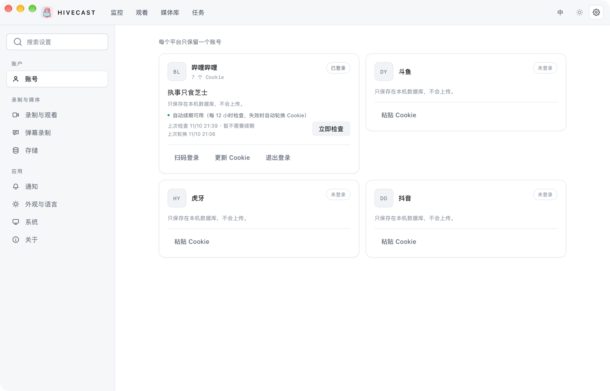
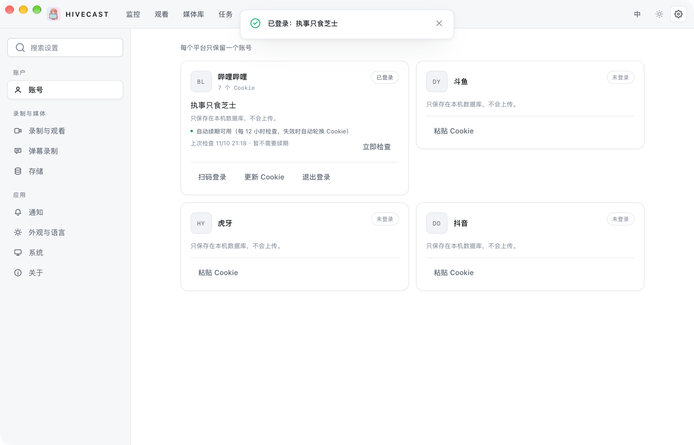
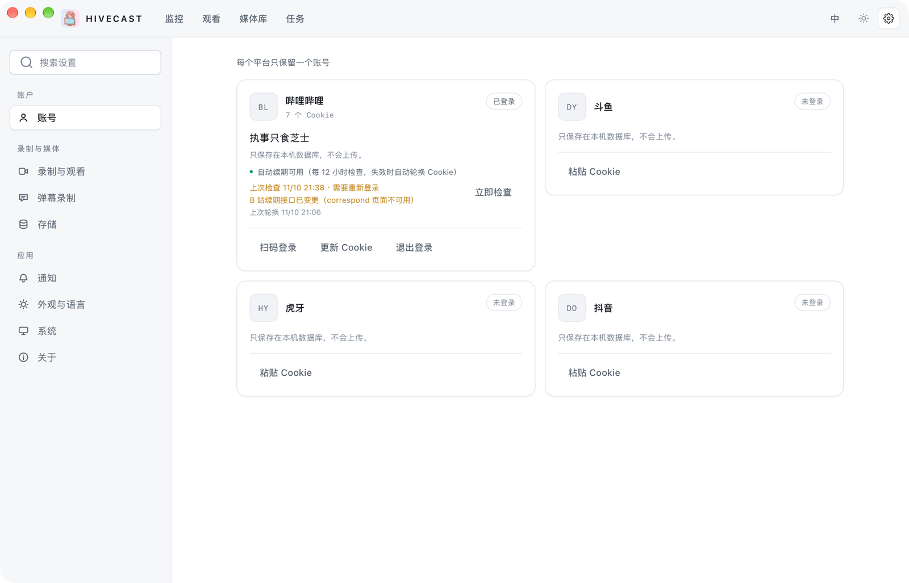
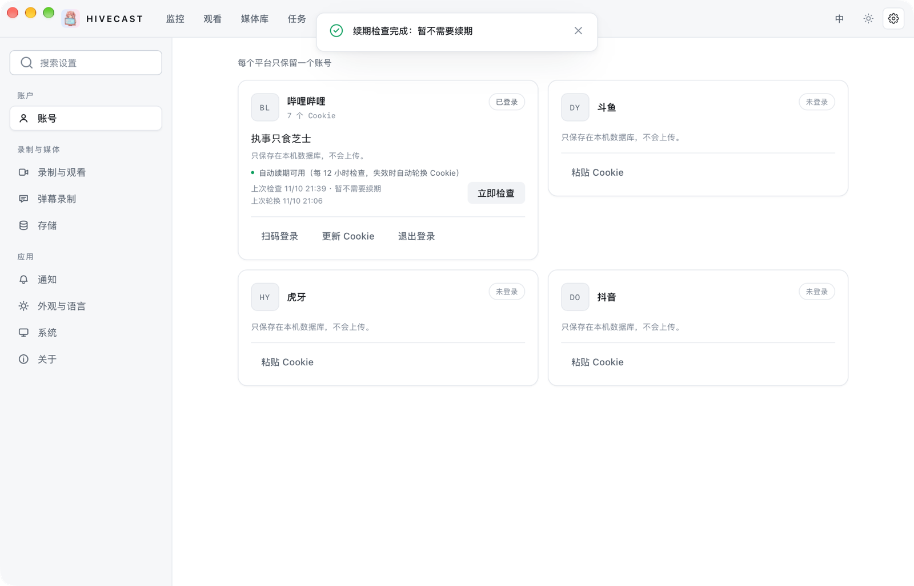
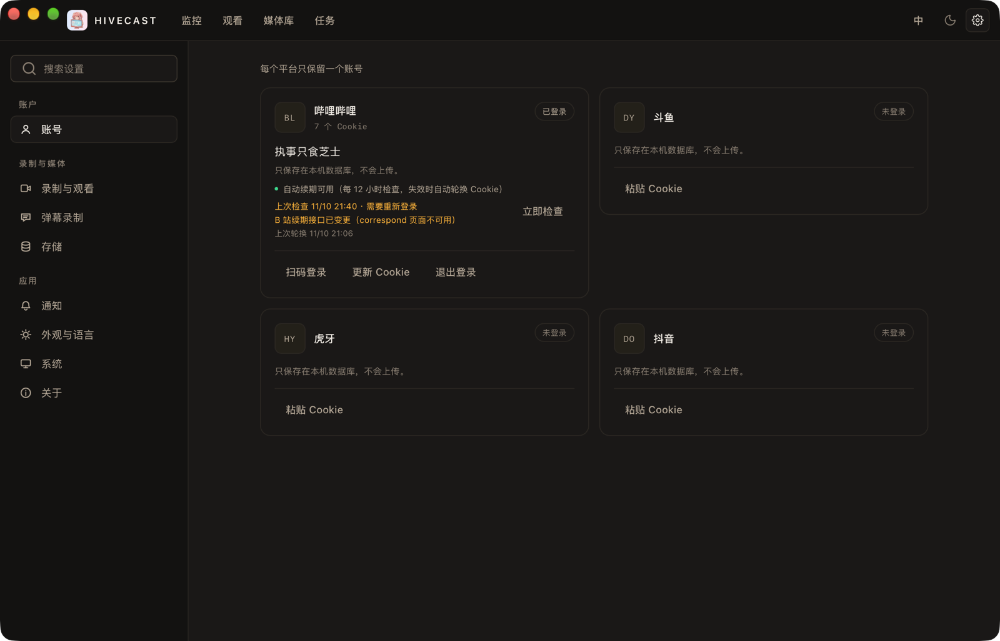

# 136 · B 站 Cookie 续期：唤醒、手动检查与状态可见

> 状态：**已实现并完成真机验证**（2026-11-10）。承接 [135](135-B站扫码取态与Cookie自动续期实现.md) 的自动续期底座，本文补上「登录后立即检查」「手动立即检查」「最近一次结果可见」「续期接口变更提示重新登录」四件事。
> 关联：[134-B站扫码登录与Cookie自动续期审计](134-B站扫码登录与Cookie自动续期审计.md)、[132-登录与Cookie](132-登录与Cookie.md)。

---

## 1. 结论先行

| 能力 | 改动前 | 改动后 |
| --- | --- | --- |
| 登录/换 Cookie 后 | 等下一个 12 小时窗口 | `Notify` 唤醒后台循环，立即检查一次 |
| 手动检查 | 无入口 | 账号卡「立即检查」+ `bilibili_refresh_now` 命令 |
| 最近一次结果 | 进程内、刷新后丢失 | `credential_refresh` 持久化；卡片显示时间、结果、上次轮换 |
| 续期接口变更 | 只记一条普通失败 | `correspond 404/412` 或缺少 `refresh_csrf` 判定 `key_stale`，提示重新登录 |
| 登录后的卡片状态 | 常停在「尚未检查」 | 后端写入续期状态后发 `account://refresh`，前端收到即刷新（137 起改为事件驱动） |

一句话：**续期不再「悄悄在后台跑」——登录会立刻触发，结果看得见，接口变了会明确要求重新登录，而不是假装一切正常。**

---

## 2. 立即唤醒

### 2.1 唤醒点

`/Library/dshproject/HIVECAST/src-tauri/src/account.rs`：

- `save_cookie` 成功落库后，如果平台是 `bilibili`，调用 `wake_refresh_loop("保存 Cookie")`；
- 扫码 `poll` 确认登录、`store_account` 成功后，调用 `wake_refresh_loop("扫码登录")`。

`wake_refresh_loop` 只做两件事：写一条 INFO 日志、`REFRESH_WAKE.notify_one()`。

```rust
static REFRESH_WAKE: tokio::sync::Notify = tokio::sync::Notify::const_new();
```

### 2.2 循环等待

`refresh_loop` 的等待从单纯 `sleep` 改成 `tokio::select!`：

```rust
tokio::select! {
    _ = tokio::time::sleep(wait) => {}
    _ = REFRESH_WAKE.notified() => {
        tracing::info!(platform = "bilibili", "续期循环被唤醒，立即重新检查");
    }
}
```

唤醒只影响「下一次检查什么时候开始」，不改变失败退避：无失败仍回到 12 小时，失败仍是 1h → 6h → 24h。手动检查直接调用 `refresh_bilibili_cookie`，不经过循环，也不重置循环的计时器。

### 2.3 单飞

定时检查与手动检查共用 `REFRESH_LOCK`（`tokio::sync::Mutex<()>`）。两个入口不会同时轮换，避免新 token 互相作废。

---

## 3. 检查结果持久化

### 3.1 表结构

`/Library/dshproject/HIVECAST/src-tauri/src/db.rs`：

```sql
CREATE TABLE IF NOT EXISTS credential_refresh (
    platform TEXT PRIMARY KEY,
    checked_at INTEGER NOT NULL DEFAULT 0,
    outcome TEXT NOT NULL DEFAULT 'never',
    message TEXT,
    key_stale INTEGER NOT NULL DEFAULT 0,
    last_refreshed_at INTEGER NOT NULL DEFAULT 0
);
```

这是新增表，不改动 `credential` 的加密 Cookie 结构，因此不需要搬数据。没有记录时前端按 `never` 展示。

### 3.2 outcome 语义

| outcome | 何时写入 | 卡片文案 | 是否保留上次轮换时间 |
| --- | --- | --- | --- |
| `never` | 从未检查 / 无记录 | 尚未检查续期状态 | — |
| `fresh` | `cookie/info` 返回 `refresh=false` | 暂不需要续期 | 是 |
| `refreshed` | 完成 refresh + confirm 并写回 Cookie | 已完成续期 | 是，且更新为本次时间 |
| `not_refreshable` | 缺少 `ac_time_value` 或 `bili_jct` | 无法自动续期 | 是 |
| `failed` | 网络、平台错误、Cookie 失效等 | 失败原因 | 是 |
| `key_stale` | 判定续期公钥/接口已变更 | 需要重新登录 | 是 |

规则落地在 `record_refresh_result`：

- `NoCredential`：删除该平台的 `credential_refresh` 行；
- `Discarded`：请求期间账号被替换，不写入，保留新账号自己的状态；
- 成功/失败：写 `checked_at`；只有 `Refreshed` 才推进 `last_refreshed_at`；
- 失败信息走 `short_error`：最多 180 字符，超出加 `…`，换行替换为空格。

### 3.3 IPC

`RefreshStatus` 定义在 `ipc-types`，由 `CredentialInfo.refresh_status` 一起返回；前端绑定在 `/Library/dshproject/HIVECAST/src/lib/bindings/RefreshStatus.ts`。

手动检查命令在 `/Library/dshproject/HIVECAST/src-tauri/src/commands.rs`：

```rust
#[tauri::command]
pub async fn bilibili_refresh_now(
    app: AppHandle,
    state: State<'_, AppState>,
) -> Result<RefreshStatus, AppError> {
    crate::account::refresh_now(&state.db, &app).await
}
```

没有 B 站账号时返回用户错误「尚未登录 B 站」。

---

## 4. 账号卡

`/Library/dshproject/HIVECAST/src/features/settings/AccountSection.tsx`：

- 第二行仍是「自动续期可用 / 不可用」；
- `refreshable` 时，左侧显示：
  - `上次检查 11/10 21:18 · 暂不需要续期`；
  - `key_stale` 时第二行补充具体原因，例如 `B 站续期接口已变更（correspond 页面不可用）`；
  - 发生过轮换时再显示 `上次轮换 11/10 21:06`；
- 右侧是 ghost 小按钮「立即检查」/「检查中…」，`busy || checking` 时禁用；
- `key_stale` 用 `--c-warn` 实色，不再叠透明度，保证小字号下仍可读；长文本有 `title` 悬浮完整内容。

手动检查成功与失败都会刷新列表并弹 toast：

```
续期检查完成：暂不需要续期
续期检查完成：需要重新登录
```

失败时 toast 显示错误，卡片仍会落一次 `failed`，不会只弹提示不留痕。

### 4.1 登录后的状态刷新（137 起为事件驱动）

保存 Cookie / 扫码成功后，前端先 `await load()`。此时后端刚被唤醒，`cookie/info` 往往还没返回，直接读库会看到「尚未检查」。

137 起不再用 900ms/2400ms 定时器猜测，而是由后端在续期状态真正落库后发送 `account://refresh`，前端 `onAccountRefresh(() => load())` 收到即刷新。慢请求（HTTP 超时 10 秒）也能正确更新，不需要重新进入账号页。

---

## 5. 续期接口变更

### 5.1 判定条件

`correspond_key_stale` 只认两种网络错误：

```rust
PlatformError::Network(message)
    if message.contains("HTTP 404") || message.contains("HTTP 412")
```

另外，`correspond` 页面返回 200 但解析不到 `refresh_csrf`，也判定为接口变更（`refresh_key_stale`）。

500、超时、连接重置都不算 `key_stale`，仍走普通 `failed` 与退避重试，避免把临时故障误报成「必须重新登录」。

### 5.2 行为

- 不写 Cookie，不轮换 token；
- `credential_refresh` 写 `outcome=key_stale`、`key_stale=1`、`message=...`；
- 保留 `last_refreshed_at`，用户还能看到上次成功轮换的时间；
- 账号卡用 warn 色提示「需要重新登录」，并给出具体原因；
- 不自动退出登录：旧 Cookie 可能仍能取流，贸然清掉会丢失可用凭据。用户可重新扫码，或稍后手动检查确认是否为临时故障。

---

## 6. 数据流

```
扫码确认 / 保存 Cookie
        │
        ├─ store_account 写入加密 credential
        └─ wake_refresh_loop
                 │
                 ▼
        refresh_loop（12h，可被唤醒）
                 │
                 ▼
        refresh_bilibili_cookie
                 │
        cookie/info（refresh?）
           │false          │true
           ▼               ▼
         fresh       correspondPath
                           │
                    cookie/refresh
                           │
                    confirm/refresh
                           │
                    写回 Cookie + refreshed
                 │
                 ▼
        credential_refresh（checked_at/outcome/message）
                 │
                 ▼
        CredentialInfo.refresh_status → 账号卡
```

手动「立即检查」走同一条 `refresh_bilibili_cookie`，只是由命令直接等待返回值。

---

## 7. 单测

新增 4 个测试，均在 `account.rs` 的 `tests` 模块：

| 测试 | 覆盖点 |
| --- | --- |
| `refresh_status_defaults_to_never` | 无记录时 `checked_at=0`、`outcome=never`、`key_stale=false` |
| `refresh_status_records_results_and_keeps_last_rotation` | fresh / key_stale 保留 `last_refreshed_at=111`；refreshed 推进；Discarded 不覆盖；NoCredential 清回 never |
| `correspond_key_stale_only_matches_404_or_412` | 404/412 为真；500/连接重置为假 |
| `short_error_truncates_and_flattens_newlines` | 180 字符截断并加 `…`；换行变空格 |

全量结果：

```
cargo test --lib
265 passed; 0 failed; 17 ignored
```

构建与检查：

```
cargo fmt --check                         通过
cargo check --all-targets                 0 错误 0 警告
pnpm exec tsc -b                          通过
pnpm run check:i18n                       753 keys
pnpm run check:docs                       137 files
pnpm build                                2701 modules
pnpm app:build                            bundle 30.65 MiB
```

---

## 8. 真机验证

环境：macOS，真实 B 站账号（执事只食芝士，uid 352130563），真实加密 Cookie，release bundle。

| 场景 | 结果 |
| --- | --- |
| 启动后自动检查 | 日志 `cookie/info 表示暂不需要续期`；DB 写入 fresh |
| 手动「立即检查」 | 21:02:21 日志「手动检查 Cookie 续期」→ fresh；DB `checked_at` 前进；toast 与卡片同步 |
| 保存 Cookie 唤醒 | 21:06:15 日志「已请求立即检查 Cookie 续期 reason="保存 Cookie"」→「续期循环被唤醒，立即重新检查」→ `cookie/info` → fresh；未轮换 token |
| 延迟刷新 | 保存后立即读库仍可能是旧状态；900ms 快照后卡片显示「上次检查 11/10 21:18 · 暂不需要续期」 |
| key_stale 展示 | 直接写 `credential_refresh` 模拟 `key_stale=1`，切页后卡片显示「需要重新登录」、原因与上次轮换时间 |
| key_stale 恢复 | 手动「立即检查」重新走真实 `cookie/info`，状态回到 fresh，提示「续期检查完成：暂不需要续期」 |
| 深/浅色 | 账号卡、警告色、toast 在两套主题下均正常 |

截图资产：

- `docs/assets/136-refresh-account.png`：正常续期状态与「立即检查」；
- `docs/assets/136-refresh-wake.png`：保存 Cookie 后立即检查的 toast 与更新时间；
- `docs/assets/136-refresh-key-stale.png`：接口变更提示；
- `docs/assets/136-refresh-toast.png`：手动检查完成 toast；
- `docs/assets/136-refresh-dark.png`：深色主题下的接口变更提示。











---

## 9. 限制

1. 只覆盖 B 站。斗鱼、虎牙、抖音仍只有 Cookie 校验，没有自动续期。
2. `REFRESH_PUBLIC_KEY` 是硬编码的 B 站 Web 公钥；B 站改版后，只有 `correspond` 返回 404/412 或缺少 `refresh_csrf` 才能识别为 `key_stale`，其他形态可能表现为普通 `failed`。
3. 手动检查是同步网络请求；需要轮换时会依次请求 `cookie/info`、`correspond`、`cookie/refresh`、`confirm/refresh`，按钮会一直显示「检查中…」。
4. 卡片刷新依赖后端 `account://refresh` 事件；后端进程未启动或事件通道异常时，仍需重新进入账号页或点「立即检查」。
5. 状态只在设置 → 账号卡展示，不在主界面做全局红点或横幅；续期失败不会打断录制。
6. 后台检查周期仍是 12 小时；唤醒只发生在登录、换 Cookie 与手动检查，不会因为电脑休眠/恢复额外触发。
7. `last_refreshed_at` 只在真正轮换时前进；普通 fresh 检查不会把它刷新成当前时间。

---

## 10. 涉及文件

| 文件 | 内容 |
| --- | --- |
| `src-tauri/src/account.rs` | `REFRESH_WAKE`、`wake_refresh_loop`、`refresh_loop` select、`refresh_now`、`record_refresh_result`、`correspond_key_stale`、`short_error`、4 个单测 |
| `src-tauri/src/db.rs` | `credential_refresh` 建表、读写与清理 |
| `src-tauri/src/commands.rs` | `bilibili_refresh_now` 命令注册 |
| `src-tauri/src/ipc-types` | `RefreshStatus`、`CredentialInfo.refresh_status` |
| `src/lib/bindings/RefreshStatus.ts` | 前端绑定 |
| `src/lib/ipc.ts` | `bilibiliRefreshNow` |
| `src/features/settings/AccountSection.tsx` | 状态行、手动检查；137 起改为 `onAccountRefresh` 事件刷新 |
| `src/i18n/zh-CN.json`、`en-US.json` | `account.refresh*` 文案 |

---

## 11. 复现命令

```bash
cd /Library/dshproject/HIVECAST
cargo fmt --check
cargo check --all-targets
cargo test --lib
pnpm exec tsc -b
pnpm run check:i18n
pnpm run check:docs
pnpm build
pnpm app:build
```
