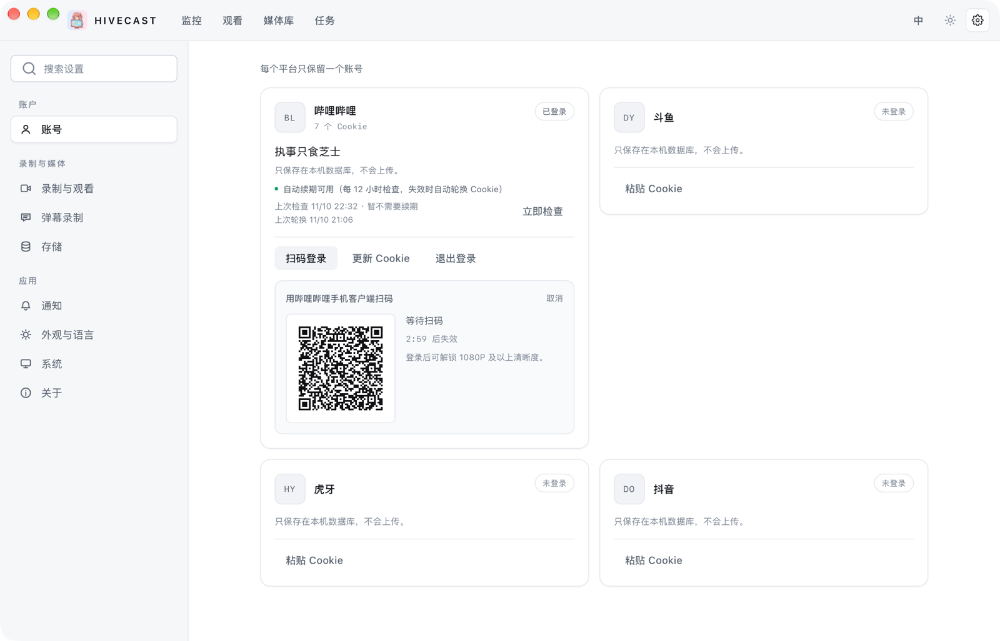
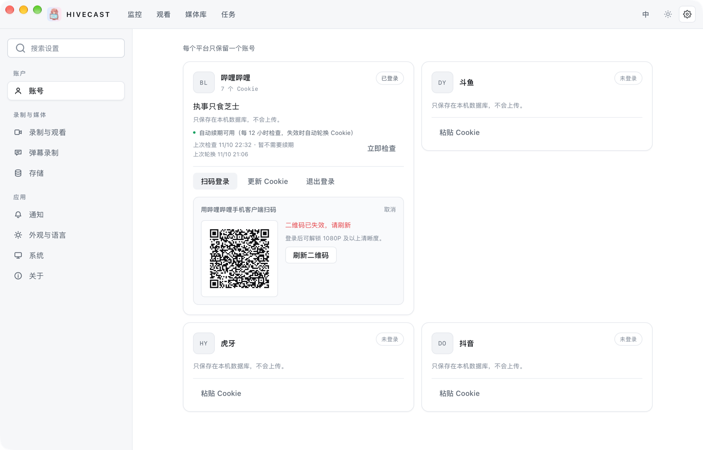
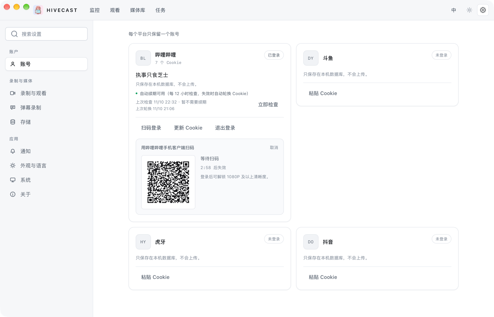
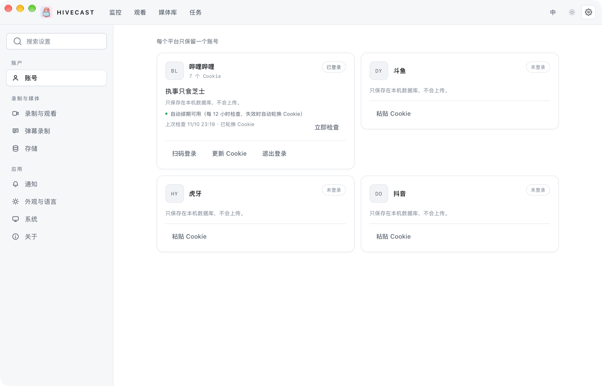

# 137 · B 站扫码与 Cookie 全链路复查

> 状态：**已实现并完成单测、真实接口与真机验证**（2026-11-10）。承接 [135](135-B站扫码取态与Cookie自动续期实现.md)、[136](136-B站Cookie续期状态与手动检查.md)，本轮重新审查扫码登录与 Cookie 续期的完整生命周期，修掉 2 个会造成凭据错乱的缺陷和一组并发/轮询问题。
> 关联：[134-B站扫码登录与Cookie自动续期审计](134-B站扫码登录与Cookie自动续期审计.md)、[132-登录与Cookie](132-登录与Cookie.md)。

---

## 1. 结论先行

| 问题 | 结论 |
| --- | --- |
| 扫码成功后轮转 | 正常：pending → scanned → confirmed/expired；confirmed 后停表，expired 后可刷新重新生成 |
| 二维码过期 | 服务端 86038 与本地 180 秒倒计时任一先到都会停止轮询，不会继续打已失效的 key |
| 二维码刷新 | 关闭/重开递增代次，迟到的 generate/poll 响应会被丢弃，不会覆盖新二维码 |
| 关闭窗口 | 关闭面板立即清掉 interval；切页会卸载组件；隐藏到托盘时保留轮询到 180 秒到期（保证扫码能完成）；退出进程即结束，无后端 QR session 需要销毁 |
| 请求性能 | 1.6 秒一次、同一时刻最多 1 个在途 poll（HTTP 超时 10 秒），不会叠出多个并发请求 |
| 异常处理 | confirmed 后的 nav/保存失败会返回 error，前端立即停表并提示刷新，不再反复提交已消费的 key |
| Cookie 一致性 | 修复两个会把新旧账号字段拼在一起的校验缺陷；续期写回、登录、保存、删除共用一把写锁 |

一句话：**扫码流程本身不需要常驻 session，真正的风险不在「关不关窗口」，而在换号时旧 Cookie 补齐新 Cookie 的缺失字段。**

---

## 2. 本轮修掉的缺陷

### 2.1 扫码换号会拼出「混号 Cookie」（严重）

`account.rs` 的 confirmed 分支原先是：

```text
landing = merge(Set-Cookie, poll data.url)
merged  = merge(旧 Cookie, landing)
校验 merged 是否含 SESSDATA/bili_jct/DedeUserID
```

旧账号三项齐全时，即使本次登录只下发了 SESSDATA，旧账号的 `bili_jct` / `DedeUserID` 也会把 `merged` 补齐，校验通过，最终保存成「新 SESSDATA + 旧 bili_jct/DedeUserID」的混号凭据。

修复：**先校验 `landing` 自己是否三项齐全，再与旧 Cookie 合并**。缺任一字段直接返回 `state=error`，提示刷新二维码。

### 2.2 续期响应为空也会被当成成功（严重）

`account.rs` 原先校验 `has_login_cookies(merge(original, new_cookie))`。`original` 永远三项齐全，所以即使 `cookie/refresh` 完全没给 Set-Cookie，也会通过校验，把原 Cookie 写回并报告 `refreshed`。

修复：**只校验本次响应解析出的 `new_cookie`**；缺 SESSDATA/bili_jct/DedeUserID 时返回平台错误，不写库、不报告成功。

### 2.3 续期结果可能写到新账号名下

续期请求可能持续数秒；期间用户重新扫码、粘贴新 Cookie 或删除账号。原实现请求结束后直接 `record_refresh_result`，旧请求的 Fresh/Failed 会覆盖新账号刚清空的续期状态。

修复：

- 发起检查时记录 Cookie 快照；
- 写状态前在 `CREDENTIAL_WRITE` 锁内比对当前 Cookie；
- 不一致直接丢弃；`Refreshed` 用写回后的新 Cookie 作为 expected；
- 状态写入成功后发送 `account://refresh` 事件。

### 2.4 续期写回与登录/保存/删除的竞态

原实现先比对 Cookie，再 `save_credential` + `credential::set`，两步之间没有锁；新登录可能刚好插进来，随后被旧续期覆盖。

修复：新增 `static CREDENTIAL_WRITE: std::sync::Mutex<()>`，以下路径统一持锁：

| 路径 | 持锁范围 |
| --- | --- |
| `store_account`（扫码/保存 Cookie） | 比较、保存 DB、更新内存、清空续期状态 |
| `delete` | 删除 DB、移除内存 |
| 续期写回 | 比对快照、保存 DB、更新内存 |
| 续期状态写入 | 比对快照、写 `credential_refresh` |
| `revalidate` 复验写回 | 比对 Cookie 快照、更新账号名/头像/状态 |

锁内不做 `.await`，不会阻塞 Tokio 调度；锁顺序固定为「先 REFRESH_LOCK，后 CREDENTIAL_WRITE」，没有反向获取。

### 2.5 轮询 key 未编码

原实现把 `qrcode_key` 直接拼进 query，key 含 `&` 时可以注入额外参数。修复：用 `reqwest::Url::query_pairs_mut().append_pair` 编码，并限制 key 长度 ≤ 256。

### 2.6 confirmed 后处理失败仍继续轮询

前端原先只在 `poll.state` 变化时停表；confirmed 分支里 `nav` 失败、保存失败会抛错，前端只设置 `error` 文本，state 仍是 pending，interval 继续请求已消费的 key，每次都可能重复 nav + 保存。

修复：后端 confirmed 分支的校验/保存错误改为返回 `Ok(QrPoll { state: "error", ... })`；前端 `qrState` 变 error 后 effect 自动卸载。

### 2.7 轮询重叠、关闭竞态与定时器泄漏

| 问题 | 修复 |
| --- | --- |
| `setInterval` 1.6 秒 + HTTP 超时 10 秒，慢网最多 6 个并发 poll | effect 内 `inFlight` 单飞，回调开场早退 |
| 关闭/重开二维码时旧 `bilibiliQrStart` 迟到响应覆盖新状态 | `qrSeq` 代次；open/close 递增，await 后只有代次匹配才写状态 |
| 保存/扫码后 900ms、2400ms 两次 `setTimeout` 刷新，卸载后仍会执行 | 删除定时器，改后端 `account://refresh` 事件驱动；组件卸载时解除监听 |
| 「立即检查」快速双击发两次请求 | `checkingRef` 同步闸门，state 更新前也能拦住 |
| 续期 `-101` 只报错，不标过期，最多等 30 分钟复验 | 立即标 `expired`、清流缓存、发账号过期通知与刷新事件 |

---

## 3. 扫码生命周期

```text
点击扫码
  → bilibili_qr_start（生成 key + 本地渲染 SVG）
  → 每 1.6s bilibili_qr_poll（单飞）
      ├─ 86101 pending   → 继续
      ├─ 86090 scanned   → 继续
      ├─ 86038 expired   → 停表，显示「刷新二维码」
      ├─ code 0          → 校验 landing 三项 → nav → 保存 → 唤醒续期 → 停表
      └─ 其他/网络错误    → 显示错误；已确认后的失败直接停表
  → 关闭面板 / 切页 / 本地 180s 到期 → 清 interval
```

- **没有后端 QR session**：B 站按 `qrcode_key` 轮询，key 失效由服务端返回，客户端不需要销毁接口。
- **关闭窗口到托盘**：WebView 不卸载，轮询会继续到 180 秒到期；这反而保证用户切到手机扫码后仍能完成登录。选择「退出」则进程结束，最多只有一个 10 秒内的在途 HTTP。
- **刷新二维码**：不是复用旧 key，而是重新 generate；旧代次的响应全部丢弃。

---

## 4. 续期全链路

```text
cookie/info
  ├─ refresh=false → Fresh
  ├─ -101          → 标记 expired + 通知 + 返回「Cookie 已失效」
  └─ refresh=true
       → correspondPath（RSA-OAEP）
       → GET correspond 页面取 refresh_csrf
       → POST cookie/refresh（旧 csrf + 旧 refresh_token）
       → 校验响应 Set-Cookie 自身三项齐全
       → POST confirm/refresh（新 bili_jct + 旧 refresh_token）
       → 锁内比对快照 → 写回新 Cookie
```

- 12 小时基线；失败 1h / 6h / 24h 退避；成功加 0–30 分钟抖动，失败加 0–5 分钟抖动。
- 登录/保存 Cookie 通过 `Notify` 立即唤醒，不改变退避基线。
- confirm 失败仍保留已轮换的新 Cookie（否则新旧两边都可能失效），只记 warn。

---

## 5. 前端刷新方式

后端在以下时机发送 `account://refresh`：

- 续期状态写入成功；
- 复验把账号从过期恢复为正常，或首次标成过期；
- 续期 `-101` 标记过期。

前端 `AccountSection` 订阅后重新 `credentialsList()`。这取代了 [136](136-B站Cookie续期状态与手动检查.md) 中「保存后 900ms、2400ms 各刷新一次」的猜测式定时器，慢请求（最长 10 秒）也能正确更新卡片。

---

## 6. 验证

### 单测

`cargo test --lib`：**268 passed / 0 failed / 17 ignored**。本轮新增：

- `qr_poll_url_encodes_qrcode_key`：`&` 被编码，超长 key 拒绝，`qr_error` 状态为 error；
- `qr_landing_needs_its_own_identity_fields`：只有 SESSDATA 的 landing 不能借旧账号字段通过；
- `refresh_response_must_carry_its_own_login_cookies`：空/残缺 refresh 响应不能靠 original 补齐。

### 真实接口

`cargo test --lib qr_generate_returns_svg -- --ignored --nocapture` 通过：真实生成 SVG（23294 bytes），轮询返回 `pending 等待扫码`，证明编码后的 poll URL 可用。

### 真机

- 打开扫码面板：二维码 128px、`等待扫码`、`3:00 后失效`、`取消` 正常。
- 轮询节拍：日志 22:36:17–22:37:04 每 1.60 秒一条 `qrcode/poll`，无重叠请求。
- 本地到期：22:39:06 最后一轮 poll 后停止；22:40:04 复查日志无新请求，面板显示「二维码已失效，请刷新」。
- 刷新二维码：点击后重新生成，倒计时回到 `2:58`，轮询恢复。
- 关闭清理：点击「取消」后 4 秒内 poll 计数不变（378 → 378）。
- 切页清理：扫码面板打开时切到「监控」，poll 计数不变（379 → 379），组件卸载后没有迟到请求。
- 手动续期：点「立即检查」后 1 秒内卡片显示 `上次检查 22:41 · 暂不需要续期`，无需 900/2400ms 定时器。
- 真实 `refresh=true` 强制轮换（2026-11-10 23:19）：临时加仅 `#[cfg(debug_assertions)]` 生效的 `HIVECAST_FORCE_BILI_REFRESH=1`，跳过 `cookie/info` 的 `refresh=false` 判定。日志依次出现 `跳过 cookie/info 判定，强制轮换一次` → `correspond/1/***` → `cookie/refresh` → `confirm/refresh` → `B 站 Cookie 续期成功 account=执事只食芝士 refreshable=true`。
- 轮换结果：`ac_time_value` 的 SHA-256 前缀由 `cd83e780` 变为 `00b56388`；DB `credential_refresh` 写入 `refreshed|1794323982|0|1794323982`；独立用新 Cookie 请求 `cookie/info` 返回 `code=0 refresh=false`，`nav` 返回 `isLogin=true uname=执事只食芝士 mid=352130563`，证明新 Cookie 可用且无需再次续期。
- 卡片显示 `上次检查 11/10 23:19 · 已轮换 Cookie`。验证后已删除强制开关；release bundle 本就不含该开关，随后直接用 release 启动并点「立即检查」，显示 `上次检查 11/10 23:26 · 暂不需要续期` 与 `上次轮换 11/10 23:19`，证明正式包不会强制轮换且新 Cookie 已生效。

截图：









### 构建

`cargo fmt --check`、`cargo check --all-targets`、`pnpm exec tsc -b`、`pnpm run check:i18n`、`pnpm run check:docs`、`pnpm build`、`pnpm app:build` 全部通过。

---

## 7. 已知边界

1. `refresh=true` 已通过仅 debug 构建生效的 `HIVECAST_FORCE_BILI_REFRESH=1` 在真机强制轮换；该开关验证后已删除，正式包不会主动跳过 `cookie/info` 判定。
2. QR generate/poll 请求仍会带本地旧账号 Cookie（`platform/http.rs` 的默认注入）。B 站 passport 以 `qrcode_key` 为准，当前未观察到影响；如果后续换号异常，可给这两个请求显式传空 Cookie。
3. 关闭窗口到托盘时轮询会持续到二维码到期（最多 180 秒、约 112 次请求），这是为保证扫码完成的有意行为。
4. `revalidate` 与续期仍可能同时请求 B 站；两者写回都受快照/写锁保护，但网络请求本身没有合并。

---

## 8. 涉及文件

| 文件 | 改动 |
| --- | --- |
| `src-tauri/src/account.rs` | landing/new_cookie 校验、CREDENTIAL_WRITE、续期状态快照、QR key 编码、confirmed 错误态、-101 标过期、account://refresh、3 个单测 |
| `src-tauri/src/lib.rs` | 无改动（事件常量在 account 模块） |
| `src/lib/ipc.ts` | `onAccountRefresh` 事件桥 |
| `src/features/settings/AccountSection.tsx` | 单飞 poll、qrSeq、checkingRef、事件订阅、删除延迟定时器 |
| `docs/136-B站Cookie续期状态与手动检查.md` | 延迟刷新说明改为事件驱动 |
