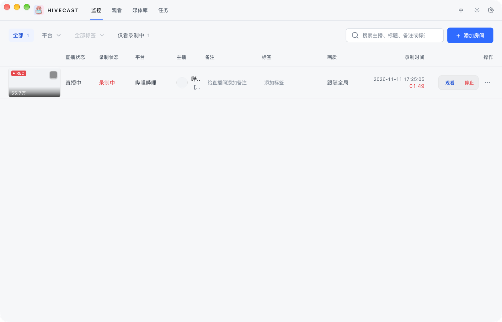
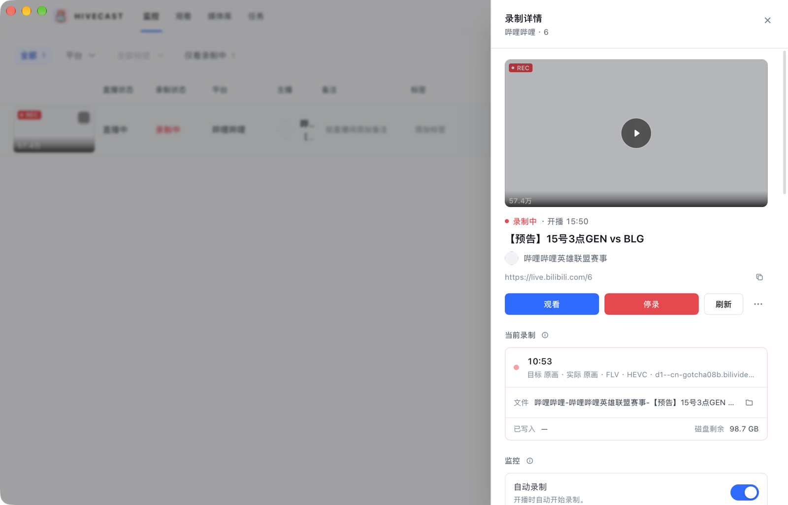
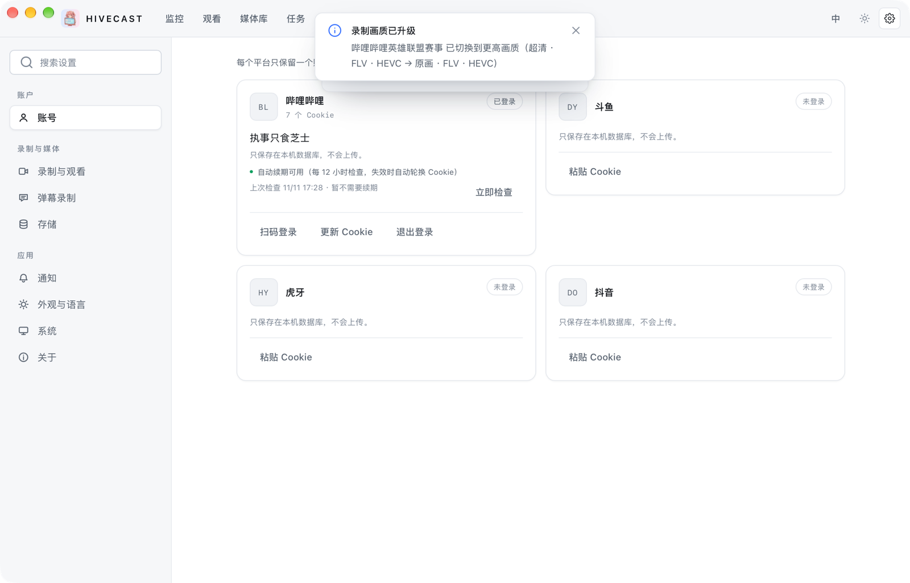

# 141 录制画质目标与自动升档

> 状态：已实现并真机验收（2026-11-11）。默认录制目标改为原画 10000；匿名回落、补 Cookie/扫码/续期后自动探测升档；同编码同格式在原会话续写（v1），编码或源流格式变化时另开新会话并用 group 关联（v2）。275 个 Rust 单测通过，release bundle 30.84 MiB。
>
> **2026-11-11 修订**：全局录制目标已改为「最高可用 40000」，B 站请求映射为 30000；全局下拉只保留最高可用，房间级仍可覆盖具体档位。本文 §1/§3 中「默认 10000」的描述已被 [142](142-B站画质档位与高档探测修复.md) 取代，其余 target/requested/actual 分离、v1/v2 升档机制不变。

## 1. 结论

- **目标档位（target_qn）与本次实际档位（actual_qn）分离**：目标不会因为首段匿名回落而改写成 250；补 Cookie 后仍知道要升到 10000。
- **默认目标 = 原画 10000**，不是「最高可用 40000」，也不是「平台决定 0」。用户可选 40000 / 10000 / 400 / 250 / 150 / 80；录制下拉不再出现 0。
- **匿名拿不到目标档时不拒绝录制**：按平台实际可用档开录，并在录音卡标注「目标 X · 实际 Y」；这是回落，不是目标丢失。
- **凭据恢复才触发升级**：保存 Cookie、扫码 confirmed、自动续期成功、监控 tick 兜底都会调用重检；删除 Cookie / 过期 / 续期失败只清缓存，不降档、不重启当前 ffmpeg。
- **升级必须换 ffmpeg**：不存在同一个进程内热切画质。v1 先停旧进程，再在**同一 session、同一路径、下一个分片号**启动新进程；v2 停旧进程后开新 session，旧 session 以后台任务收尾，两条记录用 group_id 关联。
- **升级失败自动回退**：探测失败、候选没有更高、旧进程不退、v2 新会话启动失败，都保持或恢复旧档位继续录；不会因为升级失败把整场录制丢掉。

## 2. 三个档位概念

| 字段 | 含义 | 典型值 |
| --- | --- | --- |
| target_qn | 本场目标，来自全局默认或房间覆盖 | 10000（原画） |
| requested_qn | 本次调用平台接口请求的档位 | 10000 |
| actual_qn | 平台实际下发的档位 | 匿名 250、登录 10000 |

/respawn 不再把首段实际档位钉成续录锚点（旧 plan_qn 行为），而是始终请求 target_qn。这样断流重连、补 Cookie 后的下一次取流都会重新朝目标档努力。

## 3. 默认值与归一化

- /Library/dshproject/HIVECAST/src-tauri/src/settings.rs:105 默认 default_record_qn 从 40000 改为 10_000。
- /Library/dshproject/HIVECAST/src-tauri/src/settings.rs:538 normalize_qn：0 保留给观看「自动」；80/150/250/400/10000/20000/30000/40000 原样保留；其它值才取整到 100 倍数。修复了「选超清 250 被改成 200，平台只给 150」。
- /Library/dshproject/HIVECAST/src-tauri/src/settings.rs:554 normalize_record_qn：录制目标不接受 0，0 统一按 10000。
- /Library/dshproject/HIVECAST/src/features/settings/SettingsView.tsx:59 RECORD_QN_OPTIONS 过滤掉 0，设置页仍保留最高可用 40000、原画 10000、蓝光 400、超清 250、高清 150、标清 80。

## 4. 触发时机

| 事件 | 调用 | 行为 |
| --- | --- | --- |
| 保存 Cookie | commands.rs:1316 recheck_all_quality(..., "credential_saved") | 对所有正在录制的房间强制重检 |
| 扫码 confirmed | commands.rs:1347 recheck_all_quality(..., "qr_confirmed") | 同上；只在新登录态已落库后 |
| 自动续期成功 | account 续期链路 | 续期后清缓存，下一次监控/重检使用新 Cookie |
| 监控 tick | monitor.rs:687 recheck_quality(..., false) | 兜底；300 秒冷却，已达标直接跳过 |
| 手动保存 Cookie 但没在录 | 无 active | 只清缓存，下一次开录直接用新 Cookie |

删除 Cookie、Cookie 过期、续期失败不会触发升级，也不会停当前 ffmpeg：录制只持有启动时的 CDN URL + headers，后续 Cookie 变化不影响已启动进程。

## 5. 重检与选流

/Library/dshproject/HIVECAST/src-tauri/src/recorder.rs:2008 recheck_quality：

1. 取房间级 upgrade_lock 单飞；非 force 时 300 秒冷却（UPGRADE_COOLDOWN）。
2. 快照 session_id、current_qn、target_qn、line、prefs、codec、format、host、notify_live。
3. 已在升级中、已请求停录、current_qn 已达 target_qn 时直接返回。
4. /Library/dshproject/HIVECAST/src-tauri/src/broker.rs:111 probe 绕过冷却、失败不写监控失败计数；探测失败只记 debug，保持当前档。
5. 探测偏好用用户偏好（codec/format），不能钉住当前容器；否则「匿名 H.264 → 登录 HEVC」永远识别不到容器变化。
6. 按平台 qualities 顺序比较候选与当前，而不是裸 qn 数值：/Library/dshproject/HIVECAST/src-tauri/src/recorder.rs:4109 quality_is_better。斗鱼 401/400、虎牙 15000/20000/30000 这类非单调档位不会被误判。
7. 候选更高才进入切换；平台当前没有更高时记录 debug「平台当前没有更高画质，保持当前档位」。

## 6. v1：同会话续写

适用：编码与源流格式都没变（例如 HEVC FLV 250 → HEVC FLV 10000）。

- 标记 active.upgrading=true，watcher 在此期间跳过断流判断，避免把主动停进程当成异常。
- send_graceful 旧 ffmpeg，最多等 5 秒（50 × 100ms）；不退则 kill_and_wait。
- 调 /Library/dshproject/HIVECAST/src-tauri/src/recorder.rs:1763 respawn_inner：skip_delay=true、count_restart=false、qn=target_qn、require_better_than=current_qn。
- 新进程使用同一 session_id、同一文件路径、start_number 继续下一个 .partNNNN.ts；upgrades+1，不计入 restarts/MAX_RESTARTS。
- 成功后写 update_session_quality，quality_history 追加一条 {at, qn, quality, line}，发 quality_upgraded 通知。
- 若升级 respawn 失败：保持 upgrading=true，用 qn=current_qn 回退 respawn；回退成功才清标志，避免 watcher 在空窗期收尾。

真机 v1：session 0e352991 匿名 250 HEVC → 保存 Cookie 后同 session 变原画 HEVC，history 2 条，start_number=9，upgrades=1。

## 7. v2：新会话 + group 关联

适用：编码或源流格式真的变了（例如匿名 H.264 FLV → 登录 HEVC FLV，或 FLV → HLS）。两种编码绝不能混进同一个 mkv/ts 文件。

- 从 inner 移除旧 active，调 start_inner(..., recheck=false, notify_started=false) 新建 session。
- 旧 session set_session_group(old, old, 0, None)；新 session set_session_group(new, old, 1, Some("quality_upgrade"))。
- 旧 session 交给后台 finalize_active，reason=quality_upgrade；分段合并、弹幕 ASS、缩略图、postprocess 都在后台完成，不阻塞新录制。
- 新 session 不弹「开始录制」，只发一次 quality_upgraded；避免一次升级出现两条开始通知。
- 若新会话启动失败：把旧 active 放回 inner，用 qn=current_qn 回退 respawn；只有回退也失败才清 upgrading。
- Media 库按 group_id 把两条记录归到同一直播；旧记录 reason=quality_upgrade，新记录 clip_index=1。

## 8. 通知与 UI

- 监控详情「当前录制」显示：目标 原画 · 实际 原画 · FLV · HEVC · 线路；目标与实际不同时显示「目标 X · 实际 Y」，见 /Library/dshproject/HIVECAST/src/features/monitor/MonitorPage.tsx:1357。
- 升级成功 toast/系统通知：录制画质已升级 / 「{{host}} 已切换到更高画质（{{detail}}）」，info tone。
- 升级回退仍用中性的 quality_fallback：「录制画质已调整」，不报错。
- 截图：设置页保存 Cookie 后右下角 toast；监控详情显示目标/实际。

## 9. 真机测试记录

环境：macOS，真实 B 站房间 bilibili:6（LPL 赛事），真实账号「执事只食芝士」uid 352130563；record.codec=h265；release bundle 30.84 MiB。

| 场景 | 操作 | 结果 |
| --- | --- | --- |
| 匿名开录、默认目标 | 删除 credential，自动开录 | requested 10000 / actual 250，「超清 · FLV · HEVC」，history 1 条 |
| v1 补 Cookie（H.264） | 保存有效 Cookie | 同 session 42c0f393 250→10000，history 2 条，part0009 续写 |
| v1 补 Cookie（HEVC） | 保存有效 Cookie | 同 session 0e352991 250→10000，原画 HEVC，start_number=9、upgrades=1 |
| 显式低目标 | 设置选超清 250，保存 Cookie | DB 250，actual 250；重检日志「平台当前没有更高画质」，不升 10000 |
| 显式低目标再次保存 Cookie | 录制中保存同一 Cookie | 1 个 ffmpeg，session 不变，history 仍 1 条 |
| 空闲保存 Cookie 后开录 | 无录制时保存，再开录 | 新 session 直接原画 10000，证明下一次开录用当前 Cookie |
| 升级失败回退 | 候选不高于当前 / 探测失败 | 不停录、不新建 session，保持原档 |
| v2 分支 | debug-only 临时钩子强制分会话 | 旧 session 99341e0b finished reason=quality_upgrade、14,783,384 B；新 session 5ded8f0e recording 原画 HEVC；group 相同、clip_index 0/1；旧文件后台合并/ASS/缩略图完成；任何时刻只有 1 个 ffmpeg |

v2 说明：生产代码只在 container_changed 时进入 v2。当前测试房间匿名 250 就已经返回 HEVC，保存 Cookie 后同编码，因此**没有自然触发** v2 的真实样本。为验证分会话链路，临时在 debug 构建加 HIVECAST_FORCE_V2=1 钩子强制走 v2，完成上述验证后已删除钩子并重建 release；单测 container_changed 覆盖真实编码/格式变化判断。

## 10. 单测与构建

- cargo test --lib：275 passed / 0 failed / 17 ignored。
- 新增/更新测试：quality_upgrade_uses_platform_order、container_change_only_when_codec_or_format_really_differs、normalize_qn(250/150/400)、normalize_record_qn(0)=10000；原有 respawn/quality_fallback 测试继续通过。
- cargo fmt --check、cargo check --all-targets 0 警告。
- pnpm exec tsc -b；check:i18n 756 keys；check:docs 142 files（新增本文件后）；pnpm build；pnpm app:build 30.84 MiB。

## 11. 限制与后续

- 升档有 1–5 秒断点（停旧进程 + 起新进程 + 取流），这是换 ffmpeg 的固有代价；低画质已录片段不会变成高清。
- v2 会产生两条 record_session，虽然同 group，但按「单场一条」统计时要注意分组；建议后续在媒体库显式展示「画质升级前/后」。
- target_qn 目前只存在 RecordingInfo/Active，没有落到 record_session；历史记录只能看到实际 quality 与 quality_history，看不到当时目标。若要做「目标达成率」报表，需要加列。
- 自动续期 token 轮换不改变登录态，不触发升级；只有「不可用 → 可用」才值得升。删除/过期不降档是刻意行为。
- 升级探测失败不写监控退避；代价是下一轮可能重复探测，但 300 秒冷却 + 单飞把请求量压住了。
- 用户中途改设置（目标/编码/格式）只影响下一次开录，不影响当前 session；这是为了避免一次设置改动把正在录的文件切断。

## 12. 复现

1. 设置 → 录制与观看 → 新房间默认录制画质选「原画」。
2. 删除 B 站账号或退出登录，添加一个正在直播的 B 站房间，自动开录；确认详情「目标 原画 · 实际 超清」。
3. 设置 → 账号 → 更新 Cookie，保存有效 Cookie。
4. 预期：toast「录制画质已升级」；DB 同一 session 的 quality 变原画、quality_history 2 条；监控详情「目标 原画 · 实际 原画」。
5. 若平台没有更高画质：日志「平台当前没有更高画质，保持当前档位」，录制不中断。
