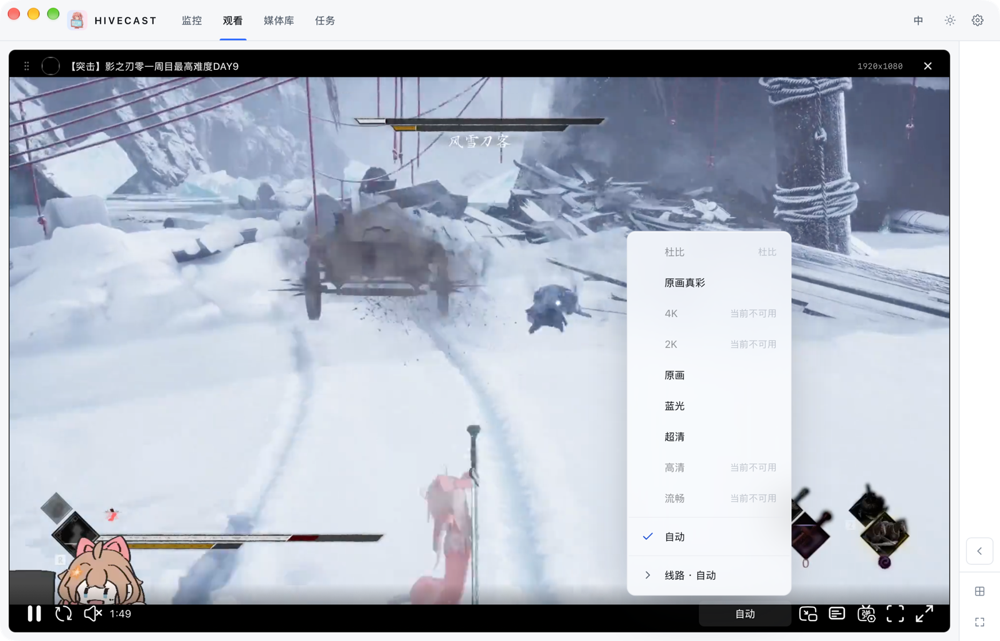
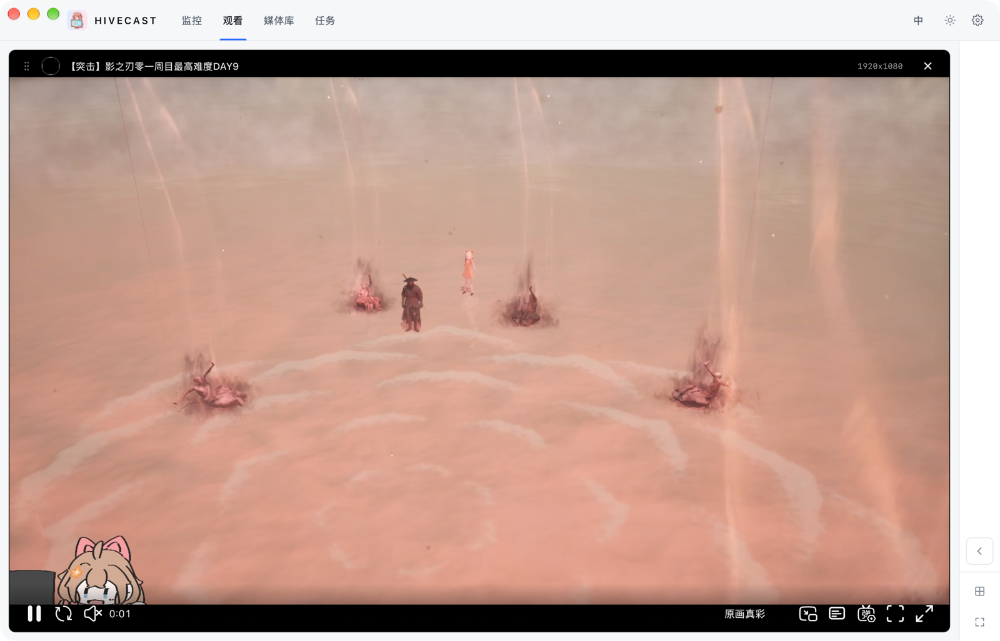
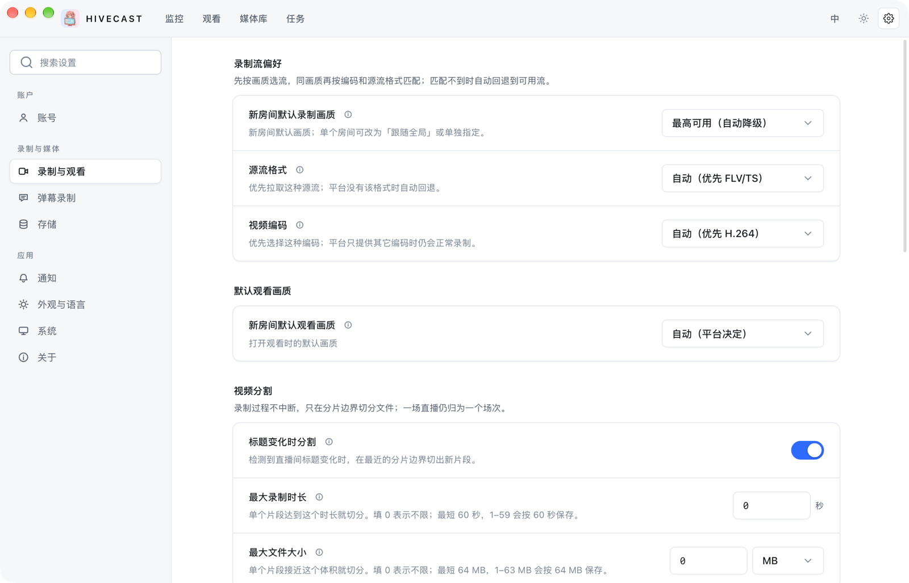

# 142 B 站画质档位与高档探测修复

> 状态：已实现并真机验收（2026-11-11）。B 站能力清单改为独立的高档探测，补回 25000「原画真彩」，录制链路跳过 AV1；全局录制档位收敛为「最高可用」。277 个 Rust 单测通过，release bundle 30.x MiB。

## 1. 问题

本轮审计前，B 站画质链路有四个互相叠加的问题：

1. **40000 哨兵被映射成原画 10000**。应用层用 40000 表示「最高可用」，但 `request_qn(40000)` 返回 10000，导致「最高」实际只请求原画，25000/30000 永远不出现。
2. **能力清单跟请求档位绑定**。登录账号请求 10000 时，平台把 `current_qn` 封在 10000；用同一份响应判断 2K/4K/杜比，菜单就会把高档全部标灰。这不是账号没权限，而是探测档位太低。
3. **qn 表缺 25000**。「原画真彩」是 B 站真实存在的档位，但旧映射只有杜比/4K/2K/原画，25000 被归到「语义不稳定」而未进主表。
4. **AV1 没有录制门禁**。请求加 `codec=2` 后可能拿到 AV1；AV1 直接 `-c copy` 进 MPEG-TS/Matroska 分片会报 `Output file does not contain any stream`，产物 0 字节。

## 2. 改法

### 2.1 最高哨兵映射到 30000

`/Library/dshproject/HIVECAST/src-tauri/src/platform/bilibili.rs`：

```rust
const QN_MAX: u32 = 30_000;

fn request_qn(qn: u32) -> u32 {
    if qn == 40_000 { QN_MAX } else { qn }
}
```

B 站接口能接受的最大 qn 是 30000（杜比）；应用层的 40000 只表示「最高可用」，不直接发给平台。实测 qn=30000 会按账号/房间权限回退到 25000 或 15000，是安全的最高探测值。

### 2.2 能力清单独立高档探测

`stream_plan` 现在最多发两次请求：

| 请求 | 用途 | qn |
| --- | --- | --- |
| base | 线路与候选 URL | 用户请求档位；40000 映射成 30000 |
| high probe | 只用于能力清单 | 30000（仅当 base 请求 < 30000） |

规则：

- `requested_qn < 30000` 时，额外请求 qn=30000；成功且 `live_status=1` 才使用它的 `g_qn_desc/accept_qn/current_qn`。
- 探测失败、未开播、缺少 `playurl_info`：回退到 base 的能力清单，`probed_high=false`，**不能把未知高档直接标灰**。
- `requested_qn >= 30000`：base 本身就是最高探测，一次响应同时用于线路与能力清单。
- 线路组仍来自 base，避免把高档探测返回的 CDN 混进用户实际请求档位的线路列表。

`/Library/dshproject/HIVECAST/src-tauri/src/platform/bilibili.rs` 的 `quality_available`：

```rust
if !accepted.contains(&qn) {
    return false;
}
if probed_high {
    qn <= granted
} else {
    granted >= QN_ORIGIN as i64 || qn <= granted
}
```

`granted_qn` 取高档响应里所有 codec 的 `current_qn` 最大值。这样「账号上限 25000」时 30000 禁用、25000 可选；「房间 accept_qn 不含 15000」时 2K 禁用，而不是因为账号上限误判。

### 2.3 补 25000 与杜比 hint

qn 表补入：

| qn | 名称 | 说明 |
| --- | --- | --- |
| 30000 | 杜比 | 最高探测值；多数录制链路不支持 |
| 25000 | 原画真彩 | 登录账号常见的高档；FLV/H.264 可录 |
| 20000 | 4K | 需登录 + 大会员 + 房间支持 |
| 15000 | 2K | 需房间 accept_qn 包含 |
| 10000 | 原画 | 旧默认 |
| 400 | 蓝光 | |
| 250 | 超清 | 未登录常见上限 |
| 150 | 高清 | |
| 80 | 流畅 | |

`build_qualities` 合并 `g_qn_desc` 与 `accept_qn`，按 qn 降序；`quality_hint` 让「杜比」优先于编码，否则 30000 会被标成 HEVC，用户看不出是杜比。

### 2.4 请求加 AV1，但录制跳过 AV1

取流 query 从 `codec=0,1` 改为 `codec=0,1,2`，并保留 `dolby=5&panorama=1`。

观看侧仍可使用 AV1（MSE 有能力门禁）；录制侧在 `best_in_group` 过滤 `Codec::Av1`：

```rust
.filter(|candidate| candidate.codec != Some(Codec::Av1))
```

如果整份 plan 只有 AV1 可用，开录返回明确错误：

> 当前直播只提供 AV1 编码，录制链路暂不支持 AV1

而不是笼统的「没有可用的线路」。

### 2.5 全局录制档位只保留「最高可用」

`/Library/dshproject/HIVECAST/src-tauri/src/settings.rs`：

- `default_record_qn = RECORD_QN_HIGHEST (40000)`。
- `normalize_record_qn(_qn) = 40000`：旧版本存过的 10000/250 等全局值，加载和保存时统一迁移。
- `normalize_view_qn(qn)`：只允许 0（自动）或 40000（最高）；其它值归 0，避免把 B 站专有 qn 发给斗鱼/虎牙/抖音。
- 默认观看画质仍为 0（自动）。

前端：

- `SettingsView.tsx` 的 `QN_OPTIONS` 只保留 0/40000；`RECORD_QN_OPTIONS` 只有 40000。真机下拉只有一项「最高可用（自动降级）」。
- `MonitorPage.tsx` 删除写死的 `QUALITIES`；能力清单未到时只给「自动」和当前档位，不再猜平台专有档位。
- `WatchPage.tsx` 删除 `FALLBACK_QUALITY_QNS`；清单未到时只补当前档位，自动项由播放器追加。

房间级覆盖仍保留：单个房间可以在监控详情里选「跟随全局」或具体档位，不受全局只有「最高」的限制。

## 3. 真机验收

环境：release bundle，窗口 1166×749，测试房间 `bilibili:22637261`（直播中），登录 Cookie 有效。

### 3.1 观看菜单

画质菜单显示 9 档：



| 菜单项 | 状态 | 原因 |
| --- | --- | --- |
| 杜比 | 灰 | qn 30000 > 高档探测 granted 25000 |
| 原画真彩 | 可选，当前选中 | qn 25000，账号/房间可用 |
| 4K | 灰，「当前不可用」 | qn 20000 > granted 25000 |
| 2K | 灰，「当前不可用」 | 房间 accept_qn 不含 15000 |
| 原画 | 可选 | qn 10000 |
| 蓝光 | 可选 | qn 400 |
| 超清 | 可选 | qn 250 |
| 高清 | 灰 | 房间 accept_qn 不含 150 |
| 流畅 | 灰 | 房间 accept_qn 不含 80 |

选「原画真彩」后播放器底栏标签变为「原画真彩」，分辨率 1920×1080。



### 3.2 录制

监控页点「录制」，状态变为「录制中」，画质列仍显示房间配置「跟随全局」。DB 的 `record_session.quality` 为：

```text
原画真彩 · FLV · H.264
```

`quality_history` 记录 `qn=25000`、编码 H.264、线路 CDN。停止后：

| 指标 | 值 |
| --- | --- |
| 文件大小 | 499,451,170 B（约 476 MiB） |
| 时长 | 327.732 s（5 分 22 秒） |
| 视频 | H.264，1920×1080，60 fps |
| 音频 | AAC |
| 状态 | finished / stopped |

ffprobe 输出：

```json
{"streams":[{"index":0,"codec_name":"h264","width":1920,"height":1080,"avg_frame_rate":"60/1"},{"index":1,"codec_name":"aac"}],"format":{"duration":"327.732000","size":499451170}}
```

录制文件与分片合并正常，缩略图/弹幕链路未受影响。

### 3.3 设置页

「录制与观看 → 新房间默认录制画质」显示「最高可用（自动降级）」，下拉只有这一项。



## 4. 单测

新增/更新：

- `maps_highest_sentinel_to_dolby_probe`：40000 → 30000；30000/20000/10000/0 原样。
- `caps_quality_availability_to_high_probe_grant`：probed_high 时 25000/15000 需 <= granted；250 仍可用；探测失败回退旧规则。
- `builds_room_catalog_from_high_probe`：30000 有 hint「杜比」但超 granted 不可用；25000/15000 可用；10000 codec 优先 h264。
- `recording_skips_av1_and_reports_av1_only_plans`：混合 plan 选 h264；AV1-only plan 返回 None 且 `only_av1_available` 为 true。
- `global_qn_is_restricted_to_auto_or_highest`：录制 0/250 → 40000；观看 250 → 0，40000 保留。
- `save_clamps_and_roundtrips`：保存/加载后 `default_record_qn=40000`。

结果：`cargo test --lib` **277 passed / 0 failed / 17 ignored**。

## 5. 限制

- **没有找到真实 AV1-only 房间**。AV1 门禁由合成的 `StreamGroup` 单测覆盖；真实 AV1 URL 的 ffmpeg 失败日志来自本轮之前的探测，未在本轮重新复现。
- **4K/杜比未做真实权限验证**。测试房间的高档探测 granted 为 25000，30000 和 20000 被正确标灰；如果账号/房间有更高权限，菜单会按 `granted_qn` 自动放开。
- **2K 不可用是房间级**。该房间 `accept_qn` 不含 15000；在其他房间（如 docs/127 的 `6`）2K 仍可实测 2560×1440。
- **全局「最高」可能导致文件更大**。本次 1080p60 录制约 476 MiB/5 分钟；需要控制体积时，可在单个房间覆盖为原画/蓝光/超清，或使用录制后转封装。
- **界面画质列仍显示配置值**（如「跟随全局」），不是本次实际档位；实际档位看录制详情/任务中心。这是既有展示语义，本轮未改。

## 6. 改动文件

- `/Library/dshproject/HIVECAST/src-tauri/src/platform/bilibili.rs`
- `/Library/dshproject/HIVECAST/src-tauri/src/recorder.rs`
- `/Library/dshproject/HIVECAST/src-tauri/src/settings.rs`
- `/Library/dshproject/HIVECAST/src/features/settings/SettingsView.tsx`
- `/Library/dshproject/HIVECAST/src/features/monitor/MonitorPage.tsx`
- `/Library/dshproject/HIVECAST/src/features/watch/WatchPage.tsx`

相关文档：[05](05-平台接入-B站.md)、[127](127-平台Cookie实测与全量画质验证.md)、[130](130-取流与线路.md)、[141](141-录制画质目标与自动升档.md)。

## 7. 验证命令

```bash
cargo fmt --check
cargo check --all-targets
cargo test --lib
pnpm exec tsc -b
pnpm run check:i18n
pnpm run check:docs
pnpm build
git diff --check
```
