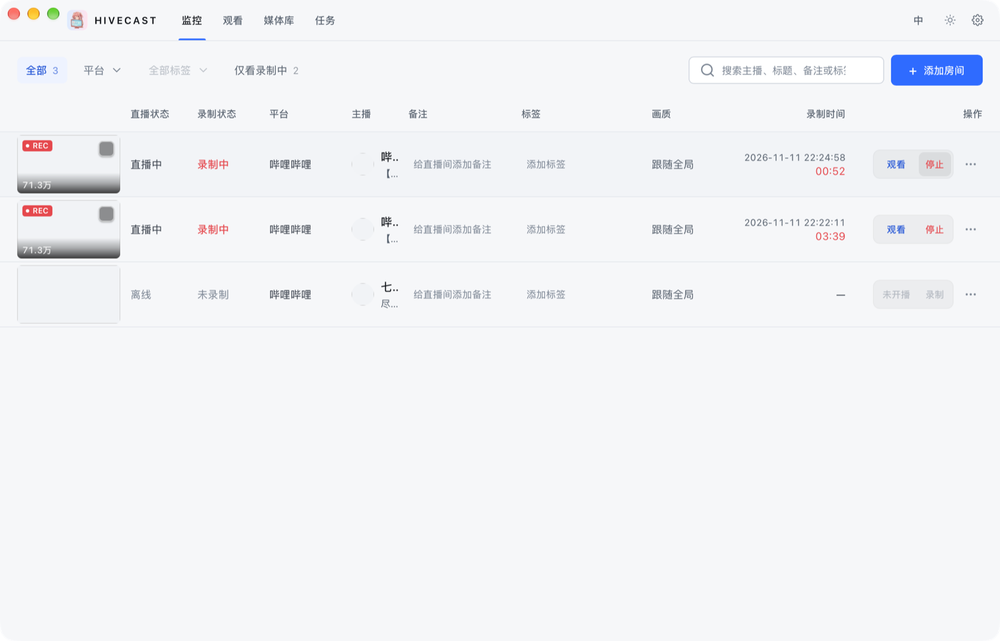
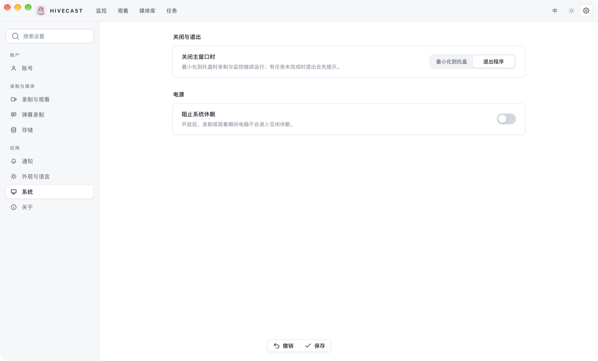
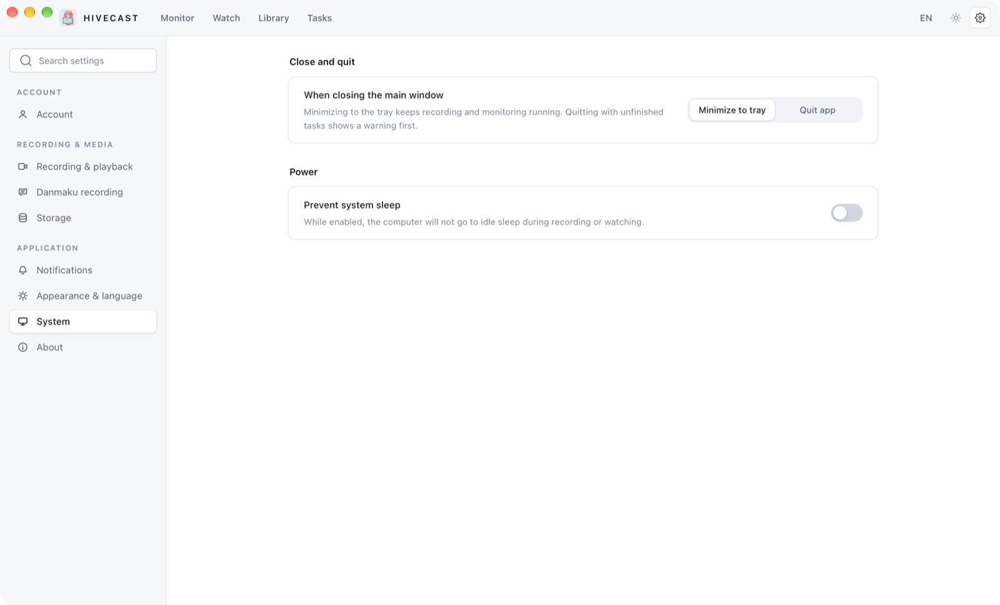
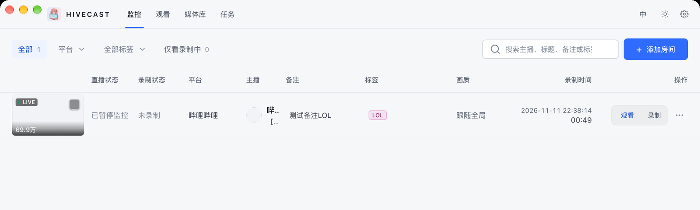
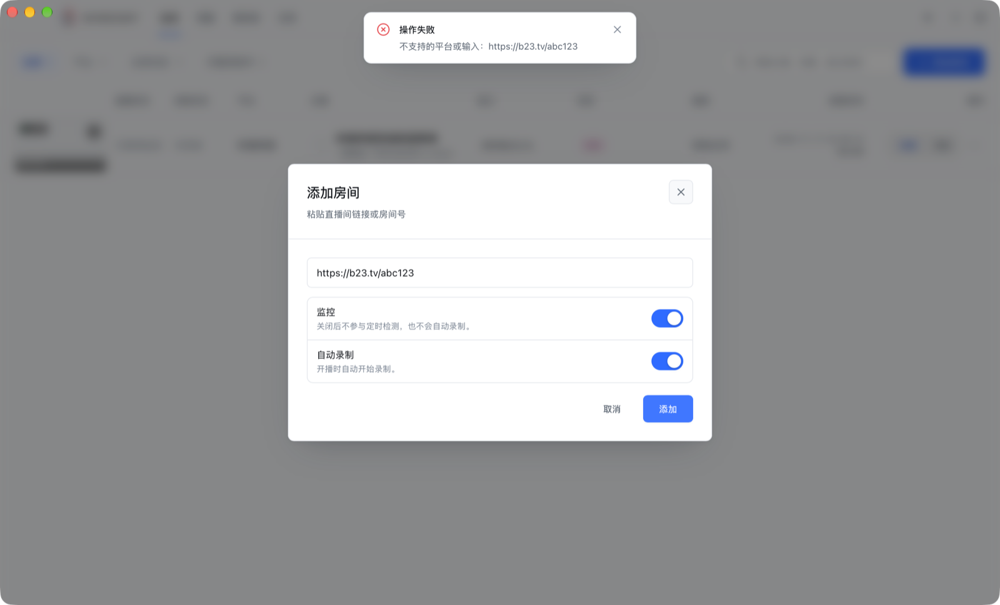

# 143 · B 站全平台功能复查（除弹幕）

> 日期：2026-11-11
> 基线：`da949c9 fix(bilibili): 补全画质档位与 AV1 录制门禁`
> 范围：B 站账号与 Cookie、添加直播间、监控、录制、画质、停止与后处理、媒体库、设置中影响 B 站的项。
> 排除：弹幕连接、弹幕落盘、ASS 导出（用户明确排除）。
> 方法：真机操作 + SQLite 现场查询 + 运行日志 + `ps`/ffmpeg 观察；另用四路只读代码审计交叉核对。每条结论都标注「实测」或「静态」。
> 后续：本文的 3 个 P0、7 个 P1 与 P2 已在 `144-B站审计缺陷修复与复验.md` 修复并真机复验；本文保留为问题基线。

---

## 1. 结论先行

主链路可用：有效 Cookie 下账号卡正确、手动续期可用；用房间号 6 添加后能自动开录 2K FLV/H.264，停止后 30 个分片合并为 884 MB 母带，`source` 后处理保留 FLV；离线房间、备注、标签、标签搜索都能工作。

但本轮确认了 3 个 P0、7 个 P1。P0 都属于「会重复占磁盘 / 设置实际没生效 / 暂停后仍自动录」这一类，不应留到发布后。

| 级别 | 问题 | 一句话后果 |
| --- | --- | --- |
| P0 | 短号与真号双录 | 同一场直播可被录两遍，磁盘与并发双倍占用 |
| P0 | 关闭行为、防休眠未落库 | 用户选「退出程序」重启后变回「最小化到托盘」；录制中允许休眠 |
| P0 | 暂停监控仍可自动开录 | UI 显示「已暂停监控」，实际仍在录 |
| P1 | 默认窗口主播列压扁 | 1166×749 下主播列只剩约 54px，主播名与房间标题都被截断 |
| P1 | 重复添加假成功 | 提示「直播间已添加」，实际参数被丢弃 |
| P1 | b23.tv 短链不支持 | 常见分享链接直接报「不支持的平台或输入」 |
| P1 | 房间级规则入口缺失 | 菜单只提示「即将上线」，画质单元格不可点 |
| P1 | 实际画质不显示 | 已录 2K，监控表仍显示「跟随全局」 |
| P1 | 离开设置自动保存 | 未点保存也会写库，并触发保留策略删除 |
| P1 | 搜索不匹配平台名 | 输入「B站」搜不到任何 B 站房间 |

> 统计口径：P0 = 会造成数据重复/丢失、设置失效或用户无法完成核心操作；P1 = 明显可用性缺陷但有绕行方式；P2 = 需要特定条件才触发或仅代码层确认。

---

## 2. 测试环境与判定方式

| 项 | 值 |
| --- | --- |
| 应用 | release bundle，`src-tauri/target/release/bundle/macos/HIVECAST.app` |
| 基线 | `da949c9`，`main == origin/main`，工作区干净 |
| 窗口 | 初始 1166×749 @ (70,30)；后调至 1320×800 @ (20,30) |
| 屏幕 | 1355×851（逻辑） |
| 账号 | B 站「执事只食芝士」uid 352130563，Cookie 635 字符，status=ok |
| 数据库 | `~/Library/Application Support/com.hivecast.desktop/hivecast.db` |
| 日志 | `~/Library/Logs/com.hivecast.desktop/hivecast-2026-11-11.log` |
| 截图 | 窗口截图 2332×1498 或 2640×1600，OCR 使用原图像素坐标 |

「实测」表示在本机真实应用里点过、并在 DB/日志/文件系统看到结果；「静态」表示只读代码确认，尚未构造出稳定复现。两者在文中分开写，避免把代码推断冒充现场证据。

---

## 3. 已通过的链路（实测）

### 3.1 账号与续期

设置 → 账号，B 站卡显示「已登录」「7 个 Cookie」「执事只食芝士」「自动续期可用（每 12 小时检查，失效时自动轮换 Cookie）」「上次检查 11/11 21:27 · 暂不需要续期」。

点「立即检查」后日志依次出现：

```text
手动检查 Cookie 续期
cookie/info 表示暂不需要续期
```

UI 时间更新为 21:32，并弹出「续期检查完成：暂不需要续期」。说明手动检查、状态回写、toast 三段都通。

启动阶段另有 `登录态复验完成 checked=1`，`cookie/info` 与 `nav` 均成功，证明本轮使用的 Cookie 真实有效，后续录制结论不是匿名态。

### 3.2 添加与自动录制

通过「添加直播间」输入 `6`，监控与自动录制都开：

```text
添加房间 room_id=b4a96696-b75e-4c85-a87b-03426c68535c platform=bilibili room_key=6 monitor=true auto_record=true
```

随即自动开录：

| 项 | 值 |
| --- | --- |
| session | `bd379436-1899-4526-ba9d-77e44b3fd1d5` |
| quality | `2K · FLV · H.264` |
| requested_qn | 40000 |
| actual qn | 15000 |
| line | `d1--cn-gotcha08b.bilivideo.com` |
| 分片 | `part0000.ts` / `part0001.ts` / `part0002.ts` … 每 60 秒 |
| ffmpeg | `-c copy -f segment -segment_time 60 -segment_format mpegts` |

录制中主 `.flv` 为 0 B，数据只在 `.partNNNN.ts` 里增长，这是分片录制的正常中间态，不是失败。

ffmpeg 参数里没有 Cookie 头，只有 `Origin` / `Referer` / UA；鉴权来自 playurl 的签名 URL。这与 docs/130 的记录一致。

### 3.3 停止、合并与后处理

点行内「停止」后：

| 项 | 值 |
| --- | --- |
| status | `finished` |
| stop_reason | `stopped` |
| file_size | 884,448,595 B |
| duration_ms | 1,764,000（29 分 24 秒） |
| parts | 30 |
| 合并耗时 | 5,322 ms |
| post_state | `done` |
| source_deleted | 0 |

日志：

```text
分片合并完成 ... parts=30 bytes=884448595 elapsed_ms=5322
```

`source` 模式保留 `.flv` 母带，缩略图随后排队生成；`media_file` 有 main 行。停止、合并、母带保留这条链路通过。

### 3.4 离线房间

添加 `21452505`（七海Nana7mi，当时离线），把自动录制关掉后添加。监控表显示「离线 / 未录制」，操作列的「未开播」「录制」均置灰。离线态不会误开录。

### 3.5 备注、标签与标签搜索

行内备注输入「测试备注LOL」按 Enter，DB 写入 `room.note=测试备注LOL`；标签输入「LOL」失焦，DB 写入 `room.tags=LOL`。

搜索「lol」能命中该房间；搜索「B站」不能（见 §5.7）。说明备注/标签参与检索，平台名不参与。

---

## 4. P0 详情

### 4.1 P0：短号与真号双录

**复现步骤**

1. 添加 `6`（B 站 LPL 赛事，短号）。
2. 再添加 `7734200`（同一场直播的真号）。
3. 两行都保留，且都能开录（7734200 行后来被软删，但在当时是独立行）。

**现场证据**

| room_key | room id | 说明 |
| --- | --- | --- |
| 6 | `b4a96696-b75e-4c85-a87b-03426c68535c` | 短号行 |
| 7734200 | `54673397…` | 真号行，`get_info.data.room_id=7734200` |

同时存在两个录制会话、两个 ffmpeg：

| session | 房间 | 文件大小 | 时长 |
| --- | --- | --- | --- |
| `1acda646` | 54673397（真号） | 182,263,501 B | 273 s |
| `4b257220` | b4a96696（短号） | 64,957,544 B | 105 s |



**根因**

- `src-tauri/src/platform/mod.rs` 的 `resolve_input()` 对纯数字直接返回 `RoomRef { room_key: 输入值 }`，没有把平台返回的规范房间号写回。
- `src-tauri/src/platform/bilibili.rs` 的 `get_info` 已经拿到 `data.room_id`，但只用于拼接播放地址，没有回写 `room_key`。
- `src-tauri/src/commands.rs:95-107` 的查重按 `(platform, room_key)`，6 与 7734200 被视为两个键。
- 监控、录制、冷却、单飞都按 `room.id` 或 `room_key` 隔离，所以两条链路完全独立。

**影响**

同一场直播双倍占磁盘、双倍占并发槽；通知、后处理、保留策略都会重复计数。用户以为「只是加了个别名」，实际得到两份录像。

**修复建议**

1. 添加与监控刷新时都以平台返回的规范 `room_id` 为准，写回 `room_key`，原始输入另存 `input_alias`。
2. `room` 增加 `(platform, canonical_room_id)` 唯一约束；迁移时合并同 canonical 的重复行，保留最早创建的一条，其余软删。
3. 在 `resolve_input` 之后、插入之前做一次 canonical 归一，避免 UI 层各自处理。
4. 验收：先加 6 再加 7734200，DB 只有 1 行、只开 1 个 ffmpeg；反向顺序同样。

### 4.2 P0：关闭行为与防休眠没有保存

**复现步骤**

1. 设置 → 系统。
2. 「关闭主窗口时」选择「退出程序」。
3. 点底部保存。
4. 退出应用并重启。

**现场证据**

保存后查 DB：

```sql
select key, value from app_setting
where key in ('app.close_action', 'app.prevent_sleep');
-- 无行
```

重启后界面回到「最小化到托盘」。日志同时出现：

```text
2026-11-11 23:14:50 应用运行时设置 ... prevent_sleep=false
2026-11-11 23:14:50 设置已保存
```




**根因**

`src-tauri/src/settings.rs:379-453` 的 `save()` 从 380 行到 450 行逐项写键，唯独没有 `KEY_CLOSE_ACTION` 与 `KEY_PREVENT_SLEEP`；而 `load()` 在 `:244` / `:247` 会读这两个键。读得到、写不回，重启必然回默认值。

防休眠开关本轮实际没有成功切换（一直为关），所以「防休眠丢失」目前是同一处代码导致的静态结论，不能写成已实测丢失。关闭行为是实测丢失。

**影响**

- 用户选「退出程序」，实际关闭窗口只是最小化，录制继续在后台跑，用户以为已退出。
- 反过来，如果默认值与用户预期不符，关闭窗口可能直接杀进程，正在写的分片来不及收尾。
- 防休眠不生效时，录制中系统休眠会断流，表现为「无缘无故分段/失败」。

**修复建议**

在 `save()` 中补两行写键；`load()` 已有读取，不需要迁移。补一个 roundtrip 单测：save 后 load，两个字段必须相等。再补一条「录制中关闭窗口」的行为测试，确保先收尾再退出。

### 4.3 P0：暂停监控仍可自动开录

**复现步骤**

1. 房间 6 处于 `monitor_paused=1`，UI 显示「已暂停监控」。
2. 打开行菜单，点「开启自动录制」。
3. DB `auto_record=1`，立即生成新 session。

**现场证据**

```text
session f33fc000-75f2-4607-ac4c-d40611825336
status=recording
file_size=19,965,551 B
duration_ms=49,000
```

UI 同时显示「已暂停监控 / 录制中」，自相矛盾。

**根因**

`src-tauri/src/commands.rs:280-293` 的开录条件只有：

```rust
if enabled
    && room.is_live
    && !state.recorder.is_recording(&id)
    && crate::monitor::auto_record_allowed(&room, &room.title)
```

没有检查 `room.monitor_paused`。`auto_record_allowed` 只做标题包含/排除判断，也不看暂停位。

**影响**

暂停监控本来用于「先别管这个房间」；现在反而能通过菜单触发录制。用户以为已暂停，实际在写盘。

**修复建议**

- 开录条件加 `&& !room.monitor_paused`。
- UI 在暂停态禁用「开启自动录制」，或点击时提示「先恢复监控」。
- 单测：`monitor_paused=true + auto_record=true + is_live=true` 不得产生 session。

---

## 5. P1 详情

### 5.1 默认窗口下主播列被压扁

默认 1166×749 下，监控表「主播」列只有约 54px：头像被压成细条，主播名显示成「哔...」「七...」，房间标题完全不显示。顶栏右侧齿轮在该尺寸仍然可见，按钮本身没有被裁；问题是表格列宽分配，不是顶栏溢出。



把窗口调到 1320×800 后，主播列恢复、标题可见、表格不再拥挤。说明不是数据问题，是默认尺寸与最小列宽不匹配。

**建议**

- 默认窗口至少 1280×760，或设置 `minWidth` 1280。
- 表格给主播/标题列 `min-width`，操作列 sticky 右侧，窄窗口横向滚动而不是压扁。
- 顶栏右侧按钮组加 `shrink-0` 作为防御，避免后续加按钮时再次挤出。

### 5.2 重复添加假成功

已有房间 6 时再次添加 6，toast 显示「直播间已添加 / 哔哩哔哩英雄联盟赛事」，但 DB 仍只有 1 行，第二次传入的 `monitor` / `autoRecord` 被静默丢弃。

根因是后端 `src-tauri/src/commands.rs:95-107` 命中 existing 后直接返回旧 `RoomView`，没有 `created` 标志；前端 `src/features/monitor/AddRoomDialog.tsx:36-56` 无条件 `notify.success`。

**建议**：返回值增加 `created: bool`；前端对已存在显示「已在监控中」，并询问是否应用新参数。若要静默忽略，至少不要报成功。

### 5.3 b23.tv 短链不支持

添加 `https://b23.tv/abc123`（示例短码，只验证解析层，不依赖该链接是否真实存在）：

```text
操作失败
不支持的平台或输入：https://b23.tv/abc123
```

弹窗不关闭，用户只能手动找房间号。



根因在 `src-tauri/src/platform/bilibili.rs:570-592`：只接受路径里的纯数字段。b23 的短码是大小写字母数字，永远不匹配。

**建议**：对 `b23.tv` 先发 HEAD/GET 跟随 301/302，从 `Location` 里取 `live.bilibili.com/<id>`；同时支持 `BV`/`av` 号解析。解析失败要给出「短链已失效或不是直播间」而不是笼统的「不支持」。

### 5.4 房间级规则入口缺失

行菜单「直播间设置」只弹 toast「直播间设置即将上线」；点击画质单元格没有任何反应。设置页没有房间级画质/监控覆盖入口。

但 docs/142 写的是「房间级仍可覆盖」。文档与实现不一致，用户按文档找不到入口。

**建议**：要么本轮补一个最小房间设置抽屉（画质、监控、自动录制、标题规则），要么把 docs/142 的表述改成「房间级字段已存在，UI 待补」。

### 5.5 实际画质不显示

session 的 `quality` 是 `2K · FLV · H.264`，`quality_history` 里 qn=15000；监控表画质列仍显示「跟随全局」。

原因是表格只渲染 `room.recordQn`（0=跟随全局），不读 session 的 `quality` / `quality_history`。录制中用户看不到「实际拿到了什么档」。

**建议**：录制中显示 `last_session_quality` 或当前 active quality；历史行展开显示 `quality_history` 的每次变化。至少不要用「跟随全局」覆盖实际值。

### 5.6 离开设置自动保存，且触发保留策略

**复现步骤**

1. 设置 → 录制与观看，把「源流格式」从「自动」改成「FLV」。
2. 不点保存，直接点顶栏「监控」。
3. 查 DB：`record.source_format=flv`。

把选项改回「自动」再离开，DB 又变回 `auto`。说明离开设置会自动提交整份草稿。

代码在 `src/App.tsx:102-121`：离开设置时如果 dirty，直接调用保存；`src-tauri/src/settings.rs:452` 在每次保存末尾执行 `retention::enforce_from_settings(db)`。这意味着用户只是改了个格式再离开，也可能触发按新阈值删除旧录像。

「撤销本次保存」在 `src/App.tsx:138-157` 用整份快照回写，和「只撤销本次字段」不是一回事，容易把并发改动一起覆盖。

**建议**

- 要么恢复显式保存，要么在离开时只暂存、不执行 retention 等有副作用的动作。
- 撤销改为字段级 diff，不要整份快照回写。
- 保存前把「将删除 N 个旧录像」放进确认提示。

### 5.7 搜索不匹配平台名

搜索「B站」显示「没有匹配房间」；搜索备注/标签「lol」能命中。根因是 `src/features/monitor/MonitorPage.tsx:678-699` 只匹配 `title` / `hostName` / `roomKey` / `note` / `tags`。

**建议**：把平台显示名（哔哩哔哩/B站/Bilibili）、平台 key、房间 URL 加入检索；再做一层别名表，避免「B站」「bilibili」「BILI」三种写法结果不同。

---

## 6. P2 与静态风险

以下条目能定位到代码，但未全部构造真机复现；每条标注「静态」或「待验证」，不与前面的实测结论混在一起。

### 6.1 账号与 Cookie

| 条目 | 类型 | 说明 |
| --- | --- | --- |
| confirm 失败不重试 | 静态 | `src-tauri/src/account.rs:817-831` 在 confirm/refresh 返回非 0 或网络失败时只 WARN，仍返回 `Refreshed` 并保留已轮换的新 Cookie；如果 confirm 实际未生效，下一次 cookie/info 才会暴露。建议把 confirm 失败记为「待确认」并短退避重试 |
| 扫码与续期共用写锁的等待窗口 | 静态 | 扫码确认、保存 Cookie、续期写回都走 `CREDENTIAL_WRITE`；长请求期间另一个入口会等待。当前没有超时提示，极端情况下 UI 可能长时间停在「保存中」 |

### 6.2 画质

| 条目 | 类型 | 说明 |
| --- | --- | --- |
| 40000 档的 HDR/杜比缺口 | 静态 | 能力探测固定 qn=30000，若账号只在更高哨兵位给 HDR/杜比，菜单可能显示但取不到；当前账号无权限，未能真机验证 |
| 菜单给 AV1、录制拒绝 | 静态 | 观看层按平台能力展示 AV1；录制层 `best_in_group` 过滤 AV1，只给 AV1 时直接报错。两边语义不一致，用户会以为「能看就能录」 |
| 编码未知时不触发 v2 | 静态 | `src-tauri/src/recorder.rs:4085-4094` 的 `container_changed` 在任一侧 codec 为 `None` 时返回 false；若旧会话编码未知、新流是 HEVC，可能继续写同一容器。建议未知时按「已变化」处理或先探测 |

### 6.3 录制生命周期（待验证）

| 条目 | 类型 | 说明 |
| --- | --- | --- |
| 0 字节也标 finished | 待验证 | 需要构造 ffmpeg 启动即退出（错误 URL/权限）观察是否仍生成 session 并标完成；若成立，媒体库会出现空文件 |
| 合并成功但 DB 更新失败 | 待验证 | 文件已合并、DB 未写回时会留下孤儿文件；缺少启动时对账 |

### 6.4 设置

| 条目 | 类型 | 说明 |
| --- | --- | --- |
| 「跟随系统」失效 | 静态 | `src/i18n/index.ts:12-16` 优先读 localStorage；`SettingsView.tsx:450` 选 system 时仍从 localStorage 取上次语言；`App.tsx:188` 只在非 system 时 setLanguage。OS 语言与上次选择不同时不会跟随系统 |
| 撤销整份快照 | 静态 | `src/App.tsx:138-157` 用整份 `before` 回写；若保存后另一个入口改了设置，撤销会一起覆盖 |
| 分割最小值静默修正 | 静态 | UI 允许 1–59 秒，后端保存时夹到 60；用户看不到值被改 |
| 每次保存都跑 retention | 静态 | `src-tauri/src/settings.rs:452` 在每次 save 末尾执行 `retention::enforce_from_settings`，调小阈值会立即删旧录像，缺少预览/确认 |

### 6.5 添加

| 条目 | 类型 | 说明 |
| --- | --- | --- |
| 首次检查延迟 | 静态 | 新房间要等下一轮 30 秒轮询才更新直播状态，添加后短时间显示「未开播」 |
| 输入归一不足 | 静态 | 除 b23 外，`live.bilibili.com/blanc/6`、带跟踪参数的分享链接也依赖纯数字段；建议统一走平台 canonical 解析 |

## 7. 修复顺序建议

| 顺序 | 问题 | 理由 | 预估 |
| --- | --- | --- | --- |
| 1 | 短号/真号双录 | 数据重复，越晚修迁移越贵 | 1–2 天（含迁移） |
| 2 | 关闭行为/防休眠落库 | 两行代码 + 单测，收益立竿见影 | 0.5 天 |
| 3 | 暂停监控仍开录 | 条件一行 + UI 禁用 + 单测 | 0.5 天 |
| 4 | 默认窗口/表格列 | 影响首次打开，纯前端 | 1 天 |
| 5 | 重复添加语义 | 避免误导，后端加 created | 0.5 天 |
| 6 | b23/分享链接 | 常见入口，解析层 | 1 天 |
| 7 | 实际画质展示 | 只读展示，风险低 | 0.5 天 |
| 8 | 离开设置副作用 | 交互与 retention 解耦 | 1 天 |
| 9 | 房间级设置入口 | 补 UI 或改文档 | 1–2 天 |
| 10 | 搜索平台名 | 小改动 | 0.5 天 |

P0 三项建议同一批提交，先补回归测试再改行为；P1 可以按上表拆成两组（1–5、6–10）。

---

## 8. 覆盖边界与未验证项

- 未找到「只提供 AV1」的真实房间，AV1 录制门禁只有单测覆盖，没有真机 0 文件复现。
- 当前账号没有 4K/HDR/杜比权限，40000 档的 HDR 行为未实测。
- 未找到多音轨/多语言房间，音轨选择与 `-map` 未验证。
- 未模拟断网、DNS 失败、平台 5xx 连续重试；相关结论来自代码。
- 未做真实换号扫码（只做同账号重登），换号 Cookie 合并仍是静态审查。
- 未等到直播自然结束，只验证手动停止；自然结束的收尾/重连未覆盖。
- 弹幕按用户要求排除。
- 「账号过期」没有有效实测：把 DB status 改成 expired 后重启，启动复验因 Cookie 仍有效又写回 ok，不能作为「过期不提示」的证据。
- 防休眠开关未成功切换，只有 close_action 是实测丢失。

---

## 9. 复现命令

查房间与会话：

```bash
sqlite3 "$HOME/Library/Application Support/com.hivecast.desktop/hivecast.db" \
  "select id, platform, room_key, is_live, monitor_paused, auto_record, note, tags
   from room where removed_at is null;"
```

```bash
sqlite3 "$HOME/Library/Application Support/com.hivecast.desktop/hivecast.db" \
  "select id, room_id, status, stop_reason, file_size, duration_ms, quality, group_id
   from record_session order by started_at;"
```

查设置是否落库：

```bash
sqlite3 "$HOME/Library/Application Support/com.hivecast.desktop/hivecast.db" \
  "select key, value from app_setting
   where key in ('app.close_action','app.prevent_sleep','record.source_format');"
```

看合并与后处理：

```bash
grep -E "分片合并完成|后处理|source|thumbnail" \
  "$HOME/Library/Logs/com.hivecast.desktop/hivecast-2026-11-11.log" | tail -50
```

看是否还有多个 ffmpeg：

```bash
ps aux | grep -c "[f]fmpeg"
```

---

## 10. 文件与行号索引

| 主题 | 位置 |
| --- | --- |
| 输入解析/平台分发 | `src-tauri/src/platform/mod.rs` `resolve_input()` |
| B 站房间号解析 | `src-tauri/src/platform/bilibili.rs:570-592` `extract_room_number()` |
| 添加房间/重复返回 | `src-tauri/src/commands.rs:95-107` |
| 自动录制命令 | `src-tauri/src/commands.rs:280-293` |
| 自动录制标题规则 | `src-tauri/src/monitor.rs:536` `auto_record_allowed()` |
| 设置保存 | `src-tauri/src/settings.rs:379-453` |
| 设置读取 close/sleep | `src-tauri/src/settings.rs:244` / `:247` |
| 保存后 retention | `src-tauri/src/settings.rs:452` |
| 设置离开自动保存 | `src/App.tsx:102-121` |
| 撤销快照 | `src/App.tsx:138-157` |
| 添加弹窗成功提示 | `src/features/monitor/AddRoomDialog.tsx:36-56` |
| 监控搜索字段 | `src/features/monitor/MonitorPage.tsx:678-699` |
| 语言检测/持久化 | `src/i18n/index.ts:12-16` / `:30-34` |
| 设置语言选择 | `src/features/settings/SettingsView.tsx:450-455` |
| App 应用语言 | `src/App.tsx:188` |

---

## 11. 变更日志

| 日期 | 版本 | 变更 |
| --- | --- | --- |
| 2026-11-11 | v1.0 | 首轮全链路复查：3 个 P0、7 个 P1、若干 P2；含真机证据、代码定位、修复顺序与覆盖边界 |
