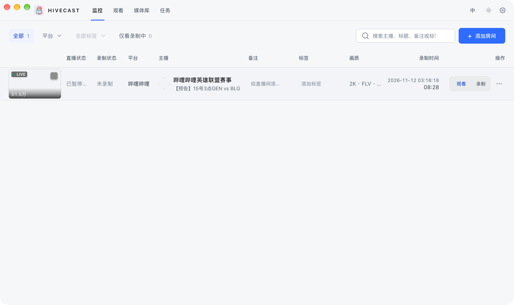
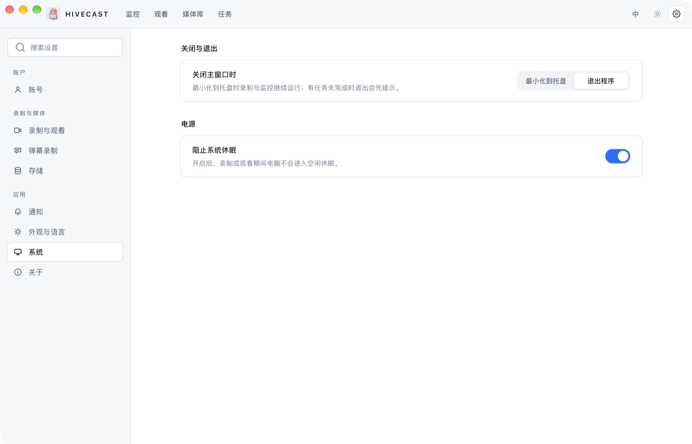
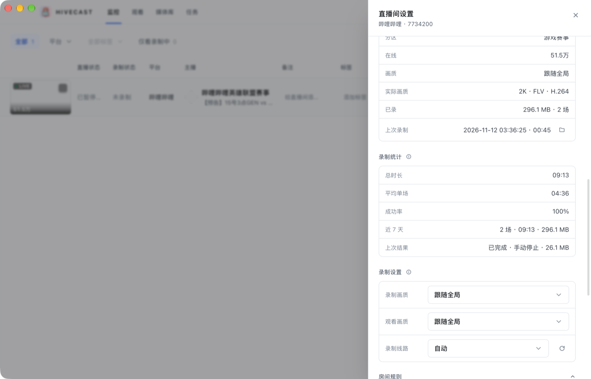
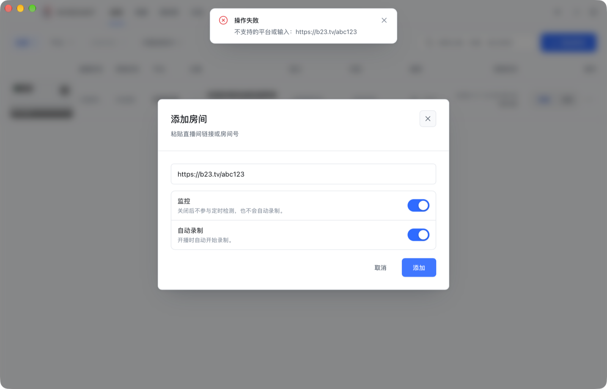

# 144 · B 站审计缺陷修复与真机复验

> 日期：2026-11-12
> 基线：`9f06319 docs: 复查 B 站全平台功能并记录 P0/P1 缺陷`
> 输入：`143-B站全平台功能复查.md` 中的 3 个 P0、7 个 P1 与 P2 风险
> 范围：B 站账号/Cookie、添加直播间、监控与自动录制、画质、房间级设置、设置保存、语言偏好、录制边界
> 排除：弹幕连接与弹幕落盘（沿用 143 的排除项）
> 方法：代码修复 + Rust 单测 + release bundle 真机操作 + SQLite/日志/进程核对

---

## 1. 结论先行

143 报告的 3 个 P0 与 7 个 P1 已全部落到代码，并完成 release 真机复验；P2 按用户要求做了代码层修复，其中可用真机复现的部分已验，依赖特定直播源/平台异常的部分只做到单测与静态核对。

| 编号 | 143 中的问题 | 本轮处理 | 验证方式 |
| --- | --- | --- | --- |
| P0-1 | 短号 6 与真号 7734200 双录 | 以 B 站真实 room_id 作为 room_key；已有短号行 rekey；两边都有时合并 | 真机：添加 6 后 DB 只有 7734200；再添加 6/7734200 都提示已在列表 |
| P0-2 | close_action / prevent_sleep 未保存 | settings::save 补写两个键 | 真机：保存后 DB=quit/true；重启后仍选中「退出程序」且开关为开 |
| P0-3 | 暂停监控仍自动开录 | 自动路径检查 monitor_paused；房间级自动录制开关禁用 | 真机：暂停后 45 秒无新 session；手动「录制」仍可开录 |
| P1-1 | 默认窗口主播列压扁 | 默认 1320×860、minWidth 1180、表格固定列收窄到约 986 | 真机：1180 与系统恢复的 1166 宽下所有列可见 |
| P1-2 | 重复添加假成功 | room_add 返回 created；前端分「已添加/已存在」 | 真机：toast「直播间已在列表中」，DB 仍 1 行 |
| P1-3 | b23.tv 短链失败 | 仅 b23.tv 入口异步跟随 302，限制最终域名与跳转 | 单测 + 真机无效短码错误路径；有效直播短链未找到样本 |
| P1-4 | 房间级入口缺失 | 行菜单/画质单元格打开同一抽屉，补画质、线路、规则 | 真机：抽屉显示实际画质、录制统计、录制/观看画质、线路、房间规则 |
| P1-5 | 实际画质不显示 | room.last_session_quality 回填，表格显示实际值 | 真机：session 2K，表格显示 2K·FLV，tooltip 保留目标 |
| P1-6 | 离开设置自动保存并触发 retention | 本轮按用户要求只分析，不改保存模型 | 分析写入第 7 节 |
| P1-7 | 搜索不匹配平台名 | haystack 加平台名、别名、canonical URL、分区 | 真机：搜索「B站」命中 B 站房间 |
| P2 | confirm 失败伪装成功、AV1 菜单、未知编码、0 字节、语言 system | 逐项修复 | 单测 + 静态；见第 6 节 |

真机结果一句话：**用房间 6 添加后直接得到 7734200，自动录制 2K；重复添加、暂停、手动开录、设置重启、房间级画质、实际画质、平台别名搜索都按预期工作。**

---

## 2. 关键实现

### 2.1 短号/真号去重（P0-1、P1-2）

问题根因是 room 表以 `UNIQUE(platform, room_key)` 去重，而 6 与 7734200 是两个不同的 room_key，平台返回的 `data.room_id` 才是稳定 ID。

修复分三层：

1. `src-tauri/src/platform/mod.rs:50` 的 `RoomInfo` 新增 `stable_id: Option<String>`；B 站 `room_info` 在 `src-tauri/src/platform/bilibili.rs:270` 填入 `data.room_id.to_string()`，其他平台为 `None`。
2. `src-tauri/src/commands.rs:82` 的 `canonical_reference` 把短号引用提升为 stable_id，并把 canonical_url 改成 `https://live.bilibili.com/{stable}`。
3. `room_add` 在查重前先查 canonical，再查旧短号行：
   - 只存在短号行：`rekey_room` 到真号，保留 session/备注/标签；
   - canonical 与短号各一行：`merge_room` 合并备注、标签、auto_record、monitor_paused，迁 record_session 与 task_history，删除重复行；
   - 已存在且未删除：更新房间信息后返回 `created:false`。

`AddRoomResult.created` 由 `src-tauri/ipc-types/src/lib.rs` 定义并生成到 `src/lib/bindings/AddRoomResult.ts`。前端 `AddRoomDialog` 据此显示「直播间已添加」或「直播间已在列表中」，不再无条件成功。

### 2.2 设置保存（P0-2）

`src-tauri/src/settings.rs:404` 与 `:405` 补写：

```rust
db.set_setting(KEY_CLOSE_ACTION, &settings.close_action)?;
db.set_setting(KEY_PREVENT_SLEEP, &settings.prevent_sleep.to_string())?;
```

单测 `save_clamps_and_roundtrips` 从原来的 tray 改成 `CLOSE_QUIT` 与 `prevent_sleep=true`，保存后重新 load 断言，避免再次漏键还能过测试。

### 2.3 暂停监控（P0-3）

暂停的语义按用户确认改为：**停止轮询 + 停止自动录制，手动录制仍可用。**

- `src-tauri/src/monitor.rs:644` 自动开录条件加 `&& !room.monitor_paused`；
- `src-tauri/src/commands.rs:296` 与 `:361` 的自动开录路径同样检查暂停位；
- `room_set_auto_record` 在 `src-tauri/src/commands.rs:349` 拒绝「暂停中开启自动录制」，返回「监控已暂停，恢复监控后才能开启自动录制」；
- MonitorPage 行菜单与详情抽屉的自动录制开关在暂停时禁用；
- 手动 `record_start` 不检查暂停位。

### 2.4 默认窗口与表格（P1-1）

`src-tauri/tauri.conf.json` 默认 1320×860，minWidth 1180。MonitorPage 的列宽改为：

```text
120px 58px 60px 58px minmax(0,1fr) 104px 104px 74px 120px 140px
```

固定列合计约 986px，剩余宽度给主播/标题列。系统若恢复旧窗口尺寸，macOS 可能仍以 1166×749 启动；这个宽度下表头与操作列仍完整，标题按可用宽度省略。

### 2.5 b23 短链（P1-3）

`src-tauri/src/platform/bilibili.rs:573` 的 `expand_short_link`：

- 只处理 host 为 b23.tv 的输入；
- 用 reqwest 默认跟随 302；
- 最终 host 必须是 live.bilibili.com、www.bilibili.com 或 bilibili.com；
- 失败返回 `None`，room_add 回退原输入，错误提示保留用户原始 URL。

不在白名单的域名、解析失败、超时都不会被当作直播间继续请求。

### 2.6 房间级设置（P1-4）

行菜单「直播间设置」不再 toast「即将上线」，而是打开与详情相同的抽屉；表格画质单元格也变成按钮。抽屉已包含：

- 封面、直播状态、标题、主播、canonical URL；
- 观看/开录/刷新；
- 自动录制、监控开关；
- 实际画质、已录场次、上次录制；
- 录制统计（总时长、平均单场、成功率、近 7 天、上次结果）；
- 录制画质、观看画质、录制线路；
- 房间规则：备注、标签、标题包含/排除、分片时长/大小、开播/错误通知。

真机把「录制画质」从跟随全局改为原画后，DB `room.record_qn=10000`，说明不是静态展示。

### 2.7 实际画质（P1-5）

`room` 表新增 `last_session_quality TEXT`（`src-tauri/src/db.rs:2057`）。迁移时为已有房间回填最近 session 的 quality；`refresh_room_last_session` 每次录制结束后同步更新。

MonitorPage 画质列优先显示 `room.lastSessionQuality`，没有才显示目标档位；tooltip 同时保留「实际/目标」。这样「目标原画、实际 2K」不会再伪装成「跟随全局」。

### 2.8 搜索（P1-7）

`src/features/monitor/MonitorPage.tsx:678` 起的搜索 haystack 增加：

- platform 显示名；
- 平台别名（bilibili 含「b站 bilibili 哔哩哔哩」）；
- canonical_url；
- area_name。

真机在搜索框输入「B站」，房间仍保留，结果为「全部 1」。

### 2.9 设置自动保存与 retention（P1-6，只分析）

当前设计是：离开设置时若 dirty，先静默保存再切页；保存成功后出现 8 秒 UndoToast，撤销会整份回写旧 settings。

风险不在「自动保存」本身，而在 `settings.rs` 保存末尾无条件调用 `retention::enforce_from_settings(db)`。retention 对超期/超容量文件执行 `std::fs::remove_file`，不是移入回收站；撤销只能恢复设置，不能恢复已经删除的录像。

本轮按用户要求**没有改这条链路**。后续若要收敛，建议把 retention 从 save 拆成独立的 preview/apply，或在自动保存路径跳过删除，只更新策略。

### 2.10 P2 修复

| 项 | 实现 |
| --- | --- |
| confirm 失败仍保存新 Cookie | `RefreshOutcome::ConfirmFailed`；写入 `confirm_failed` 与「Cookie 已轮换，但确认续期失败；若之后提示未登录，请重新扫码」；仍推进 last_refreshed_at |
| AV1 菜单与录制不一致 | `recordingCodecSupported` 过滤录制档位；观看仍用 `videoCodecSupported` |
| 未知编码不触发 v2 | `container_changed` 改为 codec 或 format 任一变化即分段 |
| 0 字节 finished | `empty_recording_failure` 把 0 字节 finished 降级 failed/reason=empty，error「录制没有产生任何数据」 |
| 语言「跟随系统」 | 新增 `detectSystemLanguage` 与 `setLanguagePreference("system")`；localStorage 可保存 system，启动/保存/撤销都按偏好解析 |

---

## 3. 测试环境

| 项 | 值 |
| --- | --- |
| 应用 | release bundle，`src-tauri/target/release/bundle/macos/HIVECAST.app` |
| 基线 | `9f06319` + 本轮未提交改动 |
| 窗口 | 1180×700、系统恢复的 1166×749、1320×800 都测过 |
| 屏幕 | 1355×851（逻辑） |
| 账号 | B 站「执事只食芝士」uid 352130563，Cookie 635 字符，status=ok |
| 数据库 | `~/Library/Application Support/com.hivecast.desktop/hivecast.db` |
| 日志 | `~/Library/Logs/com.hivecast.desktop/hivecast-2026-11-12.log` |
| 截图 | 窗口截图 2332×1498 / 2360×1400，OCR 用原图像素坐标 |

---

## 4. 真机复验

### 4.1 短号归一与重复添加

操作：监控 → 添加房间 → 输入 `6` → 添加。

结果：

- DB `room.room_key=7734200`，`id=b20eebfb-f63a-4d22-8b1e-5940e185490a`；
- 自动开录 session `7ce6c89c-a614-4a14-8ba4-3860591543f3`，quality「2K · FLV · H.264」；
- 表格主播、标题、平台、备注、标签、画质、录制时间、操作全部可见。

再添加 `7734200`：toast「直播间已在列表中 / 哔哩哔哩英雄联盟赛事」，DB 仍只有 1 行。
再添加 `6`：同样提示已在列表，DB 仍 1 行，证明短号不会再生成第二条。


### 4.2 暂停监控与手动录制

行菜单 →「停止监控」后：

- DB `monitor_paused=1`、`auto_record=1`、`is_live=1`；
- 等待 45 秒，没有新 record_session，也没有 ffmpeg 分片进程；
- 行内按钮从「停止」变为「录制」，说明手动入口仍开放。

点「录制」后新 session `da94722b-3f7d-4aaa-a01a-ac158c5036af`，status=recording，quality 2K；点停止后 finished/stopped，file_size=27,342,808。即暂停只拦自动路径，不拦手动。



### 4.3 关闭行为与防休眠保存

设置 → 系统：

- 关闭主窗口时选「退出程序」；
- 打开「阻止系统休眠」；
- 点底部「保存」。

DB 立即变为：

```text
app.close_action|quit
app.prevent_sleep|true
```

日志出现 `应用运行时设置 ... prevent_sleep=true`。杀掉应用再启动，系统页仍选中「退出程序」、开关仍为开，证明不是只改了前端状态。

随后用辅助功能点击窗口关闭按钮，进程退出（`APP QUIT`），证明 close_action=quit 生效。



### 4.4 房间级设置与实际画质

行菜单 →「直播间设置」打开抽屉，首屏显示封面、主播、canonical URL、观看/开录/刷新；向下滚动看到：

- 画质：目标「跟随全局」，实际「2K · FLV · H.264」；
- 已录 2 场、上次录制 2026-11-12 03:36:25 · 00:45；
- 录制统计：总时长 09:13、平均单场 04:36、成功率 100%；
- 录制画质/观看画质/录制线路；
- 房间规则与「保存规则」。

把录制画质改为「原画」后 DB `room.record_qn=10000`；选项列表包含杜比、4K、2K、原画、蓝光、超清、高清、流畅，并对不可用档位标「当前不可用」。



### 4.5 搜索平台别名

搜索框输入「B站」，房间仍显示，计数为「全部 1」；清空后恢复。说明平台别名已进入 haystack，不再只匹配标题/主播/房间号/备注/标签。

### 4.6 b23 无效短码

输入 `https://b23.tv/abc123` 后添加，toast 为「操作失败 / 不支持的平台或输入：https://b23.tv/abc123」，弹窗不关闭，DB 仍 1 行。

这条只证明失败路径不再把输入改写成不可读的乱码、也不会误加房间；**有效 b23 直播短链未拿到真实样本，展开成功路径目前只有单测覆盖**。



---

## 5. 单测与静态检查

| 检查 | 结果 |
| --- | --- |
| `cargo test --lib` | 281 passed / 0 failed / 17 ignored |
| `cargo check --all-targets` | 0 错误；仅既有 `credential.rs:66 is_ok` 未使用警告 |
| `pnpm exec tsc -b` | 通过 |
| `pnpm run check:i18n` | 761 keys |
| `pnpm run check:docs` | 随本文件增至 145 files |
| `pnpm build` | 通过 |
| `pnpm app:build` | 30.80 MiB release bundle |

新增/调整的关键单测：

- `canonical_reference_promotes_bilibili_short_id`：短号提升为真号，无 stable_id 时不变；
- `only_b23_is_treated_as_short_link`：只有 b23.tv 进入展开；
- `save_clamps_and_roundtrips`：close_action/prevent_sleep 回读；
- `refresh_status_records_results_and_keeps_last_rotation` 增加 confirm_failed 分支；
- `zero_byte_finished_recording_is_downgraded`：0 字节 finished 降级 failed；
- `container_change_only_when_codec_or_format_really_differs`：codec/format 任一变化才分段。

---

## 6. 覆盖边界

以下项目本轮**没有**拿到真实平台样本，只能算代码与单测通过：

- 有效 b23 直播短链的 302 展开；
- 只有 AV1 编码的真实直播间（录制菜单过滤已单测）；
- 平台 confirm 接口真实失败但 refresh 成功的场景；
- 真实 0 字节录制（用单测构造）；
- 语言「跟随系统」在 OS 语言与上次选择不同时的行为（本机 OS 为中文，无法切换系统语言做 A/B）。

以下项目本轮按用户要求只分析、未改代码：

- 离开设置自动保存 + retention 删除旧录像；
- 撤销整份 settings 快照。

---

## 7. 文件索引

| 文件 | 改动 |
| --- | --- |
| `src-tauri/src/platform/mod.rs` | RoomInfo.stable_id |
| `src-tauri/src/platform/bilibili.rs` | stable_id、expand_short_link、is_short_link、单测 |
| `src-tauri/src/commands.rs` | canonical_reference、room_add 去重/合并、暂停检查、b23 展开 |
| `src-tauri/src/db.rs` | last_session_quality 迁移/回填、rekey_room、merge_room |
| `src-tauri/src/monitor.rs` | 自动开录跳过暂停房间 |
| `src-tauri/src/settings.rs` | close_action/prevent_sleep 保存 |
| `src-tauri/src/account.rs` | ConfirmFailed 结果 |
| `src-tauri/src/recorder.rs` | AV1 门禁、未知编码分段、0 字节降级 |
| `src-tauri/ipc-types/src/lib.rs` | AddRoomResult、RoomRecord.last_session_quality |
| `src-tauri/tauri.conf.json` | 默认 1320×860、minWidth 1180 |
| `src/features/monitor/AddRoomDialog.tsx` | created 分支 toast |
| `src/features/monitor/MonitorPage.tsx` | 列宽、搜索、房间设置抽屉、实际画质、AV1 菜单 |
| `src/features/settings/AccountSection.tsx` | confirm_failed 文案 |
| `src/features/settings/SettingsView.tsx` | 语言偏好保存 |
| `src/i18n/index.ts` | detectSystemLanguage、setLanguagePreference |
| `src/lib/codecSupport.ts` | recordingCodecSupported |
| `src/lib/ipc.ts` | roomAdd 返回 AddRoomResult |
| `src/lib/bindings/AddRoomResult.ts` | 新生成绑定 |

---

## 8. 变更日志

| 日期 | 版本 | 内容 |
| --- | --- | --- |
| 2026-11-12 | v1.0 | 143 审计的 3 P0 + 7 P1 + P2 修复落地；release 真机复验短号去重、重复添加、暂停/手动录制、设置重启、房间级画质、实际画质、平台别名搜索；记录有效 b23/AV1/0 字节/confirm 失败的覆盖边界 |
