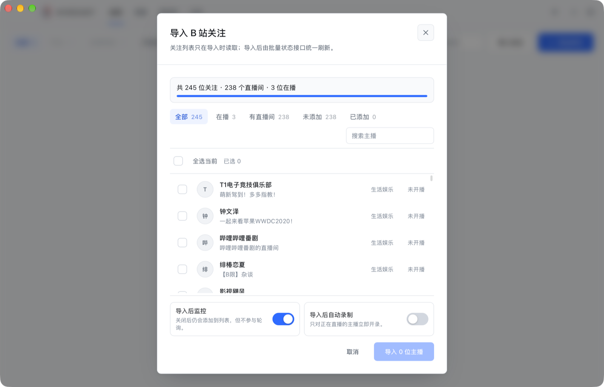
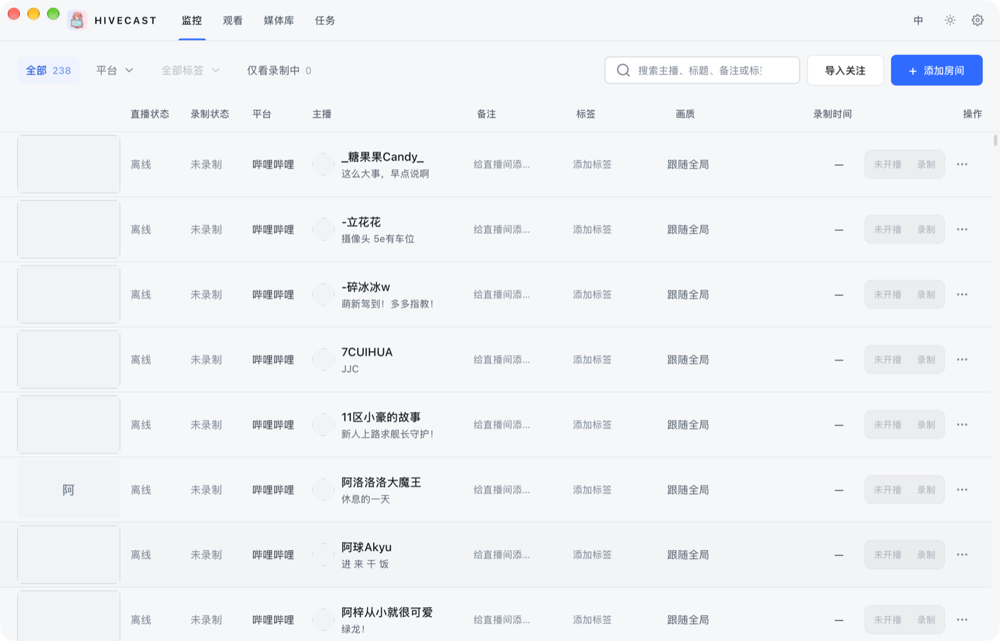
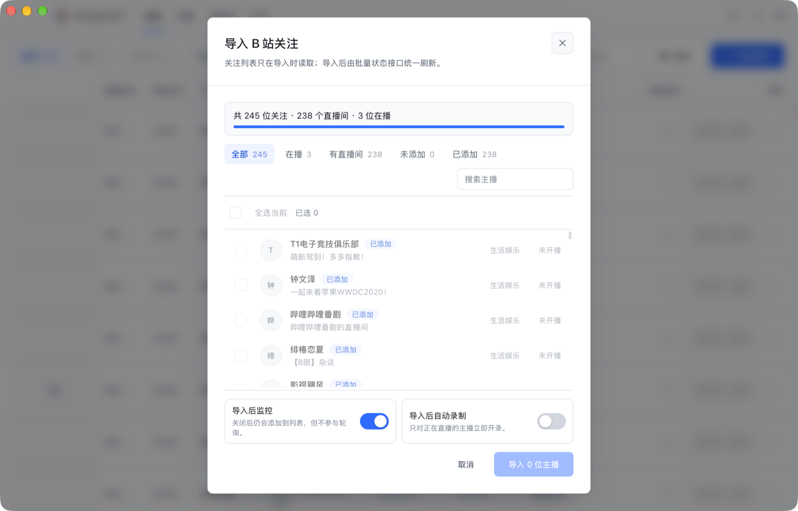
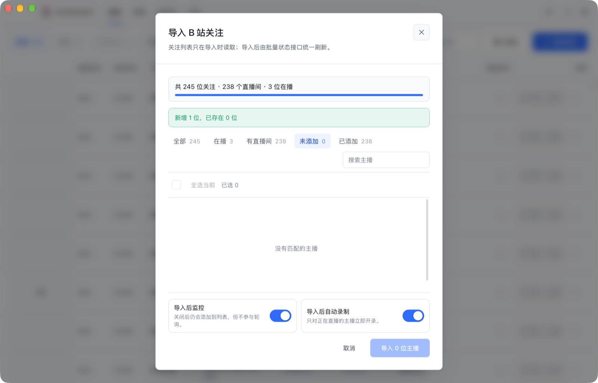

# 145 · B 站关注导入与批量状态轮询

> 日期：2026-11-12
> 基线：`0257384 fix(bilibili): 修复审计发现的重复录制与设置失效`
> 输入：用户要求补全 B 站关注导入，并提供批量状态轮询与兜底
> 范围：B 站关注列表读取、直播状态批量查询、监控导入、批量检测调度与失败回落
> 排除：弹幕连接与弹幕落盘、非 B 站平台的关注体系
> 方法：Rust 实现 + 单测 + release bundle 真机 + SQLite/日志/进程核对
> 后续：`146` 审计了 10 项并修复关注导入字符串 UID 入库为空；本文 §2.1 与 §5.4 已同步修正。

---

## 1. 结论先行

本轮把「关注列表」接成了监控房间的第二条入口：可以一次拉取当前 B 站账号的全部关注，按在播/有直播间/未添加筛选，全选后批量导入；导入只写本地库，不逐主播请求 B 站。导入后的监控检测不再让 238 个房间各发一次请求，而是共用一个批量状态接口，每个周期只发一次（超过 200 个 UID 才分片）。

| 能力 | 实现 | 真机结果 |
| --- | --- | --- |
| 关注列表 | `/x/relation/followings`，每页 50，前端翻页 | 245 位关注全部读出 |
| 直播状态 | `POST /room/v1/Room/get_status_info_by_uids`，单次 ≤200 UID | 238 个直播间一次查询 |
| 导入去重 | 真实 room_id + platform_uid 双键；软删恢复；短号 rekey/merge | 二次导入「未添加 0」 |
| 导入开关 | 监控、导入后自动录制 | 自动录制真实开录并正常收尾 |
| 批量轮询 | 独立批次节奏，批量房间不再单独出门 | 238 行 `last_checked_at` 完全相同 |
| 缺失 UID 兜底 | 批量结果没有该 UID 时回退单房间检查 | 伪 UID 被恢复为真实 UID |
| 整批失败兜底 | 在播/录制中的房间单查，其余等下个批次重试 | 代码路径 + 单测，未制造真实批量故障 |

核心原则：**批量接口只用来省请求，不用来猜状态**。批量没返回某个 UID 不等于离线；整批失败更不能把 238 个房间一起标成离线。

---

## 2. 数据模型

### 2.1 room 新增 `platform_uid`

`room` 表新增可空列 `platform_uid TEXT`（db.rs:21、db.rs:2049-2052 迁移）。它保存平台账号 UID，B 站批量状态接口按 UID 查询；其它平台留空。

写入点：

- 单房间添加：`room_add` 从 `RoomInfo.extra.uid` 取 UID，写入 `RoomRecord.platform_uid`（commands.rs:220）。
- 监控刷新：`update_room_info` 用 `platform_uid = COALESCE(?11, platform_uid)`，只补不清（db.rs:520）。
- 关注导入：由关注列表的 `uid` 直接写入 draft，`insert_room` 在平台信息没有 UID 时回落到 draft 的 `platform_uid`。
- 旧行：迁移只加列，不回填；UID 为空的房间走单房间检查，第一次刷新会从 `RoomInfo.extra.uid` 补上，之后进入批量。

`platform_uid_of` 同时接受 `extra.uid` 的数字和字符串形式（db.rs:2243-2262）：数字走 `as_i64`，字符串 trim 后解析，只接受正整数，避免把空串或 0 写进库。关注导入写入的是字符串 UID，必须支持这一形式，否则导入的房间第一轮会漏掉批量。

### 2.2 导入相关 IPC 类型

定义在 `src-tauri/ipc-types/src/lib.rs`：

| 类型 | 字段 | 用途 |
| --- | --- | --- |
| `FollowingUser` | uid、uname、avatarUrl | 关注列表一项 |
| `FollowingPage` | total、page、pageSize、items | 一页关注 |
| `LiveStatus` | uid、roomId、shortId、uname、title、avatarUrl、coverUrl、areaName、isLive、online | 批量状态一项 |
| `ImportRoomInput` | 上述展示字段 + uid/roomId | 前端提交的导入快照 |
| `ImportFailure` | uid、uname、message | 单条失败，不阻断其它条目 |
| `ImportRoomsResult` | added、existing、failed[] | 导入结果 |

`roomId` 为 `None` 表示该关注没有直播间；`LiveStatus.online` 为 `None` 表示平台给了负数或缺失，不显示 0 人。

### 2.3 前端绑定

`pnpm gen:bindings` 生成：

- `src/lib/bindings/FollowingPage.ts`
- `src/lib/bindings/FollowingUser.ts`
- `src/lib/bindings/LiveStatus.ts`
- `src/lib/bindings/ImportRoomInput.ts`
- `src/lib/bindings/ImportFailure.ts`
- `src/lib/bindings/ImportRoomsResult.ts`
- `RoomRecord.ts` 增加 `platformUid: string | null`

`src/lib/ipc.ts` 暴露 `bilibiliFollowings(page)`、`bilibiliFollowStatuses(uids)`、`roomsImport(items, monitor, autoRecord)`。

---

## 3. 关注列表与批量状态接口

### 3.1 关注列表

`fetch_followings(uid, page)`（bilibili.rs:674-696）：

```
GET https://api.bilibili.com/x/relation/followings
    ?vmid=<当前登录 UID>&pn=<page>&ps=50&order=desc&order_type=attention
Referer: https://space.bilibili.com/
```

- 当前账号 UID 从 `credential` 表取，空 UID 报「未登录 B 站，请先在设置中登录」（commands.rs:254-263）。
- 每页固定 50，过滤 `mid <= 0` 的脏项。
- 返回 `total` 用于前端计算页数；实际列表短于 total 时前端继续翻页直到空页/末页。
- 关注列表隐藏或接口返回 -101 时，统一翻译成「B 站登录已失效，请重新扫码登录」（commands.rs:265-272）。

### 3.2 批量直播状态

`fetch_live_statuses(uids)`（bilibili.rs:715-739）：

```
POST https://api.live.bilibili.com/room/v1/Room/get_status_info_by_uids
Content-Type: application/json
Referer: https://live.bilibili.com
Origin: https://live.bilibili.com

{"uids":["352130563","1794315001", ...]}
```

- UID 先 trim、去空、排序、去重。
- 每片最多 200 个（`STATUS_CHUNK`，bilibili.rs:597）；238 个房间仍是一片。
- 每片失败后等 400ms 重试一次；仍失败则整次返回第一个错误，由监控层做整批降级。
- 响应是以 UID 为键的对象；条目缺 `uid` 时用对象键兜底（`status_from_item`，bilibili.rs:653-671）。
- `live_status == 1` 才是在播；`online < 0` 映射为 `None`。
- `live_time` 是 Unix 秒（实测与单房间 `get_info` 一致，0 表示没有开播时间），映射到 `LiveStatus.started_at`。快速下播重开时，只有这个字段能让监控识别出「新一场」，避免沿用旧开播时间。

单测 `maps_batch_status_and_falls_back_to_the_uid_key`（bilibili.rs:911-963）覆盖：

- 条目 uid=0 时用键；
- room_id=0 时返回 None；
- short_id 保留；
- cover_from_user 优先、keyframe 兜底；
- face 为空时 avatar None；
- online=-1 时 None；
- live_status=1/0 的布尔映射；
- 显式 uid 优先于键。

---

## 4. 导入流程

### 4.1 打开弹窗

`src/features/monitor/ImportFollowsDialog.tsx`：

1. 拉第 1 页关注，按 total/pageSize 计算页数；
2. 第 2 页起每页间隔 180ms，避免瞬时连打；
3. 全部拿到后一次调用 `bilibiliFollowStatuses(all.map(uid))`；
4. 状态按 uid 建成 Map，进入 ready。

加载态分 `follows` / `status` / `ready` / `followError` / `statusError`。关注列表失败可整轮重试；状态失败只重试批量状态，不重拉关注。

### 4.2 筛选与去重

前端用当前监控列表构造两个集合：`roomKey` 与 `platformUid`。一条关注满足任一条件即视为已添加：

- `uid` 命中 `platformUid`；
- `status.roomId` 命中 `roomKey` 或 `platformUid`；
- `status.shortId` 命中 `roomKey`。

筛选项：全部 / 在播 / 有直播间 / 未添加 / 已添加；搜索匹配主播名与直播间标题。只有「有 roomId 且未添加」的行可选，已添加与无直播间行禁用。

全选只作用于当前筛选下可导入的行；已选数量实时显示，可一键清空。

### 4.3 导入开关

- 「导入后监控」默认开；关闭时所有导入房间写 `monitor_paused=1`，并强制自动录制为关，自动录制开关同时禁用并提示「需要先开启监控」。
- 「导入后自动录制」默认关；只有监控开时才可为真。
- 后端再做一次收敛：`auto_record = monitor && auto_record.unwrap_or(false)`（commands.rs:303），不信任前端的组合。

### 4.4 后端写入（commands.rs:298-470）

导入只写本地库，**不逐房间请求平台**。每条：

1. 校验 room_id 非空；为空直接进 `failed`，不建离线房间。
2. 先按 `(bilibili, room_id)` 查已有行。
3. 再按 `(bilibili, platform_uid)` 查短号/旧 UID 行：
   - 只命中 UID 行：把该行 rekey 到真实 room_id；
   - 两个不同行都命中：`merge_room` 合并，再 rekey 到真实 room_id。
4. 已有且未软删：只 `update_room_info` 刷新标题/主播/封面/分区/在播/在线与 UID；**不覆盖** record_qn、view_qn、record_line、备注、标签、标题规则、分割规则、自动录制、监控暂停。
5. 已有但已软删：用当前导入开关恢复，`added += 1`；在播且自动录制为真时加入待开录列表。
6. 不存在：新建 `RoomRecord`，`record_qn=0`（跟随全局）、`view_qn=默认观看画质`、`last_checked_at=now`，写入平台 UID 与展示字段。
7. 全部处理完发一次 `EVENT_ROOMS_CHANGED`，日志 `批量导入关注 added existing failed`。
8. 对需要自动录制的房间逐个 `start_checked`；某个失败只写该房间错误，不影响其它房间。

去重键仍以真实 room_id 为主，platform_uid 是兜底；这与 144 的「短号归一到真实 room_id」保持一致，避免导入后又出现短号/真号双行。

### 4.5 结果展示

- 部分失败：顶部黄色结果条显示 added/existing 与失败数，toast 用第一条失败原因做 warning。
- 全部成功：toast「导入完成」，正文「新增 N 位，已存在 M 位」。
- 结果条保留在弹窗内，用户可继续选下一批；已导入项立即变为「已添加」并禁用。

---

## 5. 监控批量检测

### 5.1 为什么需要独立节奏

旧监控是每个房间各自 `next_at`，即使 238 个房间的间隔相同，也会因为抖动与排期分散成 238 次请求。批量接口必须让所有房间共用一次请求，因此不能跟着单房间排期走。

`monitor.rs` 新增 `batch_at: Option<Instant>` 与 `batch_interval: Option<i64>`：

- 首次批次时间 = now + `spread("batch:bilibili", base)`，与单房间一样做平台内散开；
- 之后每个周期 `now + base` 再加 jitter，且不早于 now+1s；
- 用户修改监控间隔后，`batch_interval` 与设置不一致会立即按新间隔重排，不会沿用旧节奏；
- 一批还在途时，空批次不会每拍把 `batch_at` 往后推；一批结束后才排下一批；
- 关闭自动检测时 base=0，函数在更早处已返回，不会留下 0 秒批次。

### 5.2 哪些房间走批量

`room.platform == "bilibili"` 且 `platform_uid` 非空（monitor.rs:490-493）。

- 可批量：在批次到点时把房间放进 `batch_rooms`，设 `inflight=true`，然后 `continue`，**不再走单房间请求**；不在批次点时也继续跳过，保持排期但不单独出门。
- 不可批量（其它平台、UID 缺失的旧行）：沿用原单房间路径。
- `monitor_paused` 的房间在最前面已跳过，不参与批量。

### 5.3 一次批次做什么（monitor.rs:589-668）

1. 收集这批房间的 UID，调用 `fetch_live_statuses`。
2. 成功：按 uid 建 Map，逐房间：
   - 命中：把 `LiveStatus` 映射成统一的 `RoomInfo`，走 `check_room_info`；
   - 未命中：**回退单房间 `run_check`**，不按离线处理。
3. 失败：
   - 收集 `room.is_live || recorder.is_recording(room.id)` 的关键房间，逐个单查；
   - 其余房间发 `Outcome::Retry(10)`，不写状态、不拉长到小时级退避；批量房间不按单房间 `next_at` 出门，实际会在下个批次再查，单房间才在 10 秒后重试；
   - 日志 `B 站批量状态失败，降级单房间检查 rooms=... critical=... elapsed_ms=...`。
4. 任务用 `tokio::spawn` 包一层 guard；整批 panic 时只给尚未回传结果的房间补 `Outcome::Failed`，避免 `inflight` 卡住，又不把已经成功落库的房间重复计一次失败。
5. 成功批次日志 `B 站批量状态检查开始` 与 `B 站批量状态检查完成 rooms=... uids=... returned=... live=... missing=... elapsed_ms=...`；缺失 UID 另有一条 DEBUG。

### 5.4 状态映射（monitor.rs:679-718）

`batch_room_info` 把批量状态映射为 `RoomInfo`：

- uname/title 为空时保留本地旧值；
- avatar/cover/area 优先用批量接口，缺失回落本地；
- `stable_id` 优先真实 room_id，否则 room_key；
- `started_at` 优先用批量接口的 `live_time`；缺失时，只有本地上一轮在播才沿用旧值，否则为 None。这样快速下播重开也会拿到新的开播时间；
- `extra` 写入 uid/roomId/shortId/liveStatus，后续 `update_room_info` 可回填 platform_uid。

### 5.5 与自动录制共用收尾

单房间与批量都走 `check_room_info`（monitor.rs:805 起），因此以下判断只有一份：

- 结构性字段变化才整行写库；
- 在线人数节流写库；
- 在播时清离线计数、判断新一场、检查自动录制门禁（含 `monitor_paused`、失败冷却、开录冷却、收尾中）；
- 确认离线两次才停录；平台报离线但文件仍增长时暂不停。

这避免了「单房间路径修了、批量路径忘了」的分叉。

---

## 6. 真机验收

环境：release bundle 31.07 MiB，真实账号「执事只食芝士」uid 352130563，Cookie 有效；DB 初始为空库。

### 6.1 245 关注 / 238 直播间

打开「导入关注」后：245 位关注、238 个直播间、3 位在播、7 个没有直播间。筛选「未添加」全选 238，监控开、自动录制关。



导入结果：

- 日志 `2026-11-12 10:34:36 INFO hivecast_lib::commands: 批量导入关注 added=238 existing=0 failed=0`；
- DB `room=238`，全部有 `platform_uid`，`monitor_paused=0`、`auto_record=0`；
- `record_session=0`，没有因为导入误开录；
- 从点击到完成约 16 秒；期间 8 秒采样只看到 101 行，是写入进行中，不是丢数据。



### 6.2 批量轮询证据

导入后两次查询：

```sql
SELECT COUNT(DISTINCT last_checked_at), MIN(last_checked_at), MAX(last_checked_at) FROM room;
```

结果：`count(distinct)=1`，两次采样分别是 1794451109 与 1794451209。238 个房间在同一秒被刷新，间隔约 100 秒，说明是一次批量接口，不是 238 个独立请求。

### 6.3 缺失 UID 兜底

把房间 24139174（T1电子竞技俱乐部）的 `platform_uid` 改成 `999999999`、`last_checked_at=1`，等下一轮：

- 行恢复为真实 uid `594558993`；
- `last_checked_at=1794451209`，与其余 237 行同一时间；
- 说明批量结果没有这个伪 UID 时走了单房间 `run_check`，且 `update_room_info` 从 `info.extra.uid` 回填。

### 6.4 重复导入

238 个导入后再开弹窗：全部 245、未添加 0、已添加 238；可导入项全部禁用。证明前端 existing 判定覆盖 roomKey、platformUid、status.roomId、status.shortId 四种情况。



### 6.5 导入即自动录制

把已软删的 live 房间 5055636（哔哩哔哩会员购）恢复为未添加，打开「导入后自动录制」导入：

- room 恢复，`auto_record=1`、`is_live=1`；
- 立即生成 session `d88c7d39-9a77-40d8-aec1-3581582dcd13`，状态 recording；
- quality「原画 · FLV · H.264」，ffmpeg `-c copy -f segment -segment_time 60 -segment_format mpegts`；
- 手动停止：`file_size=29,943,752`、`duration_ms=126,000`、`post_state=done`，分片合并 3 段，缩略图后台完成。



### 6.6 关闭监控导入

再次软删 5055636，重启后导入时关闭「导入后监控」：

- DB `auto_record=0`、`monitor_paused=1`、`is_live=1`；
- 没有新 session、没有 ffmpeg；
- 自动录制开关在 UI 上禁用并提示需要先开监控。

### 6.7 清理

验收结束后删除测试房间、session、media_file、task_history 与录制目录，清理 Caches/{play,view,thumbs} 和 DB -wal/-shm；最终 `room=0`、`record_session=0`，保留真实 credential。

---

## 7. 边界与已知限制

| 边界 | 现状 | 说明 |
| --- | --- | --- |
| 关注列表隐私 | 依赖账号可见性 | 隐藏关注或接口 -101 时提示重新登录；没有绕过 |
| 关注总数变化 | 打开弹窗时快照 | 导入期间新关注不会出现，重新打开即可 |
| 关注列表分页 | 前端串行翻页 | 每页 180ms；大账号仍是 N 次关注接口，但状态只批量一次 |
| 批量接口上限 | 200 UID/片 | 超过会串行分片，仍是每周期少量请求 |
| 批量结果缺失 UID | 单房间兜底 | 兜底成本与缺失数量成正比；缺失多时这一批会变慢 |
| 整批失败 | 关键房间单查，其余下个批次重试 | 未真机制造批量故障，只有代码路径与单测；`Retry(10)` 对批量房间不决定实际时机 |
| 导入信任边界 | 后端信任前端提交的快照 | 本地单用户应用可接受；未逐条复核关注关系 |
| 非 B 站平台 | 不支持关注导入 | 接口与 UI 均未接 |
| 弹幕 | 不在本轮范围 | 导入房间的弹幕行为沿用原逻辑 |

### 7.1 没有做的事

- 没有把关注列表做成长期同步：关注变化不会自动增删本地房间。
- 没有在导入时校验房间是否仍存在：以状态接口返回的 room_id 为准，后续监控失败会走原有错误提示。
- 没有给导入加进度条以外的取消：请求本身很快，未做中断令牌。

---

## 8. 文件索引

### 后端

- `src-tauri/src/commands.rs:254` `bilibili_uid`
- `src-tauri/src/commands.rs:265` `map_bilibili_error`
- `src-tauri/src/commands.rs:275` `bilibili_followings`
- `src-tauri/src/commands.rs:287` `bilibili_follow_statuses`
- `src-tauri/src/commands.rs:298` `rooms_import`
- `src-tauri/src/platform/bilibili.rs:596` `FOLLOW_PAGE_SIZE` / `STATUS_CHUNK`
- `src-tauri/src/platform/bilibili.rs:653` `status_from_item`
- `src-tauri/src/platform/bilibili.rs:674` `fetch_followings`
- `src-tauri/src/platform/bilibili.rs:715` `fetch_live_statuses`
- `src-tauri/src/platform/http.rs:354` `post_json`
- `src-tauri/src/monitor.rs:139` `batch_at`
- `src-tauri/src/monitor.rs:490` 批量房间筛选
- `src-tauri/src/monitor.rs:589` `run_batch_check`
- `src-tauri/src/monitor.rs:679` `batch_room_info`
- `src-tauri/src/monitor.rs:805` `check_room_info`（单房间与批量共用）
- `src-tauri/src/db.rs:21` room.platform_uid
- `src-tauri/src/db.rs:387` `find_room_by_uid`
- `src-tauri/src/db.rs:2049` 迁移
- `src-tauri/src/db.rs:2243` `platform_uid_of`

### 前端

- `src/features/monitor/ImportFollowsDialog.tsx`
- `src/features/monitor/MonitorPage.tsx` 入口按钮与弹窗挂载
- `src/lib/ipc.ts` 三个命令封装
- `src/lib/bindings/FollowingPage.ts` 等生成类型
- `src/i18n/zh-CN.json` / `en-US.json` 的 `monitor.importFollow.*`

### 单测

- `src-tauri/src/platform/bilibili.rs:911` `maps_batch_status_and_falls_back_to_the_uid_key`
- `src-tauri/src/monitor.rs:1028` `batch_status_keeps_local_fallbacks_and_only_reuses_a_known_start_time`

---

## 9. 复现步骤

1. 登录 B 站账号，确认设置→账号显示「已登录」。
2. 监控页点「导入关注」。
3. 等待关注列表与状态加载完成。
4. 选「未添加」，按需全选；决定是否开启监控/自动录制。
5. 点「导入 N 位主播」。
6. 用以下 SQL 检查结果：

```sql
SELECT COUNT(*) FROM room;
SELECT COUNT(*) FROM room WHERE platform_uid IS NULL OR platform_uid='';
SELECT COUNT(DISTINCT last_checked_at) FROM room;
SELECT COUNT(*) FROM record_session;
```

7. 导入后等一个监控周期，确认 `COUNT(DISTINCT last_checked_at)=1`。

---

## 10. 变更日志

| 日期 | 版本 | 变更 |
| --- | --- | --- |
| 2026-11-12 | v1.0 | 关注导入与批量状态轮询落地：platform_uid、关注/状态接口、导入去重与软删恢复、导入开关、B 站独立批次、缺失 UID 与整批失败兜底；release 真机 245 关注/238 房间、批量时间戳一致、自动录制与关闭监控导入验收 |
| 2026-11-12 | v1.1 | 复查修订：`live_time` 映射 started_at；改监控间隔立即重排批次；在途批次不推后 `batch_at`；panic 只补未回传；导入优先保留 active 行并合并画质/线路/过滤/通知设置；补批次与导入结构化日志 |
