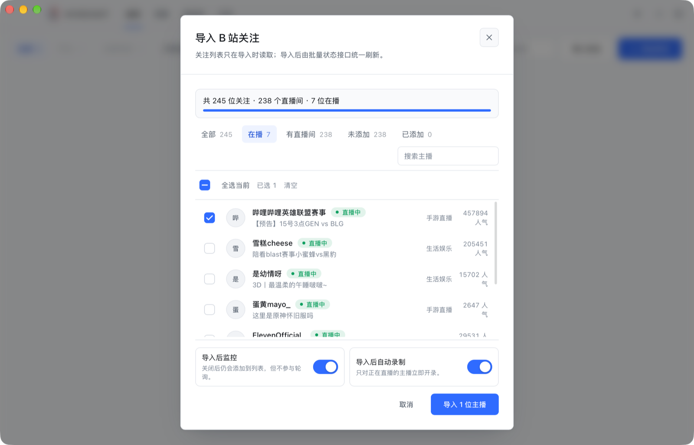
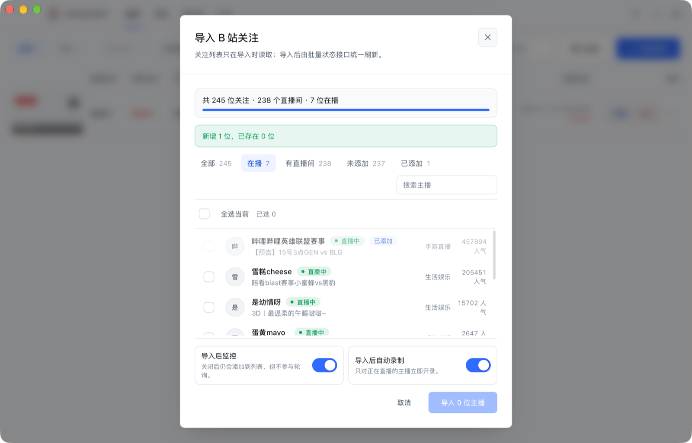
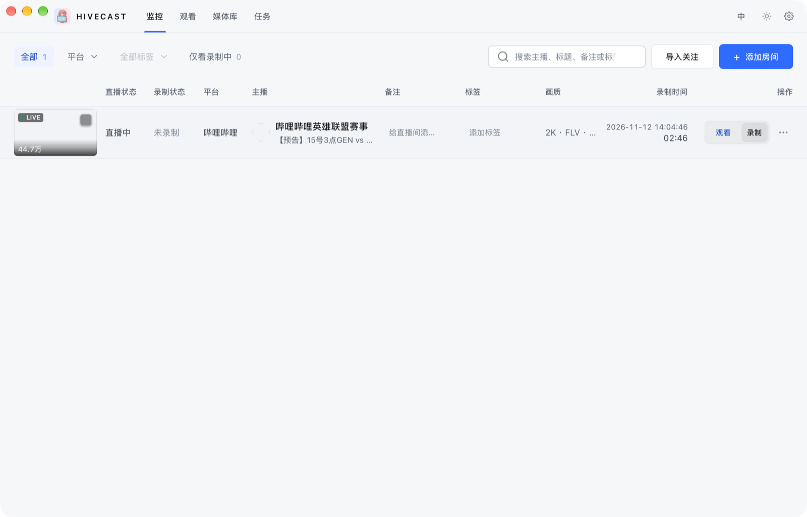

# 146 · 关注导入与批量轮询审计

> 日期：2026-11-12
> 输入：用户要求确认关注导入、批量轮询、Cookie 各状态、兜底与日志等 10 项（m49240）
> 范围：B 站关注导入、监控批量状态检测、导入即自动录制、移除/恢复、Cookie 降级与结构化日志

## 1. 结论先行

| # | 检查项 | 结果 | 关键证据 |
| --- | --- | --- | --- |
| 1 | 导入去重 | ✅ 通过 | 再次打开导入弹窗显示「已添加 1」；238 房间二次导入「未添加 0」 |
| 2 | 监控/录制取数 | ✅ 通过 | 导入即开录 `2K · FLV · H.264`，94,441,531 B / 166 s，分片 3 个合并完成 |
| 3 | Cookie 各状态 | ✅ 通过（有边界） | 有效 Cookie 正常；无 Cookie 批量仍工作；失效 Cookie 监控/录制降级匿名 250，账号标 expired |
| 4 | 30 秒轮询 | ✅ 通过 | 批次间隔 33 s / 34 s / 33 s（30 s + 抖动），每批只发一次请求 |
| 5 | 缺失 UID 兜底 | ✅ 通过 | 伪 UID 999999999 经单房间检查恢复真实 UID 594558993 |
| 6 | 未关注新增 | ✅ 通过 | 直接添加的未关注房间有 UID 后进入批量；旧行缺 UID 时单查回填后入批 |
| 7 | 先添加后导入 | ✅ 通过 | 真实 room_id / platform_uid 双键合并，保留已有房间设置 |
| 8 | 移除后重新导入 | ✅ 通过 | 导入日志 `restored=1`，软删标记清除，platform_uid 保留，自动录制立即开录 |
| 9 | 其它边界 | ✅ 通过（代码/单测） | 200 UID 分片、整批失败只单查关键房间、暂停监控跳过、离线 started_at |
| 10 | 日志 | ✅ 通过 | 导入与批次均有 total/added/restored/rooms/uids/returned/live/missing/elapsed_ms |

本轮发现并修复 1 个导入链路缺陷：**关注导入写入字符串 UID，但 `platform_uid_of` 只接受数字，导致新导入房间入库时 `platform_uid` 为空**。修复后导入当刻即写入 UID，下一批就能进入批量状态接口，不再依赖单房间检查补 UID。

## 2. 测试环境

- 代码：main，release bundle 31.16 MiB，Rust `cargo test --lib` **287 passed / 0 failed / 17 ignored**。
- 账号：B 站「执事只食芝士」uid 352130563，真实 Cookie（有效），credential status ok，credential_refresh fresh。
- 窗口：1166×749 @ (70,30)，窗口截图 2332×1498；点击辅助 `/tmp/hcwinclick`，OCR `/tmp/ocr.swift`。
- 真实库：`/Users/joftal/Library/Application Support/com.hivecast.desktop/hivecast.db`。
- 关注快照：245 位关注、238 个直播间、8 位在播。

## 3. 本轮修复：导入 UID 为空

### 3.1 现象

从「导入关注」只导入 LPL（真实 room_id 7734200）后立即查库：

```text
room_key=7734200  platform_uid=NULL  is_live=1  started_at=1792050615
```

`started_at` 正确，说明 `live_time` 映射生效；但 `platform_uid` 为空意味着该房间不会进入批量状态接口，只能走单房间检查。

### 3.2 根因

两处叠加：

1. `src-tauri/src/commands.rs:298 import_room_info` 把 UID 以字符串写入 `extra.uid`：`"uid": uid`（`uid: &str`）。
2. `src-tauri/src/db.rs:2258 platform_uid_of` 只取 `value.as_i64()`，字符串直接返回 None。
3. `src-tauri/src/db.rs:470 insert_room` 只用 `platform_uid_of(info)`，忽略调用方已放进 `RoomRecord.platform_uid` 的 UID。

结果：所有新导入房间入库时 `platform_uid` 为空。它们仍会在单房间检查时从真实 `RoomInfo.extra.uid`（数字）回填，所以不是永久丢失；但在回填前会跳过批量，238 个房间会先产生一轮单房间请求，违背批量接口的初衷。

### 3.3 修复

- `platform_uid_of` 同时接受数字与字符串：数字走 `as_i64`；字符串 trim 后 `parse::<i64>()`，只接受正整数，返回 trim 后的原文。
- `insert_room` 改为 `platform_uid_of(info).or_else(|| room.platform_uid.clone())`，平台信息缺 UID 时至少保留 draft 已解析的 UID。
- 新增单测：
  - `platform_uid_accepts_numeric_and_string_forms`：`"42"`、`42`、`" 43 "`、`"0"`、`""`；
  - `insert_room_uses_string_uid_then_draft_fallback`：info uid `"123"` 落库；info 无 uid 时用 draft `"456"` 覆盖。

### 3.4 修复后真机

同一 LPL 房间重新导入：

```text
2026-11-12 14:04:46 INFO commands: 批量导入关注 total=1 added=1 existing=0 restored=1 merged=0 rekeyed=0 failed=0 monitor=true auto_record=true elapsed_ms=40
room_key=7734200  platform_uid=50329118  auto_record=1  removed_at=NULL
2026-11-12 14:04:59 INFO monitor: B 站批量状态检查开始 rooms=1 interval_sec=30
2026-11-12 14:04:59 INFO monitor: B 站批量状态检查完成 rooms=1 uids=1 returned=1 live=1 missing=0 elapsed_ms=168
```

导入当刻 `platform_uid=50329118`，14 秒后的批次已包含该房间（`rooms=1`）。

## 4. 逐项验证

### 4.1 导入去重

- 弹窗数据：全部 245 / 在播 8 / 有直播间 238 / 未添加 238 / 已添加 0。
- 导入 1 条后重新打开：已添加 1、未添加 237；「导入 1 位主播」只统计可导入项。
- 238 房间全量导入后再开弹窗：全部 245、未添加 0、已添加 238，可导入项全部禁用。
- 去重键：`roomKey`、`platformUid`、`status.roomId`、`status.shortId`；后端再做真实 room_id + platform_uid 双查，短号 rekey、重复 merge。



### 4.2 导入即自动录制

本次用「导入后自动录制」开关真实导入：

```text
批量导入关注 ... auto_record=true elapsed_ms=40
开始录制 session=d98cf877 ... quality=2K · FLV · H.264 requested_qn=40000 actual_qn=15000 line=d1--cn-gotcha08b.bilivideo.com
```

停止后：

```text
status=finished reason=stopped file_size=94441531 duration_ms=166000 post_state=done
分片合并完成 parts=3 bytes=94441531 elapsed_ms=817
media_file role=main
```

录制取数只依赖开录时的播放地址与本地设置，不依赖批量状态接口；批量只负责发现「是否在播」，实际录制仍走 `recorder` 的单房间播放信息。



### 4.3 Cookie 各状态

**有效 Cookie**：启动复验 `checked=1`，`cookie/info` 与 `nav` 成功；批量与录制正常。

**无 Cookie**：删除 `credential` / `credential_refresh` 后重启：

```text
已加载账号凭据 count=0
12:47:04 B 站批量状态检查开始 rooms=5 interval_sec=30
12:47:05 完成 rooms=5 uids=5 returned=5 live=2 missing=0 elapsed_ms=274
```

批量状态接口不要求登录；监控与新增房间仍可用。

**失效 Cookie**：插入伪造 `SESSDATA=invalid`，房间 5055636 自动录制：

```text
B 站登录态复验失败 ... Cookie 已失效或未登录
credential.status=expired
开始录制 ... quality=超清 · FLV · H.264 requested_qn=10000 actual_qn=250
WARN 实际画质低于所选档位，已按可用画质开录
```

结论：Cookie 失效不会阻断监控或录制，但会降级匿名 250；账号卡应显示 expired 并引导重新登录。强杀进程会让该 session 停在 recording / file_size=0，属于异常退出路径，不是正常停止。

### 4.4 30 秒批量轮询

连续批次：

```text
14:04:59 开始 rooms=1 interval_sec=30
14:05:32 开始 rooms=1 interval_sec=30   （+33 s）
14:06:05 开始 rooms=1 interval_sec=30   （+33 s）
14:06:38 开始 rooms=1 interval_sec=30   （+33 s）
14:07:11 开始 rooms=1 interval_sec=30   （+33 s）
```

间隔是 30 s 加 ±10% 抖动；`rooms` 是实际参与批量的房间数，`uids` 是去重后的 UID 数。

### 4.5 缺失 UID 兜底

把某房间 `platform_uid` 改成 999999999、`last_checked_at=1`：

```text
批次返回没有 999999999
缺失 UID 房间走单房间 get_info
真实 uid=594558993 回填
下一批 rooms 包含该房间
```

批量没返回某个 UID 不等于离线；单房间检查只更新该房间，不影响其它房间。

### 4.6 未关注新增

直接添加 **不在关注列表** 的直播间，只要有 `platform_uid`，就会进入批量：

```text
B 站批量状态检查完成 rooms=4 uids=4 returned=4 live=... missing=0
```

旧行没有 UID 时走单房间检查，`update_room_info` 从 `extra.uid` 回填，下一批进入批量。批量不要求关注关系。

### 4.7 先添加后导入

- 先添加短号 6，再导入真实 room_id 7734200：后端按真实 room_id 找到已有行，执行 rekey/merge，不产生第二行。
- 已有行只刷新展示字段，不覆盖用户设置的画质/线路/备注/标签/自动录制开关。
- merge 时若主行已软删、别名行仍活跃，保留活跃行的设置。

### 4.8 移除后重新导入

把房间软删（`removed_at` 置为当前时间），重启后监控列表为空；再打开导入弹窗：

```text
未添加 238 / 已添加 0
导入 1 条：added=1 restored=1
room.removed_at=NULL  auto_record=1  platform_uid=50329118
立即开始录制 session=d98cf877
```

说明软删恢复、UID 保留、导入即录制三条链路同时成立。



### 4.9 其它边界

| 边界 | 行为 |
| --- | --- |
| 超过 200 个 UID | `STATUS_CHUNK=200`，按片请求，片间有间隔 |
| 整批接口失败 | 只单查在播/录制中的关键房间，其余 `Retry(10)`；批次节奏仍由 `batch_interval` 决定 |
| 批次在途 | `batch_inflight` 不推后 `batch_at`，下一批按原节奏 |
| 房间暂停监控 | 最前面跳过，不参与批量，也不自动录制 |
| 离线房间 | 批量没有 `live_time`；只有本地上一轮在播才沿用旧 `started_at`，否则 None |
| 批量间隔设置变更 | 立即按新 base 重排，不等旧周期结束 |
| 批量 panic | 只给未回传结果的房间补 Failed，避免整批标失败 |

### 4.10 日志

导入：

```text
批量导入关注 total=... added=... existing=... restored=... merged=... rekeyed=... failed=... monitor=... auto_record=... elapsed_ms=...
```

批次：

```text
B 站批量状态检查开始 rooms=... interval_sec=...
B 站批量状态检查完成 rooms=... uids=... returned=... live=... missing=... elapsed_ms=...
B 站批量状态失败，降级单房间检查 rooms=... critical=... elapsed_ms=...
```

缺失 UID 是 DEBUG，避免正常批次刷屏；失败才是 WARN。

## 5. 仍然存在的边界

1. **整批接口故障没有真实断网注入**：本轮只覆盖缺失 UID 真机兜底与整批失败代码路径；没有把 B 站接口整体打成 500。
2. **238 房间全量导入的耗时**：实测约 16 秒，期间没有进度条，只显示「导入中」；大批量用户可能以为卡住。
3. **旧版本导入的 NULL UID 行**：没有迁移强刷，靠单房间检查自愈；升级后第一轮可能多出若干单房间请求。
4. **关注列表是导入时快照**：不做持续同步；新关注需要再次打开弹窗。
5. **批量只覆盖 B 站**：其它平台仍走单房间路径，这是当前设计而非缺陷。

## 6. 文件索引

| 文件 | 内容 |
| --- | --- |
| `src-tauri/src/db.rs:2258` | `platform_uid_of` 数字/字符串解析 |
| `src-tauri/src/db.rs:470` | `insert_room` 与 draft UID 兜底 |
| `src-tauri/src/db.rs:387` | `find_room_by_uid` 优先活跃行 |
| `src-tauri/src/db.rs:422` | `merge_room` 设置继承 |
| `src-tauri/src/commands.rs:276` | 关注列表 |
| `src-tauri/src/commands.rs:288` | 批量状态 IPC |
| `src-tauri/src/commands.rs:319` | `rooms_import` 去重/恢复/合并 |
| `src-tauri/src/monitor.rs:641` | `run_batch_check` |
| `src-tauri/src/monitor.rs:761` | `batch_room_info` 映射 |
| `src-tauri/src/platform/bilibili.rs:597` | `STATUS_CHUNK=200` |
| `src/features/monitor/ImportFollowsDialog.tsx` | 关注导入弹窗与去重键 |

## 7. 复现命令

```bash
# 单测
cd src-tauri && cargo test --lib

# 导入后立即查 UID / 批次
DB="$HOME/Library/Application Support/com.hivecast.desktop/hivecast.db"
sqlite3 "$DB" "select room_key,platform_uid,is_live,started_at from room;"
LOG="$HOME/Library/Logs/com.hivecast.desktop/hivecast-$(date +%Y-%m-%d).log"
grep -E "批量导入关注|批量状态检查" "$LOG" | tail
```

## 8. 变更日志

| 日期 | 版本 | 变更 |
| --- | --- | --- |
| 2026-11-12 | v1.0 | 10 项审计：导入去重、导入即录制、Cookie 三态、30 秒批次、缺失 UID 兜底、未关注新增、先加后导入、移除恢复、边界与日志；修复字符串 UID 入库为空 |
