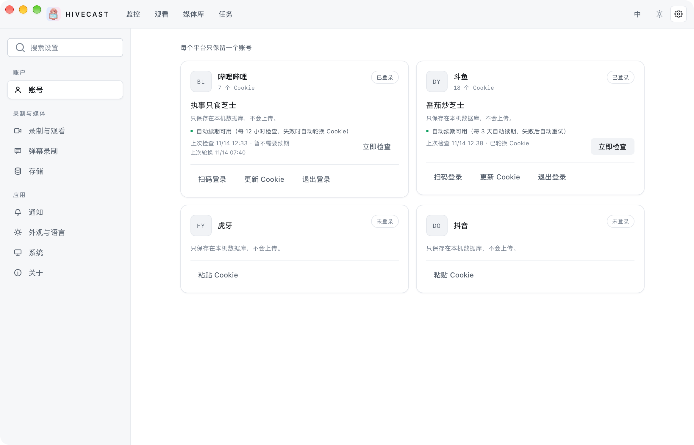
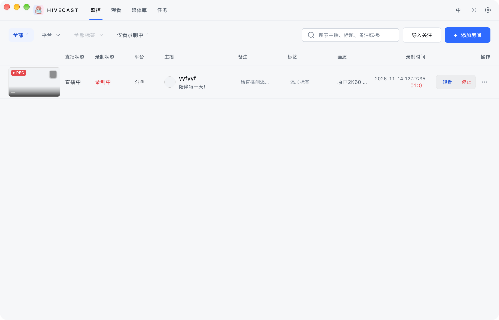

# 斗鱼监控录制 Cookie 状态机

> 2026-11-14。范围：斗鱼房间在「无 Cookie / 有 Cookie / 录制中补 Cookie / 录制中失效、退出、自动续期」下的监控与录制行为。
> 目标：Cookie 轮转不能打断已开始的录制；登录态变化只影响下一次取流和可用的最高画质。

## 1. 结论

斗鱼的监控与录制**不以 Cookie 是否有效作为开关**。Cookie 只决定两件事：

1. 平台接口能拿到哪些画质；
2. 自动续期、复验能否使用长期凭证。

因此下面这些行为是设计内且真机验证过的：

| 场景 | 监控 | 当前录制 | 画质 | 下一次取流 |
| --- | --- | --- | --- | --- |
| 无 Cookie | 正常检查 | 正常开录 | 按匿名实际档位封顶（9999 为蓝光4M） | 匿名 |
| 有有效 Cookie | 正常检查 | 正常开录 | 账号最高档（9999 为原画2K60） | 登录态 |
| 录制中补 Cookie | 不停 | 不停，按需重检后同一会话升档 | 可升到账号档 | 登录态 |
| 录制中退出登录 | 不停 | 旧 ffmpeg 不变，继续当前流 | 保持当前档位 | 匿名 |
| Cookie 过期 | 不停，不判离线 | 旧 ffmpeg 不变 | 保持当前档位 | 按匿名档位 |
| 过期后自动恢复 | 不停 | 同一会话升档 | 回到账号档 | 登录态 |
| 自动续期成功 | 不停 | 旧 ffmpeg 不变 | 保持当前档位 | 新 Cookie |

关键点：**录制进程一旦启动，只依赖已经解析出来的 CDN 地址与 dy_did，不再读账号 Cookie**。所以 Cookie 轮换、退出登录、过期标记都不会让正在写的文件中断；已录内容也不会因为登录态变化被重写或丢弃。

## 2. Cookie 状态如何参与判定

- `credential.status` 只有 `ok` 时才算登录态。`expired` 时平台接口按匿名处理，画质菜单按匿名实际档位封顶。
- `credential::cookie_for_url` 原先只看域名、不看状态，导致标记过期后仍把失效 Cookie 发给斗鱼接口，可能触发风控。本次改为 `!is_ok(platform)` 直接返回 `None`。
- 复验、续期需要读取原始 Cookie 的地方仍直接读 `credential::get(row.cookie)`，不受这个注入开关影响。
- 监控自动开录条件不读 Cookie 状态；room_info 失败才进入错误/退避，不会把房间误判为离线。

## 3. 录制中的画质重检

`recheck_quality` 只在「保存 Cookie / 扫码确认 / 过期恢复」这类登录态变化后触发，不做周期探测。

- 目标档已经达到：不动当前 ffmpeg。
- 目标档更高且编码、封装不变：同一 session 换 ffmpeg，分片继续编号，通常有 1–5 秒断点。
- 编码或封装变化：结束旧 session，开新 session，用 group_id 关联。
- 升级失败：退回当前实际档位继续录，不停止录制。

因此「录制中补 Cookie」的语义是**升级**，不是重开一场。真机证据见 §5.1。

## 4. 本次修复

### 4.1 过期 Cookie 不再自动注入

文件：`/Library/dshproject/HIVECAST/src-tauri/src/credential.rs`

```rust
if !is_ok(platform) {
    return None;
}
```

单测 `expired_cookie_is_not_injected` 覆盖：设置 Cookie → 标记 expired → 注入返回 `None` → 恢复 ok → 返回 `Some`。

### 4.2 续期、复验写回竞态

文件：`/Library/dshproject/HIVECAST/src-tauri/src/douyu_auth.rs`

问题：`safeAuth` 需要几秒，期间用户可能重新扫码、粘贴 Cookie 或退出登录。旧实现只比较数据库行，晚到的续期结果可能把新凭据覆盖或误标过期。

修复：

- `cookie_is_current(row)`：比较内存中的斗鱼 Cookie 是否仍是本次读到的同一份。
- `mark_expired_locked`：调用方必须持有 `credential_write_guard()`；写过期前再检查一次，Cookie 已变化就跳过。
- `refresh_once` 的 Invalid / Transient / 结果不完整 / 成功写回四个分支，都在写锁内复核 Cookie 与 LTP0；变化则返回 `Discarded`，绝不覆盖新凭据。
- `revalidate` 恢复登录态同样在写锁内复核，避免旧复验结果把新账号标成 ok。

### 4.3 过期恢复后主动重检

`revalidate` 从 expired 恢复到 ok 后调用：

```rust
recheck_recording(app, "douyu_revalidated");
```

`refresh_once` 在 `was_expired` 且续期成功时调用 `recheck_recording(app, "douyu_refreshed")`。正常 token 轮换（was_expired=false）不触发，避免无意义换 ffmpeg。

### 4.4 监控表显示活动会话的实际画质

文件：`/Library/dshproject/HIVECAST/src/features/monitor/MonitorPage.tsx`

原先画质列直接用 `room.lastSessionQuality`，它要等本场结束才回写；升级发生在录制中时，表格会一直显示开录档位。改为：

```tsx
const shownQuality = view.recording?.quality || room.lastSessionQuality;
```

按钮 title 与文本都使用 `shownQuality`。录音中升级后表格立即变为新档位；结束后回落到本场最终画质。

## 5. 真机验证

### 5.1 匿名开录 → 中途补 Cookie（旧 bundle）

- 删除斗鱼凭据，房间 9999 设 `auto_record=1`、`record_qn=10000`。
- 11:32:43 自动开录：`quality=蓝光4M · FLV requested_qn=10000 actual_qn=400`，日志「实际画质低于所选档位，已按可用画质开录」。
- 11:40:25 粘贴网页 Cookie，保存成功。
- 11:40:25.55 触发重检 → 11:40:25.86 探测到 10000 → 11:40:27.43 新 ffmpeg 写流：
  `start_number=8 restarts=1 upgrades=1 quality=原画2K60 · FLV requested_qn=10000 actual_qn=10000`。
- 日志「画质升级完成（同一会话续写）」；quality_history 两条 400/10000，session id 不变；断点约 2.2 秒。
- 先粘贴一份 1304 字符的旧 QR Cookie 被拒绝「斗鱼 Cookie 已失效或未登录」，数据库未被覆盖，录制未受影响。

### 5.2 录制中退出登录（旧 bundle）

- 11:46:46 点斗鱼「退出登录」并确认。
- 日志「删除平台登录凭据」「账号凭据变更，已清空取流与房间信息缓存」。
- 旧 ffmpeg PID 30238 未变化；active session 仍是 recording，quality 仍是原画2K60。
- 说明删除 Cookie 不会停当前录制；之后断流重取才按匿名 400。

### 5.3 过期状态开录 → 自动恢复并升档（新 bundle）

- 数据库中斗鱼 `status=expired`，无长期凭证；房间 `auto_record=1`。
- 12:02:24 自动开录：`quality=蓝光4M · FLV actual_qn=400`，证明过期状态不阻断监控/开录。
- 12:02:40 维护循环 `revalidate` 探活成功：「斗鱼登录态已恢复」。
- 随后「凭据恢复，检查是否可升级画质 reason="douyu_revalidated"」；12:02:42.89 同一 session 升级 400→10000，`upgrades=1`。
- DB `credential.status=ok`，`record_session.quality=原画2K60 · FLV`。

### 5.4 启动时旧 Cookie 失效 → 自动续期自愈

- 12:33:33 取流 403；12:33:49 `斗鱼登录态已失效，已标记过期`；12:33:50 `斗鱼 Cookie 自动续期完成`；12:34:05 用新 Cookie 以原画2K60 开录。
- 说明「启动时先失败、随后自动续期」不会留下永久过期状态。

### 5.5 录制中自动续期不打断

- 12:34:05 以原画2K60 开始录制，ffmpeg PID 34216。
- 12:38:35 点「立即检查」触发同一 `refresh_once` 路径：`斗鱼 Cookie 自动续期完成`。
- 续期后 ffmpeg PID 仍为 34216，session 仍为 `8c6014a0-0c48-4783-909c-158ff53b784c`，quality 仍为原画2K60。
- DB `credential_refresh.outcome=refreshed`、`last_refreshed_at=12:38:35`；Cookie 长度由 1783 变为 1767，证明确实轮换。
- 账号卡显示「上次检查 11/14 12:38 · 已轮换 Cookie」。



### 5.6 监控表画质列随升级更新

同一场「过期开录→恢复升级」后，监控表显示 `原画2K60`，不再停留在开录时的 `蓝光4M`。截图来自新 bundle，房间处于录制中。



## 6. 失败与恢复语义

| 事件 | 是否中断当前 ffmpeg | 是否清取流缓存 | 是否立即重检 | 结果 |
| --- | --- | --- | --- | --- |
| 保存有效 Cookie | 否 | 是 | 是 | 可升级 |
| 扫码确认 | 否 | 是 | 是 | 可升级 |
| 退出登录 | 否 | 是 | 否 | 下次断流匿名 |
| 自动续期（正常轮换） | 否 | 是 | 否 | 下次取流用新 Cookie |
| 自动续期（过期恢复） | 否 | 是 | 是 | 立即升档 |
| 续期失败（网络抖动） | 否 | 否 | 否 | 保持当前，下轮再试 |
| 续期失败（凭证失效） | 否 | 否 | 否 | 标记 expired，下次取流匿名 |
| 录制中断流 | — | — | 按需 | 按当前 Cookie 状态重取 |

## 7. 边界

- 没有构造「手机同时确认两次」和「续期与扫码同一毫秒」的真实并发；写锁与当前 Cookie 复核由代码与单测覆盖。
- 没有等待真实 3 天续期窗口；5.5 用「立即检查」走同一条 `refresh_once`，区别只是 `force` 与触发者。
- 没有让真实账号在录制中自然过期；5.2 的退出登录与 5.3 的 expired 开录覆盖了「当前 ffmpeg 不读 Cookie」这条关键路径。
- HTTP 429/5xx 仍按平台错误退避；续期网络异常不会改 Cookie 状态。
- 过期 Cookie 不注入是全局行为（所有平台），B 站自己的复验/续期直接读原始凭据，不依赖自动注入。

## 8. 验收

- `cargo fmt --check`、`cargo check --all-targets` 通过。
- `cargo test --lib`：**319 passed / 0 failed / 17 ignored**。
- `pnpm exec tsc -b`、`pnpm run check:i18n`（807 keys）、`pnpm run check:docs`、`pnpm build` 通过。
- `pnpm app:build`：release bundle **31.68 MiB**。
- 真机：无 Cookie 开录、补 Cookie 升档、退出登录不停录、expired 恢复升档、录制中自动续期不停录、监控表画质实时更新。
