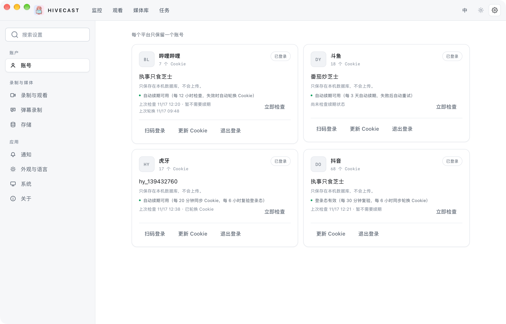
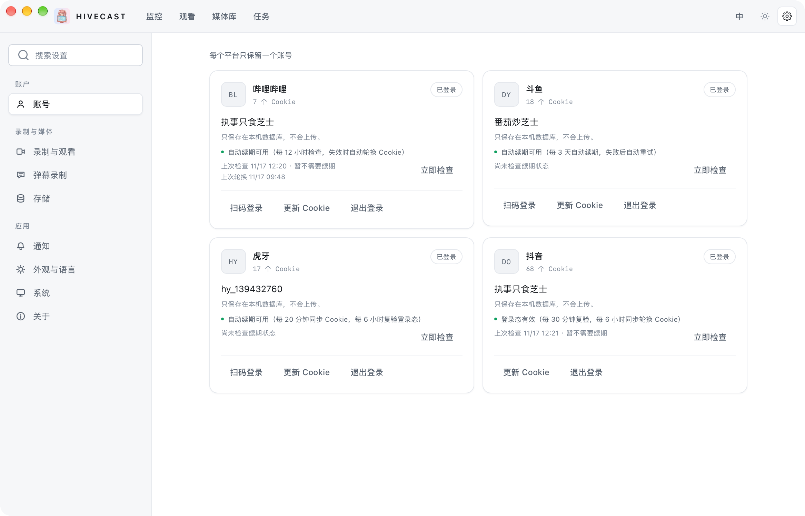

# 虎牙扫码登录与 Cookie 自动续期

- 日期：2026-11-17
- 范围：虎牙账号登录、Cookie 校验、长期凭证与自动续期；哔哩哔哩、斗鱼、抖音账号链路保持不变。
- 结论：虎牙具备可用的自动续期能力，核心是长期 `udb_cred` + 每 20 分钟 `cookieExchange`，失败回退 `credLogin`。本次已实现原生 HTTP 扫码登录、Cookie 校验、长期凭证加密保存、自动续期与失效标记；除二维码生成/等待/过期与无效 Cookie 外，真实账号扫码快速登录、登录态落库、真实 `cookieExchange` 轮换均已完成真机闭环，证据见 §5.2/§5.3。剩余边界见 §6。

## 1. 需求与改动前的缺口

用户要求先确认虎牙有没有自动更新 Cookie 的能力，有才做扫码；同时检查现有实现与公开项目。

改动前：

- 没有 `huya_auth.rs`，虎牙只有「粘贴 Cookie」，保存时不校验，见 `/Library/dshproject/HIVECAST/src-tauri/src/account.rs:1029` 的平台分支。
- `/Library/dshproject/HIVECAST/src-tauri/src/account.rs:126` 的 `info_for_row` 只把哔哩哔哩、斗鱼、抖音标成可续期，虎牙恒为 `false`，界面不显示续期区。
- `/Library/dshproject/HIVECAST/src-tauri/src/account.rs:1095` 起的 `revalidate` 只遍历哔哩哔哩，虎牙失效不会被标记。
- 前端 `/Library/dshproject/HIVECAST/src/features/settings/AccountSection.tsx` 有四张平台卡，但扫码/续期按钮的条件只含哔哩哔哩、斗鱼、抖音。
- 虎牙取流与弹幕匿名可用，所以这个缺口不影响「能不能录」，只影响「登录后能不能稳定续期、失效能不能被发现」。

公开项目结论：

- `weiqin5882/huya-login-web` 是 Flask + Playwright 截屏扫码，没有协议、Cookie 提取或续期。
- `biliLive-tools/packages/HuYaRecorder` 与 `huya-danmu` 只做匿名取流/弹幕。
- 没有可直接复用的虎牙续期实现，改为逆向官方登录前端 `HyUDBWebSDK_c30a1b8.js`、`udb_login_aio_0339427.js`、`udb.sdk.web.js`。

## 2. 协议链路

### 2.1 匿名设备 Cookie

二维码绑定在匿名设备上。只带 `udb_guiddata`、`__yamid_new`、`guid`、`sdid`、`PHPSESSID` 时，`tryQrLogin` 会直接返回 `stage=6`（二维码已失效）；补上下面三个后才返回 `stage=0`：

- `udb_deviceid=w_<13 位毫秒><6 位随机数>`
- `udb_appid=5002`
- `udb_passdata=3`

`new_device_jar()` 在 `/Library/dshproject/HIVECAST/src-tauri/src/huya_auth.rs:128` 生成整组设备 Cookie，不依赖先打开网页。

### 2.2 二维码

| 步骤 | 请求 | 关键参数 | 结果 |
| --- | --- | --- | --- |
| 申请 | `POST https://udblgn.huya.com/qrLgn/getQrId` | `uri=70001`、`version=2.6`、`appId=5002`、`appSign=1ce3bf682483d03f146f58232ec10635`、`context=WB-<udb_guiddata>-<__yamid_new>-<guid>`、`sdid`、`byPass=3`、`requestId` 8 位、`data.behavior`/`data.page` 均 percent-encode | `returnCode=0`、`data.qrId` |
| 图片 | `GET https://udblgn.huya.com/qrLgn/getQrImg?k=<qrId>&appId=5002` | 与申请相同的设备 Cookie | PNG |
| 轮询 | `POST https://udblgn.huya.com/qrLgn/tryQrLogin` | `uri=70003`、`data.qrId`、`remember=1`、`behavior`、`page` | `data.stage` |

stage 语义：0/4 等待；1/10 已扫码待确认；2/3 登录成功；5 二维码过期；6 二维码失效；7 取消授权；8 扫码账号异常。

本项目的 `fetch_qr_id`、`fetch_qr_png`、`qr_start`、`qr_poll` 分别在 `huya_auth.rs:372`、`:405`、`:433`、`:514`。二维码只活 `QR_TTL=225` 秒，内存最多保留 16 个会话，轮询间隔 1.6 秒；每次轮询拿到的 `Set-Cookie` 都会合并回该会话，避免设备绑定在中途失效。

### 2.3 登录成功换票

`stage=2/3` 有两个分支。真机（2026-11-17 12:33）实际返回的是**快速登录票据**，没有 `loginTime`/`sign`：

```json
{"uri":70004,"returnCode":0,"data":{
  "uid":1199573670219,"passport":"","subUid":0,"regOrigin":0,
  "version":"1.0","biztoken":"<344 字符>","status":1188881,"stage":2}}
```

`confirm_login`（`huya_auth.rs:589`）先读 `loginTime`/`sign`；任一为空时调用 `apply_quick_login`（`huya_auth.rs:636`）：

- 要求 `uid` 与 `biztoken` 同时存在，否则返回「虎牙登录响应缺少换票参数，请刷新二维码重试」。
- 把 `uid`、`biztoken` 直接写成 `udb_uid`、`udb_biztoken`，`passport`/`version` 非空时一并写入 `udb_passport`/`udb_version`。
- `biztoken` 已经是最终票据，不能再走 `/web/v2/quickTicket`：真机用 `biztoken` 请求该接口返回 `returnCode=10052`「LGN_LOGIN_FAILS / 登录失败，请稍候重试」。
- 随后与普通分支共用 `finish_login`（`huya_auth.rs:655`）：`checkLogin`（最多三次重试）、合并 `udb_cred`、落库、加密长期凭证、关二维码会话、广播刷新。

如果响应确实带 `loginTime`/`sign`，仍走原来的 `huyaCallback` 分支：

```
GET https://l.huya.com/udb_web/udbport2.php?m=HuyaLogin&do=huyaCallback
    &loginTime=<loginTime>&sign=<sign>&callback=cb
```

从响应的 `Set-Cookie` 吸收 `udb_uid`、`udb_biztoken`、`udb_cred` 等，再请求：

```
GET https://l.huya.com/udb_web/udbport2.php?m=HuyaLogin&do=checkLogin&callback=cb
```

返回形如 `cb({"isLogined":true,"uid":...,"userNick":...,"userLogo":...})`。匿名实测返回 `{"isLogined":false,"uid":0,...}`，说明这个接口可以区分「Cookie 有效」与「只是没登录」，不会把网络错误当成失效。

成功后：

- `store_account(db,"huya",...)` 写入账号。
- `save_secret` 把 `udb_cred` 放进 `credential_secret.refresh_token`，`sdid` 放进 `device_id`；两者都走现有的加密存储。
- 清流地址缓存、广播账号刷新；`huya_qr_poll` 确认后由命令层再触发同平台画质重检，与 B 站/斗鱼一致。

### 2.4 自动续期

官方 `udb.sdk.web.js` 每 20 分钟在页面可见时请求一次：

```
POST https://udblgn.huya.com/web/cookieExchange
{"uri":"70015","version":"2.6","context":"1","appId":"5002",
 "appSign":"1ce3bf682483d03f146f58232ec10635","lcid":"2052",
 "traceid":"<uuid>","sdid":"<sdid>","data":{"page":"https%3A%2F%2Fwww.huya.com%2F"}}
```

响应 `data.writeCookieFlag` 表示服务端是否写回了 Cookie；真正的登录态仍以 `checkLogin` 为准。若 `cookieExchange` 失效，再请求 `POST /web/credLogin`（`uri=70017`），请求体只有 `sdid` 与 `page`，依赖 Cookie 里的 `udb_cred`。

本项目的 `refresh_once`（`huya_auth.rs:993`）顺序：

1. 读凭据与 `credential_secret`；没有 `udb_cred` 直接 `NotRefreshable`，不碰账号状态。
2. `refresh_due`：成功/新鲜态 20 分钟；失败且需重扫码 24 小时；临时失败 6 小时；已过期立即。
3. 持 `REFRESH_LOCK` 重读凭据，防止等锁期间用户重新扫码。
4. `cookieExchange` 合并 `Set-Cookie`；`checkLogin`。
5. 未登录且 Cookie 或 `udb_cred` 可用时，`credLogin` 再换一次，再 `checkLogin`。
6. 仍失败：写 `failed`/`key_stale=true`，在写锁内确认 Cookie 仍是本轮读到的值，再标记 `expired` 并发登录失效通知。
7. 成功：在写锁内比较当前 Cookie、保存新 Cookie、同步加密的 `udb_cred`/`sdid`、写 `refreshed`/成功状态、广播刷新；过期恢复时重检所有活动房间画质。

补充两个实现细节：

- `cookieExchange` 可能轮换掉 `udb_cred` 本身。若合并后的 Cookie 缺少它，`refresh_once` 会从独立的加密长期凭证补回，再走 `credLogin`；绝不会把旧设备的凭证写进新账号。
- 长期凭证与 Cookie 在同一把 `credential_write_guard` 内落库，避免扫码登录刚好插进来后，本次旧结果覆盖新账号的 `udb_cred`。

`maintenance_loop`（`huya_auth.rs:1261`）每 20 分钟跑一次 `refresh_once`；`revalidate`（`:1274`）每 6 小时用 `checkLogin` 独立复验，只在明确 `LoggedOut` 时标记过期，网络失败不误踢。

## 3. 手动 Cookie

`prepare_cookie`（`huya_auth.rs:875`）用于「粘贴 Cookie」：

- 有 `udb_cred` 但缺 `udb_uid`/`udb_biztoken`：先 `credLogin` 补票，再 `checkLogin`。
- 没有 `udb_cred`：只做 `checkLogin`，校验通过也能保存，但 `refreshable=false`，界面显示「手动粘贴的 Cookie 没有长期凭证，扫码登录后可启用自动续期」。
- 保存时 `remember_secret`（`huya_auth.rs:719`）只在当前 Cookie 含 `udb_cred` 时写长期凭证；没有就清掉旧设备的凭证，避免拿旧票污染新账号。

## 4. 前端与命令

- `/Library/dshproject/HIVECAST/src-tauri/src/lib.rs:14` 注册 `mod huya_auth`；`:320-322` 注册 `huya_qr_start`、`huya_qr_poll`、`huya_refresh_now`。
- `/Library/dshproject/HIVECAST/src-tauri/src/commands.rs:2274` 起是三个命令。
- `/Library/dshproject/HIVECAST/src-tauri/src/state.rs:154` 起启动续期循环与 6 小时复验循环。
- `/Library/dshproject/HIVECAST/src/lib/ipc.ts:578` 起是 `huyaQrStart`、`huyaQrPoll`、`huyaRefreshNow`。
- `/Library/dshproject/HIVECAST/src/features/settings/AccountSection.tsx` 的 `checkRefresh`、`openQr`、轮询 effect 都增加 `huya` 分支；二维码标题/提示、未登录说明、续期状态、扫码按钮条件同步扩展。
- 新增 i18n：`account.huyaHint`、`account.huyaNoRefresh`、`account.qrTitleHuya`、`account.qrHintHuya`、`account.autoRefreshOnHuya`；`check:i18n` 837 keys。

## 5. 验证

### 5.1 自动化

- `cargo fmt --check`、`cargo check --all-targets` 通过，0 警告。
- `cargo test --lib`：**380 passed / 0 failed / 19 ignored**，其中 `huya_auth` 10 个单测覆盖设备 Cookie、Cookie 合并/删除、JSONP、退避窗口、登录 Cookie 判定、回调 URL 编码，以及快速登录票据的 `uid`/`biztoken` 写入与缺参拒绝。
- 真实网络 ignored 测试 `huya_auth::tests::live_qr_start_returns_png_svg` 通过（0.24 秒），证明当前网络下 `getQrId` + `getQrImg` 能拿到 PNG 并包成 SVG。
- `pnpm exec tsc -b`、`check:i18n`、`check:docs`、`pnpm build` 通过。
- release bundle 构建通过，`HIVECAST.app` 32.61 MiB。

### 5.2 真机二维码、无效 Cookie 与真实登录

release bundle 真机（macOS）：

- 设置 → 账号 → 虎牙卡从「未登录」变为「扫码登录 / 粘贴 Cookie」。
- 点「扫码登录」：日志 `INFO hivecast_lib::huya_auth: 虎牙扫码二维码已生成 expires_in=225`；面板显示虎牙标题、二维码、等待扫码、倒计时、失效后可刷新；截图 `/tmp/huya-qr.png`、最终包 `/tmp/huya-new-qr.png`。
- 粘贴 `udb_uid=1; udb_biztoken=fake; foo=bar` 保存：日志 `ERROR hivecast_lib::ui: 界面错误 context=ipc:credential_save 虎牙 Cookie 已失效或未登录`，toast 同文案；数据库 `credential` 仍只有哔哩哔哩/斗鱼/抖音，未写入虎牙，`credential_secret` 仍只有斗鱼；截图 `/tmp/huya-invalid.png`。
- 轮询期间无错误日志，倒计时按服务端 `expires_in` 对齐。

真实扫码闭环（同一 release bundle，2026-11-17 12:32–12:38）：

- 重新生成二维码后，用户用虎牙 App 扫码并在手机确认；日志依次出现：
  `INFO huya_auth: 虎牙扫码返回快速登录票据，使用 uid+biztoken 落登录态 uid=1199573670219`
  `INFO huya_auth: 虎牙扫码登录成功 account=hy_139432760 uid=1199573670219 method="quick" cookie_names=[...17 个...]`
- Cookie 名包含 `udb_uid`、`udb_biztoken`、`udb_cred`、`PHPSESSID`、`sdid`、`yyuid` 等；说明 `checkLogin` 已把快速登录票据换成完整登录态，而不是只停在 `biztoken`。
- 数据库：`credential` 新增 `huya|ok|hy_139432760|1199573670219`，DB 里是 AES-256-GCM 密文（1299 字符），`credential::get` 解出的明文 Cookie 是 941 字符；`credential_secret` 新增 `huya`，`refresh_token` 密文 247 字符（明文 `udb_cred` 152 字符）、`device_id` 密文 95 字符；原哔哩哔哩/斗鱼/抖音三行未变。
- 账号卡从「未登录」变为「已登录 / hy_139432760 / 17 个 Cookie / 自动续期可用（每 20 分钟同步 Cookie，每 6 小时复验登录态）」；截图 `assets/169-huya-login.png`。
- 点虎牙「立即检查」：日志 `DEBUG huya_auth: 虎牙 cookieExchange 完成 write_flag=true changed=true cookies=9 return_code=0`，随后 `INFO huya_auth: 虎牙 Cookie 自动续期完成 changed=true rotated=true udb_cred_len=152`；`credential_refresh` 写入 `huya|refreshed|已同步虎牙登录态|key_stale=0`，界面显示「上次检查 11/17 12:38 · 已轮换 Cookie」，截图 `assets/169-huya-refresh.png`。


- 本次真实轮换确实更新了 `udb_cred`（长度 152），不是只返回 `returnCode=0` 的空轮换。




### 5.3 协议探针与真实轮换

- `checkLogin` 匿名：`cb({"isLogined":false,"userName":"","uid":0,...})`。
- `cookieExchange` 伪造 `udb_cred`：HTTP 200、`returnCode=0`、`writeCookieFlag=false`，证明不能只凭 `returnCode` 判断续期成功；代码随后用 `checkLogin` 兜底。
- `credLogin` 伪造 `udb_cred`：`returnCode=40002`、`description="登录失败，请重新登录"`，对应 `RefreshFailure::Invalid`，会标记需要重新扫码。
- 真实快速登录票据请求 `/web/v2/quickTicket`（`uri=30007`）：`returnCode=10052`、`description="LGN_LOGIN_FAILS / 登录失败，请稍候重试"`，确认 `biztoken` 不能再换一次，必须直接作为 `udb_biztoken` 使用。
- 真实登录态的 `cookieExchange`：`writeCookieFlag=true`、`changed=true`、9 个 Cookie 被更新，和伪造票据时的 `writeCookieFlag=false` 形成对照。

## 6. 未验证与边界

已经真机闭环的部分不再列入「未验证」：

- 真实扫码快速登录：`uid+biztoken` → `udb_uid/udb_biztoken` → `checkLogin` → `credential`/`credential_secret`。
- 真实 `cookieExchange` 轮换：`writeCookieFlag=true`、`udb_cred` 更新、`credential_refresh=refreshed`。
- 二维码生成/等待/过期/取消与无效 Cookie 拒绝。

仍需明确的边界：

1. **`loginTime/sign` + `huyaCallback` 分支没有真实响应样本。** 本次真实扫码走的是快速登录分支；旧分支仍保留，但只有代码路径与匿名探针，未在真实账号上触发。若虎牙后续切回回调模式，需要再验一次。
2. **`udb_cred` 的长期有效期与多次轮换稳定性只观察了一次。** 本次 20 分钟周期内轮换成功；更长周期（天级）、服务端主动让 `udb_cred` 过期、以及 `credLogin` 回退是否仍可用，尚未经历。
3. **登录是否提升虎牙画质未验证。** 虎牙取流当前匿名可用；登录态是否解锁更高档位、是否需要额外参数，需要真实账号录制对比。
4. 手动 Cookie 没有 `udb_cred` 时只校验、不续期，这是与斗鱼一致的降级路径，不是缺陷。
5. `revalidate` 在明确 `LoggedOut` 时会把 `last_refreshed_at` 置 0；当前界面只用于展示「上次轮换」，不影响续期判断。6 小时复验周期本次未等到触发。
6. 二维码确认失败时返回 `error` 但不销毁会话，下一轮仍可重试；用户关闭/刷新面板现在会显式 `qr_cancel` 释放 session，10 分钟清理阈值只作为遗漏兜底，见 `170-虎牙Cookie全链路复查.md`。

## 7. 后续复查

2026-11-17 的 `170-虎牙Cookie全链路复查.md` 补做了扫码取消/关闭清理、checkLogin Set-Cookie 合并、手动 Cookie 的 `udb_cred` 重试、响应体限流与续期状态竞态检查；本文 §6 的“关闭面板后 10 分钟自然清理”已由显式取消替代。

## 8. 文件清单

- `/Library/dshproject/HIVECAST/src-tauri/src/huya_auth.rs`：新增，设备 Cookie、getQrId/getQrImg/tryQrLogin、confirm_login、apply_quick_login、finish_login、prepare_cookie、cookieExchange/credLogin、refresh_once、maintenance_loop、revalidate、10 个单测与 1 个 ignored 真实网络测试。
- `/Library/dshproject/HIVECAST/src-tauri/src/account.rs`：`info_for_row` 的 huya 可续期判断、`save_cookie` 的 huya 校验与长期凭证保存。
- `/Library/dshproject/HIVECAST/src-tauri/src/commands.rs`：三个 huya 命令。
- `/Library/dshproject/HIVECAST/src-tauri/src/lib.rs`：模块与命令注册。
- `/Library/dshproject/HIVECAST/src-tauri/src/state.rs`：续期与复验后台循环。
- `/Library/dshproject/HIVECAST/src/lib/ipc.ts`：三个前端 IPC。
- `/Library/dshproject/HIVECAST/src/features/settings/AccountSection.tsx`：虎牙扫码/续期/未登录文案接线。
- `/Library/dshproject/HIVECAST/src/i18n/zh-CN.json`、`/Library/dshproject/HIVECAST/src/i18n/en-US.json`：5 个新 key。
- `/Library/dshproject/HIVECAST/docs/169-虎牙扫码登录与Cookie自动续期.md`：本文。
