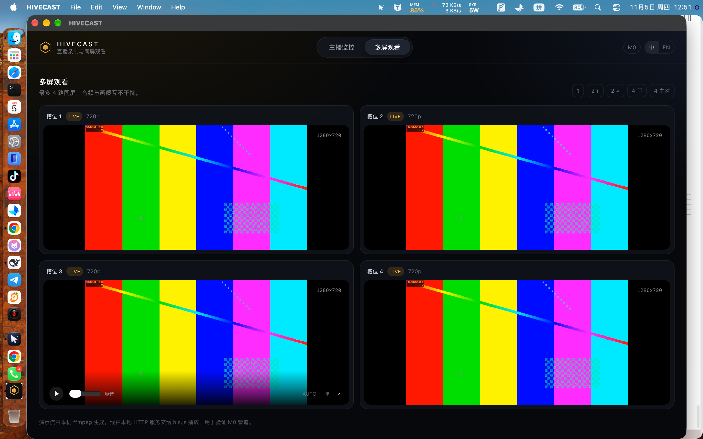
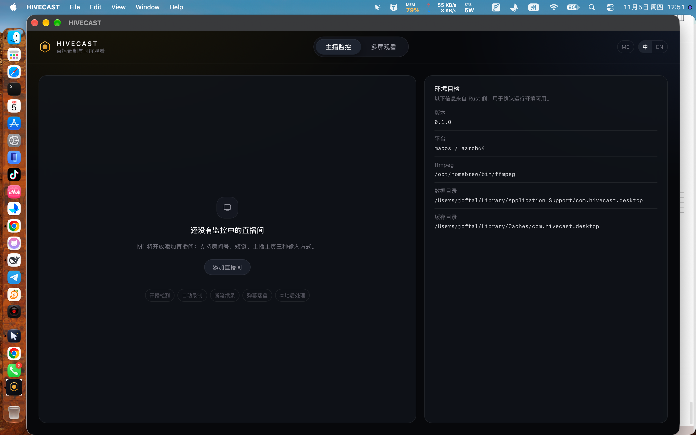

# 20 · M0 实现记录（骨架与本地播放管道）

> 状态：✅ 2026-11-05 完成。范围与验收依据 [19-产品蓝图与阶段计划](19-产品蓝图与阶段计划.md) §5 的 M0 一行。

## 1. 这一阶段交付了什么

| 能力 | 状态 | 代码位置 |
| --- | --- | --- |
| Tauri 2 应用外壳（macOS 窗口、CSP、能力配置） | ✅ | `src-tauri/` |
| React 19 + Vite 7 + Tailwind 4 前端骨架、双 Tab | ✅ | `src/` |
| IPC 类型单一来源：Rust 定义 → 生成 TS | ✅ | `src-tauri/ipc-types/` → `src/lib/bindings/` |
| 本地回环流服务（token + Host/Origin 校验） | ✅ | `src-tauri/src/stream/server.rs` |
| ffmpeg 生成演示流（fMP4 HLS） | ✅ | `src-tauri/src/stream/demo.rs` |
| hls.js 播放器（每实例独立，含统计与控制条） | ✅ | `src/features/watch/Player.tsx` |
| 中英双语 i18n | ✅ | `src/i18n/` |
| ffmpeg 可执行文件定位（macOS GUI PATH 问题） | ✅ | `src-tauri/src/ffmpeg.rs` |

验收对照：**打包前后都能播放一个本地 m3u8** 已在 `pnpm tauri dev` 下实测（见 §5）；**IPC 类型由 Rust 生成 TS** 由 `pnpm gen:bindings` 保证。

## 2. 目录结构（当前真实状态）

```text
HIVECAST/
├── README.md
├── docs/                     架构文档 + assets/ 截图
├── index.html
├── package.json              React/Vite/Tauri CLI
├── vite.config.ts            端口固定 1420（Tauri devUrl 依赖）
├── tsconfig*.json
├── scripts/
│   ├── gen-bindings.sh       cargo test 触发 ts-rs 导出
│   ├── check-i18n.mjs        中英 key 一致性
│   └── check-docs.mjs        文档表格/围栏/内链校验
├── src/                      前端
│   ├── App.tsx               顶栏 + TabBar + 页面切换
│   ├── components/TabBar.tsx 两段式滑块
│   ├── features/monitor/     监控页（M0 为空态 + 环境自检）
│   ├── features/watch/       观看页（4 槽位 + Player）
│   ├── i18n/                 zh-CN / en-US + 语言持久化
│   ├── lib/ipc.ts            invoke 封装 + 类型再导出
│   ├── lib/bindings/         ⚠️ 生成物，勿手改
│   └── styles/index.css      Tailwind v4 主题与动画
└── src-tauri/
    ├── Cargo.toml
    ├── tauri.conf.json
    ├── capabilities/default.json
    ├── ipc-types/            独立 crate：只依赖 serde + ts-rs
    └── src/
        ├── lib.rs            启动：tracing → AppState → invoke_handler
        ├── error.rs          AppError → { code, message }
        ├── ffmpeg.rs         ffmpeg 路径解析
        ├── state.rs          AppState（info / server / cache_root / demo）
        ├── commands.rs       app_info / demo_stream
        └── stream/
            ├── server.rs     回环 HTTP 服务
            └── demo.rs       演示流生成
```

## 3. 开发命令

```bash
pnpm install          # 首次
pnpm tauri dev        # 起 Vite + 编译 Rust + 打开窗口
pnpm build            # tsc -b && vite build（前端类型检查 + 产物）
pnpm tauri build      # 打包（M6 才作为验收项）
pnpm gen:bindings     # 改过 ipc-types 后必跑
pnpm check:i18n       # 中英文案 key 对齐
```

本机 pnpm 由 corepack 提供（`packageManager: pnpm@10.18.0`），若 `pnpm` 不在 PATH，可用 `corepack pnpm`。

## 4. 关键实现说明

### 4.1 本地回环流服务

- 绑定 `127.0.0.1:0`（系统分配端口），进程启动时生成一次性 `token`（uuid v4）。
- 路由：`/s/{token}/{session}/{*path}`，`session` → 目录由 `RwLock<HashMap<String, PathBuf>>` 维护。
- 校验链：token → `Host` 必须是 `127.0.0.1:{port}` 或 `localhost:{port}` → `Origin` 白名单（`tauri://localhost`、`http://tauri.localhost`、`https://tauri.localhost`、`http://localhost:1420`、`http://127.0.0.1:1420`）→ 扩展名白名单（m3u8/m4s/mp4/ts）→ 路径不得以 `/` 开头或含 `..`。
- 响应头：m3u8 用 `Cache-Control: no-store`（直播间切换后不能拿旧播放列表），分片 `max-age=30`。
- 为什么要 token：回环端口对本机所有进程可见，不做鉴权等于把流暴露给任意本地程序（对应 19 文档 R5）。

### 4.2 演示流（真实管道，不是假数据）

`demo_stream` 第一次调用时用 ffmpeg 生成 24 秒的测试流，之后复用缓存目录 `{cache}/streams/demo-hls`：

```text
输入  testsrc2=size=1280x720:rate=30 + sine 440Hz
编码  libx264 veryfast / yuv420p / -g 60 / aac 128k
封装  -f hls -hls_time 2 -hls_playlist_type event -hls_segment_type fmp4
产物  index.m3u8 + init.mp4 + seg_%05d.m4s
```

选 fMP4 而不是 TS，是为了和 M2 观看管道（-hls_segment_type fmp4）保持一致，提前暴露 hls.js 对 fMP4 的兼容问题。

### 4.3 ffmpeg 定位（踩过的坑）

从 Finder 启动的 macOS GUI 进程，PATH 通常只有 `/usr/bin:/bin:/usr/sbin:/sbin`，**不含** `/opt/homebrew/bin`。若直接用 `Command::new("ffmpeg")`，开发期（从终端启动）能跑、打包后必然 `FfmpegMissing`。

`ffmpeg::resolve()` 的查找顺序：PATH 各目录 → `/opt/homebrew/bin` → `/usr/local/bin` → `/usr/bin`（Windows 追加 `C:\ffmpeg\bin`、`C:\Program Files\ffmpeg\bin`），命中后用 `-version` 实跑一次确认可执行。真正 spawn 时用绝对路径（`ffmpeg::binary()`）。

### 4.4 播放器

每个 `Player` 实例持有**自己的** `Hls` 对象，互不共享；参数 `lowLatencyMode: true`、`backBufferLength: 30`、`liveSyncDurationCount: 2`、`maxBufferLength: 8`。

- fatal error 时清空实例并给出「重试」入口，不清空其他槽位状态。
- 每秒读一次 `videoWidth/videoHeight`、`getVideoPlaybackQuality()` 的 dropped/total、`buffered` 末端，用于顶部角标（M2 起接到「掉帧自动降级」）。
- 音量 0–100 + 一键静音；默认 `muted`（对应 D3）。

### 4.5 布局

观看页用 `grid md:grid-cols-2 md:grid-rows-2` 撑满窗口，4 格各自独立 `useState`——这是「一个格子切画质不影响另一个」的最小可见验证雏形；真正的会话隔离在 M2 由 Rust 侧 StreamLease 保证。

## 5. 实测记录（2026-11-05，macOS arm64）

| 项 | 结果 |
| --- | --- |
| `pnpm build` | 通过，`tsc -b` 无错误；主 chunk 886 KB（hls.js 占大头） |
| `cargo check` | 通过，无警告 |
| `pnpm tauri dev` 窗口 | 正常打开，双 Tab 可切换，中英切换即时生效 |
| 4 路演示流同屏 | 正常播放，每路约 150 KB/s，角标显示 1280×720 |
| ffmpeg 探测 | 环境自检显示 `/opt/homebrew/bin/ffmpeg` |





## 6. 已知缺口（M1 前需要补）

| 缺口 | 影响 | 计划 |
| --- | --- | --- |
| 没有自动化测试 | 回归靠手点 | M1 起给 StreamBroker / 适配器加 `#[tokio::test]` |
| `pnpm tauri build` 未验证 | 打包问题会拖到后期 | M1 期间先跑一次，确认产物能启动 |
| hls.js 未分包 | 首屏体积 886 KB | M2 改动态 `import()` |
| 演示流常驻缓存 | 不是真实会话隔离 | M2 改为每槽位独立目录 + 生命周期回收 |
| 本地服务无并发/速率限制 | 极端情况打满磁盘 IO | M2 补信号量 + 分片并发上限 |
| 日志只在 stdout | 用户报障缺现场 | M1 接 tauri-plugin-log 落盘 |
| Android/iOS 图标产物冗余 | 仓库噪声 | 清理 `src-tauri/icons/` 下的 android、ios 目录 |

## 7. 下一步（M1 · B 站监控闭环）

已在 21 中完成并记录，此处保留原始待办以便对照：

1. PlatformAdapter trait + B 站实现：房间信息、开播状态、取流、线路分组。→ 已完成
2. StreamBroker：缓存 60s、in-flight 去重、每房间 1.5s 限速、-352/429 指数退避。→ 已完成
3. 持久化：SQLite + 迁移，先落 rooms / record_sessions / app_settings。→ 前两张表已完成，app_settings 推迟
4. 录制：ffmpeg 拉流 → 分段落盘 → 断流重连状态机。→ 已完成 FLV 直录 + 退出收尾；分段留 M2
5. 监控页真实列表 + 「添加直播间」对话框。→ 已完成（输入框形式）

> 后续以 [21-M1-实现记录](21-M1-实现记录.md) 为准。
