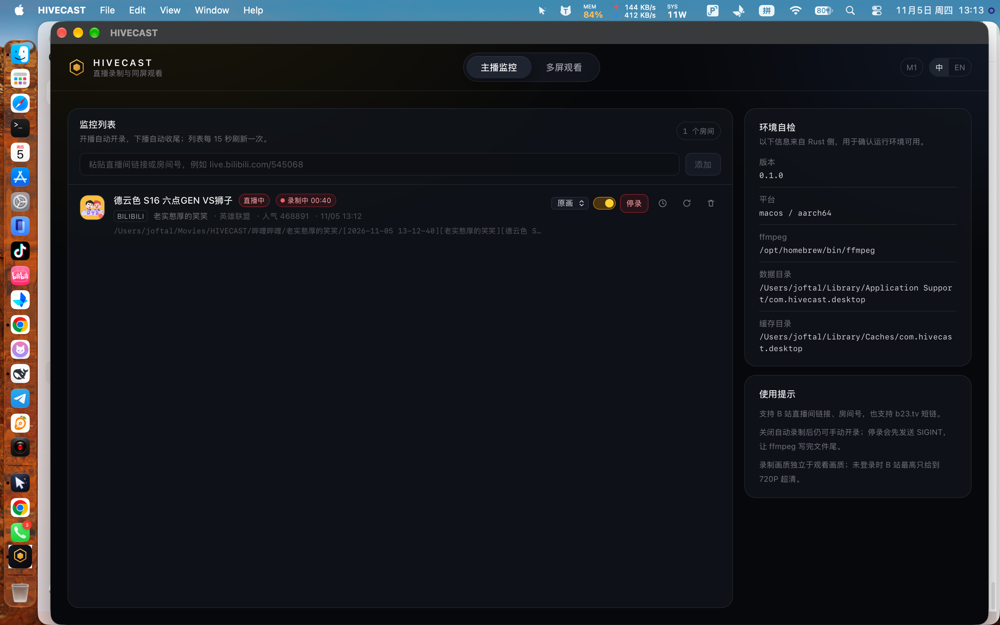
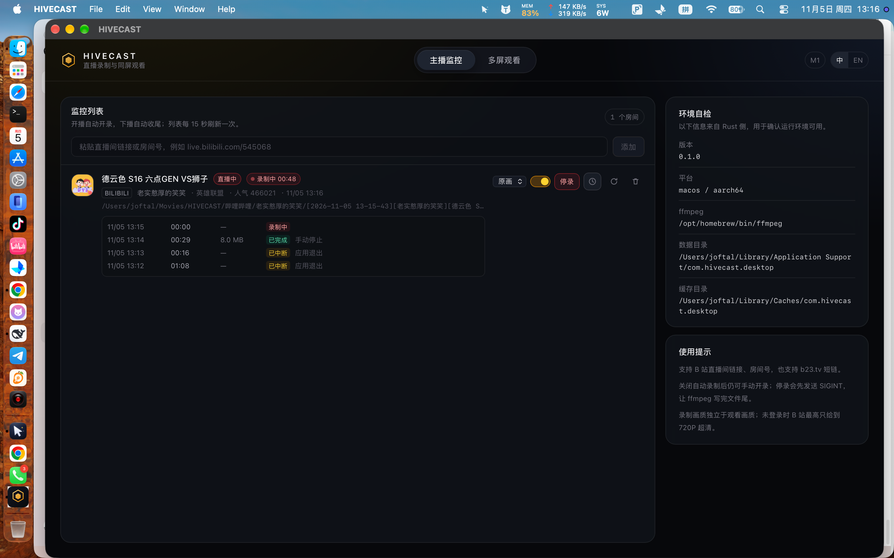
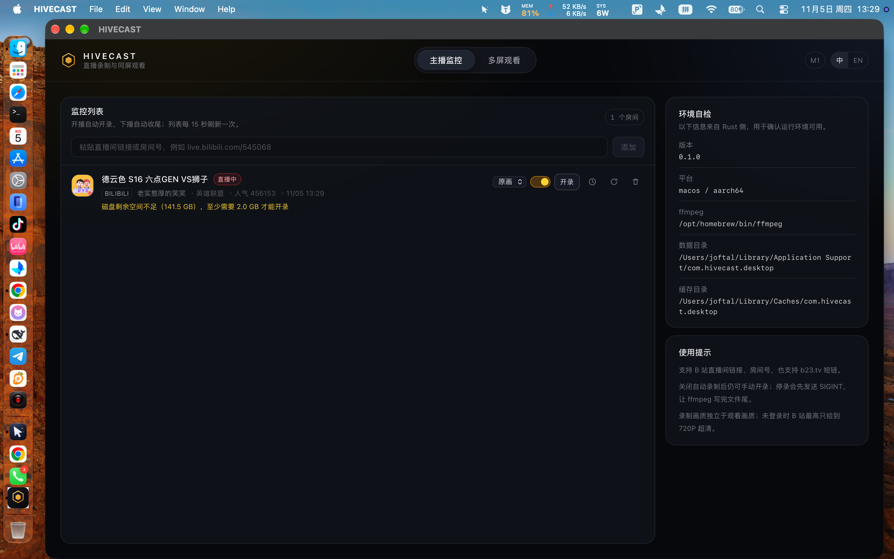
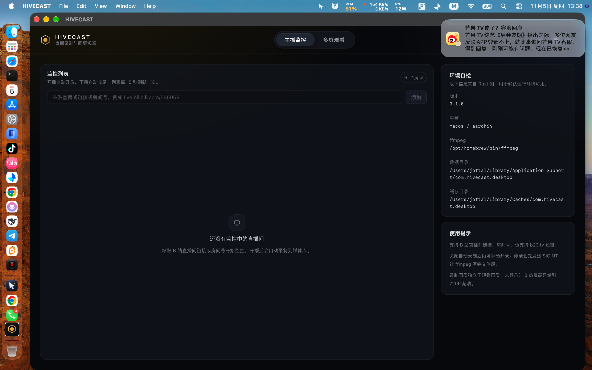

# 21 · M1 实现记录：B 站监控闭环

> 对应里程碑：docs/19 §5 的 **M1**（适配器、StreamBroker、轮询、ffmpeg 录制、历史、通知、磁盘守卫）。
> 完成日期：2026-11-05。本文只记录**已经跑起来的实现**与实测结论；设计取舍仍在 19 / 03 / 04 / 08。

## 1. 验收对照

| 验收项 | 目标 | 实测 | 结论 |
| --- | --- | --- | --- |
| 添加直播间 | 链接 / 房间号都能解析 | 纯数字 `545068`、`live.bilibili.com/545068?x`、`/blanc/545068` 均落到同一房间 | ✅ |
| 房间信息 | 标题、主播、头像、分区、人气 | 一次请求拿全，无需登录 | ✅ |
| 开播自动开录 | 开播 30s 内 | 添加时已在播 → 0.7s 内拉起 ffmpeg；轮询发现开播 → 下一个 tick（≤18s） | ✅ |
| 文件可播 | 录制完能直接播放 | ffprobe：h264 1280x720 + aac，18.2s / 8.0MB，解码无错 | ✅ |
| 手动停录 | 停得住、写完整文件尾 | 8.0MB、状态 finished / stopped；停后 60s 内未被监控重新拉起 | ✅ |
| 下播自动停 | 主播下播后收尾 | 逻辑就绪（stream_ended 路径），当日未遇到真实下播 | 🟨 待观察 |
| 断流续录 | 断流 60s 内续录 | ffmpeg 退出 → 1s 内收尾 → 下一个 tick 重开；未构造真实断流 | 🟨 待观察 |
| 录制历史 | 按房间可查 | 监控页行内展开，显示时间 / 时长 / 大小 / 状态 / 原因 | ✅ |
| 通知 | 开录、结束、失败、磁盘满通知 | 开录通知实测到达（13:32，事件链路 → 系统通知）；开发态由 macOS 归到「终端」 | ✅ |
| 磁盘守卫 | 剩余空间不足时拦住开录 / 主动停录 | 门槛 2 GiB 拒绝开录并把原因显示在行内；红线 1 GiB 停录，历史记 aborted / disk_full | ✅ |





## 2. 代码地图

| 文件 | 职责 | 关键点 |
| --- | --- | --- |
| `src-tauri/src/platform/mod.rs` | 平台无关契约 | `PlatformAdapter`（async_trait）、`RoomRef` / `RoomInfo` / `StreamGroup`、`PlatformError` 六码、`resolve_input` 与 `adapter_for` |
| `src-tauri/src/platform/http.rs` | 统一 HTTP 客户端 | 单例 reqwest（rustls + gzip）、10s 超时、默认桌面 UA、按调用传 Referer |
| `src-tauri/src/platform/bilibili.rs` | B 站适配器 | 三个接口、线路分组（按 CDN host）、qn / 封装 / 编码映射、组内排序 |
| `src-tauri/src/broker.rs` | 取流与房间信息缓存 | 60s / 15s TTL、in-flight 去重、房间闸门 1.5s、瞬时错误指数退避 |
| `src-tauri/src/db.rs` | SQLite 持久化 | WAL、`room` + `record_session` 两表、启动清理孤儿会话 |
| `src-tauri/src/recorder.rs` | 录制状态机 | 每房间一个 ffmpeg、房间级开录锁、1s 轮询退出、停录抑制、磁盘门槛、录制播报 |
| `src-tauri/src/disk.rs` | 磁盘守卫 | `fs4::available_space`、2 GiB 开录门槛 / 1 GiB 红线、阈值与文案集中在这 |
| `src-tauri/src/monitor.rs` | 轮询循环 | 直播 15s / 离线 30s 节流，驱动开录与停录 |
| `src-tauri/src/commands.rs` | IPC 命令 | 11 个命令，全部返回 `RoomView` 或列表 |
| `src-tauri/ipc-types/src/lib.rs` | 跨语言类型 | 用 ts-rs 导出到 `src/lib/bindings/`；i64 一律 `#[ts(type = "number")]` |
| `src/features/monitor/MonitorPage.tsx` | 监控页 | 添加输入框、行内操作、历史展开、每秒心跳刷新录制时长 |
| `src/App.tsx` | 通知装配 | 监听 `record://notice`，按 i18n 文案调用 `sendNotification`；启动时申请权限 |

为什么不把适配器写进 commands：平台会越来越多（M4 加斗鱼虎牙、M5 加抖音），命令层只做「解析 → 建记录 → 交给 recorder」，新增平台只加一个 `platform/xxx.rs` 并注册进 `registry()`。

## 3. 数据模型

### 3.1 room

| 字段 | 类型 | 说明 |
| --- | --- | --- |
| id | TEXT PK | uuid，本地主键，不随平台变化 |
| platform / room_key | TEXT | 联合唯一，例如 `bilibili` + `545068` |
| canonical_url | TEXT | 规范化地址，用于展示与再次解析 |
| title / host_name / avatar_url / cover_url / area_name | TEXT | 平台展示信息，轮询覆盖 |
| is_live / started_at / online | INTEGER | 开播状态、本场开播时间戳、人气 |
| auto_record / record_qn / view_qn | INTEGER | **本地设置，轮询永不覆盖** |
| last_checked_at / created_at / updated_at | INTEGER | 秒级时间戳，用于节流 |

### 3.2 record_session

| 字段 | 说明 |
| --- | --- |
| status | `recording` / `finished` / `failed` / `aborted` |
| reason | `stream_ended` / `stopped` / `error` / `app_exit` |
| file_path / file_size / duration_ms | 收尾时回填；录制中大小为 0 |
| quality / line | 候选名（如 `超清 · FLV · H.264`）与线路名（CDN host） |

索引：`(room_id, started_at DESC)`、`(status, started_at DESC)`。启动时 `close_orphan_sessions` 把上次崩溃遗留的 `recording` 改成 `aborted / app_exit`。

## 4. 关键流程

### 4.1 添加房间

`resolve_input`（先按 URL 匹配适配器，再按纯房间号兜底）→ 已存在则直接返回 → `broker.room_info` → 写 `room` → 若在播且开启自动录制，立刻 `recorder.start`。

### 4.2 轮询

每 3s 一次 tick，按 `last_checked_at` 与 15s / 30s 间隔决定是否真的请求；实际请求还要过 StreamBroker 的房间闸门（同一房间 1.5s 内只打一次平台）。发现 `is_live` 变化、标题或主播变化时广播 `rooms://changed`。

### 4.3 开录

顺序：房间级开录锁 → 复查是否已在录 → 失败冷却检查 → `broker.groups(qn)` → 选线 → 建目录 → 起 ffmpeg → 写 `record_session` → 广播 → 起 watcher。

选线规则（`pick_candidate`）：组按优先级（有 FLV 的组优先），组内 H.264 优先（可 `-c copy` 直录）、再按 qn。

ffmpeg 参数（B 站 FLV 直录）：

```bash
ffmpeg -hide_banner -nostdin -loglevel warning -y \
  -headers "Referer: https://live.bilibili.com/\r\nOrigin: https://live.bilibili.com/\r\nUser-Agent: ..." \
  -i <cdn url> -c copy -f flv -flvflags no_duration_filesize <path>
```

### 4.4 收尾

watcher 每秒 `try_wait`，退出后 `finalize`：按 `stop_reason` 映射状态 → 读文件大小 → 回填会话 → 广播。异常退出且存活不足 12s 记为秒退并进入 60s 冷却。

### 4.5 手动停录的抑制

停录先发 SIGINT 让 ffmpeg 写完文件尾，同时把房间加入 `suppressed`；监控循环跳过被抑制的房间，直到**主播下播**（`resume_auto`）或用户再次手动开录 / 重新打开自动录制。否则用户点了停录，3 秒后又被拉起来。

### 4.6 退出应用

`RunEvent::Exit` 时对所有活动会话发 SIGINT，逐个等最多 2s，然后自己调用 `finalize` 写 `app_exit`。只发信号不收尾的话，watcher 会随运行时一起消失，历史里会留下永远 `recording` 的脏行。

### 4.7 通知

后端只发事件，不写字幕：

```rust
pub const EVENT_RECORD_NOTICE: &str = "record://notice";
pub struct RecordNotice { kind, room_id, host_name, detail }  // kind: started | ended | failed | disk_full
```

前端 `App.tsx` 一次性完成三件事：`isPermissionGranted` → `requestPermission` → 订阅事件；收到后拼 `notice.<kind>.title/body` 再 `sendNotification`。这样切语言通知文案立刻跟着变，Rust 侧也不必维护第二套中文。

**能力声明**：Tauri v2 的插件调用要在 `src-tauri/capabilities/default.json` 里显式授权，漏了 `notification:default` 时 `isPermissionGranted` 直接 reject，界面看起来「什么都没发生」。已在 default 能力里补上。

### 4.8 磁盘守卫

- **开录前**：`disk::can_start`（≥2 GiB）与 `disk::is_low`（<1 GiB）**两个都要过**。只查 can_start 的版本在红线上调时会退化成「开录 → 3 秒后被红线停 → 立刻再开」，实测两分钟写出 6 个碎文件。
- **录制中**：监控每 tick 先看红线，命中就对所有活动房间 `stop(disk_full)`，收尾记 `aborted / disk_full`，并发 `disk_full` 通知。
- **取不到容量时放行**：网络盘等场景 `available_space` 会失败，宁可让录制跑起来，也不该因为读不到容量就拒绝服务。




### 4.9 冷启动空态

首次启动（无房间、无历史）时的界面，可用来判断环境是否就绪：环境自检里的 ffmpeg 必须是绝对路径，数据目录应落在 `~/Library/Application Support/com.hivecast.desktop`。


## 5. 参数与常量

| 常量 | 值 | 位置 | 理由 |
| --- | --- | --- | --- |
| GROUPS_TTL | 60s | broker.rs | 取流地址带签名，过期很快，但 60s 内重复解析纯属浪费 |
| INFO_TTL | 15s | broker.rs | 与轮询间隔一致，避免自己打自己 |
| MIN_INTERVAL | 1500ms | broker.rs | 同房间串行闸门，防止添加 + 轮询 + 开录三路并发 |
| BACKOFF_BASE / MAX | 5s / 60s | broker.rs | 只对网络错误和 `-352` / `429` 退避 |
| LIVE_INTERVAL | 15s | monitor.rs | 开播发现延迟上限 |
| OFFLINE_INTERVAL | 30s | monitor.rs | 离线房间没必要这么勤 |
| EARLY_EXIT | 12s | recorder.rs | 秒退判定，参考 biliLive-tools 的 12s |
| FAILURE_COOLDOWN | 60s | recorder.rs | 连续失败后冷却，避免打爆平台 |
| MIN_START_FREE | 2 GiB | disk.rs | 低于此值拒绝开录；4 路 1080p 十几分钟就能吃满 |
| MIN_KEEP_FREE | 1 GiB | disk.rs | 录制红线，命中主动停录并通知，给用户清理时间 |

## 6. IPC 命令与事件

| 命令 | 入参 | 说明 |
| --- | --- | --- |
| `rooms_list` | — | 返回 `RoomView[]`（房间 + 实时录制 + 最近错误） |
| `room_add` | `input` | 解析并落库；已存在则直接返回 |
| `room_remove` | `id` | 正在录会先停 |
| `room_refresh` | `id` | 强制失效缓存后重拉 |
| `room_set_auto_record` | `id, enabled` | 打开时若在播会立刻开录 |
| `room_set_quality` | `id, recordQn, viewQn` | 录制画质与观看画质独立 |
| `record_start` / `record_stop` | `id` | 手动开录会解除停录抑制 |
| `sessions_list` | `roomId?, limit?` | 历史，默认 50 条 |

事件：

| 事件 | 负载 | 触发 |
| --- | --- | --- |
| `rooms://changed` | 无 | 轮询、开录、停录、收尾、出错，前端收到就整表重拉 |
| `record://notice` | `RecordNotice` | 开录成功、下播结束、异常失败、磁盘红线停录，前端转系统通知 |

## 7. 实测记录（2026-11-05）

| 时间 | 动作 | 结果 |
| --- | --- | --- |
| 13:11 | 添加 545068（德云色，直播中） | 12s 内建库并开录，第一个 5MB 文件落盘 |
| 13:12 | 首次验证 | **发现 bug**：4 个 ffmpeg 同时写同一文件（并发 start） |
| 13:14 | 手动停录 | finished / stopped，8.0MB，ffprobe 18.2s |
| 13:15 | 停录后观察 60s | 未被自动拉起（抑制生效） |
| 13:15 | 手动开录 | 新会话正常开始，26.7MB |
| 13:17 | 退出应用 | 会话标记 aborted / app_exit |
| 13:26 | 把开录门槛临时调到 10 TB | 行内提示「磁盘剩余空间不足（141.6 GB），至少需要 2.0 GB 才能开录」，无 ffmpeg 拉起 |
| 13:27 | 只把红线调到 10 TB | 开录后 3s 被停录，会话 aborted / disk_full；**发现抖动**（2 分钟 6 个碎文件），补 `is_low` 校验后消失 |
| 13:32 | 手动发一条 `started` 播报 | 权限 granted → 文案送达 `sendNotification`（开发态横幅显示为「终端」） |

带宽：单路 720P 约 300–400 KB/s，与 docs/19 §4 的预算一致（4 路 1080p 上限 24–40Mbps）。

## 8. 踩坑与修复

1. **B 站 `live_time` 是字符串**，不是时间戳。用 `#[serde(untagged)]` 同时接受数字和 `"2026-11-05 11:59:14"`，再用 chrono 按 +08:00 解析；否则整条 `RoomInfo` 反序列化失败。
2. **并发开录**：监控 tick、添加房间、手动开录会同时进 `start`，各自看到「没在录」就各拉一个 ffmpeg。修法是房间级 `AsyncMutex` + 拿到锁后复查。
3. **退出不收尾**：`RunEvent::Exit` 里只发信号，watcher 随运行时消失，历史留下 `recording` 脏行。现在 shutdown 自己等进程并 finalize。
4. **ts-rs 把 i64 映射成 bigint**，运行期 JSON 却是 number，前端做算术会炸。统一加 `#[ts(type = "number")]`。
5. `RoomRef.platform` 早期用 `&'static str`，轮询里为拿静态生命周期会 `Box::leak`，每个房间漏一点。改成 `String`。
6. ts-rs 的 `export_to` 是相对 crate 的 `src/`，不是工作区根目录，写成 `../../../src/lib/bindings/` 才落在前端目录。
7. **插件权限漏声明**：capabilities 里只有 `core:default` 时，notification 的 invoke 会被拒；`isPermissionGranted` 抛错又被 `catch` 吞掉，表现成「通知永远不弹」。前端每个插件的失败分支都要 `console.warn`，否则这类问题只能靠肉眼猜。
8. **macOS 开发态通知归属**：`tauri dev` 跑的是裸二进制，没有 .app 包，系统把通知算在启动它的「终端」名下，首页还会弹「终端想发送通知」。真机验收要等 M6 打出 bundle 再看一次。
9. **阈值关系要成对检查**：`can_start` 与 `is_low` 单独看都合理，凑在一起却可能自相矛盾（能开录但又立刻该停）。守卫类代码要断言 `start > keep`，并在 start 里同时校验两者。

## 9. 已知缺口

| 缺口 | 影响 | 计划 |
| --- | --- | --- |
| 未登录，B 站只给 720P（current_qn=250） | 录不到原画 | M1.5 做 Cookie 导入 + qn 协商 |
| 通知只在开发态验证过 | 打包后真实归属未确认 | M6 出 bundle 后复验，并补「静音某类通知」的开关 |
| 磁盘守卫只拦不清理 | 长时间多路录制仍会堆满 | M2 起做保留策略（按天数 / 总量） |
| 断流续录未实测 | 长直播稳定性未知 | M1.5 构造断流验证 |
| 只有 FLV 直录 | 无分段、无 mp4 转封装、崩溃丢尾 | M2 起接分段 ts + remux |
| 历史只有列表 | 不能播放 / 打开目录 / 删除 | M2 |
| 轮询失败时行内报错会停留 | 恢复后需手动刷新 | 已有 clear_error，可再补自动清除 |

## 10. 常用命令

```bash
pnpm tauri dev                                  # 起窗口
cargo test --lib --manifest-path src-tauri/Cargo.toml   # Rust 单测
cargo test --lib -- --ignored --nocapture       # 含 B 站联网探测
bash scripts/gen-bindings.sh                    # 改 ipc-types 后必须重跑
pnpm run check:i18n && node scripts/check-docs.mjs
```

数据库位置：`~/Library/Application Support/com.hivecast.desktop/hivecast.db`；媒体库：`~/Movies/HIVECAST/{平台}/{主播}/[时间][主播][标题].flv`。

## 11. 变更日志

| 日期 | 变更 |
| --- | --- |
| 2026-11-05 | 首版：M1 后端 + 监控页落地，实测 B 站 545068 全链路通过 |
| 2026-11-05 | 补通知（事件 + i18n 文案 + capabilities 授权）与磁盘守卫（2 GiB / 1 GiB 双阈值），记录抖动修复 |
