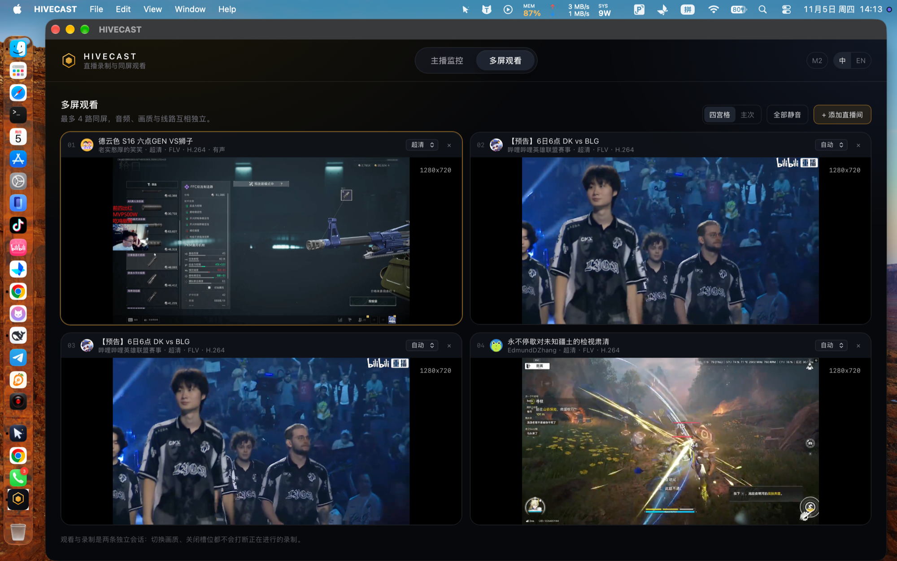
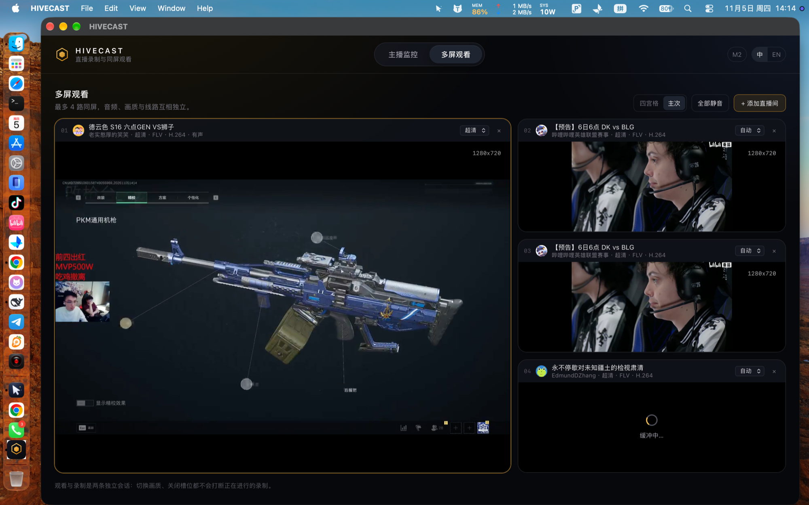

# 22 M2 实现记录：多屏观看端

> 状态：✅ 已完成（2026-11-05）
> 里程碑：docs/19 §5 M2
> 前序：[20-M0-实现记录](20-M0-实现记录.md)、[21-M1-实现记录](21-M1-实现记录.md)

## 0. 一句话结论

观看端与录制端彻底解耦：每个观看格子是一条独立的 **ViewSession**（独立 StreamLease、独立 ffmpeg 转封装、独立 hls.js 实例），两者之间只共享「取流解析缓存」。4 路 720p 同屏实测约 3.5% CPU、app 常驻 51 MB；切画质只重启该格的转封装进程，录制进程与文件不受影响。





## 1. 交付清单

| 层 | 文件 | 内容 |
| --- | --- | --- |
| 后端 | `src-tauri/src/view.rs` | ViewManager、Slot 状态机、ffmpeg 转封装、重连退避 |
| 后端 | `src-tauri/src/process.rs` | `send_graceful`（SIGINT）与 `wait_exit`（轮询 + 超时强杀） |
| 后端 | `src-tauri/src/lib.rs` | SIGTERM 收尾；RunEvent::Exit 收尾 |
| 后端 | `src-tauri/src/commands.rs` | view_slots / view_open / view_close / view_set_quality / view_retry |
| 契约 | `src-tauri/ipc-types/src/lib.rs` | `ViewSlotInfo`（ts-rs 导出到 `src/lib/bindings/`） |
| 前端 | `src/features/watch/WatchPage.tsx` | 布局预设、槽位、音量、画质、选择器 |
| 前端 | `src/features/watch/Player.tsx` | hls.js 封装、错误恢复、卡顿看门狗、控制条 |
| 前端 | `src/lib/ipc.ts` | 5 个命令 + `view://changed` 事件 |
| 文案 | `src/i18n/{zh-CN,en-US}.json` | watch 命名空间 113 个 key（含 qn 名称与降级提示） |

## 2. 后端：ViewManager

### 2.1 对象与常量

```text
ViewManager { root: <cache>/view, server: Arc<StreamServer>, slots: Mutex<HashMap<u8, Arc<Slot>>>, open_gate: Mutex<()> }
Slot        { room: RoomRecord, state: Mutex<SlotState> }
SlotState   { status, session_id, dir, child, url, requested_qn, actual_qn, quality, line, error, generation, closed, alive }
```

| 常量 | 值 | 用途 |
| --- | --- | --- |
| MAX_SLOTS | 4 | 最多四路同屏 |
| POLL | 500 ms | 监督循环轮询间隔 |
| READY_TIMEOUT | 12 s | 等首片 `#EXTINF` 的上限，超时判起播失败 |
| RETRY_BASE / RETRY_MAX | 1 s / 8 s | 重连退避（1、2、4、8 封顶） |
| MAX_RETRIES | 10 | 连续失败上限，超过报「转封装多次失败」 |
| STOP_TIMEOUT | 4 s | 收尾时等 ffmpeg 退出的上限 |

### 2.2 状态机

| 状态 | 含义 | 进入条件 |
| --- | --- | --- |
| starting | 正在拉起 ffmpeg 或等待首片 | open / 切画质 / retry |
| playing | 播放列表已有分片，url 可播 | wait_ready 成功 |
| reconnecting | 进程异常退出，退避后重试 | 子进程退出且未关闭 |
| error | 重试超限或起播超时 | attempts > MAX_RETRIES |

槽位被关闭时走 `teardown`：SIGINT → 等 4 s → 仍在则强杀 → 注销 URL → 删会话目录。

### 2.3 起播流程

1. `broker.groups(RoomRef, qn)` 取线路组（解析缓存 TTL 60 s，跨录制/观看共享）。
2. `pick_view_candidate`：每条线路组内先比编码（H.264 优先），再比封装（FLV > HLS > TS），最后比 `weight`。
3. 新建会话目录 `<cache>/view/<uuid>/`，起 ffmpeg：

```bash
ffmpeg -hide_banner -nostdin -loglevel warning -y -rw_timeout 10000000 \
  -headers "Origin: ...\r\nReferer: ...\r\nUser-Agent: ...\r\n" \
  -i <stream-url> -map 0:v:0 -map 0:a:0? -c copy \
  -f hls -hls_time 1 -hls_list_size 6 \
  -hls_flags delete_segments+append_list+omit_endlist \
  -hls_segment_type fmp4 -hls_fmp4_init_filename init.mp4 \
  -hls_segment_filename <dir>/seg_%05d.m4s <dir>/index.m3u8
```

4. `server.register(session_id, dir)`，得到带 token 的 URL。
5. 每 500 ms 检查 `index.m3u8` 里是否出现 `#EXTINF`；12 s 内成功则写 `url`、状态转 `playing`，否则 SIGINT 并报「起播超时」。

ffmpeg 的 stderr 追加写入 `<cache>/view/ffmpeg.log`（替换早先的 `Stdio::null()`），健康时该文件为空，出问题时有现场可查。

### 2.4 切画质

`set_quality` 只做三件事：写 `requested_qn`、`generation += 1`、状态改 `starting`。监督循环发现 generation 变了就 `teardown` 再 `start_once`。录制侧完全不知道这件事——它拿的是另一条 lease。

### 2.5 并发开槽

`open` 与 `set_quality` 都要先过 `open_gate`（`tokio::sync::Mutex<()>`）。原因见 §6.1：React StrictMode 会把 effect 跑两遍，两个并发 open 都看不到对方，给同一房间占了两个格子。

## 3. 本机 HTTP 服务

沿用 M0 的 `stream/server.rs`：随机端口 + 一次性 token 前缀（`/s/<token>/<session>/...`），Host/Origin 白名单、扩展名白名单、禁止 `..`。会话结束即 `unregister`，旧 URL 立即失效。

## 4. 前端

### 4.1 布局预设

```text
1 路：single
2 路：twoH / twoV
3 路：threeBig（首格 row-span-2）/ threeCol
4 路：quad / main（首格 row-span-3）
```

`LAYOUTS_BY_COUNT` 决定当前路数可选的布局，默认第一个；路数变化时 `layoutChoice` 重置为 null，回到默认布局。

### 4.2 槽位与音量

- 槽位按 `slot` 排序渲染，槽号显示为 `01`–`04`。
- 音量是 `Record<slot, number>`，默认全 0（D3/O1）。
- 有声槽位头部显示「有声」并加 hive 色描边；≥3 路有声只提示一次，不自动静音。
- 工具条「全部静音」一键清零。

### 4.3 画质与降级提示

下拉选项：自动 / 原画 / 蓝光 / 超清 / 高清 / 流畅（对应 0/10000/400/250/150/80）。当 `requestedQn` 与 `actualQn` 不一致（例如未登录 B 站把原画降级为 250）时，头部出现琥珀色 `↓ 超清` 角标，鼠标悬停说明「请求的画质不可用，平台已自动降级」。

### 4.4 播放器

| 关注点 | 做法 |
| --- | --- |
| 实例隔离 | 每个 Player 一个 Hls 实例，URL 变化即销毁重建 |
| 自动播放 | 起播瞬间强制 `muted`，`play()` 成功后再恢复音量 |
| 错误恢复 | MEDIA_ERROR → `recoverMediaError()`；NETWORK_ERROR → `startLoad()`；各 3 次后再报致命 |
| 卡顿看门狗 | 每 2 s 检查 `currentTime`；第 2/4 次卡住拉回 `liveSyncPosition`，第 6 次报「播放失败」 |
| 缓冲覆盖 | 无画面尺寸时显示 spinner + 「缓冲中…」 |
| 统计 | 每秒刷新分辨率、码率、丢帧 |

hls 配置：`lowLatencyMode: false`、`liveSyncDurationCount: 3`、`maxBufferLength: 12`、`backBufferLength: 30`。

## 5. 实测（2026-11-05，房间 545068 / 6 / 7734200 / 5050）

| 项 | 结果 |
| --- | --- |
| 四路同屏 | 4 格全部 1280x720，画面连续；4 个录像 ffmpeg + 4 个转封装 ffmpeg 并存 |
| 资源 | app 51 MB / 1.1% CPU；每个转封装 16–18 MB / 0.1–0.5%；合计约 3.5% CPU |
| 切画质 | 转封装 pid 更换、旧目录被删、1–3 s 内恢复画面；录制 pid 与 flv 增长不变 |
| 音量独立 | 槽 1 设为 0.8 时只有它显示「有声」与描边，其余静音 |
| 布局 | 四宫格与主次（1 大 3 小）都正确铺满窗口 |
| 画质降级 | 未登录请求 10000 实际 250，头部显示 `↓ 超清` |
| SIGTERM 收尾 | 向 app 发 SIGTERM 后 4 个录像 + 4 个转封装全部退出，DB 旧会话标 aborted/app_exit |

## 6. 踩坑

### 6.1 StrictMode 双跑导致双开槽位

dev 下 `main.tsx` 的 StrictMode 让 effect 执行两遍，两个并发的 `view_open` 都读到「该房间没有槽位」，于是给同一房间占了两个格子，槽位 0 反复重建。修法：`open_gate` 串行化。

### 6.2 浏览器自动播放策略

未静音的 `video.play()` 会被拒绝（NotAllowedError），表现为「一直缓冲」。修法：起播瞬间设 `muted = true`，play 成功后再按外层音量恢复。这个坑只在切画质重建播放器、且该格有声音时才会踩到。

### 6.3 误开 lowLatencyMode

我们产出的是普通 HLS（没有 `EXT-X-PART`），开 `lowLatencyMode` 只会让 hls.js 反复去蹭直播边缘，切画质后容易卡在分片边界。改为普通直播配置并把 `liveSyncDurationCount` 提到 3。

### 6.4 「切画质后黑屏」的一半是缺文案

覆盖层写了 `t("watch.buffering")` 但两个语言文件都没有这个 key，界面直接显示 key 字面量、看起来像黑屏卡死。已补 `缓冲中…` / `Buffering…`。

### 6.5 用脚本切片改 TSX 会把文件切坏

用 node 做 `indexOf/slice` 拼接修补 WatchPage 时把文件头部切断，Vite 报 `'return' outside of function`。最后从 Vite 构建产物 `dist/assets/*.js.map` 的 `sourcesContent` 里取回完整源码。教训：改 TSX 只用编辑器式替换或整文件写入。

### 6.6 tokio signal feature

`tokio::signal::unix` 需要 `signal` feature，缺了会报 error[E0603]：module signal is private（tokio 内部把它标成私有模块）。Cargo.toml 的 tokio features 现已包含 signal。

### 6.7 转封装进程会变成孤儿

dev 服务器重启发的是 SIGTERM，不会触发 `RunEvent::Exit`，旧 ffmpeg 会继续写文件。现在 `.setup` 里注册了 SIGTERM 监听，收到后依次 `recorder.shutdown_all`、`view.shutdown_all`、`exit(0)`。

## 7. 已知缺口

| 缺口 | 说明 | 计划 |
| --- | --- | --- |
| room 6 录制失败 | B 站官方赛事流（room 6）录制 ffmpeg 立即 exit 8，观看正常；重试每 60 s 一次 | M2.5 捕获 stderr 定位（403 还是 404） |
| 降级无引导 | 只提示实际画质，没有「登录 B 站后可看原画」的引导 | 接 O4 登录时一并做 |
| 重连无倒计时 | reconnecting 只有文案，没有剩余秒数 | 体验优化，暂缓 |
| 观看缓存无上限 | 只有退出时 clean_cache，运行期不限制总量 | 加配额与巡检 |
| 打包态未验 | 目前只在 dev 态验证 | M6 一起验 |

## 8. 验收对照（docs/19 §5 M2）

| 验收项 | 证据 | 结论 |
| --- | --- | --- |
| 4 路同时播放互不影响 | §5 资源与进程表；关掉任意一格其它格 pid 不变 | ✅ |
| 关 A 声音不影响 B | 音量按槽位独立，槽 1 有声时其余静音 | ✅ |
| 切画质不断录制 | 转封装 pid 变化、录制 pid 与文件大小持续增长 | ✅ |

## 9. 变更日志

| 版本 | 日期 | 变更 |
| --- | --- | --- |
| v1.0 | 2026-11-05 | M2 完成：ViewManager、四宫格与布局预设、画质切换与降级提示、播放器恢复与看门狗、SIGTERM 收尾 |
