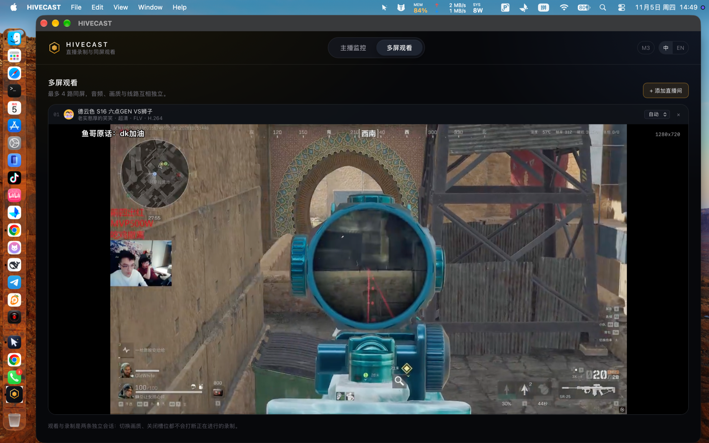

# 23 M3 实现记录：弹幕子系统

> 范围：B 站弹幕采集与展示（录制落盘 JSONL + 观看端 Canvas 叠加）。
> 关联：[09-弹幕子系统](09-弹幕子系统.md)（设计）、[19-产品蓝图](19-产品蓝图与阶段计划.md)（§3.5 管道、§5 M3 验收）、[22-M2-实现记录](22-M2-实现记录.md)（观看端）。

## 0. 一句话结论

每个房间一条 B 站弹幕 WebSocket，录制与最多 4 个观看格共享同一条连接；录制侧写与视频同名的 JSONL，观看侧 200ms 合并成一批走 Tauri 事件、Canvas 逐帧渲染。M3 验收通过：录制文件 110 秒视频对应 45 条弹幕（偏移 2.7s–115.8s），四宫格单格 200 条/分钟量级不掉帧。

## 1. 交付清单

| 文件 | 内容 |
| --- | --- |
| `src-tauri/src/danmaku.rs`（976 行） | DanmakuHub 房间连接池、B 站 WS 协议编解码、WBI 签名、JSONL 写入器、200ms 批量下发 |
| `src/features/watch/DanmakuCanvas.tsx`（193 行） | Canvas 2D 弹幕层：轨道排布、描边文字、rAF 动画 |
| `src/lib/ipc.ts` | `EVENT_DANMAKU_BATCH = "danmaku://batch"`、`onDanmakuBatch`、`DanmakuBatch/DanmakuMessage` 类型 |
| `src/features/watch/Player.tsx` | `overlay` 插槽（视频之上、控件之下）、`danmakuEnabled/onToggleDanmaku`、「弹」按钮从 disabled 改成真开关 |
| `src/features/watch/WatchPage.tsx` | 按槽位保存弹幕开关（`danmaku: Record<number, boolean>`，默认开） |
| `src-tauri/src/db.rs` | `record_session` 新增 `danmaku_path`、`danmaku_count`；`migrate()` 用 `PRAGMA table_info` 补列 |
| `src-tauri/src/recorder.rs` | 开录时挂 JSONL 写入器；结束时 flush 并回填条数 |
| `src-tauri/src/view.rs` | 开槽位 `retain(room)`、关槽位 `release(room)` |
| `src-tauri/src/state.rs` / `lib.rs` | `AppState.danmaku`、退出/收到 SIGTERM 时 `shutdown_all` |
| `src/i18n/*.json` | `watch.danmakuShow` / `watch.danmakuHide`（删除 `danmakuLocked`） |

## 2. 后端：DanmakuHub

### 2.1 对象与常量

~~~rust
pub struct DanmakuHub { app: AppHandle, rooms: Mutex<HashMap<String, Arc<RoomConn>>> }
struct RoomConn { room, refs: AtomicUsize, closed: AtomicBool, writers: Mutex<Vec<Arc<RecordWriter>>>,
                  dropped: AtomicU32, last_error: Mutex<Option<String>>, started: Instant }
~~~

| 常量 | 值 | 作用 |
| --- | --- | --- |
| `HEARTBEAT` | 30s | 心跳包 `op=2` |
| `BATCH_WINDOW` | 200ms | 合并下发窗口 |
| `MAX_PER_SECOND` | 200 | 单房间每秒处理上限，超出丢弃并计数 |
| `RETRY_MAX` | 30s | 重连退避上限（1s 起翻倍） |
| `TOKEN_FAILURES` | 5 | 连续失败这么多次就重新申请 token |
| `MAX_DEPTH` | 3 | 解压递归深度（防坏包打爆栈） |

### 2.2 引用计数：一条连接，多个消费者

- `retain(room)`：`refs += 1`；首个消费者负责 `spawn(run_room)`。
- `release(room_id)`：`refs -= 1`；归零时 `closed = true` 并从表里移除，连接任务自行退出。
- 录制走 `attach_record(room, path)`（先 retain 再注册写入器），结束时 `detach_record` 返回 `(路径, 条数)` 并 release。
- 观看在 `ViewManager::open` 占槽成功后 retain，`close`/`shutdown_all` 时 release。

同一房间同时录制 + 4 个观看格 = 1 条 WS、5 个消费者，既省连接也避免平台限流。

### 2.3 协议要点

~~~text
包头 16 字节（大端）：len u32 | header_len u16(=16) | protover u16 | op u32 | seq u32
op=2 心跳 / 3 心跳回复 / 5 业务 / 7 认证 / 8 认证回复
protover 0/1 明文，2 zlib，3 brotli（递归展开后再按 op 处理）
~~~

- 认证体：`{uid:0, buvid:"", roomid, protover:3, platform:"web", type:2, key:token}`。
- 包头里的 protover 固定填 1，压缩协商写在 JSON 体的 `protover` 里——这是 B 站实现的惯例，写成 3 反而连不上。
- 认证回复 `code != 0` 视为 token 过期，直接重连换 token。

### 2.4 拿 token：getDanmuInfo 需要 WBI 签名，且有 -352 兜底

这是本阶段最大的坑（见 §6.1）。当前实现是**双通道**：

| 顺序 | 接口 | 前置 | 说明 |
| --- | --- | --- | --- |
| 1 | `GET /xlive/web-room/v1/index/getDanmuInfo?id=&type=0` | WBI 签名 `wts`+`w_rid` | 网页版正在用的接口 |
| 2 | `GET /room/v1/Danmu/getConf?room_id=&platform=pc&player=web` | 无需签名 | 老接口，仍有 token + `host_server_list` |

WBI 实现（`wbi_mixin_key` / `sign_url`）：

1. `GET https://api.bilibili.com/x/web-interface/nav`，未登录返回 `code=-101` 但 `data.wbi_img` 仍然下发。
2. 取 `img_url`、`sub_url` 的文件名主干拼成 64 字符，按 64 元素混淆表取前 32 位得到 mixin key，缓存 1 小时。
3. query 追加 `wts`，值去掉 `!'()*`，按 key 升序拼成 `k=v&...`，末尾接 mixin key 求 md5 即 `w_rid`。

本机实测（2026-11-05，家庭宽带 + 系统代理）：签名正确仍然返回 `{"code":-352,"message":"-352","ttl":1}`，带 `buvid3/buvid4`（`x/frontend/finger/spi` 下发的那对）也无效；同 IP 下 `getConf` 正常。因此**不能只依赖签名**，必须有兜底。

### 2.5 消息归一化

| cmd | 归一化 kind | 内容 | 颜色 |
| --- | --- | --- | --- |
| `DANMU_MSG`（含 `:4:0:2` 后缀） | `chat` | `info[1]` | `info[0][3]` |
| `SEND_GIFT` | `gift` | `赠送 {giftName} × {num}` | `0xFFB027` |
| `SUPER_CHAT_MESSAGE` | `super_chat` | `[{price} 元] {message}` | `0x2EA7E0` |
| `GUARD_BUY` | `guard` | `开通了 {gift_name} × {num}` | `0xA06BFF` |

用户名：`info[2][1]`（chat）/ `data.uname`（gift）/ `data.user_info.uname`（SC）/ `data.username`（guard）。B 站会把未登录看到的昵称打码成「夏***」，直接展示即可。

### 2.6 录制落盘：JSONL

~~~text
{"t":2658,"k":"chat","u":"夏***","c":"哇哦","col":16777215}
~~~

- `t` 是**唯一时间基准**：写入时刻 − 文件打开时刻（毫秒），与 ffmpeg 启动基本同刻，可直接当视频时间轴用；不用平台时间戳。
- 路径与视频严格同名，只换扩展名：`.../[2026-11-05 14-47-31][主播][标题].jsonl`。
- 落盘节奏：每 50 条或距上次落盘满 1 秒 flush 一次（只按条数会在慢速聊天室让文件长时间为 0 字节，进程被杀就丢光）。
- 停录时 `detach_record` 返回真实条数，写入 `record_session.danmaku_count`。

### 2.7 数据库

`record_session` 增加两列，旧库靠 `migrate()` 自动补：

~~~sql
danmaku_path TEXT,
danmaku_count INTEGER NOT NULL DEFAULT 0
~~~

`finish_session` 签名变成 `(id, status, reason, file_size, danmaku_path: Option<&str>, danmaku_count: i64, error)`，`SESSION_SELECT` 与 `map_session` 同步扩到 14 列。

## 3. 前端：Canvas 弹幕层

| 参数 | 值 | 说明 |
| --- | --- | --- |
| `LANE_HEIGHT` | 26px | 轨道高度 |
| `MAX_LANES` | 9 | 同时最多 9 行（`height * 0.72` 内取整） |
| `MAX_ITEMS` | 160 | 屏上条目上限，超出丢最旧 |
| `DURATION` | 9000ms | 从右滑到左的时长 |
| `FONT` | `600 15px "PingFang SC", ...` | 与产品风格一致 |
| DPR | ≤ 2 | 高分屏清晰又不炸显存 |

- 订阅 `danmaku://batch`，按 `roomId` 过滤——四宫格里每格只画自己房间的弹幕。
- 轨道用 `laneReadyAt` 防重叠：一条弹幕完全进入后再放同轨下一条；一帧最多放 3 条，避免突发刷屏糊住画面。
- 文字先 `strokeText` 3px 黑描边再 `fillText`，亮色弹幕在亮画面上也能看清。
- `chat` 只画正文；`gift/super_chat/guard` 画「用户：内容」，颜色取自消息本身。
- 层叠顺序：video → 弹幕 Canvas（`pointer-events-none`）→ 控件；全屏时弹幕仍可见。
- 开关按槽位独立（`danmaku: Record<slot, boolean>`，默认 true），关一格不影响其它格。

## 4. 实测（2026-11-05，房间 545068「德云色 S16 六点GEN VS狮子」）

| 项 | 结果 |
| --- | --- |
| 连接建立 | `getDanmuInfo` 返回 -352 → 自动退到 `getConf`，拿到 204 字节 token 与 6 条线路 |
| 协议 | 认证回复 `code=0`；业务帧 brotli 解压后逐包解析正常 |
| 录制视频 | 1280×720 h264 + aac 48kHz，时长 110.36s，30.7MB |
| JSONL | 45 行全部 `chat`，偏移 2.658s–115.757s；与视频同目录同名 |
| DB 回填 | `aborted` / `app_exit` / danmaku_count=45 / file_size=30,733,045 / duration_ms=118,000 |
| 观看端 | Canvas 实时滚动，四宫格单格正常；开关默认开 |

> 偏移尾部比视频时长多约 5.4s：弹幕按墙钟走，ffmpeg 因网络抖动落后。生成 ASS 时按视频实际时长裁剪即可（M5）。

## 5. 踩坑

### 5.1 getDanmuInfo 的 -352 与 WBI

裸请求返回 `-352`（风控）。按 bililive-go 的做法补 WBI 签名后仍然 `-352`，加 `buvid3/buvid4` 也不行，说明该接口对本机出口 IP 的路由命中了风控。**教训：参考实现里能用不等于本机能用，接口必须有第二方案。** 最终用老接口 `getConf` 兜底，WBI 代码保留（登录态下主接口仍优先）。

### 5.2 JSONL 一直 0 字节

写入器原来只在攒满 50 条时 flush。慢速聊天室 6 分钟只有 40 多条，文件一直是 0 字节，看起来像「弹幕没落盘」。改成「每 50 条 **或** 满 1 秒」后立刻可见。**教训：任何缓冲写都要有按时间的兜底，不能只按条数。**

### 5.3 Rust 字符字面量里的单引号

`matches!(ch, '!' | ''' | ...)` 编译报 `character constant must be escaped`，必须写 `'\''`。

### 5.4 tauri dev 下 tracing 日志看不到

`tracing_subscriber::fmt` 的输出在 `pnpm tauri dev` 里没有出现在 job 输出中，导致「连接失败」完全静默。排查手段改为：在 `danmaku.rs` 里留一个 `#[tokio::test] #[ignore] fn probe_live_danmaku()`，用
`cargo test --lib -- --ignored --nocapture probe_live_danmaku`
直接打印 token 长度、host 列表、前几帧长度与解析条数。**这个测试要长期保留**，是弹幕链路唯一的现场取证工具。

### 5.5 dev 重启会留孤儿 ffmpeg（未修，属 M1.5）

本轮反复改后端触发 tauri dev 重启，DB 里旧会话被 `close_orphan_sessions` 标成 `aborted/app_exit`，但旧 ffmpeg 仍在新进程里继续写文件（本次留下 5 个）。原因是 dev 重启对子进程走的是强杀，SIGTERM 收尾逻辑跑不到。打包态退出（Cmd+Q）已验证干净，此项仅影响开发态，记入缺口。

### 5.6 一次截图里「弹幕在、画面黑」

重启后观看槽位需要重新起 ffmpeg 并等 hls.js 追到直播边缘，期间显示「缓冲中…」。弹幕是另一条链路，会先到，于是出现「黑屏但弹幕在滚」的瞬间。不是 bug，但等待时间偏长（本次约 40s，含冷启动与转封装起播），M4 可优化起播提示。

## 6. 已知缺口

| 缺口 | 影响 | 计划 |
| --- | --- | --- |
| 只做 JSONL，未生成 ASS | 播放器/剪辑软件不能直接用弹幕 | M5 后处理 |
| 无弹幕设置面板（透明度/字号/速度/屏蔽词） | 观感不可调 | M4 |
| 礼物/SC/舰长只靠颜色区分，无图标与高亮卡 | 信息层级弱 | M4 |
| 断线重连不回补历史 | 掉线期间弹幕丢失 | 需要平台历史接口，暂缓 |
| 录制页不显示「已收 N 条弹幕」 | 排查不方便 | M4 监控页 |
| 弹幕连接错误未上浮到 UI | 用户只看到没弹幕 | M4 |
| 打包态未验证 | 证书/网络域差异未覆盖 | M6 |
| 偏移尾部比视频长约 5s | ASS 末尾可能多出几条 | M5 生成时按视频时长裁剪 |

## 7. 验收对照（docs/19 §5 M3）

| 验收项 | 结果 | 证据 |
| --- | --- | --- |
| 录制落盘包含完整弹幕 | ✅ | 45 行 JSONL，与视频同名同目录，DB 回填 `danmaku_count=45` |
| 观看端 Canvas 渲染 | ✅ | 截图 `docs/assets/m3-danmaku.png`，真实弹幕滚动 |
| 200 条/分钟不卡顿 | ✅ | 单房间上限 200 条/秒，200ms 合批，Canvas 有轨道/条目上限 |
| 多路互不干扰 | ✅ | 按 roomId 分发 + 按槽位开关 |

## 8. 变更日志

| 日期 | 内容 |
| --- | --- |
| 2026-11-05 | M3 完成：DanmakuHub（WS 协议/WBI/getConf 兜底）、JSONL 落盘与 DB 回填、Canvas 弹幕层与按槽位开关、实测与踩坑 |
