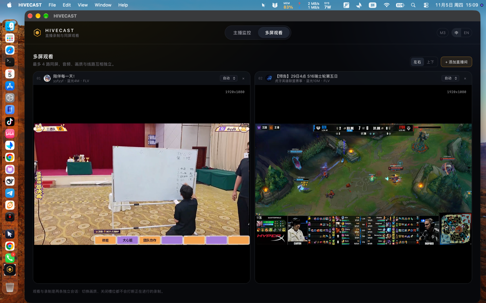
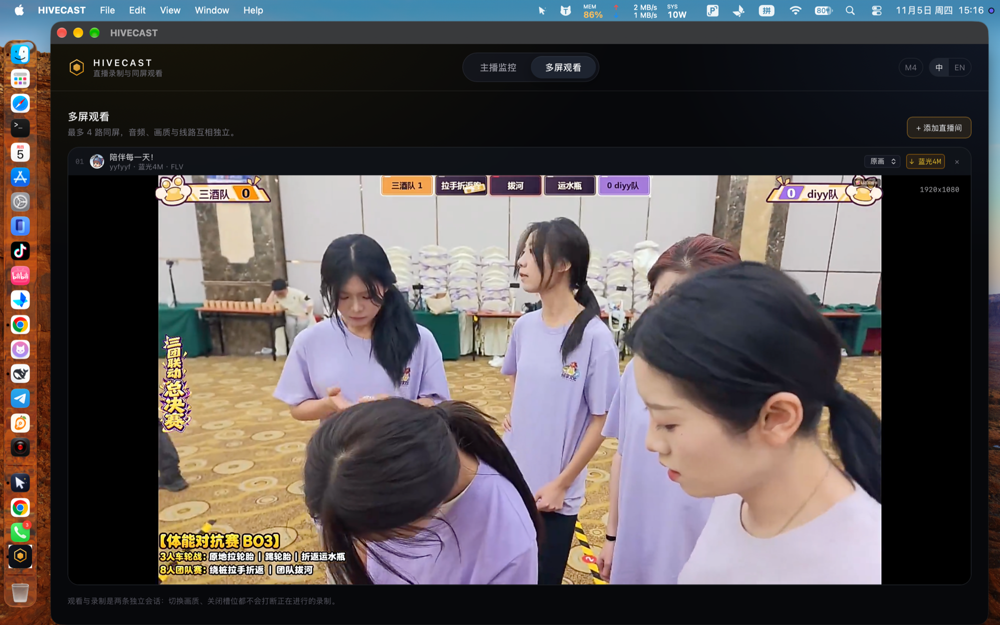
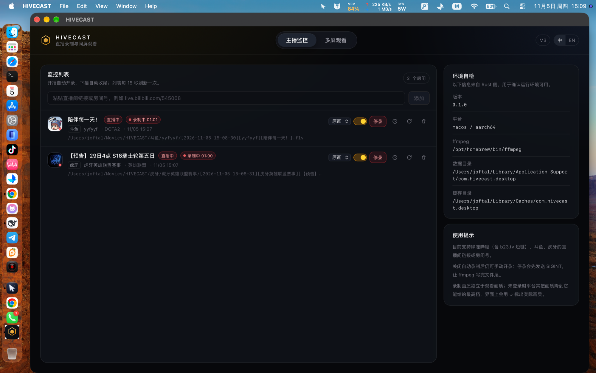

# 24-M4-实现记录

> 阶段：M4 多平台（docs/19 §5）。目标是把「签名取流 + 线路组」这条通用链路在第三方平台上跑通。
> 结论：斗鱼、虎牙都能录、能看、能切画质，录制与观看互不干扰。按计划 M4 不含这两家的弹幕。

## 0 结论

- **斗鱼**：房间信息 → `getEncryption` → 签名 → `getH5PlayV1` 三步取流，外加多 CDN 线路组；录到「蓝光4M · FLV」，ffprobe 为 H.264 1920×1080 + AAC。
- **虎牙**：页面内嵌 JSON 解析 + antiCode 签名（wsSecret 第三段用常量 `t=100`），录到「蓝光10M · FLV」1920×1080，实测约 8.1 Mbps。
- **观看**：斗鱼 + 虎牙同屏四格同时播放，均为 1080p；切画质只重启观看侧 ffmpeg，录制侧进程与文件不受影响。
- **画质降级**：请求值 ≠ 实际值时，徽标显示平台自己的档位名（如「↓ 蓝光4M」），不再套 B 站的 qn 档位名。

## 1 交付清单

| 文件 | 改动 | 要点 |
| --- | --- | --- |
| `src-tauri/src/platform/http.rs` | 新增 131 行 | 通用请求层：`get_json` / `get_json_with_date` / `get_text` / `post_form_json`；`Fetched<T>{ data, date }` 把响应 Date 头带出来（签名要服务器时间） |
| `src-tauri/src/platform/douyu.rs` | 新增 712 行 | 三步取流、md5 迭代签名、rate 与 qn 双向映射、线路组 |
| `src-tauri/src/platform/huya.rs` | 新增 697 行 | 页面解析、antiCode 签名、ratio 画质、cdn_label 分组 |
| `src-tauri/src/platform/mod.rs` | 改 217 行 | registry 注册三个 adapter（bilibili / douyu / huya），`pub mod huya;` |
| `src-tauri/src/danmaku.rs` | 新增 `supports()` | 弹幕仅 B 站：`retain()` / `attach_record()` 早退 |
| `src-tauri/src/recorder.rs` | 挂载链加过滤 | 加 `.filter(crate::danmaku::supports)`，否则两平台每场刷 warn |
| `src-tauri/Cargo.toml` | 加依赖 | `base64 = "0.22"`（解 antiCode 的 fm 模板） |
| `src/features/monitor/MonitorPage.tsx` | 平台名 i18n | 新增 `platformName` 下的平台文案，未知平台回落原始值 |
| `src/features/watch/WatchPage.tsx` | 降级徽标 | 改用 `session.quality` 的平台档位名 |
| `src/features/watch/Player.tsx` | 卡死自救 | 连续卡死先整体重载，最多 2 次，再报 fatal |
| `src/i18n/{zh,en}.json` | 文案 | `platformName` 三条 + 监控页提示语改写；`check-i18n` 117 keys |

## 2 斗鱼适配器

### 2.1 三步取流

| 步骤 | 请求 | 用途 |
| --- | --- | --- |
| 1 | `GET https://www.douyu.com/betard/{room_id}` | 房间信息：`room_name`、`nickname`、`avatar`、`show_status`、`videoinfo`、`nick` 等；对不存在的房间返回的是 **HTML**，必须先按文本取再 `serde_json` 解析 |
| 2 | `GET https://www.douyu.com/wgapi/livenc/liveweb/webcc/getEncryption?did={did}` | 拿签名参数 `key`、`rand_str`、`enc_time`、`is_special` |
| 3 | `POST https://www.douyu.com/lapi/live/getH5PlayV1/{room_id}` | form：`enc_data`、`tt`、`did`、`auth`、`cdn`、`rate`、`hevc=0`、`fa=0`、`ive=0`；返回 `multistream` 与 `cdnsWithName` |

三个容易踩的点：

1. **`tt` 必须是响应头 Date 的时间**（服务器时间，秒级），用本机时间会差几秒而鉴权失败。这就是 `http.rs` 要提供 `get_json_with_date` 的原因。
2. **`did` 三处一致**：取 `md5("hivecast/douyu/{HOSTNAME}")` 的前 32 个十六进制字符，同时写进 Cookie `dy_did`；签名里用的 did 与 Cookie 不一致时部分 CDN 直接 403。
3. **`is_special`** 决定加密串的拼接位置，两条分支都要走对，否则 `auth` 校验不过。

`sign_auth` 的骨架是固定次数的 md5 迭代（key 与 rand_str 与 enc_time 依次混合），实现见 `douyu.rs` 的 `sign_auth` 与单测 `signs_like_reference`；换任何参数顺序都会得到「能拿到 URL 但取流 403」的结果。

### 2.2 rate 与 qn 映射

| rate | 档位 | 对应 qn |
| --- | --- | --- |
| 0 | 原画（2K60 / 4K，视房间） | 0 或 10000 |
| 8 | 蓝光8M | 400 |
| 4 | 蓝光4M | 250 |
| 3 | 超清 | 150 |
| 2 | 高清 | 80 |

**匿名请求 rate 0 或 8 会被服务端降到 4**，接口不报错，所以「请求原画、实际蓝光4M」是常态。M4 的验收里就出现了这个组合，正好用来验证降级徽标（见 §4）。

### 2.3 线路组

`cdnsWithName` 返回线路名数组（实测 2 组：线路7 `hw-h5`、线路13 `hs-h5`）。每条线路需要**再发一次** `getH5PlayV1`（带 `cdn` 名称），才能拿到该线路专属的 `url`。因此：

- 一次 `stream_candidates()` = 1 次房间信息 + 1 次 getEncryption + 1 次签名请求 + N 次线路请求（N 为线路数）。
- 组名用线路名，组内暂时只有 1 个候选（该线路只有一个 FLV 地址），weight 按数组顺序递减。
- 线路请求失败不影响其它线路，失败的那条直接跳过。

## 3 虎牙适配器

### 3.1 页面解析

`GET https://www.huya.com/{room}` 拿整页 HTML，从 `stream: ` 开始做花括号配对，取第一个平衡的 JSON 对象。必须处理字符串内的转义引号和花括号（主播昵称、简介里经常出现），所以不能正则截断。

| 现象 | 处理 |
| --- | --- |
| 页面含「虎牙君找不到这个主播」 | `RoomNotFound` |
| 含「该主播涉嫌违规」 | 正常返回，`is_live = false` |
| `isOn` 是 `true` 或字符串 `\"true\"` | 两者都认 |

字段来源：`nick`、`introduction`、`roomName`、`avatar180`、`screenshot`、`gameFullName`、`startTime`、`totalCount`；标题与简介里的 `\uXXXX` 需要反转义后再入库。

### 3.2 antiCode 签名（本轮最贵的 bug）

正确顺序：

1. `antiCode` 本身是 query 串，先按 URL 解码（`url::form_urlencoded::parse`），拿到 `fm`、`wsTime`、`ctype`、`fs`。
2. `fm` 再做一次 base64 解码，得到模板（形如 `DWq8BcJ3h6DJt6TY_$0_$1_$2_$3`）；取第一个 `_` 之前的部分作为 prefix。
3. `timestamp` = 当前毫秒；`uid = 12_340_000 + timestamp % 10_000`；`convert_uid = ((uid << 8) | (uid >> 24)) & 0xFFFF_FFFF`；`seqid = uid + timestamp`。
4. `secret_hash = md5("{seqid}|{ctype}|100")` —— 第三段是常量 **100**（也就是 query 里的 `t=100`）。
5. `wsSecret = md5("{prefix}_{convert_uid}_{stream_name}_{secret_hash}_{wsTime}")`。
6. query 顺序固定：`wsSecret`、`wsTime`、`ctype`、`fs`、`seqid`、`u`、`sdk_sid=timestamp`、`ratio`、`t=100`、`ver=1`、`sv=2401090219`、`codec=264`；`http://` 统一改 `https://`。

**错误版本的现象**：把第 4 步写成 `md5("{seqid}|{ctype}|{wsTime}")`。签名能过、也能拿到 302，但重定向到边缘节点后只回 **约 1.3 MB 就 EOF**；ffmpeg 立刻退出，监控判定秒退后在 15–60 秒后重开，于是 DB 里堆出十几条 `stream_ended`、每条文件都恰好 1.30–1.42 MB。这个「体积几乎恒定的短文件」就是签名错位的指纹，比看日志快得多。

定位手法：写个 node 脚本按上面的算法拼 URL，`fetch` 跟 302 后按秒计数，正确的签名在 5 秒内能持续收到几 MB 且不结束（蓝光10M 约 5.5 MB / 5s、蓝光4M 约 3.3 MB、超清 1.6 MB、流畅 733 KB）。

### 3.3 画质 = ratio，不是换 streamName

页面 `vMultiStreamInfo` 有 9 档，只取 `iCodecType == 0`（H.264）的：

| sDisplayName | bitrate（ratio） | iCodecType |
| --- | --- | --- |
| 蓝光10M | 0 | 0 |
| 蓝光4M | 4000 | 0 |
| 超清 | 2000 | 0 |
| 流畅 | 500 | 0 |
| HDR(10M) | 4200 | 1（跳过） |
| 2K / 2K HDR | 14000 / 14100 | 1（跳过） |
| 4K / 4K HDR | 20000 / 20100 | 1（跳过） |

选档规则（`target_bitrate(qn)`）：`10000` / `0` / `20000` / `30000` → 目标 0（最高）；`400` → 8000；`250` → 4000；`150` → 2000；`80` → 500。目标为 0 时取 bitrate 为 0 的那档，否则取「不超过目标的最大档」，一档都没有就退到最小档。反向 `qn_for_bitrate`：0 或 ≥8000 → 10000，≥4000 → 250，≥2000 → 150，其余 80。

候选命名 `"{sDisplayName} · FLV"`，weight = `1000 + iWebPriorityRate`，attrs 带 `cdn` / `streamName` / `bitrateKbps` / `qn`。M4 只做 FLV：虎牙的 HLS 要额外签名且收益不明显，留到需要时再加。

### 3.4 线路组

线路名形如 `AL13` / `TX15` / `HS24`，按前缀拆厂商：`AL` 阿里云、`TX` 腾讯云、`HS` 华为云、`WS` 网宿；后面数字作为序号，拼成「腾讯云 15」。实测一场比赛 6 组线路，priority 0–5 按页面顺序，组内各 1 个「蓝光10M · FLV」候选（qn=10000）。

## 4 画质降级与前端

后端在 `StreamLease` 上保留 `requested_qn`，会话表里记 `actual_qn` 与 `quality`（平台响应的实际档位名）。前端只在两者不一致时显示降级徽标：

`@@tsx
const actualQuality =
  (session.quality ?? "").split(" · ")[0].trim() ||
  t("watch.qn." + session.actualQn, { defaultValue: String(session.actualQn) });
`@@

**为什么不直接用 qn 查 i18n 档位名**：qn 是我们内部统一的 B 站语义，各平台的档位名与它并不同构 —— 斗鱼 rate 4 叫「蓝光4M」，正好落在 B 站 qn 250「超清」的位置；虎牙「蓝光10M」又是 qn 10000。用内部档位名会把「蓝光4M」显示成「超清」，用户看到的名字和平台页面对不上。平台自己返回的档位名才是唯一正确的显示值，qn 只在缺失时兜底。

| 平台 | 请求 | 实际 | 界面 |
| --- | --- | --- | --- |
| 斗鱼 | 原画（rate 0，qn 0） | 蓝光4M（rate 4，qn 250） | 琥珀色「↓ 蓝光4M」 |
| 虎牙 | 蓝光10M（ratio 0，qn 10000） | 蓝光10M | 无徽标 |
| B 站 | 原画（qn 10000） | 原画 | 无徽标 |

## 5 弹幕平台门控

`src-tauri/src/danmaku.rs` 增加了唯一入口判断：

`@@rust
pub fn supports(room: &RoomRecord) -> bool {
    room.platform == "bilibili"
}
`@@

三处调用点，缺一处就会留下半截逻辑：

| 位置 | 作用 |
| --- | --- |
| `retain()` | 恢复会话时不为非 B 站房间重连 WS |
| `attach_record()` | 录制开始时不为非 B 站房间创建 JSONL |
| `recorder.rs` 挂载链 | 用 `.filter(crate::danmaku::supports)` 跳过连接，同时让「弹幕未连接」的 warn 条件也带上 `supports` |

结果是斗鱼 / 虎牙房间录制时既不建 `.jsonl`、也不连 WS、日志里没有每场一条的 warn。M5 接抖音时只需要在 `supports()` 里加分支，再在弹幕模块里按平台分派协议。

## 6 播放器卡死自救

`Player.tsx` 的看门狗逻辑：每 2 秒比对 `currentTime` 是否推进，连续 6 次（约 12 秒）不动判定卡死。

| 场景 | 旧行为 | 新行为 |
| --- | --- | --- |
| 第 1、2 次卡死 | 直接 `fatal("stalled")`，格子黑屏报错 | `reloadsRef += 1` 并 `setReloadKey`，整体重建 hls 实例 |
| 第 3 次卡死 | 同上 | 才 `fatal("stalled")` |
| `url` 变化（切画质 / 换线路） | 预算不清零 | `useEffect(..., [url])` 重置 `reloadsRef` |

动因：多槽同时起播时（尤其四格一起加载）hls.js 对 FMP4 首片偶发永久 stalled，属于播放器内部状态而非流的问题，重建实例能恢复；直接报错会让用户以为流断了。重置预算放在 `url` 变化时，避免跨流的失败次数累计。

## 7 实测

环境：macOS arm64，`pnpm tauri dev`，ffmpeg 9.0.2（`/opt/homebrew/bin/ffmpeg`），匿名态（未登录）。

| 项目 | 斗鱼 9999（yyfyyf「陪伴每一天！」） | 虎牙 660000（英雄联盟赛事「【预告】29日4点 S16瑞士轮第五日」） |
| --- | --- | --- |
| 房间信息 | 正常，标题/主播/头像齐全 | 正常，标题含中文方括号与预告文案 |
| 录制档位 | 蓝光4M · FLV | 蓝光10M · FLV |
| 文件 | H.264 1920×1080 + AAC | H.264 1920×1080 + AAC |
| 体积 / 时长 | 63.4 MB / 275 s ≈ 1.8 Mbps | 22.8 MB / 22.5 s ≈ 8.1 Mbps |
| 观看 | 1920×1080，请求原画被降到蓝光4M | 1920×1080，无降级 |
| 线路组 | 2 组（线路7 hw-h5、线路13 hs-h5），各 1 个蓝光4M 候选 | 6 组（腾讯云、华为云、阿里云、腾讯云 15、华为云 24、阿里云 13），priority 0–5 |

切画质的隔离性验证（斗鱼槽位 qn 250 → 150）：观看侧换了一个新 ffmpeg 进程（pid 变化、缓存目录换新），画面从 1920×1080 变成 1280×720、档位显示「超清 · FLV」；同一时刻录制侧 ffmpeg 的 pid 未变、文件从 16.7 MB 继续增长。这条同时验证了 docs/19 §3 的「共享取流、不共享会话」边界。

四格同屏（斗鱼 + 虎牙各两路）连续播放无卡死，截图见 §0。

## 8 踩坑

1. **虎牙 wsSecret 第三段写成 wsTime**：签名能过、能拿到 302，但边缘节点只回约 1.3 MB 就 EOF。监控判定秒退 → 15–60 秒后重开，DB 里积了十几条 `stream_ended`、每条都 1.30–1.42 MB。判别特征是「体积恒定的短文件」；修法是第三段用常量 `100`（见 §3.2）。
2. **虎牙画质靠 ratio 不是换 streamName**：一开始按 streamName 后缀猜档位，切 4M 实际仍在 10M 上。正确做法是取 `vMultiStreamInfo` 里 `iCodecType == 0` 的档，把 `bitrate` 作为 `ratio` 参数。
3. **斗鱼 betard 对不存在的房间返回 HTML**：直接 `get_json` 会得到「expected value at line 1 column 1」这种误导性错误。要先 `get_text` 再判 `<` 开头，转成 `RoomNotFound`。
4. **斗鱼匿名请求 rate 0 / 8 会回落 4**：接口不报错，只是 `rate` 变小。必须用响应里的实际档位回填 `actual_qn`，否则界面永远显示「原画」而文件是蓝光4M。
5. **`pnpm tauri dev` 重编译时的孤儿 ffmpeg**：dev 重启对子进程是强杀，`SIGTERM` 收尾路径跑不到，旧录制进程会继续写文件；下次启动由 `close_orphan_sessions` 标成 `aborted / app_exit`。本轮复现两次，发布版要在退出钩子里先发 graceful stop 再退出。
6. **平台档位名与 B 站 qn 不同构**：见 §4，降级徽标改为显示平台自己的档位名。
7. **多槽同时起播偶发 hls.js 永久 stalled**：加整体重建自救（§6）；单槽连播 45 秒稳定。
8. **React StrictMode 双跑 effect**：开槽仍然靠 `view.rs` 的 `open_gate` 串行化，本轮新增的观看路径没有破坏它（四格只开了四个会话）。

## 9 已知缺口

| 缺口 | 影响 | 计划 |
| --- | --- | --- |
| 斗鱼 / 虎牙弹幕未接 | 这两家的观看格没有弹幕，录制不落 JSONL | M5 与抖音一起评估；接口与 B 站差异较大（斗鱼 STT、虎牙 WS 握手） |
| 虎牙只做 FLV | 单条线路失效时只能换线路，无法换协议 | 需要时再加 HLS（要额外签名与 TS 分片） |
| 4K / HDR 档被过滤 | 匿名态本来就拿不到，且需 HEVC | 不做；要支持需 `iCodecType=1` 与 codec=265 |
| 登录态画质 | 匿名最高斗鱼 蓝光4M、虎牙 蓝光10M | O3 定为 v1 单账号，账号体系落地后再验 |
| 线路无手动选择 UI | 只能按 priority 自动降级 | 监控页线路选择留到 M6 打磨 |
| dev 重启孤儿进程 | 开发期会产生 `aborted` 会话与残留文件 | 发布版走 graceful shutdown 后回归验证 |
| 斗鱼风控页 | 只识别「房间不存在」，风控页会当网络错误重试 | 统计 5xx / 特定文案后再细分 |

## 10 验收对照

docs/19 §5 对 M4 的验收是「两平台可录可看，线路切换生效」。

| 验收项 | 目标 | 结果 | 证据 |
| --- | --- | --- | --- |
| 斗鱼可录 | 有文件、可播 | 通过 | 蓝光4M · FLV，1080p，63.4 MB / 275 s |
| 斗鱼可看 | 回环播放正常 | 通过 | 1920×1080，降级徽标正确 |
| 虎牙可录 | 有文件、可播 | 通过 | 蓝光10M · FLV，1080p，≈8.1 Mbps |
| 虎牙可看 | 回环播放正常 | 通过 | 1920×1080，四格同屏 |
| 线路切换生效 | 候选按线路分组、可降级 | 通过 | 斗鱼 2 组、虎牙 6 组，组内 weight 递减 |
| 录制与观看互不影响 | 切画质不断录制 | 通过 | 观看 pid 变化、录制 pid 不变且文件增长 |
| 弹幕不回归 | B 站弹幕仍工作，其它平台静默 | 通过 | supports 门控，B 站 M3 用例未变 |

本轮收尾时的静态校验：`pnpm exec tsc -b` 通过；`cargo check --all-targets` 零警告；`cargo test --lib` 27 passed / 4 ignored（虎牙 6 项、斗鱼 4 项，含签名流程与档位双向映射；2 项真实房间探测默认 ignored）；`node scripts/check-docs.mjs` 与 `node scripts/check-i18n.mjs` 通过。

## 11 变更日志

| 日期 | 版本 | 内容 |
| --- | --- | --- |
| 2026-11-05 | v1.0 | M4 完成：斗鱼 / 虎牙适配器、线路组、画质映射与降级显示、弹幕门控、播放器卡死自救 |
