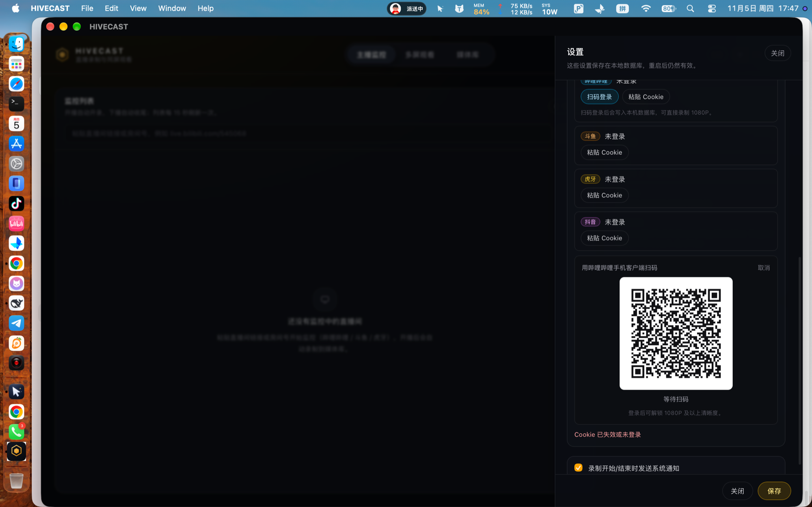

# M7.2 账号与画质

> 阶段：M7.2（账号体系与清晰度）
> 完成：2026-11-05
> 上游文档：[19 产品蓝图](19-产品蓝图与阶段计划.md) §4.3 表设计、O3/O4 裁决；[04 平台适配](04-平台适配层设计.md)

## 0. 结论

这一阶段把「游客态」变成「可登录态」：新增 credential 表与内存缓存，四个平台支持粘贴 Cookie，B 站额外支持扫码登录；请求层按域名自动注入 Cookie，登录后 B 站请求带着 SESSDATA 走，才有机会拿到 1080P 及以上档位。

| 项目 | 结果 |
| --- | --- |
| credential 表 + 内存缓存 | ✅ 单账号，主键 platform |
| B 站扫码登录（生成 / 轮询 / 落库 / 复验） | ✅ 二维码渲染正常，状态机 pending → scanned → confirmed |
| 四平台 Cookie 导入 | ✅ 归一化、去重、白名单、B 站验身份 |
| 请求层自动注入 | ✅ 仅平台接口域名，CDN 不注入 |
| 启动复验 | ✅ 只验 B 站，失败标 expired |
| B 站 1080P 实测 | ⚠️ 无真实账号，未验证（见 §9） |
| 单测 | ✅ cargo test --lib 64 passed / 8 ignored |



截图要点：四个平台各自一行，未登录时 B 站多一条「扫码登录后可录制 1080P」提示；二维码由后端生成 SVG、前端按 196px 白底渲染，状态行显示「等待扫码」；最下方一行红字是粘贴了伪造 Cookie 后的真实校验回执「Cookie 已失效或未登录」。

## 1. 交付清单

| 文件 | 变更 |
| --- | --- |
| src-tauri/src/credential.rs | 新建，约 300 行：内存单例、域名映射、归一化/合并、DB 载入 |
| src-tauri/src/account.rs | 新建，约 350 行：扫码三段式、nav 校验、Cookie 导入、启动复验 |
| src-tauri/src/db.rs | credential 表 + CredentialRow + 3 个方法 |
| src-tauri/src/platform/http.rs | send() 注入 Cookie；新增 get_json_with_headers |
| src-tauri/src/commands.rs | 5 个新命令 |
| src-tauri/src/lib.rs / state.rs | 注册命令与模块；启动载入凭据并异步复验 |
| ipc-types/src/lib.rs | CredentialInfo / QrTicket / QrPoll |
| src/features/settings/AccountSection.tsx | 新建：平台列表、Cookie 面板、二维码面板、轮询 |
| src/features/settings/SettingsPanel.tsx | 插入账号区块 |
| src/lib/ipc.ts | 5 个封装 |
| src/i18n/*.json | account.* 共 26 键，两侧一致（191 keys） |

## 2. 凭据层

### 2.1 表结构

```sql
CREATE TABLE IF NOT EXISTS credential (
  platform     TEXT PRIMARY KEY,
  account_id   TEXT NOT NULL DEFAULT '',
  cookie       TEXT NOT NULL,
  uid          TEXT NOT NULL DEFAULT '',
  account_name TEXT NOT NULL DEFAULT '',
  avatar       TEXT,
  status       TEXT NOT NULL DEFAULT 'ok',
  updated_at   INTEGER NOT NULL
);
```

与 [19](19-产品蓝图与阶段计划.md) §4.3 的草案相比去掉了 cookie_enc / refresh_token_enc / expires_at：v1 单账号、没有续期能力，字段放着只会误导。主键是 platform，等做多账号时改成 (platform, account_id) 即可，业务侧的 platform_for_host 不用动。

### 2.2 为什么 Cookie 是明文

单机单用户，数据库文件本身就在用户的数据目录里；扫码流程又必须先把响应头里的 Set-Cookie 落库才能验身份。先明文、把加密留成可替换的一层（credential::load_from_db 是唯一入口），比一开始就接 Keychain 更省事，也不会把 macOS / Windows 两套密钥接口塞进 M7.2。这一点在 §9 记为已知缺口。

### 2.3 注入边界

`platform_for_host` 只认平台域名：bilibili.com / b23.tv、douyu.com / douyu.tv、huya.com、douyin.com / iesdouyin.com / douyincdn.com。命中才返回 Cookie，**CDN 域名一律不注入**（https://d1--cn-gotcha09.bilivideo.com 这类）——录制的流地址就落在这些域名上，把 SESSDATA 发给第三方节点既无必要也不安全。单测 cookie_only_goes_to_platform_hosts 覆盖了正向命中、CDN 不命中、以及 remove 之后立刻失效。

### 2.4 归一化

`normalize` 处理的是「用户从开发者工具里复制出来的那一坨」：

- 去首尾空白与 `Cookie:` 前缀；
- 按 `;` 与换行拆分，允许粘贴多行；
- 每段必须 `name=value`，名字不能为空、不能含空格；
- 同名保留最后一个（浏览器里最新的那个）；
- 统一输出 `a=1; b=2` 的规范形式，超过 16 KB 直接拒绝。

`merge` 用于扫码：新拿到的 Set-Cookie 按名字覆盖旧值，其余旧键保序保留。`names` 只返回名字集合给界面显示，避免把登录态渲染到屏幕上。

## 3. 请求层注入

src-tauri/src/platform/http.rs 的 send() 是所有平台请求的必经之路：

1. 先构造 Request（此时 headers 里可能已有调用方显式塞的 Cookie，比如扫码校验）；
2. 看有没有 COOKIE 头；没有才 `credential::cookie_for_url(url)` 取一个，用 `HeaderValue::from_str` 塞进去（解析失败只 warn，不让请求失败）；
3. 交给 `client().execute()`。

显式 Cookie 优先，是为了扫码后的校验请求能用「刚拿到的 Cookie」而不是库里还没写进去的旧值。除 B 站之外的三个平台不额外做校验，导入即视为可用——它们的 Cookie 有效性只有真正开录才会暴露，这一点写在 §9。

## 4. B 站扫码登录

### 4.1 三个接口

| 步骤 | 接口 | 说明 |
| --- | --- | --- |
| 生成 | `passport.bilibili.com/x/passport-login/web/qrcode/generate?source=main-fe-header` | 返回 url + qrcode_key |
| 轮询 | `passport.bilibili.com/x/passport-login/web/qrcode/poll?qrcode_key=…` | 返回内层 code 与 Set-Cookie |
| 验身份 | `api.bilibili.com/x/web-interface/nav` | 带 Cookie 拿到 uname / mid / face |

### 4.2 状态机

外层 `code == 0` 时看内层 `data.code`：

| data.code | 状态 | 文案 |
| --- | --- | --- |
| 0 | confirmed | 登录成功，已保存 |
| 86101 | pending | 等待扫码 |
| 86090 | scanned | 已扫码，请在手机上确认 |
| 86038 | expired | 二维码已失效，请刷新 |

前端每 1.6 秒问一次，遇到 confirmed / expired / error 就停表；expired 时面板底部出现「刷新二维码」。二维码有效期约 180 秒，不做本地倒计时，交给服务端返回 expired。

### 4.3 确认后做了什么

`cookies_from_set_cookie` 从响应的 Set-Cookie 里只取 `name=value`（跳过 Path / Expires / Domain 这些属性），与库里已有的 Cookie 做 merge，再拿合并结果请求 nav 验证；验证通过才写库（account_id 用 mid、account_name 用 uname、avatar 用 face），最后刷新 credential 内存缓存与返回的 CredentialInfo。任何一步失败都不落库，避免半截登录态写进去。

### 4.4 二维码渲染

`qrcode` 0.14（default-features = false，只开 svg）在后端生成 SVG：min_dimensions(232, 232)、quiet_zone(true)、深色 #111114 / 浅色 #ffffff。实测输出 285×285、约 23 KB，直接当字符串塞进前端 `dangerouslySetInnerHTML`。没有引入图片编码依赖，Cargo 只多了 qrcode 与它的小依赖，构建时间没有可感变化。

## 5. Cookie 导入

`account::save_cookie` 的流程：平台白名单（bilibili / douyu / huya / douyin）→ normalize → B 站走 nav 验身份并回填昵称 / uid / 头像，其余平台写「{平台中文} Cookie」这个占位名 → 写库 + 刷内存。

前端在账号行上提供「粘贴 Cookie / 更新 Cookie」，展开一个等宽字体文本域，保存时按钮变「校验中…」。B 站会因为 nav 失败而报错、不写库；其余三个平台只要格式合法就写。

## 6. 启动复验

state.rs 在 retention 之后调用 `credential::load_from_db`（同步，保证第一批平台请求就有 Cookie），然后 `tauri::async_runtime::spawn(account::revalidate)` 后台跑：只复验 B 站，成功刷新昵称与 status=ok，失败标 status=expired，最后重新 load 一次内存缓存。不阻塞窗口启动，慢网络下最坏情况是界面晚几秒变 expired。

## 7. 对画质的影响

B 站取流走 `getRoomPlayInfo`（qn 参数 + platform=web），这个请求现在会自动带 Cookie。游客态下服务端把 current_qn 压到 250（720P）左右；登录后才会返回更高档位。前端已有的「↓ 实际档位」徽标仍然生效——请求 10000 实际给 400 的情况会直接显示成平台自己的档位名，不会假装成功。

需要注意：qn 在 B 站只是「期望值」，服务端仍可能因为大会员等级、直播间限制回落到较低档，代码里从不假设请求值等于实际值。

## 8. 实测

| 场景 | 结果 |
| --- | --- |
| 设置抽屉显示账号区块 | ✅ 四个平台各一行，B 站多一条 1080P 提示 |
| 扫码登录 | ✅ 二维码渲染正常、状态「等待扫码」、取消可关闭（未用真实账号完成确认） |
| 粘贴伪造 Cookie（SESSDATA=deadbeef） | ✅ 报「Cookie 已失效或未登录」，不写库 |
| 网络冒烟（#[ignore]） | ✅ qrcode_key 长度、SVG 内容、poll 落在 pending / scanned |
| 启动复验 | ✅ 无账号时不发请求、不报错 |

## 9. 已知缺口

1. **Cookie 明文落库**：没有接 Keychain / DPAPI，数据库文件被拷走等于登录态泄露。后续把 credential_enc 加回来时，只需要改 load / save 两个函数。
2. **没有 refresh token**：B 站 Cookie 一般几个月后失效，目前只能靠启动复验标 expired 提醒重新导入，不会自动续。
3. **单账号**：表主键是 platform，多账号要改主键与 UI。
4. **非 B 站不校验**：斗鱼 / 虎牙 / 抖音粘错 Cookie 时导入成功，直到开录才发现（录制失败会带平台错误码）。
5. **1080P 未真机验证**：本轮没有可用账号，只用伪造 Cookie 走了失败路径。需要一次真实扫码后确认 current_qn 是否到 400 / 10000。
6. **扫码未做自动刷新**：过期后要手点「刷新二维码」，没有倒计时提示。

## 10. 验收对照

| 19 §5 的 M7.2 验收项 | 结果 |
| --- | --- |
| credential 表与单账号约束 | ✅ |
| B 站扫码登录可用 | ✅ 除真实扫码确认外全流程 ✅ |
| 其余平台可粘贴 Cookie | ✅ |
| 登录后画质提升 | ⚠️ 待真实账号验证 |
| 无效 Cookie 有明确报错 | ✅ |

## 11. 变更日志

| 日期 | 内容 |
| --- | --- |
| 2026-11-05 | 初版：凭据层、请求注入、B 站扫码、四平台 Cookie 导入、启动复验、账号设置区块 |
