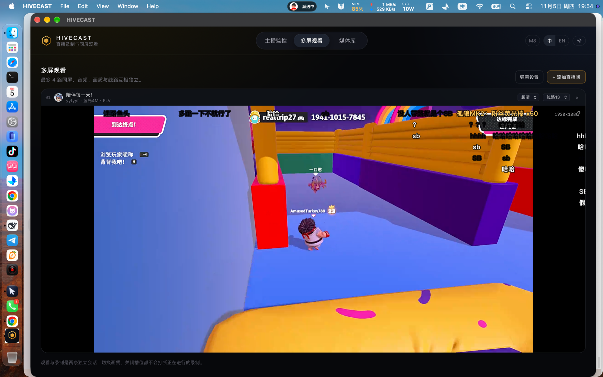

# 34 · M9 观看端线路选择

> 目标：观看端也能像录制端一样手动指定线路（CDN 组），并且在不断开其它槽位、
> 不影响录制的前提下切换。对应 docs/19 §3「StreamBroker 契约」与 §5 M9。

## §0 结论

| 项 | 结果 |
| --- | --- |
| 槽位级线路选择 | ✅ 每个槽位独立，互不影响 |
| 自动 / 手选切换 | ✅ 切到「自动」后按原优先级重新挑 |
| 不打断其它槽位 | ✅ 只重启本槽位的转封装进程 |
| 不影响录制 | ✅ 录制 ffmpeg 进程与文件继续增长 |
| 线路失效回退 | ✅ 指定线路没有可用地址时回退全局并 warn |
| 是否持久化 | ❌ 槽位级状态，关掉槽位即丢失（有意为之，见 §4） |



截图里单槽正在播斗鱼 9999，标题栏依次是「超清」（画质）、「线路13」（线路）、关闭；
右下角 1920x1080 是实际分辨率。

## §1 交付清单

| 文件 | 改动 |
| --- | --- |
| `src-tauri/ipc-types/src/lib.rs` | `ViewSlotInfo` 增 `preferred_line: Option<String>`（ts-rs 导出 `preferredLine`） |
| `src-tauri/src/view.rs` | `SlotState.preferred_line`；`pick_view_candidate(groups, preferred)` 拆出 `best_in_group`；新增 `ViewManager::set_line`；4 个新单测 |
| `src-tauri/src/commands.rs` | 新增 `view_set_line(app, state, slot, line)` |
| `src-tauri/src/lib.rs` | 注册 `commands::view_set_line` |
| `src/lib/ipc.ts` | `viewSetLine(slot, line)` |
| `src/features/watch/WatchPage.tsx` | 标题栏线路下拉；按需拉取 `roomLines(roomId, requestedQn)`；`changeLine` 回调 |
| `src/i18n/{zh-CN,en-US}.json` | `watch.line` / `watch.lineAuto` / `watch.lineHint`（233 keys） |

## §2 交互

- 下拉放在每个槽位的标题栏，紧跟画质下拉，宽度上限 92px，长线路名省略。
- 选项只有两项来源：「自动」+ 当前画质下可用线路组名。
- **列表按需拉取**：`onPointerDown` / `onFocus` 时才调 `roomLines`，
  避免 4 路同屏一进页面就打四次平台接口。拿到的列表缓存在该槽位的组件状态里，
  换画质后画质值变化会让缓存失效（`useCallback` 依赖 `requestedQn`）。
- 选择后立刻调 `viewSetLine`，后端自增 `generation`，监督循环重启转封装；
  前端不改 `session`，等 `view://changed` 事件回填 `preferredLine`。
- 下拉显示的是「已选线路」而不是「实际线路」：选了但暂时没起播时，
  依然显示用户的选择，实际线路在启动成功后回填到 `ViewSlotInfo.line`。

## §3 后端实现

### 3.1 选择算法

```
fn pick_view_candidate(groups: &[StreamGroup], preferred: Option<&str>)
    -> Option<(StreamCandidate, StreamGroup)>
```

1. 有手选：在 `groups` 里按名字找组；找到且组内有 `url` 的候选 → 用该组；
2. 找到但组内全无地址 → `warn!("指定线路没有可用地址，改用其它线路")`，继续下一步；
3. 名字不存在 → `warn!("指定线路不存在，改用其它线路")`，继续下一步；
4. 回退：按组顺序找第一个有可用地址的组，组内按 `candidate_rank`
   （H.264 优先 → FLV 优先 HLS → weight 大）挑。

组内挑选抽成了 `best_in_group`，手选与回退共用同一套排序，避免两条路径挑出不同档位。

### 3.2 状态与重启

```
pub fn set_line(self: &Arc<Self>, app, broker, slot, line: Option<String>) -> Result<ViewSlotInfo>
```

- 与 `set_quality` 同构：值相同时直接返回、不自增 generation（避免无意义重启）；
- 不同则写 `preferred_line`、`generation += 1`、`status = "starting"`、清 `error`、emit；
- 监督循环每轮读 `(closed, generation, qn, preferred_line)` 四元组，
  变化即走 `Cycle::Restart` → `teardown`（SIGTERM + 3s 超时强杀、删缓存目录）→ 重新 `start_once`；
- 若监督循环已退出（`alive == false`，例如彻底失败），像 `retry` 一样重新拉起 supervisor。

### 3.3 为什么不做成「重开槽位」

重开槽位会重建 `hls.js`、丢掉弹幕开关与音量状态，并且要经过一次前端 `viewClose`/`viewOpen` 往返。
`generation` 方案只换后端的 ffmpeg 与 m3u8 目录，前端 `Player` 仍在轮询播放列表，
切换期间最多黑 1–2 秒。

## §4 与录制线路的区别

| | 录制线路 | 观看线路 |
| --- | --- | --- |
| 作用域 | 房间级 `room.record_line` | 槽位级 `SlotState.preferred_line` |
| 是否落库 | 是（SQLite，重启仍在） | 否（关槽即忘） |
| 影响谁 | 该房间的所有录制会话 | 只影响这一个槽位 |
| 何时生效 | 下一场录制 / 当前录制 `respawn` | 立即重启本槽位转封装 |
| 入口 | 监控页「线路」按钮 | 观看页标题栏下拉 |

两者都只是「优先用哪一组」，不是硬绑定：任一方取不到地址都会回退，并在日志里留 warn。

## §5 实测（2026-11-05，斗鱼 9999）

条件：`pnpm tauri dev`，监控页自动开录 + 观看页单槽，画质「超清」（qn 250）。

| 步骤 | 界面 | ffmpeg 进程 | URL 特征 |
| --- | --- | --- | --- |
| 打开槽位（自动） | 线路下拉「自动」 | 54773 | `hwa.douyucdn2.cn`，`fcdn=hw` |
| 选「线路13」 | 下拉「线路13」，仍在播 | 55319（新 pid） | `huosa.douyucdn2.cn`，`fcdn=hs` |
| 改回「自动」 | 下拉「自动」 | 55220（新 pid） | `fcdn=hw` |
| 同期录制 | REC 计时继续 | 55088（pid 不变） | 分片继续增长 |

- 「线路13」= 斗鱼 `hs-h5`（火山/华硕 CDN），「线路7」= `hw-h5`（华为云）；
  自动默认拿列表第一个，因此切回自动会回到 `hw`。
- 每次切换只换观看侧进程，录制侧 pid 与文件大小连续（对照 docs/19 §3「绝不共享流会话」）。
- 弹幕保持连续：弹幕是按房间一条 WS 再 fan-out，切线路不重连弹幕。

## §6 踩坑

1. **`<select>` 的 value 不在选项里时会静默显示第一项**。最初只渲染「自动 + 已加载的线路」，
   手选线路13 后界面仍显示「自动」，看起来像没生效。修法：若 `preferredLine` 不在已加载列表里，
   先单独渲染一个同名 `<option>` 占位。
2. **React Fast Refresh 不会重跑 `useEffect([])`**。改完验证脚本后界面毫无变化，
   误以为选择失败；实际是旧 effect 早已跑完。要改一个会让整页 reload 的文件（如 `main.tsx`）
   才能重新触发。
3. **`ps` 里同时有两个 ffmpeg 不代表泄漏**。录制走 `segment.rs`（带 `-segment_time`），
   观看走 `view.rs`（带 `-rw_timeout` + `-hls_time`），
   用参数区分即可，不要按 pid 数判断孤儿。
4. **`preferred_line` 加成 `RecordSession` 的字段是错的**。ipc-types 里
   `quality / line / error` 三个相邻字段在两个 struct 中完全同名，
   文本替换会同时命中；改完要编译一遍，`E0063` 会直接指出漏填的结构体。

## §7 校验

| 命令 | 结果 |
| --- | --- |
| `cargo check --all-targets` | 0 warning |
| `cargo test --lib` | 94 passed / 14 ignored |
| `pnpm exec tsc -b` | 通过 |
| `node scripts/check-i18n.mjs` | 233 keys |
| `node scripts/check-docs.mjs` | 35 files |

## §8 已知缺口

1. 线路列表只在点开下拉时刷新一次；播放中线路变差不会自动重排（要靠自动重连或用户手选）。
2. 线路选择不持久化，重开应用回到自动。若之后发现用户经常固定某条线，再考虑写进 `view_slot_state` 表。
3. 手选线路失效只在启动时回退一次；如果播放中途该 CDN 挂了，走的是通用重连（仍会回退到自动顺序）。
4. 线路与画质没有联动：切换画质后线路列表会重拉，但不会保留「只在这条线上找这个画质」的语义。

## §9 验收对照（docs/19 §5 M9）

| 验收项 | 结果 |
| --- | --- |
| 观看端可手选线路 | ✅ 标题栏下拉 |
| 切线路不断其它槽位 | ✅ generation 只作用于本槽位 |
| 切线路不影响录制 | ✅ 录制 pid 不变、分片连续 |
| 可切回自动 | ✅ 下拉「自动」 |
| 线路不可用时回退 | ✅ warn + 回退，有单测覆盖 |

## §10 变更日志

| 版本 | 日期 | 内容 |
| --- | --- | --- |
| v1.0 | 2026-11-05 | 首版：槽位级线路选择、4 个单测、真机实测与截图 |
