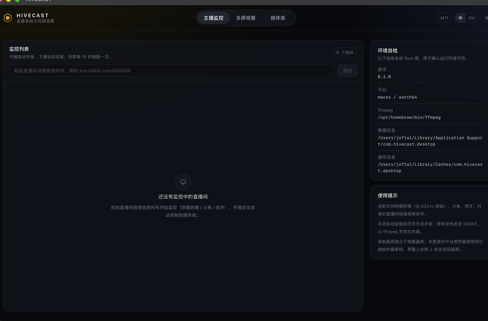

# 37 · M12 打包与 dmg 安装验收

> 目标：确认「下载 dmg → 拖进 Applications → 打开就能用」这条链路在真机上成立，
> 并把打包过程中踩到的坑固化成脚本，避免下次重新踩。

## §0 结论

| 项 | 结果 |
| --- | --- |
| `.app` 产物 | ✅ 25 MB，`arm64`，ad-hoc 签名 |
| `.dmg` 产物 | ✅ 10 MB（压缩后），双击可挂载 |
| 打包方式 | ⚠️ tauri 自带 dmg 步骤在本机失败，改用 `scripts/build-dmg.sh` |
| 安装后启动 | ✅ 菜单栏、窗口、三个 Tab 正常 |
| 首次启动建库 | ✅ `~/Library/Application Support/com.hivecast.desktop/hivecast.db` |
| 打包版 ffmpeg 定位 | ✅ 仍解析到 `/opt/homebrew/bin/ffmpeg`（Finder 启动 PATH 里没有它） |
| 签名 / 公证 | ➖ 按用户决定不做（ad-hoc 签名，仅供自用分发） |

## §1 交付清单

| 文件 | 改动 |
| --- | --- |
| `src-tauri/tauri.conf.json` | `bundle.targets` 从 `"all"` 改成 `["app"]`（dmg 交给脚本） |
| `scripts/build-dmg.sh` | 新建：构建 `.app` → 拷进临时目录 + `Applications` 软链 → `hdiutil create -format UDZO` |
| `docs/assets/m12-installed.png` | 从 dmg 安装后启动的实拍 |

## §2 为什么 tauri 自己打不出 dmg

`pnpm tauri build --bundles dmg` 在最后一步失败：

```
Failed running AppleScript
execution error: "Finder"遇到一个错误：AppleEvent已超时。 (-1712)
Error failed to bundle project: error running bundle_dmg.sh
```

原因是 tauri 的 `bundle_dmg.sh` 生成完 rw 临时 dmg 后，会用 AppleScript 指挥 **Finder**
把 .app 和 Applications 的图标摆到指定位置、设置窗口大小和背景。
这一步需要「自动化 → Finder」权限；在没有授权（或被 MDM 管控、无 GUI 会话）的机器上，
AppleEvent 会一直等到超时，整个构建失败，`.app` 其实已经生成好了。

两条路：

1. 手动给终端授予 Finder 自动化权限 —— 只在开发者的本机成立，CI 上永远不行；
2. 跳过 Finder 摆位：用 `hdiutil` 直接把 .app 压成 dmg —— 没有背景图与图标位置，但**能装能用**。

选了第二条，并把 `targets` 固定成 `["app"]`：
裸跑 `pnpm tauri build` 不再半路失败，dmg 想要就显式跑脚本。

## §3 打包脚本

```
scripts/build-dmg.sh           # 先 pnpm tauri build --bundles app，再压 dmg
scripts/build-dmg.sh --no-build # 复用已有 .app
```

关键几行：

```
APP="src-tauri/target/release/bundle/macos/HIVECAST.app"
STAGE="$(mktemp -d)"; cp -R "$APP" "$STAGE/"; ln -s /Applications "$STAGE/Applications"
hdiutil create -volname HIVECAST -srcfolder "$STAGE" -ov -format UDZO \
  "$OUT_DIR/HIVECAST_${VERSION}_${ARCH}.dmg"
```

- 版本号从 `tauri.conf.json` 读，架构用 `uname -m`，产出文件名自带两者；
- `Applications` 软链保留：用户仍然可以「拖进去」安装；
- `UDZO` 是压缩格式：25 MB 的 `.app` 压到 10 MB；
- 新版 macOS 会对 `hdiutil create` 打一条 `is deprecated ... Please use 'diskutil image create'` 的警告，
  它打在 stderr 上、不影响产物；脚本把 hdiutil 的 stdout 丢掉，只保留自己那行「dmg: 路径」与大小。

## §4 安装验收

| 步骤 | 结果 |
| --- | --- |
| `hdiutil attach -readonly HIVECAST_0.1.0_arm64.dmg` | ✅ 挂载出 `/Volumes/HIVECAST`，含 `HIVECAST.app` 与 `Applications` 软链 |
| 复制到 `/tmp/hiveinst` 后双击 | ✅ 正常启动（本机生成的 dmg 没有 quarantine 属性，不会被 Gatekeeper 拦） |
| 进程 | ✅ `/private/tmp/hiveinst/HIVECAST.app/Contents/MacOS/hivecast` |
| 首次启动建库 | ✅ `hivecast.db` + `-wal` + `-shm` |
| 环境自检 | ✅ 版本 0.1.0、`macos / aarch64`、`/opt/homebrew/bin/ffmpeg` |
| 菜单栏 / 窗口 | ✅ 应用名 HIVECAST，窗口 1320x860 居中 |



打包版的 ffmpeg 解析值得单独说：Finder 启动的 GUI 进程 **PATH 里没有 Homebrew**，
如果代码里只是 `which ffmpeg`，用户装完就是「找不到 ffmpeg」。
`src-tauri/src/ffmpeg.rs` 的 `resolve()` 会把 `/opt/homebrew/bin`、`/usr/local/bin` 等目录逐个试一遍，
再用 `-version` 实跑确认，这张截图就是它在打包版里生效的证据。

## §5 未验证 / 缺口

1. **打包版没有跑完整录制 + 回放**：本轮只验了启动、建库、ffmpeg 定位；
   取流与 HLS 回环在 dev 版验过，打包版走同一份二进制与同一套 CSP，风险低但不是零。
2. **没有公证 / 没有 Developer ID 签名**：分发给别人时对方需要「右键 → 打开」绕过 Gatekeeper。
   按用户决定（O6 已裁：签名不在本轮范围）先不做。
3. dmg 没有背景图与图标摆位：纯白窗口，双击 `.app` 或拖进去都能装。
4. Windows 侧未构建（需要 Windows 机器或交叉编译环境）。
5. 未做自动更新（tauri-plugin-updater）。

## §6 踩坑

1. **AppleScript + Finder 是 dmg 打包的隐藏依赖**：headless / 无自动化权限的机器必挂，
   报错是 `AppleEvent已超时 (-1712)`，而不是一个有意义的「缺少权限」。
2. 失败后 `bundle/macos/` 下会残留 `rw.<pid>.HIVECAST_0.1.0_aarch64.dmg` 临时文件（几百 MB 级），
   要手动清，否则下次 `hdiutil` 可能因为同名卷冲突再挂一次。
3. `bundle/dmg/bundle_dmg.sh` 是 tauri 生成的一次性脚本，改它没用（下次构建会被覆盖），
   要么改配置、要么自己写脚本。
4. 打包产物目录结构是 `bundle/macos/HIVECAST.app`（`productName`）+ `bundle/dmg/*.dmg`，
   `targets` 改成 `["app"]` 之后不再生成 `.dmg`，脚本自己往 `bundle/dmg/` 里写。

## §7 验收对照

| 验收项 | 结果 |
| --- | --- |
| 能产出可安装的 dmg | ✅ |
| 安装后能启动 | ✅ |
| 首次启动能建库 | ✅ |
| 打包版能定位 ffmpeg | ✅ |
| 构建命令可重复执行 | ✅ scripts/build-dmg.sh |

## §8 变更日志

| 版本 | 日期 | 内容 |
| --- | --- | --- |
| v1.0 | 2026-11-05 | 首版：targets 改 app、build-dmg.sh、安装验收实拍、AppleScript 坑 |
