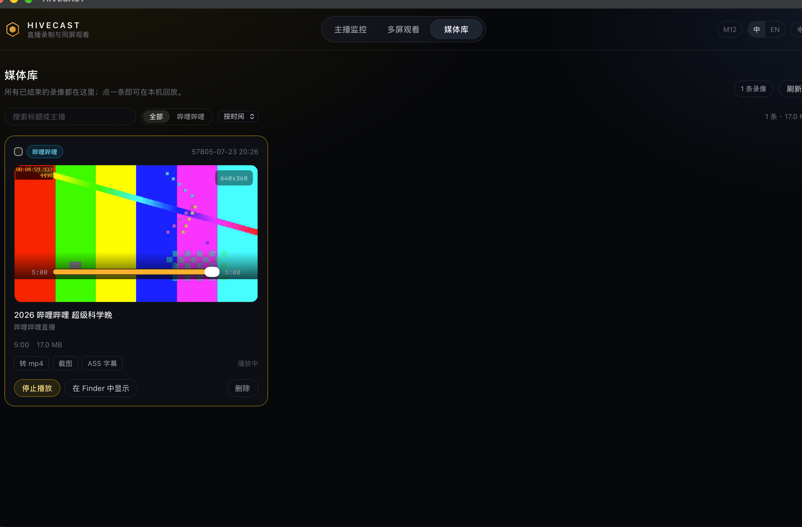

# 38 · M13 回放滑窗缓存

> 目标：回放不再「整段转一遍 HLS」，缓存体积从「等于录像体积」降到「一个窗口」。
> 同时补上回放一直没有的进度条 —— 没有进度条，滑窗就等于只能看开头 3 分钟。

## §0 结论

| 项 | 改前（M6–M12） | 改后（M13） |
| --- | --- | --- |
| 转封装范围 | 整段录像 | 播放点附近 180 秒 |
| 缓存体积 | ≈ 录像体积 | ≈ 10–25 MB / 路（与码率相关） |
| 拖到远处 | 不可能（没有进度条） | 后端换窗口重开，约 1–2 秒 |
| 播放器 | 无进度条 | 整段进度条 + 时间气泡 |
| 放完自动续窗 | 不适用 | 有（带 lead 提前量，不重复） |

实测：300 秒、17 MB 的 flv，窗口 180 秒 → 缓存目录 91 个文件 / 11 MB；
起播位置 270 秒 → 窗口就是 [120s, 300s]，`offset_ms` = 150000，播放器从第 150 秒起播，
画面上的测试图案时间戳从 4:59 开始往下走。



## §1 交付清单

| 文件 | 改动 |
| --- | --- |
| `src-tauri/src/local.rs` | 重写：窗口计算 `window_for`、`-ss/-t` 参数、窗口复用、6 个单测 |
| `src-tauri/ipc-types/src/lib.rs` | `Playback` 增 `start_ms` / `window_ms` / `lead_ms` / `offset_ms`（全部 ts number） |
| `src-tauri/src/commands.rs` | `media_play` 增 `position_ms: Option<i64>` |
| `src/lib/ipc.ts` | `mediaPlay(sessionId, positionMs?)` |
| `src/features/watch/Player.tsx` | 进度条、`startPosition`、窗口内就地 seek、`onEnded` 续窗 |
| `src/features/media/MediaPage.tsx` | `seekTo`：窗口外调 `mediaPlay` 换窗并替换 playback |
| i18n | `media.progress`（播放进度 / Playback position），236 keys |

## §2 为什么整段转封装不能留

整段转 HLS 的意思是：把录像从第一个字节读到最后一个字节，切成分片写进缓存目录。
所以回放一条 2 GB 的录像，就要额外占 2 GB 磁盘，而且**必须等 ffmpeg 把整段读完**
（12 秒超时只是等第一个分片，不是等转完）。问题有三层：

1. 磁盘翻倍：媒体库越大，缓存越吃空间；
2. 同时回放 3 条（`MAX_ACTIVE = 3`）就是 3 倍；
3. 转封装是纯 IO + 复制，一条 2 GB 录像要跑几十秒，纯属浪费。

用到的其实只有「正在看的这几分钟」。所以只转这几分钟。

## §3 窗口模型

```
pub const WINDOW_MS: i64 = 180_000; // 一窗 3 分钟
pub const LEAD_MS: i64 = 45_000;   // 起点提前 45 秒
```

`window_for(position_ms, duration_ms)` 的规则，按顺序：

1. 录像比窗口短（或时长未知）→ 整段就是窗口；
2. 窗口长度 = min(180s, 录像时长)；
3. 起点 = 播放点 − 45s，再夹到 `[0, duration − window]` —— 末尾永远贴住录像结尾，不越界。

| 录像 | 播放点 | 窗口起点 | 窗口终点 |
| --- | --- | --- | --- |
| 600s | 300s | 255s | 435s |
| 600s | 595s | 420s | 600s |
| 600s | 5s | 0s | 180s |
| 42s | 10s | 0s | 42s |

**为什么起点要提前 45 秒**：用户往回拖一点点（比如刚才错过的一句话），如果起点正好等于播放点，
这一次拖动就要重开 ffmpeg。提前 45 秒，窗口内的小幅拖动全部就地完成。

## §4 换窗与复用

`Active` 记住 `start_ms` / `window_ms`，`contains(position)` 用左闭右开区间判断：

```
if position >= start_ms && position < start_ms + window_ms { 复用 }
```

- 命中 → 直接返回原来的 `play-<ms>` URL，播放器不用重新起播；
- 未命中 → 先 `teardown` 旧窗口（SIGTERM → 等 4 秒 → 注销 URL → 删目录），再起新窗口；
- `MAX_ACTIVE` 的判定放在「清掉旧窗口之后」，所以同一条换窗永远不会把自己顶掉。

ffmpeg 参数（相对 M6 只有三处变化）：

```
-ss 120.133        # 放在 -i 前面：按关键帧快速定位
-i <录像>
-t 180.000         # 只转一窗
... -hls_playlist_type vod -hls_flags independent_segments
```

`-ss` 放在 `-i` 前是「输入定位」：ffmpeg 直接 seek 到最近的关键帧，不会把前面两小时解一遍。
代价是关键帧对齐——实际起播可能比要求的位置早 0–2 秒（flv 的关键帧间隔），所以播放器侧
用 `offset_ms` 而不是 `start_ms` 来定位起播点。

## §5 起播偏移

后端返回四个数，前端只关心两个：

| 字段 | 含义 | 用途 |
| --- | --- | --- |
| `startMs` | 窗口从整段第几毫秒开始 | 进度条把 `video.currentTime` 换算成整段位置 |
| `windowMs` | 窗口长度 | 展示、调试 |
| `leadMs` | 提前量 | 「放完续窗」时加回去，衔接处不重复 |
| `offsetMs` | 起播时刻在窗口内的偏移 | `hls.js` 的 `startPosition`（秒） |

`startPosition` 传 `-1` 表示「直播贴边缘」，只有点播窗口才传正数；
这样观看页（直播）行为完全不变。

## §6 前端进度条

Player 只在拿到 `durationMs` 时显示进度条 —— 直播没有总时长，不显示也不给拖：

```
<input type=range min=0 max={durationMs} value={scrubMs ?? positionMs}
       onChange={scrub} onPointerUp={commitScrub} onKeyUp={commitScrub} />
```

拖动过程（`scrub`）：

1. 先更新 `scrubMs`，气泡显示目标时间；
2. 目标在当前窗口内 → 直接 `video.currentTime = (target - startMs) / 1000`，实时预览；
3. 目标在窗口外 → 松开（`commitScrub`）时才调 `mediaPlay(id, target)`，后端换窗后整体替换 playback，
   Player 因为 `url` 变化重新初始化，`startAtSec` 保证从目标位置起播。

放完自动续窗：`onEnded` 时如果 `startMs + video.duration < durationMs − 0.8s`，
就 `onSeek(end + leadMs)`。加 `leadMs` 是因为新窗口起点 = 播放点 − 45s，
直接传 `end` 会让衔接处重放 45 秒。

另外，点播的卡死看门狗不再「拉回直播边缘」（点播没有直播边缘），只做 `startLoad()` 重载分片。

## §7 实测

| 项 | 数据 |
| --- | --- |
| 素材 | 300 秒 / 17 MB / 640x360 / 15fps（testsrc2 + sine 生成） |
| 起播位置 | 270 秒（90%） |
| 窗口 | start=120133ms，window=180000ms（末尾贴住 300133ms） |
| 缓存目录 | `sess-win-1793881433514`，91 个文件（1 m3u8 + 90 分片） |
| 缓存体积 | 11 MB（源 17 MB，按窗口比例 180/300 折算吻合） |
| m3u8 | VOD + INDEPENDENT-SEGMENTS，分片 2 秒 |
| 画面 | 测试图案时间戳 4:59 → 4:51（倒计时式），低分辨率角标 640x360 |
| 进度条 | 显示 5:00 / 5:00，滑块在末端；窗口内拖动即时生效 |

## §8 取舍与缺口

1. **窗口外跳转有 1–2 秒空档**：要停旧 ffmpeg、起新 ffmpeg、等第一个分片。窗口内拖动是瞬时的。
2. 缓存仍然与窗口长度线性相关：3 分钟 1080p 约 60–120 MB；如果以后要放到「后台预转」，可以加 `LEAD_MS` 调整。
3. 三条同时回放 × 3 分钟窗口 ≈ 200–400 MB 峰值缓存（退出即删）。
4. 还没做「记住上次看到哪」：没有 position 持久化，重开从头。
5. 进度条与 hls.js 的 `duration` 有两套时间轴：窗口内用 `video.duration` 判断边界，
   录像时长用 `item.durationMs`；两者不一致时以「窗口内」为准，宁可就地拖不过去也不误判。

## §9 验收对照

| 验收项 | 结果 |
| --- | --- |
| 回放不再整段转封装 | ✅ 窗口 180s |
| 缓存体积远小于录像 | ✅ 11 MB vs 17 MB（按比例） |
| 能跳到大位置并正常播放 | ✅ 270s → 窗口 [120s, 300s] |
| 有进度条可拖 | ✅ 整段进度条 + 时间气泡 |
| 直播观看行为不变 | ✅ startPosition 仅在点播时传正数 |
| 单测 | ✅ 6 个 window_for/contains 用例 |

## §10 变更日志

| 版本 | 日期 | 内容 |
| --- | --- | --- |
| v1.0 | 2026-11-05 | 首版：窗口模型、换窗复用、起播偏移、前端进度条、实测 |

