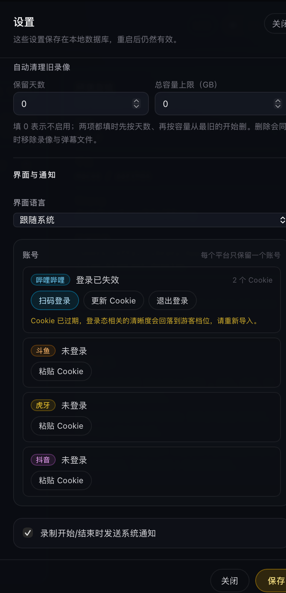

# 39 · M14 Cookie 加密存储

> 目标：hivecast.db 落到别人的磁盘/云盘时，里面的登录态不能直接读出明文。

## §0 结论

| 项 | 改前 | 改后 |
| --- | --- | --- |
| 存储形态 | `SESSDATA=xxx; bili_jct=yyy` 明文 | `enc:v1:` + base64(nonce‖密文) |
| 算法 | — | AES-256-GCM（随机 nonce，带认证标签） |
| 密钥 | — | 数据目录下 `secret.bin`，32 字节，0600 |
| 老库 | — | 启动时一次性就地重写，之后幂等 |
| 上层代码 | — | 不变（读写都在 db 层透明加解密） |

实测：手工塞入一行明文 Cookie（`SESSDATA=fake123; bili_jct=xyz`），
重启后库里变成 `enc:v1:…` 共 87 字符，`LIKE '%SESSDATA%'` 命中 0 行；
界面账号区仍能列出「哔哩哔哩 / 已过期 / 2 个 Cookie」——说明解密链路通了，
登录态失效是因为这本来就是假 Cookie，不是解密失败。



## §1 交付清单

| 文件 | 改动 |
| --- | --- |
| `src-tauri/src/secret.rs` | 新增：`Secret`（`seal` / `open` / 密钥文件读写）+ 5 个单测 |
| `src-tauri/src/db.rs` | `Db` 持 `Secret`；`save_credential` 加密、`credentials` 解密、新增 `reseal_credentials`；+3 个单测 |
| `src-tauri/src/state.rs` | 启动时先 `reseal_credentials` 再 `load_from_db` |
| `src-tauri/src/credential.rs` | 顶部注释改成「加密在 db 层」 |
| `src-tauri/Cargo.toml` | 新增 `aes-gcm = "0.10"` |

## §2 为什么不用 Keychain / DPAPI

设计文档 docs/19 §4.3 原本写的是「Keychain（macOS）/ DPAPI（Windows）」。实际落地时否掉了，理由：

1. **签名形态**：v1 是 ad-hoc 签名（没有 Developer ID 证书）。macOS 把钥匙串条目的 ACL 绑在二进制签名上，
   每次重新打包签名都变，系统就会重新弹一次「hivecast 想访问钥匙串」；开发期每次 rebuild 都弹，比明文更烦。
2. **Windows**：DPAPI 用当前用户凭据加密，换机/重装无法解密；而且它只解决「别的用户读不到」，
   对「把文件拷走」没有额外收益。
3. **复杂度/收益比**：v1 是单机单用户桌面应用，真正的风险场景是**库文件被同步到网盘或随备份带走**，
   而不是同机进程互殴。文件密钥 + AES-GCM 就能覆盖这个场景，且不引入任何平台差异与弹框。

所以 v1.1 再做 Keychain 版本（接口不变，只换 `Secret` 的实现）。

### 威胁模型（写清楚，别给虚假安全感）

| 场景 | 是否能防 |
| --- | --- |
| 只拷走 `hivecast.db` | ✅ 看不到明文 |
| 库文件进 iCloud / OneDrive / Time Machine | ✅ 密文 |
| 同用户的恶意进程（能读 `secret.bin`） | ❌ 能解密 |
| 拿到整块磁盘镜像 | ❌ 能解密（密钥同盘） |
| 内存转储 | ❌ Cookie 明文就在内存里 |

## §3 密钥文件

```
~/Library/Application Support/com.hivecast.desktop/secret.bin   # 32 字节随机
```

- 与库文件同目录；Unix 上 `chmod 0600`；
- 文件长度不是 32 字节（被截断、被编辑器加换行）→ 备份成 `secret.bin.bak` 再重新生成，
  代价是旧密文解不开（等同退出登录，重新扫码即可），日志里有 warn；
- 单测用 `:memory:` 库时，密钥落到临时目录，避免在仓库里生成文件。

## §4 密文格式

```
enc:v1:<base64( nonce[12] || ciphertext || tag[16] )>
```

前缀 `enc:v1:` 有两个用处：

1. 区分历史明文（迁移时靠它判断要不要重写）；
2. 将来换算法可以升 `v2`，一边读两种格式。

nonce 每次都随机生成，所以同一个 Cookie 存两次密文也不同——库里看不到「两条记录相同」这种侧信道。

## §5 读写路径

```
account.rs  save_cookie → db.save_credential(row.cookie=明文)
                                ↓ seal()
                          credential.cookie = 'enc:v1:…'

startup     db.reseal_credentials()   # 只处理没有前缀的行
            credential::load_from_db() # get() → open()
```

解密失败（密钥换过、密文被改）不抛错，只 `tracing::warn` 并跳过该行：
宁可让用户重新登录，也不要让整个账号列表打不开。

## §6 迁移实测

| 步骤 | 结果 |
| --- | --- |
| 1. 停掉应用，用 sqlite3 塞入明文行 | `bilibili\|SESSDATA=fake123; bili_jct=xyz\|M14 测试账号` |
| 2. 启动应用 | 日志 `已把历史明文 Cookie 加密 count=1` |
| 3. 查库 | `bilibili\|enc:v1:fX9jjmg…\|87`；`LIKE '%SESSDATA%'` = 0 |
| 4. 账号区 | 显示「哔哩哔哩 · 登录已失效 · 2 个 Cookie」 |
| 5. 重复启动 | 不再重写（幂等，计数 0） |

第 4 步是关键证据：库里的行能解出明文，`credential::names()` 才数得出 2 个 Cookie 名。

## §7 单测

| 用例 | 断言 |
| --- | --- |
| `roundtrips_and_hides_plaintext` | 加密后再解密一致，密文不含 `SESSDATA` |
| `passes_legacy_plaintext_through` | 无前缀按明文返回 |
| `rejects_tampered_ciphertext` | 改一个字符 → 解密返回 None |
| `key_file_is_private_on_unix` | 密钥 32 字节、权限 0600 |
| `same_key_survives_reload` | 同一密钥文件重新加载后仍可解 |
| `credential_is_sealed_at_rest_and_decrypted_on_read` | db 层写入即密文、读出即明文 |
| `reseals_legacy_plaintext_once` | 迁移 1 行，第二次 0 行，读回明文 |
| `undecryptable_row_is_skipped_instead_of_failing` | 坏密文不阻塞列表 |

总计 `cargo test --lib`：110 passed / 14 ignored。密钥用例各自用独立的 key 文件（并行跑时共用一个会互相删，
这一版踩过一次偶发失败）。

## §8 缺口

1. 同用户恶意进程仍可解密（见 §2 威胁模型）；v1.1 换 Keychain 后提升到「需要用户授权」。
2. 没有密钥轮换机制：换密钥 = 所有平台重新登录。
3. 弹幕、日志里可能出现 Cookie 片段？已检查：日志只打平台的 `names()` 数量，不打值。
4. `secret.bin` 不进 `.gitignore` 也不需要——它在用户数据目录，不在仓库里。

## §9 验收对照

| 验收项 | 结果 |
| --- | --- |
| 库文件里不再有明文 Cookie | ✅ 0 行命中 |
| 老库自动迁移 | ✅ 启动一次完成，幂等 |
| 登录态读取不受影响 | ✅ 账号区正常列出，Cookie 名可数 |
| 解密失败不炸 | ✅ 跳过并 warn |
| 密钥权限 | ✅ 0600 |

## §10 变更日志

| 版本 | 日期 | 内容 |
| --- | --- | --- |
| v1.0 | 2026-11-05 | 首版：AES-256-GCM、密钥文件、启动迁移、8 个单测与真机实测 |

