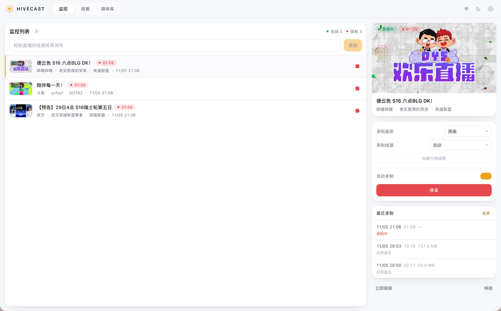
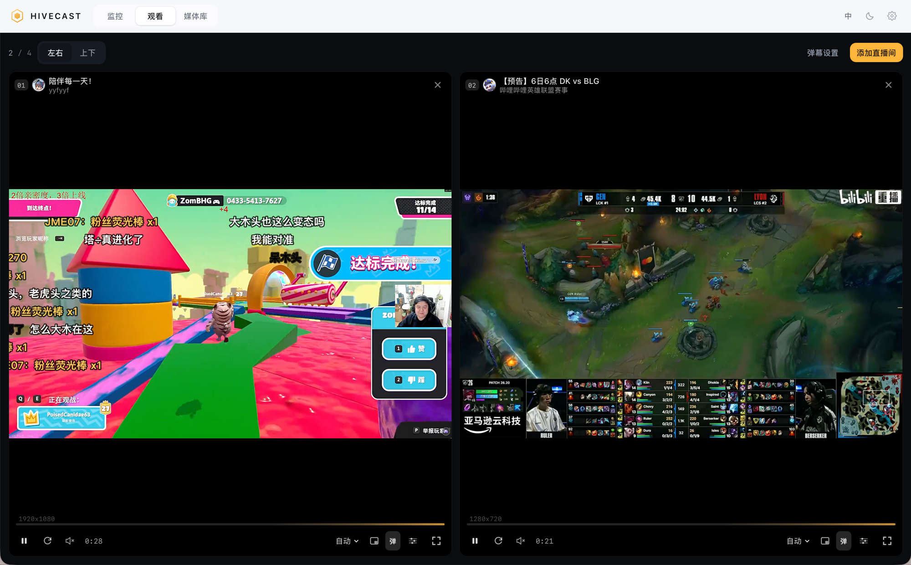
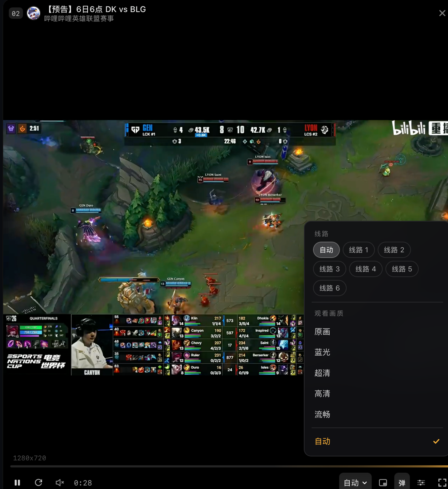
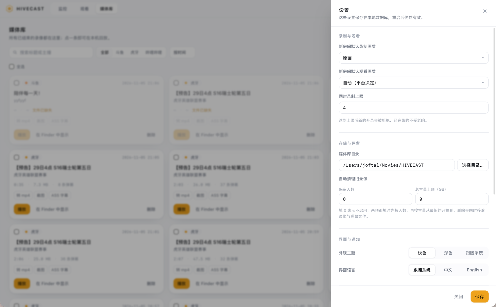

# 40 · UI/UX 重设计方案与落地记录

> 状态：v1.1（2026-11-05）· 覆盖监控页、观看页、媒体库、设置抽屉与全局框架；v1.1 重做播放器控制条
> 关联：[19 产品蓝图](19-产品蓝图与阶段计划.md) §2 蓝图、[38 回放滑窗](38-M13-回放滑窗缓存.md)

## 0. 结论先行

界面从「暗色监控工具」改成「浅色优先的桌面应用」：浅色是默认主题，深色一键切换或跟随系统；所有颜色、圆角、阴影、动效收敛到一层语义 token，页面里不再出现 `zinc-500` 这类字面色。

- 监控页：左侧房间列表 + 右侧 330px 详情面板，一屏内完成「添加 → 选画质 → 选线路 → 录制」。
- 观看页：全出血、始终暗色（视频场景）；槽位头只留标题与降级徽章，画质与线路收进播放器控制条（B 站直播形态）。
- 媒体库：三列卡片网格，卡片内嵌播放器，后处理按钮收进卡片底部。
- 设置：右侧抽屉，录制/存储/界面三段，主题三选一。

## 1. 设计原则

1. **内容优先**：面板、卡片、控件都不加装饰性边框与渐变；颜色只用来区分状态（直播/录制/警告/强调）。
2. **一屏可完成**：监控页的详情面板不跳页、不弹窗；媒体库的后处理就地执行。
3. **浅色可读、深色不刺眼**：两套 token 同源，深色不是简单反色，而是压暗画布、抬高表面、降低边框对比。
4. **动效克制**：只保留 160–260ms 的进入/位移过渡，列表与网格不做逐项动画；`prefers-reduced-motion` 全关。
5. **文案短**：按钮 2–4 字，提示一行说完；不写「请点击下方按钮以…」这类说明句。
6. **双语同构**：中英文共用同一套排版规则，平台名词（哔哩哔哩/Bilibili、斗鱼/Douyu）按语言翻译，房间标题等用户内容不译。

## 2. Design tokens

定义位置：`src/styles/index.css`（`@theme inline` 把语义名映射到 `--c-*` 变量）。

### 2.1 颜色

| 语义名 | 用途 | 浅色 | 深色 |
| --- | --- | --- | --- |
| canvas | 窗口底色 | #f6f7f9 | #0a0c10 |
| surface | 卡片/面板/抽屉 | #ffffff | #12151c |
| raised | 次级底、hover 底 | #fbfbfd | #171b24 |
| line | 常规分隔线/描边 | #e8eaef | rgba(255,255,255,.07) |
| line-strong | hover 描边、强分隔 | #d7dbe4 | rgba(255,255,255,.14) |
| ink | 主文字 | #14161b | #edeff4 |
| ink-soft | 次级文字 | #3c4351 | #c6ccd8 |
| muted | 说明文字 | #6b7280 | #98a0b0 |
| faint | 弱信息、单位、时间 | #9aa1ae | #6b7383 |
| accent | 主按钮、选中态 | #eea21c | #ffb43a |
| accent-ink | 主按钮上的字 | #1d1503 | #1a1206 |
| accent-soft | 高亮底（选中条/横幅） | #fff5e2 | rgba(255,180,58,.14) |
| accent-line | 高亮描边 | #f4d9a6 | rgba(255,180,58,.34) |
| accent-text | 高亮底上的字 | #94590a | #ffc46a |
| live | 直播中 | #0e9f5f | #3dd68c |
| rec | 录制中/错误 | #e5484d | #ff6369 |
| warn | 警告/降级 | #c07a06 | #ffb43a |
| ok | 成功 | #0e9f5f | #3dd68c |

### 2.2 圆角、阴影、字体、缓动

| token | 值 | 用在哪 |
| --- | --- | --- |
| radius-ctl | 9px | 按钮、输入框、下拉、小方块 |
| radius-card | 12px | 观看槽位、内嵌播放器 |
| radius-panel | 16px | 列表面板、详情面板、媒体库卡片、空态 |
| shadow-card | 浅色双层柔和投影；深色内描边 | 面板与卡片 |
| shadow-pop | 浮层/抽屉 | 设置抽屉、下拉浮层 |
| ease-spring | cubic-bezier(0.22, 1, 0.36, 1) | 所有位移过渡 |
| font-sans | Inter → SF Pro Text → PingFang SC → Microsoft YaHei | 全局 |

数字（时长、大小、时间、码率、计数器）统一 `font-mono tabular-nums`，避免跳动。

### 2.3 字号阶梯

| 场景 | 字号/行高 | 字重 |
| --- | --- | --- |
| 页面标题 | 15px | 600 |
| 卡片标题 | 13px / snug | 500 |
| 正文与按钮 | 11.5–12px | 500 |
| 说明与元信息 | 11px | 400 |
| 角标、单位、计数 | 10–10.5px | 400–500 |
| 分组标题 | 10.5px + 0.1em 字距 + 大写 | 600 |

## 3. 组件层

位置：`src/components/ui/Controls.tsx`。页面里不写原生 `<button>` 的样式，统一走这些组件。

| 组件 | 形态 | 说明 |
| --- | --- | --- |
| Button | primary / secondary / ghost / danger / recording | 高 28 或 32；按下 `scale(0.985)` |
| IconButton | 28×28 | 顶栏、行内图标动作，必须给 label |
| Chip | neutral / accent / live / rec / warn | 10.5px 胶囊；可带 5px 圆点 |
| Switch | 30×18 | 18px 白色滑块，位移 200ms |
| Segmented | 3 段为主 | 灰底 + 白色滑块，滑块 260ms 位移 |
| Select | 高 28 | 自绘 chevron，隐藏原生箭头 |
| TextField | 高 32 | 回车提交，focus 走 accent 环 |

数字输入框统一隐藏原生上下箭头（`appearance: textfield` + 关闭 spinner），避免浅色下出现脏控件。

### 3.1 播放器控制条

观看页与媒体库回放共用同一个播放器，控制条按 B 站直播的形态做：**细进度线在上、单行图标在下**，默认 `opacity-0`，鼠标进入画面或键盘聚焦时 200ms 淡入。

- 第一行（h-4）：3px 进度线。点播是 `bg-white/20` 轨道 + `bg-accent` 已播填充，上面叠一层透明 `input[type=range]` 接管拖动；直播没有总时长，只画轨道，右端 1/4 用 `from-accent/80` 渐隐表示「在推进」。
- 第二行（h-9）：左侧播放/暂停、重新连接、音量（悬停展开 64px 滑杆）、等宽计时（直播显示已观看时长，点播显示 `当前 / 总长`）；右侧画质文字 + chevron、画中画、弹幕开关（「弹」，开启时 `bg-white/15`）、弹幕观感设置、全屏。
- 画质浮层：`bottom-14 right-2` 的 208px 面板，底色 `#111114/95` + `backdrop-blur-xl`。用 `bg-black/80` 时背后的画面会透上来，弹幕文字会盖住菜单，必须接近不透明。
- 浮层内容自上而下：「线路」胶囊（自动 + 线路 1…n，`title` 挂真实 CDN 主机名）、分隔线、「观看画质」列表（当前档 accent + 对勾）、分隔线、底部「自动（实际档位）」。
- 点击浮层外部由一层覆盖整个播放器的透明按钮接管；选了档位或线路后自动收起。
- 线路列表按需拉取：浮层展开时才触发 `onMenuOpen`，外层调 `viewLines`，避免 4 个槽位挂载时一起打平台接口。
- 重新连接优先走外层重解析（`onReload` → `viewRetry`），没有外层回调时只重建 hls。

## 4. 页面结构

### 4.1 全局框架

- 顶栏 48px：品牌标 + `HIVECAST` 字标（0.14em 字距）+ 三 Tab 分段控件 + 右侧语言（中/EN）、主题切换（日/月）、设置齿轮。
- 主体：`main` 切换 Tab 时挂 `animate-fade-rise`（220ms），不做横向滑动。
- 监控/媒体库在 `px-6 py-5` 容器内（最大 1360px）；观看页全出血。
- 设置抽屉：`fixed inset-0 z-50`，遮罩 `bg-black/35 backdrop-blur-[2px]`，面板 440px、左侧描边、`animate-sheet` 240ms。

### 4.2 监控页

- 左列：标题 + 计数 chip + 「在线 n / 录制 n」+ 输入框与「添加」；行高约 56px，未选中透明、选中 `bg-raised` + 左侧 2px accent 竖条。
- 行内容：60×34 缩略图（LIVE 角标）、标题 12.5px、录制 chip（红色计时）、元信息 10.5px（平台 · 主播 · 分区 · 最后检查）、右侧录制开关。
- 右列 330px：封面（16:9）+ 直播/录制 chip + 标题 + 平台信息；画质与线路两个 Select；「加载可用线路」是 accent 文字按钮；自动录制 Switch；主按钮（录制中变实心红「停止录制」）；最近录制 8 条（hover 出 MP4/截图/ASS）；底部「立即刷新 / 移除」。
- 未选中时右列显示概览：房间/在线/录制中三个数字块 + 一行提示 + ffmpeg 路径小字。

### 4.3 观看页

- 根节点强制 `data-theme="dark"`：视频页永远暗色，不跟随全局主题。
- 工具栏：`n / 4` 等宽计数 + 布局分段（仅多槽时出现）+ 右侧「弹幕设置 / 全部静音 / 添加直播间」。
- 槽位：黑底 + `rounded-card`；发声槽位加 `border-accent/45` 与柔光；顶部 28px 渐变遮罩只承载槽位号、头像、标题/主播、降级徽章 `↓ 档位`、关闭按钮——画质与线路不再占头部，统一收进播放器控制条。
- 弹幕层只覆盖画面本身：`Player` 用 `videoWidth/videoHeight` 与容器尺寸算出 object-contain 的真实矩形，把 overlay 定位到该矩形（再减去 28px 给标题让位），黑边上不再出现弹幕。
- 分辨率/码率角标走 `statsCorner="bottom-left"`，避开槽位头；控制条浮出时角标在控制条上方一档。
- 空态：2×2 小格图形 + 一句提示 + 添加按钮，虚线描边。

### 4.4 媒体库

- 头部：标题 + 副标题 + 右侧计数与刷新。
- 工具栏：搜索（带放大镜）、平台胶囊（选中白底 + 轻投影）、排序下拉、右侧等宽汇总；下方「全选」。
- 卡片：勾选框 + 平台 chip（内嵌 1.5px 平台色点）+ 播放中 chip + 等宽日期；播放时内嵌 `aspect-video` 播放器；标题两行截断；元信息「时长 · 大小 · 弹幕数」；一行小号后处理按钮（转 mp4/截图/导出 ASS）；底部「播放/停止、在 Finder 中显示、删除」（删除二次确认变红）。
- 多选条：`accent-soft` 底 + 合并/批量删除。

### 4.5 设置抽屉

- 三段：录制与观看（默认画质 ×2、同时录制上限）、存储（媒体目录、保留天数与容量）、界面（主题三选一、语言三选一、账号、通知开关）。
- 账号区：四个平台各一行，圆点色 + 账号名 + Cookie 数量 + 行内动作；扫码面板 188px 白底。
- 底部固定：左「已保存」提示，右「关闭 / 保存」。

## 5. 动效与可达性

| 场景 | 时长/曲线 |
| --- | --- |
| 面板/提示出现 | fade-rise 220ms |
| 抽屉进入 | sheet-in 240ms |
| 按钮按下 | 150ms + scale 0.985 |
| 分段滑块 | 260ms spring |
| 开关滑块 | 200ms spring |

- 所有可交互元素带 `focus-ring`（2px accent 透明环），键盘可达。
- `prefers-reduced-motion: reduce` 下动画时长压到 1ms、位移归零。
- 弹幕层与统计角标 `pointer-events-none`，不挡播放器点击。

## 6. 文案与 i18n

- 按钮：动词或名词短语，2–4 字（添加/刷新/停止录制/在 Finder 中显示）。
- 空态：一句「做什么」+ 一句「怎么做」，不超过两行。
- 不用「请」「您可以」；不出现感叹号；错误信息保留原始错误串，前置一句人话（「播放失败：…」）。
- 平台名走 `platformName.*`，房间标题与主播名不翻译。
- 语言切换只影响 UI 文案；已在录制/观看的会话不重建。
- `node scripts/check-i18n.mjs` 校验两侧 key 完全一致（当前 256 个 key）。

## 7. 主题实现

| 文件 | 职责 |
| --- | --- |
| `src/styles/index.css` | 两套 token、基础排版、滚动条、动画 |
| `src/lib/theme.ts` | `resolveTheme` / `applyTheme` / `watchSystemTheme` |
| `src/App.tsx` | 启动读 `settingsGet` 应用主题；顶栏一键明暗互换并写回；system 模式监听系统 |
| `src/features/settings/SettingsPanel.tsx` | 主题三选一（浅色/深色/跟随系统） |
| `src-tauri/ipc-types/src/lib.rs` | `Settings.theme`（默认 "light"，非法值归一为 light） |
| `src-tauri/src/settings.rs` | `ui.theme` 读写与校验 |

规则：

1. 主题只存字符串 `light | dark | system`，落在 `app_setting` 表。
2. 顶栏按钮不进入 system 态：点一次在明/暗之间切换并写成显式值；「跟随系统」只在设置里选。
3. 观看页写死 `data-theme="dark"`，因为视频区域需要稳定的暗背景。
4. 新增页面只允许使用语义 token；出现字面色视为 review 不通过。

## 8. 落地清单

| 文件 | 变化 |
| --- | --- |
| `src/styles/index.css` | 全量重写：token、排版、动画、数字输入框处理 |
| `src/components/ui/Controls.tsx` | 新建：Button/IconButton/Chip/Switch/Segmented/Select/TextField |
| `src/lib/theme.ts` | 新建：主题解析与应用 |
| `src/App.tsx` | 重写：顶栏、Tab 分段、主题、语言、设置入口 |
| `src/features/monitor/MonitorPage.tsx` | 重写：列表 + 详情双栏 |
| `src/features/watch/WatchPage.tsx` | 重写：工具栏、玻璃槽位头、空态 |
| `src/features/watch/Player.tsx` | 控件重绘、B 站直播形态控制条、画质/线路浮层、弹幕层按画面矩形定位 |
| `src/features/media/MediaPage.tsx` | 重写：卡片网格与工具栏 |
| `src/features/settings/SettingsPanel.tsx` | 重写：三段式 + 主题选择 + chevron 下拉 |
| `src/features/settings/AccountSection.tsx` | 重写：行式平台列表 + 内联 Cookie 编辑 + 扫码卡 |
| `src-tauri/ipc-types/src/lib.rs`、`src-tauri/src/settings.rs` | 新增 `theme` 字段与校验 |

删除：`src/features/design/DesignBoard.tsx`（评审样本板）、`.legacy-dark` 兼容层（所有页面已迁移）。

## 9. 待裁决项（默认值已按推荐实现，可随时改）

| 议题 | 当前默认 | 备选 |
| --- | --- | --- |
| 强调色 | 琥珀 #eea21c（品牌色，与图标同源） | 蓝 #2f6fed（更中性，录制红更突出） |
| 默认主题 | 浅色（设置里可改深色或跟随系统） | 跟随系统 |
| 窗口标题栏 | 系统标题栏 + 顶部 48px 自绘工具栏 | 无边框 + 自绘拖拽区 |
| 信息密度 | 舒适（行高 56、卡片内边距 12） | 紧凑（行高 44、内边距 8） |
| 媒体库播放 | 卡片内嵌播放，可同时 3 条 | 独立播放页/浮层播放器 |

## 10. 验收

- `pnpm exec tsc -b` 通过；`pnpm build` 通过（仅有既有的 chunk 体积告警）。
- `node scripts/check-i18n.mjs` 256 keys 一致；`node scripts/check-docs.mjs` 通过。
- 真机（`pnpm tauri dev`）验证：浅色监控页、深色监控页、深色观看页双槽、浅色媒体库、浅色与深色设置抽屉。
- 主题持久化：把 `app_setting` 的 `ui.theme` 改成 dark 后重启，界面仍为深色；改回 light 后恢复浅色。
- 弹幕层：双槽时弹幕只出现在画面矩形内，标题与控件不被遮挡。
- 控制条：悬停淡入；点开画质浮层能看到线路胶囊与档位列表，面板不透明、不被弹幕穿透；选中档位后浮层收起并触发重连。

## 11. 变更日志

| 版本 | 日期 | 内容 |
| --- | --- | --- |
| v0.1 | 2026-11-05 | 设计系统 + 全局框架 + 监控页重写 |
| v0.2 | 2026-11-05 | 观看页、播放器控件、媒体库重写 |
| v1.0 | 2026-11-05 | 设置抽屉与账号区迁移、主题三选一、弹幕层按画面定位、文档定稿 |
| v1.1 | 2026-11-05 | 播放器控制条改为 B 站直播形态：细进度线 + 单行图标、画质/线路合并进浮层、重连与画中画入口；槽位头瘦身 |
