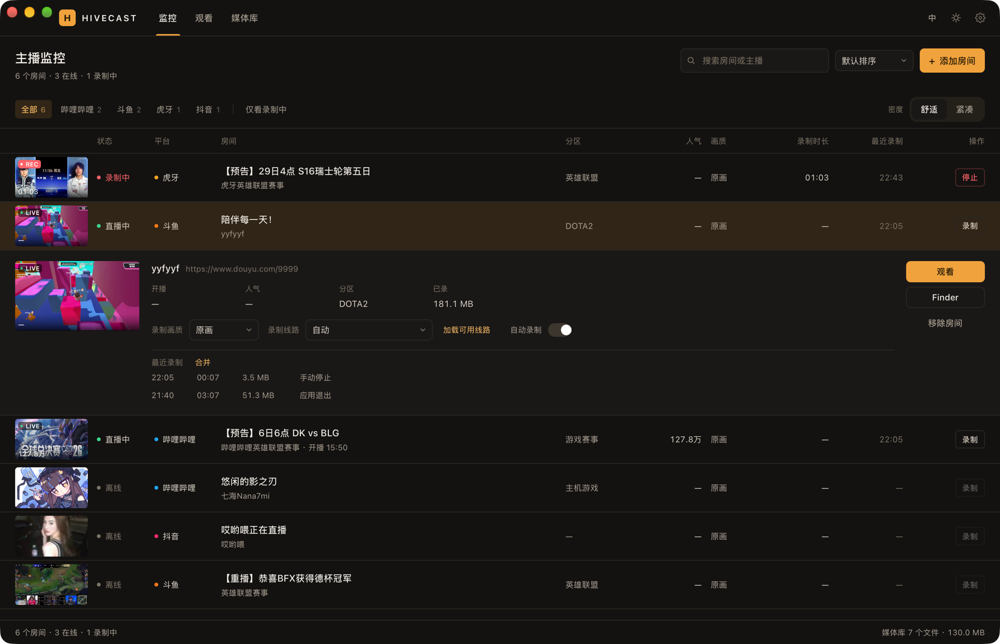
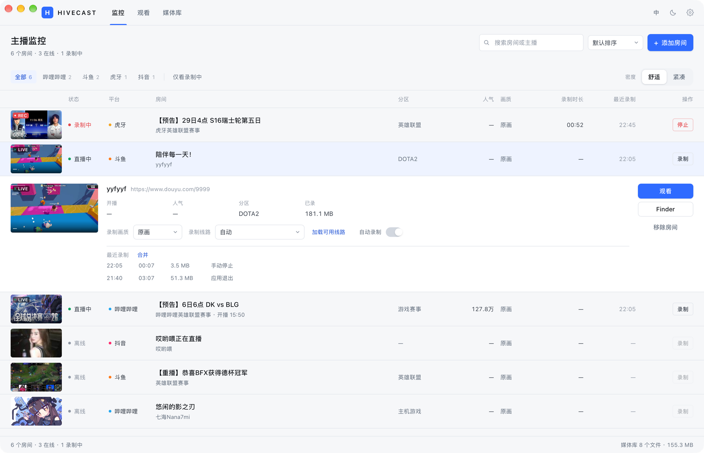

# 41 · 监控页重做：从「卡片流」到「表格工作台」

> 状态：v1.0（2026-11-05）· 只覆盖监控页；观看页、媒体库、设置沿用 [40](40-UIUX-设计方案.md) 的 token 与组件层
> 关联：[19 产品蓝图](19-产品蓝图与阶段计划.md) §7 M16、[40 UI/UX 设计方案](40-UIUX-设计方案.md)

## 0. 结论先行

监控页不再是「左边房间列表 + 右边 330px 详情面板」的双栏结构，而是一张**单列工作台**：顶部标签栏 → 页面工具行（标题 + 计数 + 搜索 + 排序 + 添加房间）→ 平台筛选行 → 10 列表格 → 点开某一行在**行内**展开详情 → 底部状态条。

三件套定稿（用户 2026-11-05 裁决「按你的建议来」）：

| 维度 | 浅色（默认） | 深色（暖黑） |
| --- | --- | --- |
| 底色 | canvas `#f6f7f9`、surface `#ffffff` | canvas `#131211`、surface `#1a1817` |
| 强调色 | `#2f6bff` 冷蓝 | `#f0a23c` 琥珀 |
| 行高 | 64px（舒适） | 64px（舒适） |
| 缩略图 | 96×54 | 96×54 |

紧凑密度是**开关**而不是第三套主题：行高 54px、缩略图 78×44、列宽整体收窄，选择结果写进 localStorage（`hivecast.ui`）。





## 1. 诊断：为什么旧版「AI 味」重

用户的原话是「布局大小与内容区域分配不合理」。复盘下来不是配色问题，是三个结构性问题：

1. **空间分配错**：1320×770 的窗口里，观看页两路 16:9 只占 371px 高，下面 340px 是纯黑；监控页每行 56px，却塞了 10.5–12.5px 的字和一张 330×186 的大封面 —— 封面重复了标题、主播、在线人数三份信息。
2. **圆角与阴影模板化**：卡片 12px、面板 16px、按钮 9px，外加一圈柔和阴影和胶囊分段控件；每个块都「浮」在背景上，界面像由组件库拼出来，而不是为「扫一眼就知道谁在播」设计。
3. **扫视效率低**：横向卡片一行只放一个房间，真实使用中 6 个房间就要滚两屏；而用户的高频动作是「看状态 → 决定录不录 → 调画质线路」，这些恰恰是表格最擅长的。

结论：把监控页当工作台（dense table + 行内展开），而不是当内容流（card feed）。

## 2. 探索过的方向（保留素材）

先做三个结构方向 × 两个页面（监控 / 观看）的对照板，再收敛为四套视觉 tone，全部留档在 `docs/assets/design/`：

| 方向 | 结构 | 结局 |
| --- | --- | --- |
| A 侧栏工作台 | 204px 左导航 + 全宽表格 + 318px 右侧检查器 | 骨架被采纳，检查器被弃用（挤掉表格宽度） |
| B 顶栏工作台 | 顶栏 Tab + 全宽表格 + 行内展开 + 底部共享面板 | 交互被采纳（行内展开替代检查器） |
| C 暗色卡片流 | 3 列封面卡 + 观看页单主画面 | 弃用（仍是卡片流，信息密度最低） |

| Tone | 观感 | 结局 |
| --- | --- | --- |
| light | 冷灰底 + 蓝强调 | 采纳为浅色默认 |
| paper | 米白底 + 墨绿强调 | 弃用（偏打印文档感） |
| slate | 石板灰底 + 冷蓝，行高 54 | 行高被借去做「紧凑」密度 |
| studio | 暖黑底 + 琥珀 | 采纳为深色主题 |

对应截图：`assets/design/monitor-light.png`、`monitor-paper.png`、`monitor-slate.png`、`monitor-studio.png`（2640×1636，headless Chrome 渲染）。

## 3. 结构：自上而下七层

```text
┌ header 48px ─────────────────────────────────────────────┐
│ [H] HIVECAST   监控 | 观看 | 媒体库            中  ☾  ⚙ │
├ 工具行 ──────────────────────────────────────────────────┤
│ 主播监控                                    [搜索] [排序] [+ 添加房间] │
│ 6 个房间 · 3 在线 · 1 录制中                              │
├ 添加条（点「添加房间」才出现）───────────────────────────┤
│ [粘贴直播间链接或房间号________________] 添加  取消        │
├ 筛选行 ──────────────────────────────────────────────────┤
│ 全部 6  哔哩哔哩 2  斗鱼 2  虎牙 1  抖音 1 | 仅看录制中   密度 [舒适|紧凑] │
├ 表头（10 列，与行同一套 grid）───────────────────────────┤
├ 行 64px ────────────────────────────────────────────────┤
│ [缩略图] ● 直播中  ● 哔哩哔哩  标题/主播·开播  分区 人气 画质 时长 最近 [录制] │
│ └ 展开面板（选中行下方，164×92 缩略图 + 信息 + 操作）      │
├ 底部状态条 32px ─────────────────────────────────────────┤
│ 6 个房间 · 3 在线 · 1 录制中            媒体库 8 个文件 · 155.3 MB │
└──────────────────────────────────────────────────────────┘
```

## 4. 表格规格

表头与数据行共用同一串 `gridTemplateColumns`，保证列位严格对齐（实测 DOM 列位：20/128/204/292/746/850/938/1016/1106/1204，单位 px）。

| # | 列 | 舒适列宽 | 紧凑列宽 | 内容 |
| --- | --- | --- | --- | --- |
| 1 | 画面 | 96px | 78px | 缩略图 96×54 / 78×44，左上角 `REC 00:24` 或 `LIVE` 徽标 |
| 2 | 状态 | 64px | 54px | 圆点 + 录制中 / 直播中 / 离线 |
| 3 | 平台 | 76px | 64px | 平台色点 + 平台名 |
| 4 | 房间 | minmax(0,1fr) | minmax(0,1fr) | 标题 12.5px + 次要行「主播 · 开播 HH:MM」10.5px |
| 5 | 分区 | 92px | 76px | `areaName`，过长截断 |
| 6 | 人气 | 76px 右对齐 | 64px | `Intl.NumberFormat('zh-CN', {notation:'compact'})` |
| 7 | 画质 | 66px | 58px | 录制画质档位名 |
| 8 | 录制时长 | 78px 右对齐 | 68px | 录制中走秒，否则 — |
| 9 | 最近录制 | 86px 右对齐 | 74px | 当天 `HH:mm`，更早 `MM-DD` |
| 10 | 操作 | 96px 右对齐 | 84px | 录制 / 停止 描边小按钮 + ⋯ |

行高与内边距：舒适 64px、紧凑 54px，横向 `px-5`、列间距 `gap-x-3`；行底 1px `border-line`。选中行整行铺 `accent-soft`，展开面板铺 `bg-surface` + 上下发丝线。

### 4.1 缩略图

- 图源是房间的 `coverUrl`（平台轮询时刷新），`object-cover` 裁切，圆角 4px。
- 左上徽标二选一：录制中 `REC` + 已录时长（红底白字），在线 `LIVE`（黑 55% 透明底白字）；离线不挂徽标。
- 底部一条 18px 高的黑色渐变，左侧写一行小字：录制中写时长，在线写人气，离线写上次录制日期；没有内容时整条不渲染。
- 缩略图加载失败降级为纯色块 + 平台首字母，不留白框。

### 4.2 行内展开

点行任意位置展开（再点收起），一次只允许一行展开。面板分三块：

1. 左：164×92 大缩略图（同样带徽标与渐变条）。
2. 中：主播名 + 房间 URL；下面 4 个信息格（开播 / 人气 / 分区 / 已录总量，`grid-cols-[repeat(4,minmax(0,96px))]`）；再下面一行控件：画质 `Select`、线路 `Select`、加载线路按钮、自动录制 `Switch`；最下面「最近录制」两行（时间 / 时长 / 体积 / 结束原因，hover 才浮出 MP4 / 截图 / ASS 三枚小按钮）+ 可合并时的「合并」链接。
3. 右：104px 操作列，观看（主按钮）/ Finder（描边）/ 移除房间（ghost，第一次点变「再点一次」，`onBlur` 复位）。

为什么不放右侧检查器：1320px 宽的窗口里，318px 的常驻检查器会把「房间」列压到 200px 以下，标题全部截断；行内展开只在需要时占用纵向空间，表格宽度不变。

## 5. 视觉规则

| 项 | 取值 | 理由 |
| --- | --- | --- |
| 圆角 | 控件 6px、卡片 8px、面板 10px | 从 9/12/16 收回一档，桌面工具更「硬」 |
| 分隔 | 1px `border-line`，不用阴影分隔 | 阴影会让每个块浮起来，脏且慢 |
| 数字 | `tabular-nums` | 时长/人气/体积跳秒时不抖动 |
| 字号 | 标题 17、行标题 12.5、表头与次要 10.5、标签 10 | 10.5px 是 2x 屏上仍清晰的下限 |
| 强调色用法 | 主按钮、选中行底、Tab 下划线、链接 | 强调色只标记「当前/可执行」，不做装饰 |
| 平台色 | 哔哩哔哩 `#22a7f0`、斗鱼 `#ff7a1a`、虎牙 `#f5a623`、抖音 `#ff2d6f` | 只用于 6px 色点与缩略图占位，不作为背景 |
| 状态色 | live/ok 绿、rec 红、离线 `faint` | 红只给录制中，避免和平台色抢注意力 |

深色主题不是把浅色反相：底是暖黑（`#131211`，带一点棕），文字是米白（`#f2ede6`），强调色换琥珀（`#f0a23c`）—— 冷蓝在暖黑上会发灰。

## 6. 交互与状态

| 场景 | 行为 |
| --- | --- |
| 选中 | 点行任意位置切换展开；选中行底色 `accent-soft`；切换选中时清空线路候选、二次确认与提示条 |
| 排序 | 默认：录制中 → 直播中 → 离线，同档按 `lastCheckedAt` 倒序；另可按人气、按名称 |
| 搜索 | 标题 + 主播 + 房间号，忽略大小写，输入即筛 |
| 平台筛选 | 胶囊带计数，计数来自全量房间而不是筛选结果 |
| 仅看录制中 | 与平台、搜索叠加 |
| 添加房间 | 内联表单展开（不弹窗），回车提交，失败显示错误条并保留输入 |
| 录制 / 停止 | 行内描边按钮，进行中显示「停止」+ 红字；请求期间禁用该行 |
| 危险操作 | 移除房间需要点两次，第二次文案变「再点一次」，失焦复位 |
| 空态 | 没有房间：图标 + 说明 + 主按钮；有房间但筛掉：单行「没有匹配的房间」 |
| 滚动 | 只有表格区域滚动，表头与底部状态条常驻 |
| 错误/通知 | 页面顶部两条可关闭的色带（红=错误，绿=成功），不遮挡表格 |

键盘：搜索框、输入框、按钮都带 `focus-ring`；表格行本身暂不可聚焦（见缺口）。

## 7. macOS 标题栏：红绿灯浮在自绘顶栏里

窗口原来有原生标题栏（显示「HIVECAST」），自绘顶栏又写一遍品牌，等于两条 header。改成 Overlay：

- `src-tauri/tauri.conf.json` 的窗口加 `"titleBarStyle": "Overlay"` 与 `"hiddenTitle": true`；
- `src/App.tsx` 顶栏在 macOS 上 `padding-left: 78px` 给红绿灯让位（Windows 回退 14px），检测方式是 `navigator.platform` 含 `Mac`；
- 顶栏、品牌区加 `data-tauri-drag-region`，空白处可拖动窗口；按钮不带该属性，仍可点击；
- 窗口高度从 860 变成内容 860（原来有 28px 归标题栏），多出来的高度直接给表格。

## 8. 实现位置

| 文件 | 作用 |
| --- | --- |
| `src/features/monitor/MonitorPage.tsx` | 整页（约 560 行）：常量 `QUALITIES`/`PLATFORMS`/`PLATFORM_DOT`/`METRICS`，`Thumb` 组件，行渲染 `renderRow`，展开 `renderExpanded`，筛选与排序 |
| `src/lib/uiPrefs.ts` | zustand persist（key `hivecast.ui`）只存 `density: comfortable \| compact` |
| `src/App.tsx` | 品牌方块 + 下划线 Tab + 主题/语言/设置按钮 + Overlay 让位 + 拖拽区 |
| `src/styles/index.css` | 圆角、浅色/深色 token（含暖黑与琥珀） |
| `src/i18n/zh-CN.json`、`en-US.json` | `monitor.*` 新增 34 个键（表头、排序、密度、状态、详情、底部条），共 292 键 |

新增的关键常量（改版时直接改这里，不要散落到行里）：

```ts
const METRICS = {
  comfortable: { row: 64, thumbW: 96, thumbH: 54,
    columns: "96px 64px 76px minmax(0,1fr) 92px 76px 66px 78px 86px 96px" },
  compact: { row: 54, thumbW: 78, thumbH: 44,
    columns: "78px 54px 64px minmax(0,1fr) 76px 64px 58px 68px 74px 84px" },
};
```

## 9. 实测

- 截图环境：macOS，窗口 1321×860pt（Retina 2x，2642×1702 取窗口位图后按 2000 宽导出），6 个真实房间（斗鱼 9999 / 哔哩哔哩 6 / 虎牙 660000 / 抖音 362845039857 等），虎牙房间处于录制中。
- 三张图分别验证：浅色舒适（选中行 + 展开面板）、深色暖黑（同一状态）、浅色紧凑（行高 54、缩略图 78×44）。
- 对齐：用 `getBoundingClientRect` 读表头与行的 10 个列位，两行完全一致；肉眼估读截图的列位不可靠，后续改列宽请继续用 DOM 测量。
- 校验：`node scripts/check-docs.mjs`（41 篇）、`node scripts/check-i18n.mjs`（292 键）、`pnpm exec tsc -b`、`pnpm build`、`cargo test --lib`（110 passed / 14 ignored）全部通过。

## 10. 缺口

| 缺口 | 说明 |
| --- | --- |
| 行不可拖拽排序 | 顺序由「录制中 → 直播中 → 离线」自动决定 |
| 列宽不可调 | 两档密度固定列宽，没有列拖拽 |
| 展开无动画 | 直接插入 DOM，没有高度过渡（避免频繁布局抖动） |
| 后处理按钮只在 hover 出现 | 触屏与键盘用户看不到，需要改成常显或加焦点态 |
| 一次只能展开一行 | 对比多个房间的画质线路时需要来回点 |
| 密度只作用于监控页 | 媒体库与设置尚未跟随 |
| 缩略图可能过期 | 依赖平台轮询时的 `coverUrl`，最长滞后一个轮询周期 |
| 键盘导航 | 行没有 `tabIndex`/`role`，无法用键盘展开 |
| 无人气/无分区的平台 | 列显示 —，排列会显得空 |

## 11. 变更日志

| 版本 | 日期 | 内容 |
| --- | --- | --- |
| v0.1 | 2026-11-05 | 三个结构方向 + 四套 tone 的 mock（`src/features/design/MonitorDesign.tsx`，验收后删除） |
| v0.9 | 2026-11-05 | 用户裁决「按建议来」：light 做浅色、studio 做深色、slate 行高做紧凑密度 |
| v1.0 | 2026-11-05 | 真实监控页落地：表格 + 行内展开 + 两档密度 + Overlay 标题栏 + 292 键 i18n，三张截图入库 |
