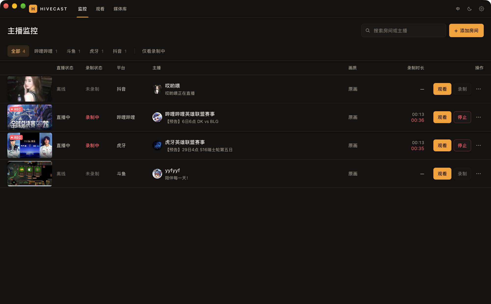
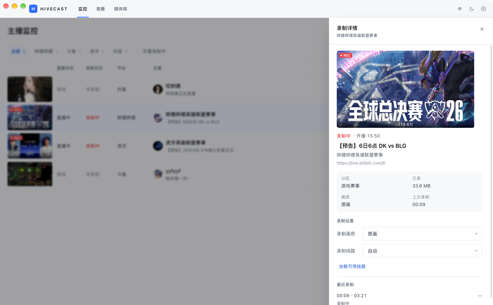

# 41 · 监控页重做：表格工作台 + 录制详情抽屉

> 状态：v1.6（2026-11-06），已落地并通过真机验收；§12 是后续迭代必须守住的设计契约。
> 关联：[40 UI/UX 设计方案](40-UIUX-设计方案.md)、[19 产品蓝图](19-产品蓝图与阶段计划.md) §5 M16。

## 0. 结论

监控页现在是「一张全宽表 + 按需打开的录制详情抽屉」：8 列房间表格（画面、直播状态、录制状态、平台、主播、画质、录制时长、操作）负责扫视与全部日常操作；右侧不再常驻详情，改由 ⋯ 菜单里的「录制详情」打开与设置抽屉同款的右侧浮层（440px、遮罩模糊、滑入）。

v1.5 在 v1.4 上按反馈又推了一轮：

- 上次录制开始时间统一成完整时间戳 `2026-11-06 00:02:28`。
- 平台筛选从「一排胶囊」收成一个下拉菜单：`全部` 仍单独放在最左，右边一个「平台 ▾」，菜单里只列已经添加过房间的平台并带数量。
- 直播状态、录制状态两列的表头可以点击排序：一次升序（在播/在录优先）、再点降序、第三次取消，箭头只在悬停或生效时出现。
- 录制详情改成与设置抽屉完全同构：整窗满高、遮罩盖住顶栏、头部标题/副标题 + 关闭、内容区滚动、底部固定「关闭」；预览图改成按内容宽度等比的 `aspect-video`，不再留 32px 右侧空档。用 `createPortal` 挂到 `document.body`，绕开页面切换动画给 `<main>` 留下的 transform（那会让 `fixed` 相对 main 定位，抽屉从顶栏下方才开始）。
- ⋯ 菜单扩成 7 项：录制详情、刷新直播间信息、直播间设置（占位）、停止/开始监控、开启/关闭自动录制、打开录制文件夹、移除房间。
- 「停止监控」落到 `room.monitor_paused` 字段：暂停后监控循环直接跳过该房间，已有录制不受影响；列表里该行直播状态显示「已暂停监控」。







三句话概括这次返工：

1. 详情从「常驻右栏」改成「按需抽屉」：表格终于能用满整行宽度，主播放列表一眼看到底；要看画质/线路/最近录制再点开。
2. 直播状态与录制状态拆成两列——「在播」和「在录」是两件事，合成一个词会让人误以为开播就等于在录。
3. 主播列带头像（无头像用平台色首字占位），房间标题降为第二行；录制时长一列显示「上次开始时间 + 时长」，正在录时第二行变红并显示实时计时。

## 1. 为什么是「表格 + 右栏」

| 方案 | 问题 |
| --- | --- |
| 卡片流（旧版） | 一屏放不下 4 个房间，封面重复信息，扫视效率低 |
| 行内展开（v1.0） | 展开行把下面的房间推走，一次只能看一个，表格失去「一览」的价值 |
| 右侧详情（v1.2） | 表格列数与行高恒定，但每行被永久压掉 320px，宽屏下浪费、窄屏下挤压 |
| 详情抽屉（现行） | 表格吃满宽度；详情按需滑出，打开时遮罩把注意力收在一个房间上 |

## 2. 版式

```text
┌────────────────────────────────────────────────────────────────┐
│ 主播监控                                        [搜索] [+ 添加房间] │
├────────────────────────────────────────────────────────────────┤
│ 全部 4 | 平台 ▾ | 仅看录制中                                    │
├────────────────────────────────────────────────────────────────┤
│ 画面  直播状态 录制状态 平台 主播              画质  录制时长  操作 │
│ [图]  直播中   录制中   哔哩 哔哩哔哩英雄联盟…  原画  00:13    观看 停止 ⋯ │
│ [图]  离线     未录制   斗鱼 yyfyyf            原画   —       观看 录制 ⋯ │
│ [图]  直播中   录制中   虎牙 虎牙英雄联盟…     原画  00:13    观看 停止 ⋯ │
│ … 表体滚动，表头常驻 …                                           │
└────────────────────────────────────────────────────────────────┘
```

页面自上而下：顶栏（品牌 + Tab + 账号/设置，见 §7）→ 标题行（H1 + 搜索 + 添加房间）→ 错误/通知条 → 筛选行 → 表头 + 表体。没有底部状态条，也没有常驻右栏。

两块浮层不占版式：

- 「添加房间」在页面上方居中（见 §6）。
- 「录制详情」从右侧滑出、带遮罩（见 §4），打开时表格保留在原位、不可交互。

## 3. 表格规格

列宽固定（CSS grid，`gap-x-3`，左右 `px-5`），表头与行共用同一份模板，改列宽只改一个常量：

```ts
const COLUMNS = "120px 66px 72px 84px minmax(0,1fr) 76px 116px 148px";
const ROW_H = 76;
```

| 列 | 宽 | 内容 |
| --- | --- | --- |
| 画面 | 120 | 缩略图 120×68，左上角 `REC`/`LIVE` 徽标，底部渐变条写人气（离线写上次录制日期）；不随录制切换成时长 |
| 直播状态 | 66 | 纯文字「直播中 / 离线 / 已暂停监控」；表头可排序 |
| 录制状态 | 72 | 纯文字「录制中（红）/ 未录制（次要灰）」；与直播状态独立，可组合成离线但仍在收尾的中间态；表头可排序 |
| 平台 | 84 | 平台名文字，不画色点 |
| 主播 | 1fr | 26px 圆头像（无图用平台色底 + 名字首字）+ 主播名 13.5px 主行 + 房间标题 11.5px 次要行 |
| 画质 | 76 | 录制档位（原画 / 蓝光4M / 超清…） |
| 录制时长 | 138 | 右对齐等宽数字两行：第一行上次录制开始时间，固定 `YYYY-MM-DD HH:mm:ss`（11px 才放得下），第二行时长；正在录制时第二行变红并走实时计时，从未录制过为 — |
| 操作 | 148 | 观看（主按钮）、录制/停止（描边）、⋯ 菜单（录制详情、开启/关闭自动录制、Finder、移除房间，移除需二次确认） |

排序只做在两道状态列上，规则是「一次升序 = 在播/在录优先，再点降序，第三次回到默认」，第三态与默认都按主播名称（`localeCompare` 带 `numeric`）。箭头默认隐藏，悬停该表头才淡出，避免表头一排小图标。

最近录制不再是独立列：开始时间进了「录制时长」列，完整记录留在详情抽屉里。

缩略图来源 `coverUrl ?? avatarUrl`，都没有时显示主播名首字；头像来源 `avatarUrl`，缺失时用同一套平台色占位。离线行不做灰度处理（平台封面本来就暗），只靠两道状态文字与上次录制时间区分。

## 4. 录制详情抽屉

从右侧滑出的浮层，和设置抽屉同一套形态：全屏遮罩（`bg-black/35` + 2px 模糊 + `animate-fade-in`）、面板 `w-[min(440px,94vw)]` 贴右、`animate-sheet` 滑入、左侧 1px 分隔线、内容区独立滚动。

打开方式只有一处：操作列 ⋯ 菜单第一项「录制详情」。关闭方式三种：右上角 ✕、点遮罩、按 `Esc`。默认关闭——监控页首屏不再自动占用任何房间的详情。

| 区块 | 内容 |
| --- | --- |
| 头部 | 标题「录制详情」+ 副标题主播名 + 关闭 ✕（`h-14`，底部 1px 线） |
| 预览 | 满宽 `aspect-video` 缩略图（`Thumb fluid`，不再写死 368×207），左上角 `REC`；下方一行状态「录制中 / 直播中 / 离线 · 开播 HH:mm」 |
| 标题区 | 房间标题 15px、主播 12.5px、房间 URL 11.5px（过长省略） |
| 信息四格 | 分区、累计已录、画质、上次录制，浅底块 2×2 |
| 录制设置 | 录制画质、录制线路（下拉 + 「加载可用线路」文字按钮） |
| 最近录制 | 最多 4 条：时间 · 时长 · 体积，第二行状态；同一房间有 2 条以上可「合并」 |

抽屉里的「最近录制」对进行中的会话显示实时计时（`now - startedAt`），而不是列表接口返回的 0 秒快照。

抽屉的外壳与设置抽屉完全同构：`createPortal` 挂到 `document.body`，整窗满高（`fixed inset-0 z-50 flex justify-end`），遮罩 `animate-fade-in bg-black/35 backdrop-blur-[2px]` 盖住顶栏，面板 `w-[min(440px,94vw)] animate-sheet shadow-2xl`；内容区 `flex-1 overflow-auto`，底部固定 `border-t` 一条放「关闭」按钮。用 portal 是必须的：主内容 `<main>` 挂着切页动画的 `transform`，会把自己变成 `fixed` 的包含块，抽屉只能从顶栏下沿开始。

MP4/截图/ASS 三个按钮已撤掉：MP4 本来就是录制收尾的默认动作（见 §4.1），ASS 现在随录制收尾自动导出，截图与「对一条录像做后处理」都不是每行的高频操作。文件后处理改成全局设置项。

### 4.1 文件后处理去哪了

「对这条录像做后处理」是**录制产物的出口**，不是每行的日常操作，所以从右栏移到设置 → 文件后处理：

| 项 | 行为 |
| --- | --- |
| 录制结束后自动转成 MP4 | 默认开。开：分片用 ffmpeg 合成单文件 mp4；关：保留 `fallback_concat` 的 .ts 拼接，适合手动剪辑或救援 |
| 弹幕 ASS | 不再有按钮。每个有弹幕的会话在收尾时自动从 .jsonl 导出同名 .ass（最多几千行文本，耗时毫秒级） |
| 截图 | 删除（含后端 `session_screenshot` 命令、前端入口与 i18n 文案） |
| 合并多段 | 保留在右栏与媒体库的多选操作里 |

设置项落到 `app_setting` 的 `post.auto_remux`，与 `media.retention_days` 同一套读写；`recorder::finish_file(path, remux)` 按它决定是否合成 mp4，崩溃恢复路径固定传 `true`。

## 5. 视觉规则

| 项 | 取值 |
| --- | --- |
| 字号 | H1 21、房间标题 14、表头/次要 12.5、详情标签 11.5、按钮 12.5 |
| 圆角 | 控件 6px、缩略图 5–7px、浮层 8px |
| 数字 | `tabular-nums` |
| 分隔 | 1px `border-line`，不用阴影分隔 |
| 强调色 | 浅色 `#2f6bff`、深色暖黑 + 琥珀 `#f0a23c`；只用于主按钮、选中行底、Tab 下划线 |
| 对比度 | 浅色 `--c-muted #57616e`、`--c-faint #7b8593`；深色 `#b3a695` / `#8b8073` |

**焦点框**：上一版点一下搜索框就出现一整圈蓝框——文本控件在鼠标聚焦时也会命中 `:focus-visible`。现在的策略是：按钮/链接保留键盘焦点环，`input`/`select`/`textarea` 只把描边加深一档（`--c-line-strong`），不再出现蓝色 outline。

## 6. 交互

| 场景 | 行为 |
| --- | --- |
| 行点击 | 无动作。行不是按钮——避免想复制房间标题或选文字时误开详情 |
| 录制详情 | 操作列 ⋯ → 录制详情：打开右侧抽屉，该行底色 `accent-soft` 作为锚点 |
| 关闭详情 | `Esc`、点遮罩、右上角 ✕，三者等效；关闭后锚点高亮消失 |
| 排序 | 默认按主播名称（`localeCompare` 带 `numeric`，中文按拼音、数字按数值）；点「直播状态」或「录制状态」表头可切升序（在播/在录优先）→ 降序 → 取消 |
| 筛选 | 「全部 N」+「平台 ▾」（只列已添加房间的平台，菜单项只有名称与数量，不画平台色点）+ 仅看录制中 + 搜索（标题/主播/房间号），四者叠加 |
| 刷新直播间信息 | ⋯ 菜单：立刻对该房间拉一次房间信息，不等轮询周期 |
| 停止/开始监控 | ⋯ 菜单：写 `room.monitor_paused`，暂停后监控循环跳过该房间（已有录制继续），列表显示「已暂停监控」 |
| 直播间设置 | ⋯ 菜单占位项，点了只出一条「即将上线」提示 |
| 添加房间 | 页面上方居中的浮层弹窗：遮罩模糊、`Esc`/点遮罩/✕ 关闭，回车提交，失败保留输入 |
| 移除房间 | 只在操作列 ⋯ 菜单里，点两次确认 |
| 自动录制 | ⋯ 菜单，按当前状态显示「开启自动录制」或「关闭自动录制」两个文案按钮；开启后房间开播即自动开始录制 |
| 打开录制文件夹 | ⋯ 菜单，原名「在 Finder 中显示」 |
| 危险/异步 | 请求期间该行降透明度并禁用按钮；错误/成功走顶部色带 |

## 7. macOS 标题栏

`tauri.conf.json` 的窗口设为 `"titleBarStyle": "Overlay"` + `"hiddenTitle": true`；`src/App.tsx` 在 macOS 给顶栏留 78px 给红绿灯（Windows 14px），顶栏与品牌区加 `data-tauri-drag-region`。

## 8. 实现位置

| 文件 | 作用 |
| --- | --- |
| `src/features/monitor/MonitorPage.tsx` | 整页（约 1100 行）：`COLUMNS`/`ROW_H`/`THUMB_*` 常量、`datetime`、`Avatar`、`Thumb`（含 `fluid`）、`SortHead`、平台下拉、行渲染、录制详情抽屉（`createPortal`） |
| `src/components/ui/Controls.tsx` | Button 增 `lg`（h-9），Select 增 `size="md"`（h-9），其余页面默认尺寸不变 |
| `src/styles/index.css` | token、焦点策略（输入框不画 outline）、圆角 |
| `src-tauri/src/commands.rs` | 新增 `room_set_monitor(id, paused)`：写库并广播 `rooms-changed`；`room_add` 的草稿补 `monitor_paused: false` |
| `src-tauri/src/db.rs` | `room.monitor_paused` 列（建表 + 迁移 + `ROOM_SELECT`/`map_room` 索引后移）、`set_monitor_paused` |
| `src-tauri/src/monitor.rs` | 轮询循环开头 `if room.monitor_paused { continue; }` |
| `src-tauri/ipc-types/src/lib.rs` | `RoomRecord.monitor_paused: bool` |
| `src/lib/ipc.ts` | `roomSetMonitor(id, paused)` |
| `src/i18n/zh-CN.json`、`en-US.json` | 新增 `monitor.colLive/colRecord/colHost/statusRecording/statusIdle/recordDetail/closeDetail/lastRecorded`、`filterPlatform/statusPaused/refreshInfo/roomSettings/roomSettingsSoon/pauseMonitor/resumeMonitor/close`；删掉 `monitor.summary/footerLibrary/colStatus/colRoom/detailEmpty`，共 295 键 |

已删除：`src/lib/uiPrefs.ts`（密度偏好）、`src/features/design/`（方向 mock）。

## 9. 实测

- 环境：macOS 26，窗口 1320×818pt（2x 截屏后缩到 2000 宽），库内 5 个真实房间（哔哩哔哩 6、虎牙 660000、斗鱼 9999、斗鱼 252140、抖音 362845039857，含三个录制中）。
- 布局：表头与行共用 `COLUMNS`，浅色/深色两张截图的列位一致；表格吃满整行宽度，不再有 320px 右栏。
- 状态：同一屏里同时出现「直播中 · 录制中」「直播中 · 未录制」「离线 · 未录制」三种组合，两道状态列互不覆盖。
- 录制时长：录制中两行显示「2026-11-06 01:08:44 / 00:35」并走秒；离线行显示上次录制完整时间与 —，从未录制过为单个 —。
- 排序：点「直播状态」表头，在播的三行浮到最上；再点变降序；第三次回到主播名排序。
- 平台筛选：「平台 ▾」菜单只列已添加的 4 个平台并带计数，选中后按钮变成平台名 + 计数，左端「全部 5」仍在。
- 暂停监控：对虎牙房间点「停止监控」，该行直播状态变成「已暂停监控」，等一个轮询周期后 `last_checked_at` 不再变化；再点「开始监控」恢复。
- 抽屉：⋯ → 录制详情打开整窗右抽屉（遮罩盖住顶栏），预览满宽 400×225、信息四格、录制设置、最近录制（进行中的会话从 00:00 起实时计时）；底部「关闭」按钮、`Esc`、遮罩、✕ 四者等效。
- 收尾产物（沿用 v1.3 验证）：一段 25 秒录制停止后目录里同时出现 `.mp4`（29.4 秒 / 7.6 MB）、`.ass`（39 行，26 条弹幕）、`.jsonl`。
- 校验：`pnpm exec tsc -b`、`pnpm build`、`node scripts/check-i18n.mjs`（295 键）、`node scripts/check-docs.mjs`（42 篇）全部通过。
- 截图：`docs/assets/ui-monitor-table.png`（浅色列表）、`ui-monitor-table-dark.png`（深色暖黑）、`ui-monitor-detail.png`（录制详情抽屉）、`ui-monitor-menu.png`（⋯ 菜单 7 项）、`ui-monitor-filter.png`（平台下拉）、`ui-monitor-add.png`（添加房间弹窗）。

## 10. 缺口

| 缺口 | 说明 |
| --- | --- |
| 抽屉内容需要滚动 | 860 高的窗口里「最近录制」以下要滚 |
| 列宽不可调 | 固定模板，窄窗口下房间名列会被压缩 |
| 缩略图最长滞后一个轮询周期 | 依赖平台的 `coverUrl` |
| 无人气的平台 | 缩略图底部显示 — |
| 抽屉无「合并到媒体库」入口 | 合并结果仍在录制目录 |
| 抽屉一次只能看一个房间 | 对比两个房间要开关两次；没有并列模式 |
| 批量操作 | 一次只能处理一个房间 |
| 直播间设置只有占位 | 点了只出一条「即将上线」提示，没有真实表单 |
| 排序只覆盖两道状态列 | 平台、画质、录制时长列还不能排 |

## 11. 设计契约（后续迭代不得破坏）

这一节把监控页当前「已经定稿、且用户明确要求过」的部分写成约束。改监控页前先对照本表：标「锁定」的项不要顺手改，确实要动就在 PR 说明里写清原因并同步本文件。

| 项 | 约束 | 级别 |
| --- | --- | --- |
| 页面结构 | 顶栏工作台 → 标题行（H1 + 搜索 + 添加房间）→ 筛选行 → 表头 → 行 → （按需）录制详情抽屉；不恢复顶部汇总条与底部状态条 | 锁定 |
| 表格列 | 8 列固定顺序：画面 120、直播状态 66、录制状态 72、平台 84、主播 1fr、画质 76、录制时长 138、操作 148；表头与行共用同一个 `COLUMNS` 常量 | 锁定 |
| 行高 | 76px；缩略图 120×68 | 锁定 |
| 行交互 | 行本身不是按钮，不响应点击；详情只能从 ⋯ 菜单打开 | 锁定 |
| 两个状态列 | 「直播状态」与「录制状态」必须分开，不能合并成一列 | 锁定 |
| 录制时长列 | 两行：第一行完整时间戳 `YYYY-MM-DD HH:mm:ss`，第二行时长；录制中第二行红色实时计时 | 锁定 |
| 平台筛选 | 左「全部 N」独立按钮 + 右「平台 ▾」菜单；菜单只列已添加房间的平台，只显示名称与数量，不画彩色圆点 | 锁定 |
| 状态排序 | 只有直播/录制两列表头可点，三态（升序→降序→默认）；默认按主播名 `localeCompare` 带 `numeric` | 锁定 |
| ⋯ 菜单顺序 | 录制详情 → 刷新直播间信息 → 直播间设置（占位）→ 停止/开始监控 → 开启/关闭自动录制 → 打开录制文件夹 → 移除房间；前六项与「移除」之间用一条分隔线 | 锁定 |
| 录制详情 | 440px 右侧抽屉，`createPortal` 到 body、整窗满高、遮罩盖顶栏、内容区滚动、底部固定「关闭」；预览满宽 `aspect-video` | 锁定 |
| 添加房间 | 页面上方居中的浮层（`pt-[88px]`、560px 宽），不是右侧抽屉也不是行内输入 | 锁定 |
| 暂停监控 | 写 `room.monitor_paused`，监控循环整体跳过该房间，已有录制继续；列表显示「已暂停监控」 | 锁定 |
| 视觉 | 浅色冷灰 + 蓝 `#2f6bff`，深色暖黑 + 琥珀 `#f0a23c`；圆角 6–10px、发丝线分隔、`tabular-nums`；不使用大圆角卡片与柔和阴影 | 锁定 |
| 文案 | 全部走 i18n（`monitor.*`），中英各一套；平台名用 `platformName.*`，后台字段名不出现 | 锁定 |

### 11.1 可以自由改的部分

- 列内排版（字号、留白）、缩略图角标样式、按钮文案长度。
- 详情抽屉里各分组的顺序（只要不删掉画质/线路/最近录制）。
- 空态、错误条、加载骨架的写法。
- 新增只读列（例如「今日录制时长」）——但不得挤掉现有 8 列的顺序。

### 11.2 改动检查单

1. 表头与行的列宽是否仍然来自同一个常量；截图里逐列对齐。
2. 行点击是否仍然无动作；⋯ 菜单是否仍是唯一详情入口。
3. 中文与英文两侧的 `monitor.*` 键是否同时存在（`check-i18n`）。
4. 抽屉是否仍然盖住顶栏（`createPortal` 没被去掉）。
5. 暂停监控是否仍然不影响已有录制。
6. 改完跑 `check-docs`、`check-i18n`、`tsc -b`、`pnpm build`、`cargo test --lib`，并重拍浅色/深色截图。

## 12. 变更日志

| 版本 | 日期 | 内容 |
| --- | --- | --- |
| v0.1 | 2026-11-05 | 三个结构方向 + 四套 tone 的 mock，用户裁决「按建议来」 |
| v1.0 | 2026-11-05 | 10 列表格 + 行内展开 + 两档密度 + Overlay 标题栏（已废弃） |
| v1.6 | 2026-11-06 | 增加 §12 设计契约与改动检查单；平台筛选菜单去掉彩色圆点 |
| v1.5 | 2026-11-06 | 上次录制时间固定 `YYYY-MM-DD HH:mm:ss`；平台筛选收成「全部 + 平台 ▾」下拉菜单；直播/录制状态表头可三态排序；详情抽屉改 `createPortal` 满窗 + 底部关闭 + 预览满宽（与设置抽屉同构）；⋯ 菜单新增刷新直播间信息、直播间设置占位、停止/开始监控；`room.monitor_paused` 字段与 `room_set_monitor` 命令 |
| v1.4 | 2026-11-06 | 去掉顶部汇总与底部状态条；直播状态/录制状态拆成两列；主播列加头像与占位；录制时长改为「上次开始时间 + 时长」两行；去掉行点击选中与默认选中；右侧常驻详情改为按需滑出的 440px 录制详情抽屉（⋯ 菜单入口，`Esc`/遮罩/✕ 关闭） |
| v1.3 | 2026-11-05 | 去掉表格「最近录制」列；缩略图固定显示人气/上次录制；自动录制改为两态文案按钮；默认选中第一行；文件后处理移进设置（新增 `post.auto_remux`）、删除截图、ASS 改为收尾自动导出 |
| v1.2 | 2026-11-05 | 去掉排序控件（固定按主播名）；添加房间改为页面上方居中弹窗；自动录制移进 ⋯ 菜单；详情栏去掉移除房间按钮；后处理按钮补悬停说明 |
| v1.1 | 2026-11-05 | 按反馈重做：行内展开改右侧固定详情、去掉状态/平台圆点与分区/人气列、常用按钮进操作列、取消密度、整体放大、输入框去蓝色焦点框 |
