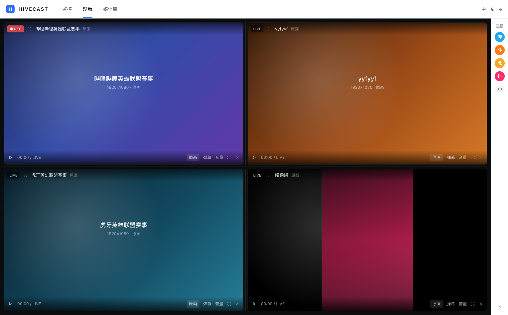
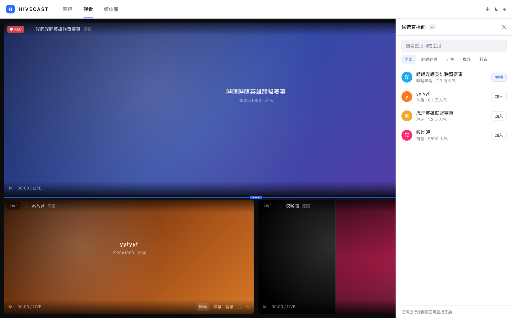
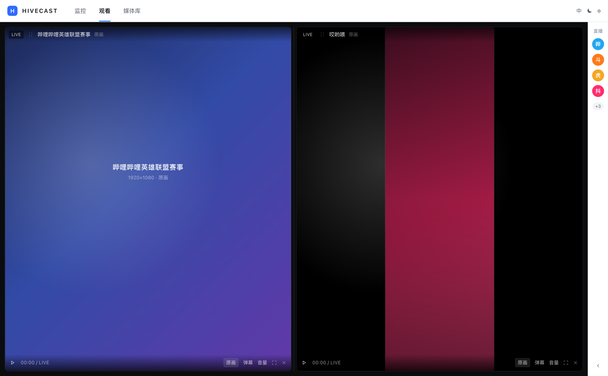
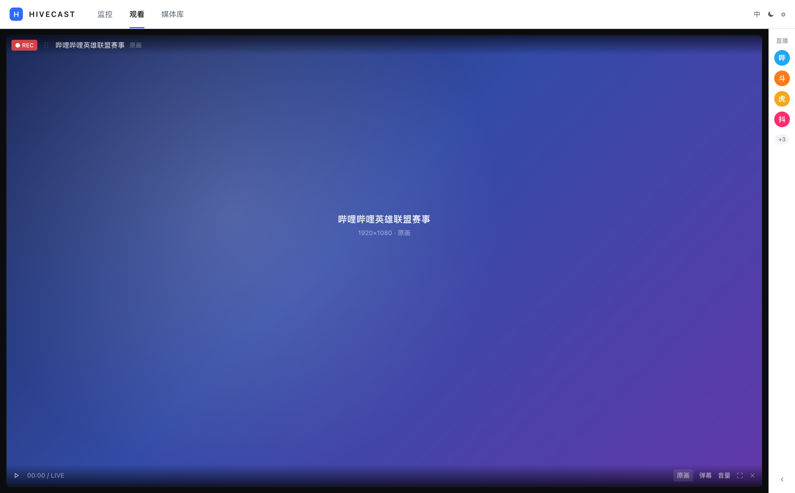

# 42 · 观看页设计方案：分屏观看

> 状态：v0.1 设计稿（2026-11-06），待裁决后进入实施。
> 关联：[41 监控页重做](41-监控页重做.md)（视觉契约）、[40 UI/UX](40-UIUX-设计方案.md)、[19 产品蓝图](19-产品蓝图与阶段计划.md) §5 M17。

## 0. 结论

观看页从「顶部一排候选卡 + 7 种固定 CSS 栅格」改成「一块纯画面画布 + 可拖拽的二叉分割 + 右侧候选浮层」：监控页勾选最多 4 个直播中的房间就能直接组成分屏，1/2/3/4 路各有一套默认版式；格子可以拖拽换位、分割线可以拖拽改比例；竖屏流永远按 `object-contain` 完整显示，不裁切；候选房间收在右侧 44px 的窄条里，需要时展开成 300px 浮层盖在画面上，不挤压观看区域。









四张都是设计稿（假数据、假画面），不是真机截图；实现完成后会按 41 的验收方式补真机截图。

## 1. 需求与约束

用户原话要点（m09306）：

1. 监控界面可以选择最多 4 个直播中的直播间，快速组成分屏观看入口，组合后直接进入观看界面。
2. 默认组合：1 个全屏；2 个左右分布；3 个上方一个大房间、下方两个小房间；4 个平均切分 4 块。
3. 支持拖拽房间移动顺序，拖动分割线实现分配区域大小。
4. 有竖屏直播时尽可能保持竖屏可见、不被裁切。
5. 观看界面也能选择直播中的直播间进行组合或替换，候选做成悬浮面板或收起/展开的面板；观看为主，不要被其他内容干扰。

硬约束：

| 约束 | 来源 |
| --- | --- |
| 最多 4 路，后端 `MAX_SLOTS = 4` | `src-tauri/src/view.rs:27` |
| 视觉沿用监控页 token 与字号梯度 | 41 §12 |
| 不改动监控页表格与菜单契约 | 41 §12 |
| 中英双语，文案全部走 i18n | 19 §8.1 |
| 不新增 HTTP 端口；观看仍走本地回环 + hls.js | 19 §3 |

## 2. 从监控页组建分屏

### 2.1 多选

| 状态 | 表现 |
| --- | --- |
| 未进入多选 | 行与现在完全一致，不显示勾选框 |
| 悬停行 | 缩略图右上角浮出 20×20 圆角勾选框（白底 1px 描边，选中后填充 accent 并显示对勾） |
| 已选中 | 整行 `accent-soft`，行左侧 2px accent 竖条；勾选框常显 |
| 离线房间 | 勾选框禁用，鼠标悬停提示「未开播，无法观看」 |
| 选择上限 | 第 5 个被点击时不再选中，操作条抖动一次并提示「最多同时观看 4 路」 |

勾选框放在缩略图内部，不新增表格列——这是为了不破坏 41 §12 的 8 列列宽契约。

### 2.2 浮动操作条

选中至少 1 个后，画布底部居中浮出一条深色胶囊（距底 20px，`bg-[#111114]/92` + 模糊 + 细描边）：

```
┌──────────────────────────────────────────────┐
│  已选 2 个直播间        [ 分屏观看 ]  [ 清除 ] │
└──────────────────────────────────────────────┘
```

- 「分屏观看」为主按钮，右侧带当前选择数量的角标；1 个时文案仍是「分屏观看」，行为是单画面。
- 「清除」清空选择并退出多选态。
- 按 Esc 也清空。
- 选择顺序即入格顺序：选 1、2、3 时，1 进主格（3 路时是上方大格），2、3 进次格。

### 2.3 进入观看页

点击后：切到「观看」Tab → 按数量套默认布局 → 逐格 `view_open`。起播期间每格显示骨架（房间封面 + 转圈 + 「正在起播」），不阻塞其它格。

已有观看会话时的合并规则：

| 情况 | 行为 |
| --- | --- |
| 无会话 | 直接开新会话 |
| 已有 1 路且本次选 3 路 | 保留原有那路（如果它也在本次选择里），补开另外 2 路 |
| 已有 4 路且本次选 2 路 | 先关闭不在本次选择里的会话，再保持这 2 路 |
| 选了正在录制但未观看的房间 | 正常开观看会话，与录制共用解析缓存、各自独立管道 |

## 3. 布局模型

### 3.1 四套默认版式

```
1 路                2 路                 3 路                    4 路
┌──────────┐      ┌────┬────┐        ┌──────────────┐      ┌──────┬──────┐
│          │      │    │    │        │              │      │      │      │
│    1     │      │ 1  │ 2  │        │      1       │      │  1   │  2   │
│          │      │    │    │        ├───────┬──────┤      ├──────┼──────┤
└──────────┘      └────┴────┘        │   2   │  3   │      │  3   │  4   │
                                       └───────┴──────┘      └──────┴──────┘
```

| 路数 | 默认分割 | 默认比例 | 可选变体 |
| --- | --- | --- | --- |
| 1 | 无分割 | — | — |
| 2 | 左右（row） | 50 / 50 | 上下（col） |
| 3 | 上下（col） | 上 62 / 下 38；下方再左右 50 / 50 | 左大右二（col 38 左，右列上下） |
| 4 | 上下各 50，每行左右各 50 | 全 50 | — |

3 路的 62/38 是设计值：上方大格保持 16:9 附近的可视面积，下方两格仍够看清人脸与弹幕。实际落地允许 50–70 之间拖动。

### 3.2 为什么用二叉分割树，而不是 CSS 栅格

| 方案 | 问题 |
| --- | --- |
| 固定栅格类（现状 `grid-cols-2` 等） | 比例写死在 class 里，拖分割线要动态生成任意 class，且 3 路的不对称无法用一条 grid 行表达 |
| 绝对定位 + 百分比 | 可以拖，但格数变化、方向切换时要手写坐标合成，边界情况多 |
| 二叉分割树（选定） | 每个节点只有方向与比例，叶子是格子；分割线就是节点；换方向、调比例、增删格子都只改树 |

树的形状（3 路默认）：

```json
{
  "dir": "col",
  "ratio": 0.62,
  "first":  { "leaf": 0 },
  "second": {
    "dir": "row",
    "ratio": 0.5,
    "first":  { "leaf": 1 },
    "second": { "leaf": 2 }
  }
}
```

- 每个内部节点保存 `ratio`（0.2–0.8），拖动分割线只改当前节点的 ratio。
- 叶子保存 `cellId`，`cellId → roomId → slot` 的映射在运行时维护。
- 最小格尺寸 220×124；拖动时若某格将小于最小值，比例被夹住而不是继续缩。
- 双击分割线复位到该路数的默认比例。
- 窗口 resize 不改树，只按比例重新计算像素。

### 3.3 顺序与换位

视觉顺序 = 树的叶子顺序（0,1,2,3）。拖动交换的是叶子里的 `roomId`，树与比例不动——这样换位不会重建任何 ffmpeg 管道，也不会触发重新起播。

布局变体切换（例如 2 路左右改上下）只重建树，叶子里的房间顺序保留。

## 4. 拖拽

### 4.1 拖拽源与落点

| 源 | 落点 | 行为 |
| --- | --- | --- |
| 格子标题条（左侧 6 点抓手） | 另一个格子 | 两个格子的房间互换；slot 不变，管道不重建 |
| 格子标题条 | 候选面板 | 该格房间移出观看（`view_close`），格子变空 |
| 候选面板的房间行 | 某个格子 | 替换该格：旧房间 `view_close`，新房间 `view_open`；旧房间回到候选列表 |
| 候选面板的房间行 | 空格子 | 直接填入并 `view_open` |
| 任意拖拽 | 画布空白 | 取消，无副作用 |

### 4.2 反馈

- 拖动开始 120ms 后进入拖拽态：跟随指针的是 96×54 的缩略浮层（带房间名、`shadow-pop`、轻微倾斜 1.5°）。
- 合法落点：格子内描边 2px accent + 内侧 3px `accent-soft`；交换双方缩到 0.985 透明度 0.85。
- 非法落点（例如拖到自己身上）：不显示描边，松手无动作。
- `Esc` 取消拖拽；拖动中禁用该格的播放器鼠标事件。
- 触控板用户不友好，所以每条路径都有等价按钮：格子标题条右侧 `⋯` 提供「与下一格交换」「移出观看」；候选面板每行提供「加入 / 替换」。

### 4.3 分割线拖动

- 命中区 10px（视觉 1px 线），悬停时线变 accent、光标变 `row-resize` / `col-resize`。
- 按下后显示 16×10 的 3 点把手（accent 胶囊），拖动实时改 ratio，其它格同步重排。
- 松开写回持久化（节流 500ms）。
- 双击复位；`⌥` + 双击把所有分割线复位。

## 5. 竖屏与画面适配

### 5.1 原则

1. **默认完整显示**：视频元素 `object-contain`，任何格子都不裁切画面。
2. 竖屏流在横格子里 → 左右黑边；横屏流在竖格子里 → 上下黑边。
3. 弹幕层、REC/LIVE 角标、控制条都贴在「实际画面矩形」上，不贴格子矩形（复用 `Player.tsx` 现有的 `box` 计算）。
4. 每格菜单提供「铺满格子」开关，仅对用户显式操作生效；默认关闭，且不写进持久化（避免下次误裁切）。

### 5.2 尺寸算例（窗口 1320×770，画布去掉 48 顶栏与 20 内边距后约 1300×730）

| 场景 | 格子 | 竖屏 9:16 实际画面 | 左右黑边 |
| --- | --- | --- | --- |
| 2 路左右 | 645×730 | 410×730 | 各 117 |
| 3 路下方右格 | 640×277 | 156×277 | 各 242 |
| 4 路右下 | 645×360 | 202×360 | 各 221 |
| 1 路 | 1300×730 | 410×730 | 各 445 |

结论：竖屏在 3/4 路里必然出现大片黑边。设计上接受这一点（完整优先），但提供两个缓解手段：

- 竖屏房间单独观看时，画布居中显示，左右黑边用 `#0b0c0e` 纯黑，不做模糊填充（模糊填充会让弹幕看不清）。
- 格子菜单提供「竖屏优先布局」：2 路时自动切成上下（竖屏占满高度），4 路时把竖屏格换到上排整行（临时树）。这是一次性操作，不改默认布局。

### 5.3 控制条与角标

- 格子内控制条只在悬停时出现（1 路沉浸模式下 3 秒无操作自动隐藏），高度 36px。
- 竖屏格子的控制条宽度跟随画面矩形，不横跨黑边。
- 左上角 `REC` 常显（录制中的房间），`LIVE` 仅悬停时显示。

## 6. 候选直播间面板

### 6.1 收起态（默认）

- 右侧 44px 竖条，与画布同高，底色 `surface`，左边 1px 分割线。
- 内容：顶部「直播」10px 标签 → 最多 4 个 26px 圆形主播头像（无头像用平台色首字）→ `+N` 计数 → 底部 `‹` 展开箭头。
- 头像点击 = 展开面板并滚到该房间；不直接加入（避免误操作）。
- 悬停头像显示房间名 tooltip。

### 6.2 展开态

- 300px 浮层，贴右缘、上下贴画布边缘，盖住 44px 竖条；**不挤压画面**（overlay，不参与 flex 布局）。
- 结构：标题「候选直播间 N」+ 关闭 ✕ → 搜索框（房间名/主播/房间号）→ 平台筛选（全部 / 哔哩哔哩 / 斗鱼 / 虎牙 / 抖音，带计数）→ 房间列表 → 底部提示「把候选行拖到画面可直接替换」。
- 列表行：32px 头像、房间名 12px、第二行「平台 · 人气」10.5px、右侧按钮。当前选中的格子已占用该房间时显示「已加入」并禁用；否则显示「加入」；当前格非空时显示「替换」。
- 排序：直播中优先，其次人气降序；离线房间不出现（候选只列直播中）。
- 空态：「监控页还没有直播中的房间」+「去监控页」文字按钮。

### 6.3 开合规则

| 动作 | 结果 |
| --- | --- |
| 点竖条 / 点头像 / `⌘K` | 展开 |
| `Esc` / 点画面空白 / ✕ | 收起 |
| 加入或替换成功 | 立即收起（把注意力还给画面） |
| 拖动候选行到画面 | 拖动开始时就保持展开，松手后收起 |
| 窗口宽度 < 900 | 展开面板改为 280px，仍 overlay |

## 7. 视觉规格

| 项 | 取值 |
| --- | --- |
| 顶栏 | 48px，与监控页同一套下划线 Tab |
| 画布 | `#0b0c0e`，内边距 10px，格子间距 10px（分割线占 10px 命中区） |
| 格子 | 圆角 8px，1px `rgba(255,255,255,0.1)` 描边，黑底 |
| 标题条 | 32px，顶部 48px 渐变 `black/60 → transparent`，悬停出现 |
| 控制条 | 36px，底部渐变，悬停出现；1 路沉浸模式 3s 自动隐藏 |
| 角标 | REC 红底白字 9.5px；LIVE 黑底半透明 |
| 分割线 | 1px `white/12`，悬停 accent/70，拖动 accent + 3 点把手 |
| 候选竖条 | 44px；展开 300px；列表行高 44px |
| 字号 | 标题 12.5、房间名 12、次要 10.5、角标 9.5；全部 `tabular-nums` 用于时间与人气 |
| 圆角 | 控件 6、格子 8、浮层 10 |
| 动效 | 面板 `animate-sheet`（240ms `ease-spring`）、格子交换 150ms、分割线拖动无动画 |
| 焦点 | 输入框不画蓝色 outline（沿用 41 §5 的焦点策略） |

## 8. 状态与数据

### 8.1 前端模型

```ts
type Node = { leaf: number }
  | { dir: "row" | "col"; ratio: number; first: Node; second: Node };

type Cell = { cellId: number; roomId: string | null; slot: number | null };

type ViewLayout = {
  version: 1;
  count: 1 | 2 | 3 | 4;
  tree: Node;
  rooms: Array<string | null>; // 按叶子顺序
};
```

- `slot` 由 `viewOpen(roomId)` 的返回值填入；同一 roomId 重复打开会复用已有 slot（后端 `find_by_room`）。
- 关闭格子 → `viewClose(slot)` → `slot = null`，格子显示空态（「选择直播间」+ 加号）。
- 换位只交换 `rooms` 数组元素，slot 保持跟随 roomId。

### 8.2 持久化

存 `app_setting` 的 `view.layout` 键（JSON 字符串），不新增表：

```json
{
  "version": 1,
  "count": 3,
  "tree": { "dir": "col", "ratio": 0.62, "first": { "leaf": 0 }, "second": { "dir": "row", "ratio": 0.5, "first": { "leaf": 1 }, "second": { "leaf": 2 } } },
  "rooms": ["room-a", "room-b", null]
}
```

- 每次比例/房间变化后 500ms 防抖写入。
- 进入观看页时读取：仍存在且直播中的房间自动 `view_open`；离线或已删除的房间保留位置但显示「未开播 / 已移除」占位。
- 从监控页多选进入时，以本次选择覆盖 `rooms`，保留同路数的比例。
- 退出应用时保留布局；提供「重置布局」入口（候选面板底部或格子菜单）。

### 8.3 后端

| 能力 | 现状 | 需要改 |
| --- | --- | --- |
| 打开/关闭/画质/线路/重试 | `view_open` / `view_close` / `view_set_quality` / `view_set_line` / `view_retry` | 复用，无需改 |
| 4 路上限 | `MAX_SLOTS = 4` | 复用 |
| 布局持久化 | 无 | 读写 `app_setting`，可走现有 settings 命令或新增 `view_layout_get/set` |
| 批量打开 | 无 | 可选：`view_open_many(roomIds)` 减少前端 N 次串行 invoke 的闪烁；W1 可先不加 |

互踢（平台只允许一个会话）沿用 19 §3 的 D6 策略：该格进入 error 状态时显示「切换为录制流回环」按钮，点击后把该格指向录制中的本地 HLS 而不是重新解析。

## 9. i18n 键

| 键 | 中文 | 英文 |
| --- | --- | --- |
| `watch.stage.empty` | 选择直播间 | Pick a live room |
| `watch.stage.starting` | 正在起播 | Starting |
| `watch.stage.offline` | 未开播 | Offline |
| `watch.stage.swapHint` | 拖到另一格交换 | Drag onto another tile to swap |
| `watch.stage.remove` | 移出观看 | Remove from view |
| `watch.stage.fill` | 铺满格子 | Fill tile |
| `watch.stage.portraitLayout` | 竖屏优先布局 | Portrait-friendly layout |
| `watch.panel.title` | 候选直播间 | Live rooms |
| `watch.panel.search` | 搜索直播间或主播 | Search rooms or hosts |
| `watch.panel.join` | 加入 | Add |
| `watch.panel.replace` | 替换 | Replace |
| `watch.panel.joined` | 已加入 | Added |
| `watch.panel.empty` | 监控页还没有直播中的房间 | No live rooms yet |
| `watch.panel.goMonitor` | 去监控页 | Go to monitor |
| `watch.panel.dragHint` | 把候选行拖到画面可直接替换 | Drag a row onto a tile to replace |
| `monitor.selectHint` | 选择直播间组成分屏 | Select rooms to watch |
| `monitor.selectedCount` | 已选 {{n}} 个直播间 | {{n}} rooms selected |
| `monitor.watchSelected` | 分屏观看 | Watch selected |
| `monitor.clearSelection` | 清除 | Clear |
| `monitor.maxSelection` | 最多同时观看 4 路 | Up to 4 rooms at once |

## 10. 实施拆解

| 阶段 | 内容 | 验收 |
| --- | --- | --- |
| W1 布局引擎 | 二叉分割树组件、四套默认布局、格子容器接现有 `Player`、1/2/3/4 路真机起播 | 4 路同屏 1080p 稳定 60s，切换布局不断流 |
| W2 交互 | 拖拽换位、分割线拖动与夹取、双击复位、布局持久化、监控页多选入口与浮动操作条 | 交换不重建管道（ffmpeg pid 不变）、刷新后布局保持 |
| W3 候选与竖屏 | 右侧 44px 竖条 + 300px 浮层、搜索/平台筛选、加入/替换/移出、竖屏矩形与控制条对齐、沉浸模式 | 竖屏流无裁切；加入后自动收起；离线候选不出现 |

每个阶段都跑：`check-docs`、`check-i18n`、`tsc -b`、`pnpm build`、`cargo test --lib`，并真机截图（浅色 + 深色）。

## 11. 验收清单

1. 监控页勾选 1/2/3/4 个直播中的房间，进入观看页的默认版式分别与 §3.1 一致。
2. 第 5 个房间无法勾选，提示「最多同时观看 4 路」。
3. 2 路左右拖动分割线，比例限制在 20–80，双击复位 50/50。
4. 拖动 A 格标题条到 B 格，两格画面互换，两路 ffmpeg 进程 pid 不变。
5. 从候选面板拖一行到格子，旧房间关闭、新房间 3 秒内起播，面板自动收起。
6. 竖屏抖音房间放进 4 路任一格，画面完整、左右黑边、弹幕与控制在画面内。
7. 关闭应用重开，布局、比例、房间顺序都恢复；离线的房间显示占位而不是被静默移除。
8. 候选竖条不遮挡任何画面；展开面板只盖住右侧画面，不触发重排。
9. 1 路时控制条 3 秒自动隐藏，鼠标移动立即出现。
10. 4 路同屏 1080p，CPU 与内存不超 19 §4 的预算（CPU < 10%、内存 ≈ 0.7GB）。
11. 浅色/深色主题下画布、面板、分割线对比度正常。
12. 中英文切换后无硬编码中文（`check-i18n` 通过）。

## 12. 待裁决

| # | 问题 | 建议 |
| --- | --- | --- |
| 1 | 2 路默认左右还是上下 | 左右（更符合 16:9 屏幕与人眼横向扫视） |
| 2 | 候选面板收起态 | 常驻 44px 竖条（随时可见、不打断），而不是完全隐藏只留按钮 |
| 3 | 分割比例是否跨会话记忆 | 记忆（与房间顺序一起存 `view.layout`） |
| 4 | 3 路上方大格比例 | 62%（可在 50–70 之间拖） |
| 5 | 是否保留「一大三小」第 5 种版式 | v1 不做，4 路固定田字 |

## 13. 变更日志

| 版本 | 日期 | 内容 |
| --- | --- | --- |
| v0.1 | 2026-11-06 | 首版设计：四套默认布局、二叉分割树、拖拽换位与分割线、竖屏 contain、右侧候选浮层、监控页多选入口；待裁决 5 项 |