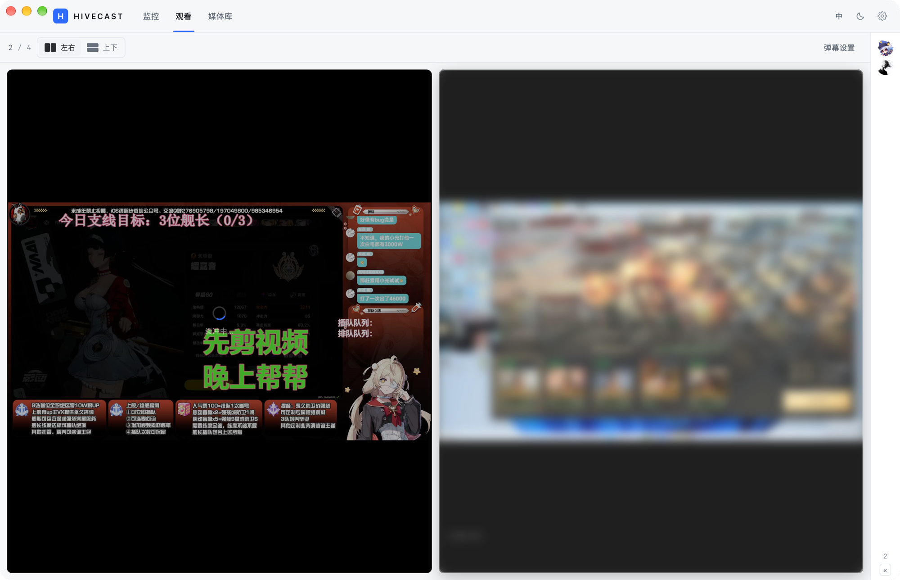
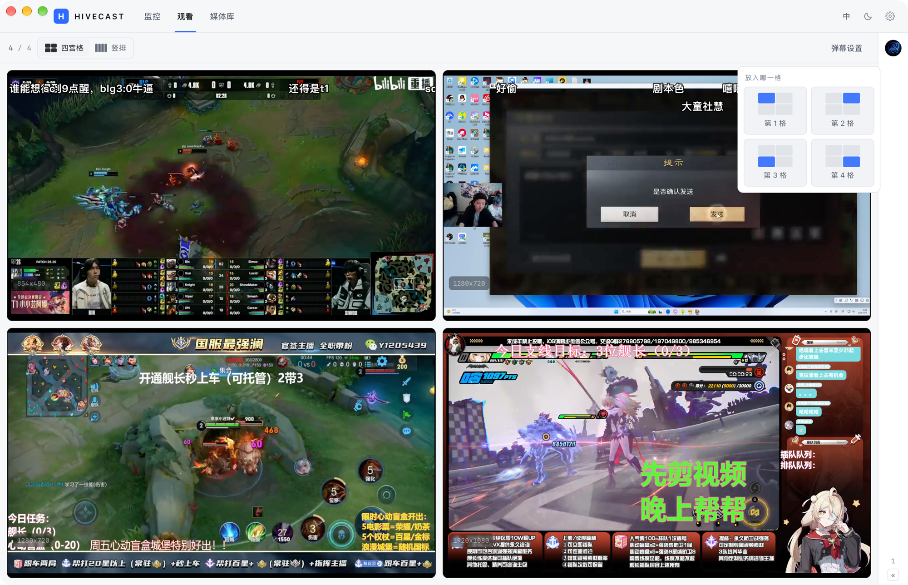
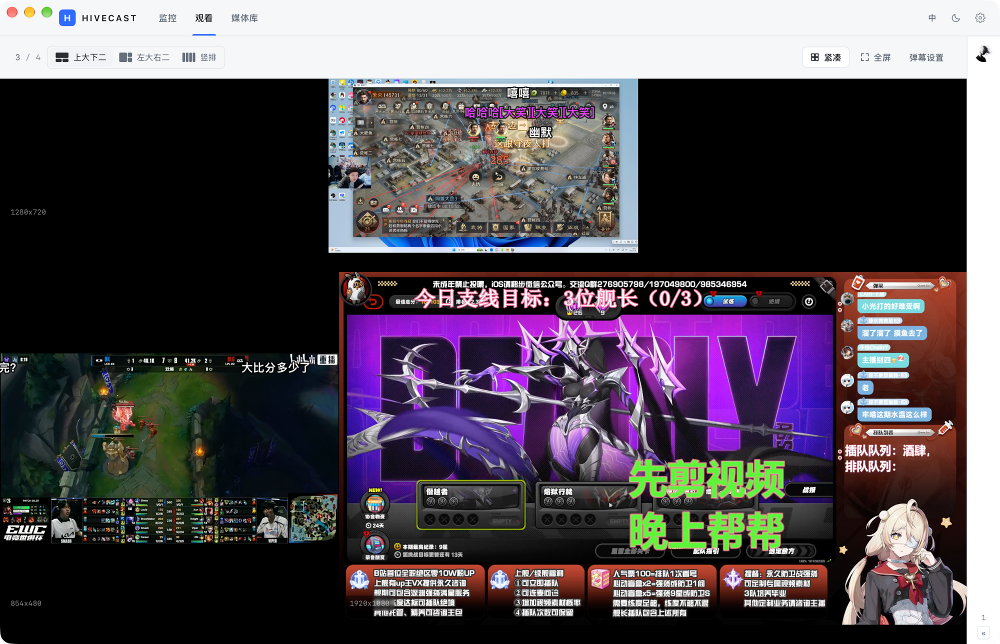
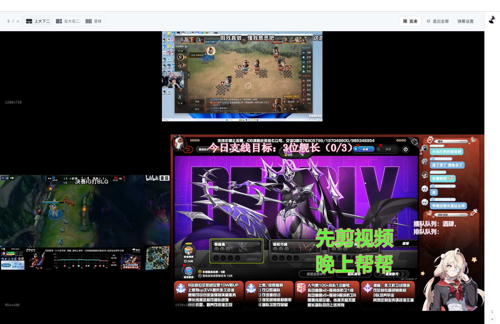

# M17 观看页分屏

> 状态：v1.5（2026-11-06）｜设计依据 [42-观看页设计方案](42-观看页设计方案.md)｜验收截图见 §10

## 0. 结论

观看页从「一排候选卡 + 固定栅格」改成**分屏舞台**：监控页勾选 1–4 个在播房间即可组屏进入；舞台用二叉分割树算像素矩形，格子可拖拽换位、分割线可拖动改比例、双击复位；右侧常驻 44px 候选竖条，展开是 300px 浮层，不挤压画面；竖屏默认 contain 不裁切。

| 维度 | 旧版 | 新版 |
| --- | --- | --- |
| 版式 | 7 个固定 class（single/twoH/twoV/threeBig/threeCol/quad/main） | 二叉分割树，1/2/3/4 各有默认版式 + 2/3 路有变体 |
| 比例 | 固定 50/50 或 62/38 | 每条分割线独立比例，夹在 0.2–0.8，可拖动、双击复位 |
| 换位 | 无 | 拖格子标题到另一格 = 交换 order（slot 与 ffmpeg 不动） |
| 候选 | 顶部一排卡片占一整行 | 右侧 44px 竖条（全部候选头像）+ 300px 浮层，浮层覆盖不挤压 |
| 入口 | 逐路添加 | 监控页勾选 1–4 个直接「分屏观看」 |
| 持久化 | 无 | app_setting.view.layout（500ms 防抖） |
| 竖屏 | object-contain（但弹幕画在黑边上） | contain + 弹幕按实际画面矩形定位；可选「铺满格子」 |
| 版式切换 | 文字按钮，切到竖屏后没有回田字的入口 | 带示意图标的按钮，竖排与田字随时互切 |
| 拖拽 | HTML5 drag，WKWebView 下不触发 | pointer 拖拽，4px 阈值 + 目标格整格磨砂预览 |
| 离开观看 | 录制与观看管道继续跑 | 切走即停所有观看 ffmpeg 并清缓存，布局留在本地，切回自动恢复 |
| 替换/换位 | 重建整页，播放器全部重载 | 换位不改 DOM 顺序（按房间 key 固定排序），替换走 viewReplace 复用同一 slot |
| 切页一致性 | 观看页比监控页矮 12px，切 Tab 还有 5px 上浮淡入 | 两页头部统一 56px / 左右 20px，去掉切页动画，切 Tab 不再跳动 |
| 紧凑模式 | 无 | 工具条「紧凑」：外圈与格子缝归零、格子直角，画面彼此相接；分割线只在悬浮时出现 |
| 全屏 | 无 | 工具条「全屏」调 Tauri 原生全屏，隐藏应用顶栏；Esc / F11 切换，切走 Tab 自动还原 |
| 拖拽稳定性 | 换位几次后抓手失效 | 抓手 setPointerCapture + 残留监听清理，换位只改 style，抓手始终可拖 |
| 添加位置 | 候选拖到格子，落点不确定 | 悬停候选弹出「放入哪一格」示意图，点哪格放哪格 |
| 文字选中 | 拖拽时会划选页面文字 | 全局禁用 user-select，输入框除外 |
| 版式图标 | 6 个 14×10 示意图形，切缝宽窄不一 | 18×13.5，四边 0.4、切缝统一 0.8 |




## 1. 交付清单

| 文件 | 改动 |
| --- | --- |
| src/features/watch/split.ts | 新增：分割树类型、buildTree/portraitTree、computeLayout（支持 pad/gap/hit 选项）、updateRatio/resetRatio、parseLayout/serializeLayout |
| src/features/watch/SplitStage.tsx | 新增：绝对定位格子、分割线指针拖拽、`hitTest` 反查格子、整格磨砂落点层、`cellKey` 固定 DOM 顺序、`compact` 无缝布局 |
| src/lib/watchPrefs.ts | 新增：紧凑模式偏好（zustand persist，key `hivecast.watch`） |
| src/features/watch/WatchPage.tsx | 重写：舞台 + 工具条（版式图标）+ 候选浮层 + 44px 竖条 + 指针拖拽 + 布局持久化 + seed 应用 + 离页停流/回页恢复 |
| src/components/ui/LayoutGlyph.tsx | 6 种版式的 18×13.5 示意图标，四边 0.4、切缝统一 0.8 |
| src/styles/index.css | 全局 `user-select: none`（输入框/文本域除外）、`-webkit-user-drag: none`，拖拽不再划选文字 |
| src/features/watch/Player.tsx | 新增 fit 属性（contain/cover）；cover 时弹幕层铺满整个 video 元素 |
| src/features/monitor/MonitorPage.tsx | 缩略图右上角勾选框、已选行高亮、底部「已选 N 个 / 清除 / 分屏模式」胶囊（按路数给 1/2/3/4 的版式按钮）、下播自动摘除 |
| src/App.tsx | watchSeed 状态：监控页多选 + 指定版式 → 观看页，应用后清空；切走观看页时 `suspendViews()`；全屏时收起顶栏（immersive） |
| src-tauri/src/commands.rs | 新增 layout_get / layout_set（上限 64KB） |
| src-tauri/src/lib.rs | 注册两条命令 |
| src/lib/ipc.ts | layoutGet / layoutSet |
| src-tauri/capabilities/default.json | 补 `core:window:allow-set-fullscreen`（`core:default` 只含 is-fullscreen） |
| src/i18n/*.json | 新增 18 个键（watch.* 13、monitor.* 5） |

## 2. 三角关系：tree / order / slots

- **slots**：后端 ViewManager 的真实会话，带 slot 号、url、画质、线路。一个房间最多一个 slot，最多 4 个。
- **order**：长度等于会话数的数组，`order[i]` 是「第 i 格显示哪个 roomId」。交换格子只动 order，不碰 slot 与 ffmpeg 进程。
- **tree**：二叉分割树，叶子只记 index（0..count-1）。比例与版式在 tree 上，与房间解耦。

三者同步规则：

1. 会话变化 → order 对齐：保留仍在看的房间、新会话补 null 位、消失的清空后裁到会话数。
2. 路数变化 → tree 重建默认版式（除非正好命中持久化的同路数布局）。
3. order[i] 找不到会话 → 该格显示「等待画面」虚线占位，不崩。

## 3. 布局引擎

```ts
type Leaf = { kind: "leaf"; index: number };
type Split = {
  kind: "split";
  dir: "row" | "col";
  ratio: number;
  base: number;
  a: SplitNode;
  b: SplitNode;
};
type SplitNode = Leaf | Split;
```

- `dir: "row"` = 左右切（切宽度），`col` = 上下切（切高度）。
- `base` 记住默认比例，双击分割线复位用。
- `computeLayout(tree, w, h, options?)` 返回 `cells: Map<index, Rect>` 与 `dividers[]`；默认外圈 10px、缝 10px，分割线命中区就是这条缝。
- `options` 三个字段：`pad`（外圈）、`gap`（缝）、`hit`（分割线命中厚度）。紧凑模式传 `{pad:0, gap:0, hit:10}`：格子严丝合缝，但分割线仍留 10px 悬浮带，否则 0 宽度的缝没法拖。
- 常量：`STAGE_PAD=10`、`STAGE_GAP=10`、`MIN_CELL_WIDTH=220`、`MIN_CELL_HEIGHT=124`、`MIN_RATIO=0.2`、`MAX_RATIO=0.8`。

默认版式：

| 路数 | 默认 | 变体 |
| --- | --- | --- |
| 1 | 全屏 | — |
| 2 | 左右 50/50 | 上下 50/50 |
| 3 | 上 62% 大格 + 下方两格 | 左 62% 大格 + 右侧两格 |
| 4 | 田字（先上下 50，再各自左右 50） | 竖排 25/25/25/25 |
| 竖屏优先 | 2 路左右各 50；3 路三条竖排（1/3、1/3、1/3）；4 路 25/25/25/25 竖条 | — |

1000×600 容器算例（取整）：

| 版式 | 格子矩形（left,top,w,h） |
| --- | --- |
| 1 路 | 0: 10,10,980,580 |
| 2 路左右 | 0: 10,10,485,580；1: 505,10,485,580 |
| 3 路上大下二 | 0: 10,10,980,353；1: 10,373,485,217；2: 505,373,485,217 |
| 4 路田字 | 0: 10,10,485,285；1: 505,10,485,285；2: 10,305,485,285；3: 505,305,485,285 |
| 竖屏 3 路 | 0: 10,10,323,580；1: 343,10,319,580；2: 672,10,318,580 |

## 4. 拖拽与分割线

| 操作 | 实现 |
| --- | --- |
| 格子换位 | 按住标题抓手拖到另一格的**左/右/上/下半区**，目标格整体罩一层磨砂；松手把源格插到目标格之前/之后（`moveCell` 重排 order，slot 与 ffmpeg 不动） |
| 落点判定 | `hitTest` 返回 `{ index, side }`：按格子宽高比决定横切还是竖切，指针在中心线前为 before、后为 after；预览层用 `inset-0` 覆盖整格，尺寸随格子实时变化 |
| 添加/替换 | 候选行不再可拖；悬停行弹出「放入哪一格」浮层（当前 4 格各一个示意图），点哪格就把候选放进哪格并关掉旧 slot；不足 4 路时多一个虚线「新增一格」 |
| 拖到空白 | 松手取消，不改变任何状态 |
| 调比例 | 分割线 pointerdown 后 setPointerCapture，pointermove 里按像素差换算比例，pointerup 提交持久化 |
| 复位 | 双击分割线 → 回到 base |
| 触控等价 | 格子 ⋯ 菜单：「与下一格交换」「移出观看」 |

四个实现要点：

1. **不用 HTML5 drag**。WKWebView 下 `draggable` 与 `dataTransfer` 不可靠，改为 pointer 事件：`pointerdown` 时同步挂 window 的 `pointermove/pointerup/pointercancel`，位移超过 4px 才算拖拽，避免点击被误判。同时全局 `user-select: none`，拖动时不会划选文字。
   - 抓手 `setPointerCapture` 后再 `preventDefault + stopPropagation`，指针移出窗口也能收到 `pointerup`。
   - 每次 `startDrag` 先调 `dragCleanupRef.current?.()` 清掉上一次的 window 监听：如果在窗口外松手导致监听残留，它会吞掉下一次 `pointerdown`，表现就是「拖几次之后抓手失灵」。
2. **落点用 `hitTest`**。`SplitStage` 通过 `useImperativeHandle` 暴露 `hitTest(clientX, clientY)`，按各格子的 DOM 矩形反查 index 并算出 `side`；拖动时目标格盖整格磨砂层 `inset-0 rounded-[8px] border border-white/45 bg-white/12 backdrop-blur-[7px]`，背后视频被模糊、边框贴合格子圆角。
3. **比例夹取分两层**：拖动时 `clampRatio` 同时守住 0.2–0.8 和「子格不小于最小尺寸」；`updateRatio` 只做全局 0.2–0.8 兜底，不再重复按像素夹（否则会把窄窗口下的合法值改坏）。
4. **放置器不挤压画面**。`createPortal` 到 body，`fixed z-[70] w-[208px]`，位置取候选行 `getBoundingClientRect().left - 204`；移入浮层取消 160ms 的关闭定时器，移出才关。
5. **换位不移动 DOM**。`SplitStage` 把子节点按 `cellKey`（房间 id）排序后渲染，换位只改每格的 `index`/style，React 不会把含 `<video>` 的子树搬到别处。WKWebView 移动 video 节点会重新加载媒体，这是「拖一下就重新拉流」的根因；`SlotCell` 的 key 也从 index 改成 roomId，避免换位时整格重挂。

## 5. 持久化

- 键：`app_setting` 表的 `view.layout`，JSON：

```json
{ "version": 1, "count": 3, "tree": { ... }, "rooms": ["room-a", "room-b", null] }
```

- 写：tree/order/count 变化后 500ms 防抖写；页面卸载时立即把最后一次 payload 落库（切 Tab 会卸载本页）。
- 离开观看页：`suspendViews()` 停掉全部观看 ffmpeg 并删除会话缓存目录，但不动 `view.layout`；切回时按存下的 rooms 顺序重新 viewOpen。首次挂载有两个门（`booted`/`roomsLoaded`），避免空布局覆盖存档、房间列表未到时误剪。
- 读：挂载时 `layoutGet()`，`parseLayout` 校验 version、count 范围、叶子数、重复与越界，脏数据直接丢弃。
- 应用时机：等会话数也确定后，只有 `saved.count === count` 才套用，套用一次后清空，避免和「路数变化重建默认版式」互相覆盖。
- `layout_set` 限制 64KB，超限返回用户态错误。

## 6. 候选面板与竖条

- 收起态：右侧 44px 竖条，候选头像 24px 竖排全部展示，超出容器直接裁掉（不滚动）；底部固定候选数与 «/»。
- 展开态：舞台内绝对定位 300px 浮层，`bg-[#141416]/95` + backdrop-blur，覆盖在画面上而不是挤压格子。
- 内容：标题 + 已用路数、搜索框（标题/主播名小写匹配）、悬停提示、候选行（头像 + 标题 + 主播 + ›）、底部粘贴链接「添加并观看」。
- 候选 = 在播且未在观看中的房间；满 4 路时行尾显示「已满 4 路」并禁用。
- 入口：右上角「直播间」按钮已删除，点击 44px 竖条本身展开/收起面板。
- 悬停候选行 → 弹出「放入哪一格」放置器（4 个当前格示意图 + 不足 4 路时的「新增一格」），点示意图即放入；点击候选行本身仍是追加到下一个空格。

## 7. 监控页多选入口

- 勾选框放在缩略图右上角（18px，不新增列，保持 8 列契约）；只有 `isLive` 的房间可勾。
- 选中行整行 `bg-accent-soft`；第 5 个提示「最多同时观看 4 路」。
- 房间下播后自动从已选集合里摘除（否则会把离线房间带进分屏）。
- 底部居中胶囊：`已选 N 个` + `清除` + `分屏模式` + 按路数给出的版式按钮（1 路单画面；2 路左右/上下；3 路上大下二/左大右二；4 路田字）。点任一版式 → App 写 watchSeed（含 layout）→ 切 Tab。
- 顺序按当前列表的 `shown` 排（搜索、平台筛选、状态排序之后），不按勾选先后。
- 观看页应用 seed：先关掉所有现有 slot，再按顺序 viewOpen，最多 4 个；应用完回调清空 seed，避免切回本页重复覆盖。


## 8. 竖屏与「铺满格子」

- 默认 `object-contain`，竖屏完整可见，左右留黑边（舞台底色 #0b0c0e）。
- Player 新增 `fit` 属性；`cover` 时 video 用 object-cover，弹幕层直接铺满整个 video 元素（不再按 videoWidth/videoHeight 算矩形）。
- 每格 ⋯ 菜单「铺满格子」是临时开关，不持久化。
- 工具条版式按钮带示意图标：2 路「左右/上下」、3 路「上大下二/左大右二/竖排」、4 路「四宫格/竖排」；点任一按钮都会同时退出竖屏模式，所以 4 路竖排可以一键切回田字。

### 8.1 主题

观看页不再强制深色，跟随应用主题（浅色 / 深色 / 跟随系统）：

- 页面骨架（工具条、提示条、弹幕设置、候选浮层、右侧 44px 竖条、空态）全部改用语义 token（canvas/surface/raised/line/ink/muted/faint），浅色下是白底浅灰画布。
- 视频格本身保持黑底；格内悬浮控件（标题条、画质/线路菜单、状态文案）叠在视频上，继续用黑底白字，不随主题反转，避免在亮画面上看不清。
- 舞台底色取 canvas：浅色下格子之间是浅灰缝，深色下是暖黑缝。


## 9. i18n 与文件清单

新增键（中英各一套，check-i18n 328 keys）：

- watch：`layout.quad`、`layout.portrait`、`layout.threeBig`、`layout.threeCol`、`layout.twoH`、`layout.twoV`、`cellN`、`dragHint`、`fill`、`swapNext`、`remove`、`cellMenu`、`stage.empty`、`panel.title`、`panel.search`、`panel.join`、`panel.empty`、`panel.full`、`panel.dragHint`、`panel.place`、`panel.placeNew`
- monitor：`selectHint`、`selectedCount`、`clearSelection`、`maxSelection`、`splitMode`、`modeSingle`、`modeRow`、`modeCol`、`modeTop`、`modeLeft`、`modeQuad`
- watch：`slotsFull`、`compact`、`compactHint`、`fullscreenHint`、`exitFullscreen`

## 9.1 紧凑模式与全屏

### 紧凑

- 偏好存在 `src/lib/watchPrefs.ts`（zustand persist，key `hivecast.watch`，默认关），跨会话记住。
- 开：`computeLayout(..., { pad: 0, gap: 0, hit: 10 })`，格子外圈与缝都归零、格子 `rounded-none border-0`，画面彼此相接；分割线仍留 10px 命中带并向两侧各扩 5px，否则 0 宽度的缝抓不到。
- 分割线视觉只在悬浮/拖动时出现（3 点把手），静止时不画线，观感是「一整块画面」。
- 关：回到默认 10px 外圈 + 10px 缝 + 8px 圆角 + 细边框。
- 工具条右侧「紧凑」按钮，文案与提示走 i18n（`watch.compact` / `watch.compactHint`）。

### 全屏

- 入口：工具条「全屏」按钮 + F11；退出：Esc、F11、系统绿灯、Cmd+Ctrl+F。
- 实现：`getCurrentWindow().setFullscreen(true|false)`（Tauri 2），需要在 `src-tauri/capabilities/default.json` 显式加 `core:window:allow-set-fullscreen` —— `core:default` 只含 `allow-is-fullscreen`，不加会直接被拒。
- 状态同步：进入后 `win.isFullscreen()` 为 true，并监听 `onResized`，这样用系统绿灯进出全屏时 UI 按钮也跟着变。
- 全屏时应用顶栏（品牌/Tab/账号/设置）隐藏，只留观看页工具条；`App` 用 `immersive` 状态控制，切到别的 Tab 自动退出全屏并恢复顶栏。
- 观看页卸载时如果还处于全屏，会主动退出并通知上层复位，避免从监控页回来时窗口还是全屏。

## 10. 实测

环境：macOS arm64、Tauri dev、5 个真实直播间（哔哩哔哩 6 / 1946280327、斗鱼 252140、虎牙 660000）。

| 场景 | 结果 | 证据 |
| --- | --- | --- |
| 监控页多选 3 个 | 行高亮、勾选框、胶囊「已选 3 个」正确；下播的抖音房间被自动摘除 | ui-monitor-select.png |
| 3 路组屏 | 上 62% 大格 + 下两格，三路同时播放，画面比例正确 | ui-watch-three.png |
| 4 路组屏 | 田字均分，竖屏房间完整显示（pillarbox），四路同时播放 | ui-watch-quad.png |
| 2 路 + 候选浮层 | 左右各 50%，浮层覆盖右侧 300px，不挤压左侧格子 | ui-watch-two.png |
| 竖条头像 | 5 个候选头像全部竖排显示，计数 5，超出裁剪 | /tmp/rail1-s.png |
| 4 路竖排 | 工具条显示「4 / 4」+ 四宫格/竖排 两个图标按钮，竖排高亮；4 条竖列 | ui-watch-portrait.png |
| 竖排切回田字 | 点「四宫格」立即回到田字，比例重置为默认 | /tmp/rev-s.png |
| 指针拖拽 | 拖第 1 格抓手到第 2 格，order 变为 `rm-b545068,rm-b6,...`，两格画面交换 | /tmp/drag2.png |
| 放置器 | 4 路 + 1 个候选，弹出 4 格示意图；点第 2 格后该格换成候选，其余三路不动 | ui-watch-picker.png |
| 整格磨砂落点 | 拖第 1 格悬到第 2 格上，目标格整格覆盖磨砂层，背后视频被模糊、边框与圆角贴合格子；松手后 order 重排 | ui-watch-frost.png |
| 离开观看停流 | 观看 2 路时切到监控页：`pgrep -f '^/opt/homebrew/bin/ffmpeg'` 为 0，`Caches/.../view` 只剩 ffmpeg.log（两个会话目录已删） | /tmp/r2b-s.png |
| 切回自动恢复 | 切回观看页：2 路 ffmpeg 重新拉起、缓存目录新建（时间戳 09:46）、版式与房间顺序不变 | /tmp/r2c-s.png |
| 监控底部分屏模式 | 勾 3 个在播房间后胶囊显示「已选 3 个 / 清除 / 分屏模式 / 上大下二 / 左大右二」，图标与 3 路版式一致 | ui-monitor-split.png |
| 图标间距 | 四宫格/竖排切缝统一 0.8、画布 18×13.5，工具栏无错位 | /tmp/icons.png |
| 紧凑模式 | 三路画面外圈与缝归零、格子直角、彼此相接；分割线静止时不显示 | ui-watch-compact.png |
| 全屏 | 窗口 2816×1826、应用顶栏隐藏、工具条保留、三路画面正常；Esc 退出后顶栏恢复 | ui-watch-fullscreen.png |
| 换位不重挂播放器 | 连续 3 次换位 + 切版式后，SlotCell 挂载计数 sm 保持 6（3 格 × StrictMode 双跑）不变；DB 布局变为 row 0.62 | /tmp/sm-now.png |
| 切页对齐 | 监控页与观看页头部同为 56px / 左右 20px，切 Tab 无高度跳变、无上浮动画 | ui-watch-compact.png |
| 布局算例 | 1/2/3/4 路、变体、竖屏、0.7 比例、序列化/解析、脏数据拒绝，全部符合 §3 | node --experimental-strip-types 直接跑 split.ts |








## 11. 缺口与后续

| 缺口 | 说明 |
| --- | --- |
| 比例记忆只在同一路数首次恢复 | 关闭一路再开回同样路数会回到默认比例；要跨次数记忆需按 count 分别存多份 tree |
| 分割线无键盘操作 | 只有指针拖动与双击；键盘用户暂无等价操作 |
| 4 路竖排不可拖比例 | 竖排 4 列共用根节点一条分割线，只能整体调，不能单独调某两列之间 |
| 窗口极窄时 | 最小格 220×124 是软约束，容器小于该尺寸时格子会被压缩 |
| 布局切换无动画 | 路数变化是瞬切，没有过渡动画 |
| 放置器只覆盖展开面板 | 收起态 44px 头像不触发悬停放置器，必须先点开面板；键盘也无等价操作 |
| 落点预览不区分前后 | 整格磨砂只说明「会插进这一格」，具体插到前还是后由指针在中心线哪侧决定，画面上看不出来 |
| 恢复时离线房间 | 切回观看页按存档顺序重新取流；房间已下播时该格显示占位，需手动替换或移除 |
| 全屏时工具条常驻 | 没有鼠标闲置自动隐藏，长时间观看时工具条会一直显示 |
| 紧凑模式命中带 | 分割线 10px 命中带会盖住缝两侧各 5px 的画面点击（格内菜单等），紧凑下更明显 |
| 全屏进出瞬变 | macOS 原生全屏有系统动画，动画期间容器尺寸变化会让布局短暂重算，画面可能闪一下 |
| Esc 优先级 | 候选浮层打开时按 Esc 先退全屏而不是先关浮层 |

## 12. 变更日志

| 版本 | 日期 | 内容 |
| --- | --- | --- |
| v1.0 | 2026-11-06 | 首版：分割树布局、拖拽换位/替换、分割线拖拽、持久化、候选浮层、监控多选入口、竖屏 contain 与铺满 |
| v1.1 | 2026-11-06 | 观看页跟随应用主题：去掉强制深色，页面骨架改用语义 token，视频格内悬浮控件保持黑底白字 |
| v1.2 | 2026-11-06 | 竖条展示全部候选头像并裁剪溢出；版式按钮加示意图标；4 路竖排可一键切回田字；HTML5 drag 换成 pointer 拖拽（4px 阈值、落点高亮） |
| v1.3 | 2026-11-06 | 全局禁用文字选中；版式图标重绘为统一 0.8 切缝的 18×13.5 画布；拖拽改为半格预览 + 前后插入（类 Windows 分屏）；候选行悬停弹出「放入哪一格」放置器；删除右上角「直播间」按钮 |
| v1.4 | 2026-11-06 | 落点预览由半格改为整格磨砂（尺寸随格子实时变化）；监控底栏按路数给出版式按钮、顺序按列表排序；离开观看页停流并保留布局、切回自动恢复；换位只移动 DOM、替换复用 slot，不再整页重载 |
| v1.5 | 2026-11-06 | 两页头部对齐 56px、去掉切页动画；新增紧凑模式（无缝、直角、分割线仅悬浮显示）；新增原生全屏（隐藏顶栏、Esc/F11、切走还原）；抓手加 pointer capture 与残留监听清理，修复拖几次后失灵；换位改为固定 DOM 顺序 + roomId key，修复拖拽导致重新拉流 |
