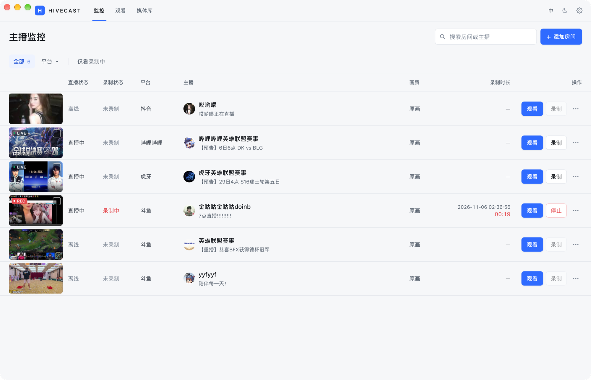
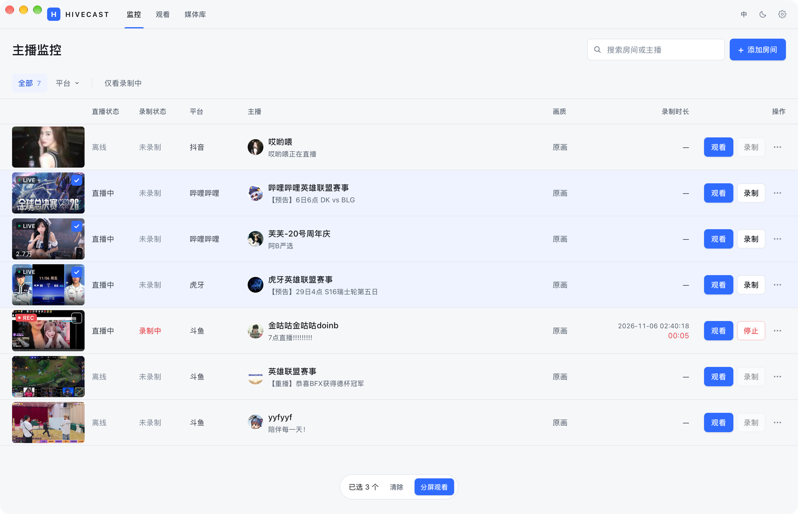
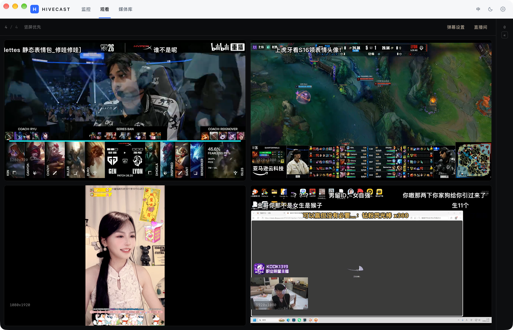
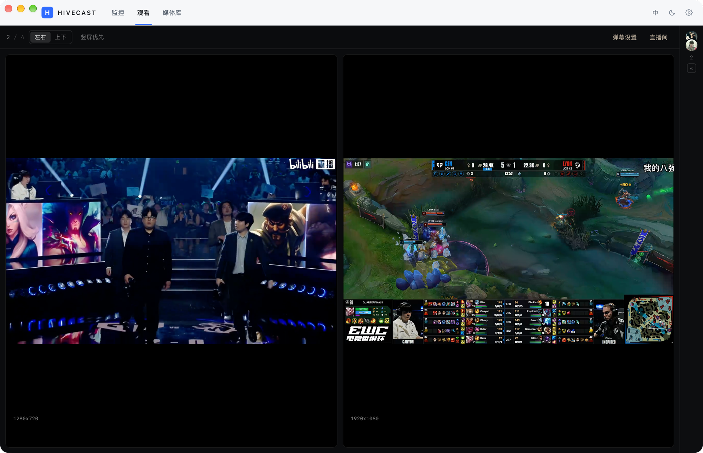

# M17 观看页分屏

> 状态：v1.0（2026-11-06）｜设计依据 [42-观看页设计方案](42-观看页设计方案.md)｜验收截图见 §10

## 0. 结论

观看页从「一排候选卡 + 固定栅格」改成**分屏舞台**：监控页勾选 1–4 个在播房间即可组屏进入；舞台用二叉分割树算像素矩形，格子可拖拽换位、分割线可拖动改比例、双击复位；右侧常驻 44px 候选竖条，展开是 300px 浮层，不挤压画面；竖屏默认 contain 不裁切。

| 维度 | 旧版 | 新版 |
| --- | --- | --- |
| 版式 | 7 个固定 class（single/twoH/twoV/threeBig/threeCol/quad/main） | 二叉分割树，1/2/3/4 各有默认版式 + 2/3 路有变体 |
| 比例 | 固定 50/50 或 62/38 | 每条分割线独立比例，夹在 0.2–0.8，可拖动、双击复位 |
| 换位 | 无 | 拖格子标题到另一格 = 交换 order（slot 与 ffmpeg 不动） |
| 候选 | 顶部一排卡片占一整行 | 右侧 44px 竖条 + 300px 浮层，浮层覆盖不挤压 |
| 入口 | 逐路添加 | 监控页勾选 1–4 个直接「分屏观看」 |
| 持久化 | 无 | app_setting.view.layout（500ms 防抖） |
| 竖屏 | object-contain（但弹幕画在黑边上） | contain + 弹幕按实际画面矩形定位；可选「铺满格子」 |



## 1. 交付清单

| 文件 | 改动 |
| --- | --- |
| src/features/watch/split.ts | 新增：分割树类型、buildTree/portraitTree、computeLayout、updateRatio/resetRatio、parseLayout/serializeLayout |
| src/features/watch/SplitStage.tsx | 新增：绝对定位格子、分割线指针拖拽、HTML5 拖放（换位/替换）、拖入高亮 |
| src/features/watch/WatchPage.tsx | 重写：舞台 + 工具条 + 候选浮层 + 44px 竖条 + 布局持久化 + seed 应用 |
| src/features/watch/Player.tsx | 新增 fit 属性（contain/cover）；cover 时弹幕层铺满整个 video 元素 |
| src/features/monitor/MonitorPage.tsx | 缩略图右上角勾选框、已选行高亮、底部「已选 N 个 / 清除 / 分屏观看」胶囊、下播自动摘除 |
| src/App.tsx | watchSeed 状态：监控页多选 → 观看页，应用后清空 |
| src-tauri/src/commands.rs | 新增 layout_get / layout_set（上限 64KB） |
| src-tauri/src/lib.rs | 注册两条命令 |
| src/lib/ipc.ts | layoutGet / layoutSet |
| src/i18n/*.json | 新增 18 个键（watch.* 13、monitor.* 5） |

## 2. 三角关系：tree / order / slots

- **slots**：后端 ViewManager 的真实会话，带 slot 号、url、画质、线路。一个房间最多一个 slot，最多 4 个。
- **order**：长度等于会话数的数组，`order[i]` 是「第 i 格显示哪个 roomId」。交换格子只动 order，不碰 slot 与 ffmpeg 进程。
- **tree**：二叉分割树，叶子只记 index（0..count-1）。比例与版式在 tree 上，与房间解耦。

三者同步规则：

1. 会话变化 → order 对齐：保留仍在看的房间、新会话补 null 位、消失的清空后裁到会话数。
2. 路数变化 → tree 重建默认版式（除非正好命中持久化的同路数布局）。
3. order[i] 找不到会话 → 该格显示「等待画面」虚线占位，不崩。

## 3. 布局引擎

```ts
type Leaf = { kind: "leaf"; index: number };
type Split = {
  kind: "split";
  dir: "row" | "col";
  ratio: number;
  base: number;
  a: SplitNode;
  b: SplitNode;
};
type SplitNode = Leaf | Split;
```

- `dir: "row"` = 左右切（切宽度），`col` = 上下切（切高度）。
- `base` 记住默认比例，双击分割线复位用。
- `computeLayout(tree, w, h)` 返回 `cells: Map<index, Rect>` 与 `dividers[]`；缝隙固定 10px，分割线命中区就是这条缝。
- 常量：`STAGE_PAD=10`、`STAGE_GAP=10`、`MIN_CELL_WIDTH=220`、`MIN_CELL_HEIGHT=124`、`MIN_RATIO=0.2`、`MAX_RATIO=0.8`。

默认版式：

| 路数 | 默认 | 变体 |
| --- | --- | --- |
| 1 | 全屏 | — |
| 2 | 左右 50/50 | 上下 50/50 |
| 3 | 上 62% 大格 + 下方两格 | 左 62% 大格 + 右侧两格 |
| 4 | 田字（先上下 50，再各自左右 50） | — |
| 竖屏优先 | 2 路左右各 50；3 路三条竖排（1/3、1/3、1/3）；4 路 25/25/25/25 竖条 | — |

1000×600 容器算例（取整）：

| 版式 | 格子矩形（left,top,w,h） |
| --- | --- |
| 1 路 | 0: 10,10,980,580 |
| 2 路左右 | 0: 10,10,485,580；1: 505,10,485,580 |
| 3 路上大下二 | 0: 10,10,980,353；1: 10,373,485,217；2: 505,373,485,217 |
| 4 路田字 | 0: 10,10,485,285；1: 505,10,485,285；2: 10,305,485,285；3: 505,305,485,285 |
| 竖屏 3 路 | 0: 10,10,323,580；1: 343,10,319,580；2: 672,10,318,580 |

## 4. 拖拽与分割线

| 操作 | 实现 |
| --- | --- |
| 格子换位 | 拖格子标题条的 6 点抓手（仅 2 路以上可拖）→ 放到另一格 → `swapCells(from,to)` 只交换 order 两项 |
| 候选替换 | 从候选浮层拖一行到格子 → 关旧 slot、开新房间，并把 order 该位替换 |
| 拖到空白 | 不处理，浏览器回弹 |
| 调比例 | 分割线 pointerdown 后 setPointerCapture，pointermove 里按像素差换算比例，pointerup 提交持久化 |
| 复位 | 双击分割线 → 回到 base |
| 触控等价 | 格子 ⋯ 菜单：「与下一格交换」「移出观看」 |

两个实现要点：

1. **dragover 读不到 dataTransfer 内容**。浏览器只在 drop 时才允许 `getData`，所以 `onDragOver` 只能看 `event.dataTransfer.types` 判断有没有拖东西，否则 `preventDefault` 不执行、drop 永远不会触发。`SplitStage.hasDrag()` 就是为此存在。
2. **比例夹取分两层**：拖动时 `clampRatio` 同时守住 0.2–0.8 和「子格不小于最小尺寸」；`updateRatio` 只做全局 0.2–0.8 兜底，不再重复按像素夹（否则会把窄窗口下的合法值改坏）。

## 5. 持久化

- 键：`app_setting` 表的 `view.layout`，JSON：

```json
{ "version": 1, "count": 3, "tree": { ... }, "rooms": ["room-a", "room-b", null] }
```

- 写：tree/order/count 变化后 500ms 防抖写；页面卸载时立即把最后一次 payload 落库（切 Tab 会卸载本页）。
- 读：挂载时 `layoutGet()`，`parseLayout` 校验 version、count 范围、叶子数、重复与越界，脏数据直接丢弃。
- 应用时机：等会话数也确定后，只有 `saved.count === count` 才套用，套用一次后清空，避免和「路数变化重建默认版式」互相覆盖。
- `layout_set` 限制 64KB，超限返回用户态错误。

## 6. 候选面板与竖条

- 收起态：右侧 44px 竖条，候选前 3 个头像叠放 + 候选数 + «/»。
- 展开态：舞台内绝对定位 300px 浮层，`bg-[#141416]/95` + backdrop-blur，覆盖在画面上而不是挤压格子。
- 内容：标题 + 已用路数、搜索框（标题/主播名小写匹配）、拖拽提示、候选行（头像 + 标题 + 主播 + 加入观看）、底部粘贴链接「添加并观看」。
- 候选 = 在播且未在观看中的房间；满 4 路时按钮显示「已满 4 路」并禁用。

## 7. 监控页多选入口

- 勾选框放在缩略图右上角（18px，不新增列，保持 8 列契约）；只有 `isLive` 的房间可勾。
- 选中行整行 `bg-accent-soft`；第 5 个提示「最多同时观看 4 路」。
- 房间下播后自动从已选集合里摘除（否则会把离线房间带进分屏）。
- 底部居中胶囊：`已选 N 个` + `清除` + `分屏观看`；点分屏观看 → App 写 watchSeed → 切 Tab。
- 观看页应用 seed：先关掉所有现有 slot，再按顺序 viewOpen，最多 4 个；应用完回调清空 seed，避免切回本页重复覆盖。



## 8. 竖屏与「铺满格子」

- 默认 `object-contain`，竖屏完整可见，左右留黑边（舞台底色 #0b0c0e）。
- Player 新增 `fit` 属性；`cover` 时 video 用 object-cover，弹幕层直接铺满整个 video 元素（不再按 videoWidth/videoHeight 算矩形）。
- 每格 ⋯ 菜单「铺满格子」是临时开关，不持久化。
- 工具条「竖屏优先」把当前路数切换成竖条版式（只切 tree，不改房间）。

### 8.1 主题

观看页不再强制深色，跟随应用主题（浅色 / 深色 / 跟随系统）：

- 页面骨架（工具条、提示条、弹幕设置、候选浮层、右侧 44px 竖条、空态）全部改用语义 token（canvas/surface/raised/line/ink/muted/faint），浅色下是白底浅灰画布。
- 视频格本身保持黑底；格内悬浮控件（标题条、画质/线路菜单、状态文案）叠在视频上，继续用黑底白字，不随主题反转，避免在亮画面上看不清。
- 舞台底色取 canvas：浅色下格子之间是浅灰缝，深色下是暖黑缝。

## 9. i18n 与文件清单

新增键（中英各一套，check-i18n 313 keys）：

- watch：`portrait`、`dragHint`、`fill`、`swapNext`、`remove`、`cellMenu`、`stage.empty`、`panel.title`、`panel.search`、`panel.join`、`panel.empty`、`panel.full`、`panel.dragHint`
- monitor：`selectHint`、`selectedCount`、`watchSelected`、`clearSelection`、`maxSelection`

## 10. 实测

环境：macOS arm64、Tauri dev、5 个真实直播间（哔哩哔哩 6 / 1946280327、斗鱼 252140、虎牙 660000）。

| 场景 | 结果 | 证据 |
| --- | --- | --- |
| 监控页多选 3 个 | 行高亮、勾选框、胶囊「已选 3 个」正确；下播的抖音房间被自动摘除 | ui-monitor-select.png |
| 3 路组屏 | 上 62% 大格 + 下两格，三路同时播放，画面比例正确 | ui-watch-three.png |
| 4 路组屏 | 田字均分，竖屏房间完整显示（pillarbox），四路同时播放 | ui-watch-quad.png |
| 2 路 + 候选浮层 | 左右各 50%，浮层覆盖右侧 300px，不挤压左侧格子 | ui-watch-two.png |
| 布局算例 | 1/2/3/4 路、变体、竖屏、0.7 比例、序列化/解析、脏数据拒绝，全部符合 §3 | node --experimental-strip-types 直接跑 split.ts |





## 11. 缺口与后续

| 缺口 | 说明 |
| --- | --- |
| 比例记忆只在同一路数首次恢复 | 关闭一路再开回同样路数会回到默认比例；要跨次数记忆需按 count 分别存多份 tree |
| 分割线无键盘操作 | 只有指针拖动与双击；键盘用户暂无等价操作 |
| 4 路无变体 | 只做田字（设计如此） |
| 触控拖拽 | 只做了 HTML5 drag 与 ⋯ 菜单等价项，未做 pointer 拖拽 |
| 窗口极窄时 | 最小格 220×124 是软约束，容器小于该尺寸时格子会被压缩 |
| 布局切换无动画 | 路数变化是瞬切，没有过渡动画 |

## 12. 变更日志

| 版本 | 日期 | 内容 |
| --- | --- | --- |
| v1.0 | 2026-11-06 | 首版：分割树布局、拖拽换位/替换、分割线拖拽、持久化、候选浮层、监控多选入口、竖屏 contain 与铺满 |
| v1.1 | 2026-11-06 | 观看页跟随应用主题：去掉强制深色，页面骨架改用语义 token，视频格内悬浮控件保持黑底白字 |
