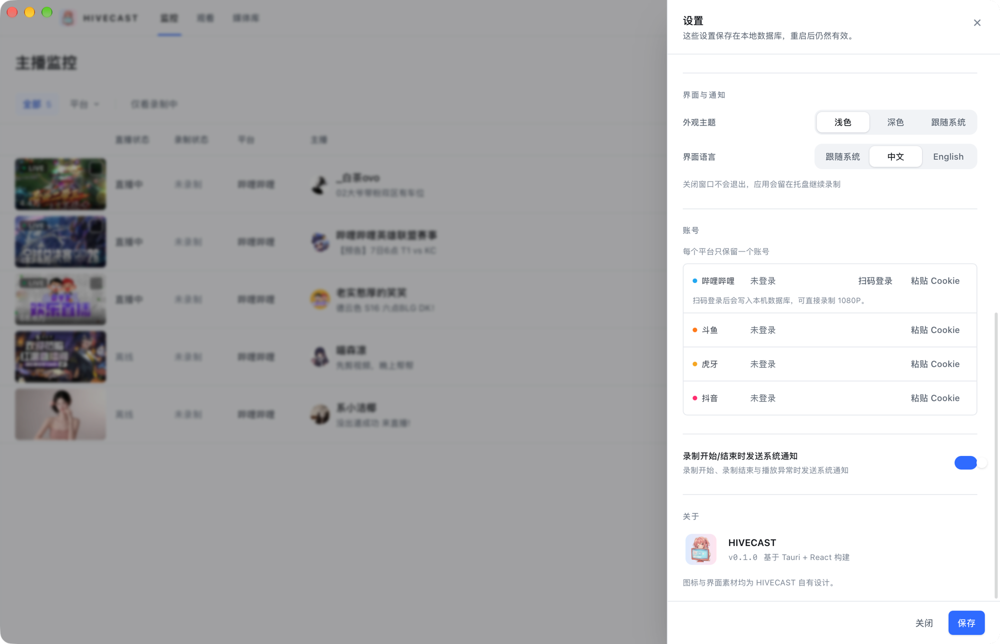

# 44 图标与托盘

> 状态：v1.0（2026-11-06）｜对应提交：待提交｜代码位置：`scripts/gen-icons.py`、`src-tauri/src/tray.rs`、`src/App.tsx`、`src/features/settings/SettingsPanel.tsx`

## 0 结论

设计稿 `app-icons-v2/` 里的两族图标（macOS 圆角版、Windows 任务栏浅/深两版）已经全量落进构建产物：

| 场景 | 用的图 | 落点 |
| --- | --- | --- |
| macOS 应用图标（Finder/Dock/⌘Tab） | `macos-rounded/AppIcon-rounded.icns` 原样 | `src-tauri/icons/icon.icns` |
| Windows 应用图标 | `windows-taskbar/light` 多尺寸合成 | `src-tauri/icons/icon.ico`（16/20/24/32/40/48/64/128/256） |
| Windows 商店/MSIX 方块图 | light 版 | `src-tauri/icons/Square*Logo.png`、`StoreLogo.png` |
| 通用 PNG | mac 版 | `icons/icon.png`(1024)、`128x128@2x`(512)、`128x128`(256)、`64x64`(128)、`32x32`(64) |
| 顶栏品牌标记 | mac 版裁掉透明留白 | `src/assets/app-mark.png`（96，显示 24） |
| 设置「关于」 | mac 版带留白 | `src/assets/app-icon.png`（256，显示 48） |
| 网页 favicon / 触屏图标 | light 版 | `public/favicon.png`(64)、`public/apple-touch-icon.png`(180)、`public/icon.png`(512) |
| macOS 菜单栏托盘 | 自绘模板图（纯黑） | `icons/tray/tray-mac.png`（36） |
| Windows 托盘 | 自绘两版 | `icons/tray/tray-win-{light,dark}.png`（36） |
| Windows 任务栏/窗口图标 | 设计稿两版 | `icons/windows/taskbar-{light,dark}.png` + 5 档小图 |

四张验收图：应用图标、顶栏标记、设置「关于」、菜单栏托盘。





## 1 素材与产物

### 1.1 设计源

`app-icons-v2/`（44 文件 4.8MB）只有两族，没有单独的托盘 glyph，也没有 wordmark：

- `macos-rounded/`：`AppIcon-rounded.icns`、`.iconset/`（10 档）、`png/icon-{16…1024}.png`。1024 图是 RGBA，alpha bbox 为 (72,72,952,952)，图形占画布 86%，四周是透明留白（macOS 图标规范要求）。
- `windows-taskbar/light|dark/`：`taskbar-*.ico`（内含 16/20/24/32/48）与 `png/` 10 档。light 是浅色底 squircle，dark 是深色底 squircle，都带透明边。

源目录不参与构建，也不被 Tauri 引用；构建只认 `src-tauri/icons/` 下已提交的产物。

### 1.2 为什么托盘图标要自己画

设计稿的图形是「圆角方块 + 吉祥物」，缩到 18pt 的菜单栏里会糊成一团色块。托盘 glyph 从图标里提取了显示器造型，加一个播放三角，画成单色描边：

- 先在 4 倍尺寸（144×144）上画，再 LANCZOS 缩到 36，边缘才有抗锯齿；
- 几何：显示器外框 `rounded_rectangle(2.5,5.5,33.5,25.5,r=3.2)`、挖空屏幕 `(5.2,8.2,30.8,22.8,r=1.6)`、播放三角 `(15.2,11.4)(23.2,15.5)(15.2,19.6)`、支架梯形 `(16.2,25.5)(19.8,25.5)(21.2,30.6)(14.8,30.6)`、底座 `(10.8,30.4,25.2,33.4,r=1.4)`；
- 三份颜色：macOS 纯黑（模板图，系统自动反色）、Windows 浅色任务栏用 `#1b1b1f`、深色任务栏用 `#ffffff`。

## 2 生成脚本

```bash
# 需要 Pillow；仓库只提交产物，构建不依赖本脚本
/Users/joftal/.dsh/dsh-runtimes/dsh-primary-runtime/dependencies/python/bin/python3 scripts/gen-icons.py
```

系统自带的 `python3` 没有 PIL（`ModuleNotFoundError: No module named 'PIL'`），要么装 Pillow，要么用 DSH 运行时自带的解释器。

脚本做的事：读三张 1024 源图 → 生成 `src-tauri/icons/**`、`src-tauri/icons/windows/**`、`src-tauri/icons/tray/**`、`src/assets/**`、`public/**`。`icon.icns` 直接 `shutil.copy` 设计稿，不重新编码，避免颜色配置漂移。

改了设计稿就重跑脚本，然后把产物一起提交——打包机不需要 Python。

## 3 应用图标在各处的落点

`src-tauri/tauri.conf.json` 的 `bundle.icon` 是五张：`32x32.png`、`128x128.png`、`128x128@2x.png`、`icon.icns`、`icon.ico`。Tauri 会按平台挑：macOS 用 `.icns` 写进 `Contents/Resources/icon.icns` 并让 `CFBundleIconFile` 指向它；Windows 用 `.ico` 编进 exe 资源。

网页侧（Vite dev 与将来的 web 预览）用 `public/` 里的三张，`index.html` 里显式声明：

```html
<meta name="color-scheme" content="light dark" />
<link rel="icon" type="image/png" href="/favicon.png" />
<link rel="apple-touch-icon" href="/apple-touch-icon.png" />
```

`color-scheme` 原来是写死的 `dark`，与应用默认浅色主题矛盾（表单控件、滚动条会按深色渲染），这次一并改成 `light dark`。

界面里两处用图，都在 `src/assets/`：

- **顶栏**：`app-mark.png`（96px，按 alpha bbox 裁掉留白）显示 24×24、`rounded-[6px]`。裁留白是因为带留白的版本在 24px 下图形只有 20px，看着偏小。
- **设置 → 关于**：`app-icon.png`（256px，保留留白，macOS 图标的观感）显示 48×48、`rounded-[11px]`，右侧是 `HIVECAST`、`v{version}`（来自 `appInfo()`）、`settings.aboutBuild`。

## 4 托盘

实现在 `src-tauri/src/tray.rs`（126 行）。

### 4.1 图标

| 平台 | 图 | 处理 |
| --- | --- | --- |
| macOS | `tray/tray-mac.png`（纯黑） | `icon_as_template(true)`，系统按菜单栏明暗自动反色 |
| Windows | `tray/tray-win-{light,dark}.png` | 读 `window.theme()` 选版本；没有模板图机制 |

坑：`TrayIcon::set_icon()` 会清掉模板标记，`refresh()` 里换完图必须再 `set_icon_as_template(true)`，否则改一次语言托盘图标就变成黑块。

### 4.2 菜单

两项：`显示 HIVECAST` / `退出 HIVECAST`（英文 `Show HIVECAST` / `Quit HIVECAST`）。文案跟界面语言走，`language()` 直接读 `app_setting` 的 `ui.language`，`system` 与未知值按中文处理（与前端默认一致）。

`show_menu_on_left_click(false)`：左键单击直接唤回窗口（`show + unminimize + set_focus`），右键才出菜单——macOS 用户对状态栏图标的预期就是这样。

设置保存后 `settings_update` 会调 `tray::refresh(&app)` 重建菜单并换图，改语言立刻生效，不用重启。

### 4.3 关窗 = 隐藏

```rust
tauri::WindowEvent::CloseRequested { api, .. } if tray_ready => {
    api.prevent_close();
    let _ = target.hide();
}
```

`tray_ready` 是兜底：托盘建不出来（Linux 无状态栏、权限异常）时这个分支不生效，窗口照常关闭退出，不会变成「点了叉没反应」的僵尸进程。

关窗不退出是刻意的：录制、监控、观看的 ffmpeg 都在后台跑，用户关窗通常只是想收起来。

### 4.4 唤回

- 点托盘图标（左键）→ `show_main`；
- 托盘菜单「显示 HIVECAST」→ 同上；
- macOS 点 Dock 图标 → `RunEvent::Reopen` → `window.show() + set_focus()`；
- Windows 点任务栏 → 系统自己恢复（窗口只是 hide，不是 minimize）。

### 4.5 退出路径

| 入口 | 行为 |
| --- | --- |
| 托盘「退出 HIVECAST」 | `app.exit(0)` → `RunEvent::Exit` 收尾 |
| ⌘Q / Alt+F4 | 同上 |
| `SIGTERM`（dev 重启、系统注销） | 单独的 signal 任务：`recorder.shutdown_all` → `view.shutdown_all` → `danmaku.shutdown_all` → `exit(0)` |

收尾必须走 `shutdown_all`：直接退出会留下还在写文件的 ffmpeg（见 27 与 24 的踩坑记录）。

## 5 Windows 差异

Windows 没有模板图，也没有「深色菜单栏」这一说，但**任务栏与标题栏图标要跟系统明暗**：浅色任务栏配浅底 squircle 会糊，所以准备了 light/dark 两版。

启动时 `sync_window_icon(&window, theme)` 设一次；之后靠 `WindowEvent::ThemeChanged` 再设一次并 `tray::refresh`（顺带换托盘图标）。

这部分代码在 macOS 上被 `#[cfg(target_os = "windows")]` 整块剥掉，本机只能保证语法通过、类型无法验证——**Windows 真机尚未验收**，见 §7。

## 6 实测（macOS arm64，2026-11-06）

| 项 | 方法 | 结果 |
| --- | --- | --- |
| 托盘图标出现 | 全屏截图裁菜单栏 | 白描边显示器 + 播放三角，深色菜单栏下自动反色（`assets/ui-tray.png`） |
| 关窗只隐藏 | Rust 探针 6s 后 `window.close()` | 探针写入 `close requested`；`CGWindowList` 里窗口消失；进程仍在；托盘图标仍在 |
| 托盘唤回 | 探针 600s 后 `window.show()` | 窗口恢复（未逐帧验证，靠 hide/show 对称性） |
| 顶栏标记 | 截图裁顶部 | 24px 吉祥物完整，圆角裁切无锯齿（`assets/ui-brand.png`） |
| 关于区块 | 打开设置 | 48px 图标 + `HIVECAST` + `v0.1.0` + 「基于 Tauri + React 构建」（`assets/ui-settings-about.png`） |
| 打包图标 | `pnpm tauri build --bundles app` | 见 §6.1；.app 内 icon.icns 与设计稿 sha1 一致 |

### 6.1 打包产物

`pnpm tauri build --bundles app` 产出 `src-tauri/target/release/bundle/macos/HIVECAST.app`（26.21 MiB）。

- `Contents/Resources/icon.icns` 与 `app-icons-v2/macos-rounded/AppIcon-rounded.icns` sha1 一致（`dae4fce0…`）；
- `Info.plist` 的 `CFBundleIconFile` = `icon.icns`；
- `sips -s format png -Z 512 icons/icon.icns` 导出的图像即上面那张。

## 7 缺口

| 缺口 | 影响 | 备注 |
| --- | --- | --- |
| Windows 未真机验证 | 任务栏明暗切换、托盘图标、`.ico` 在资源管理器里的观感都没看过 | 代码有 `cfg` 隔离，编译期只能保证语法 |
| 托盘菜单只有两项 | 没有「暂停全部录制」「打开媒体库」这类快捷项 | 后续按需加，菜单项要挂 i18n |
| 托盘左键不弹菜单 | macOS 惯例如此；Windows 用户可能预期左键出菜单 | 可加 `cfg(target_os)` 分支 |
| 无单实例锁 | 重复启动会出现两个托盘图标、两套录制 | 需要 `tauri-plugin-single-instance` |
| Dock 图标不能隐藏 | 关窗后 Dock 里仍有图标 | macOS 可用 `ActivationPolicy::Accessory`，但会失去 ⌘Tab |

## 8 变更日志

| 版本 | 日期 | 变更 |
| --- | --- | --- |
| v1.0 | 2026-11-06 | 初版：图标生成管线、托盘（模板图/明暗/菜单/关窗隐藏/Reopen）、前端品牌标记与关于区块、Windows 主题切换 |
