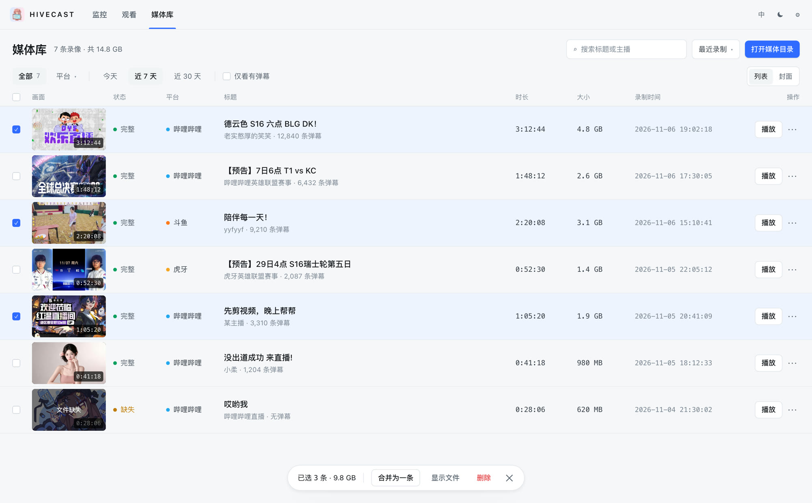
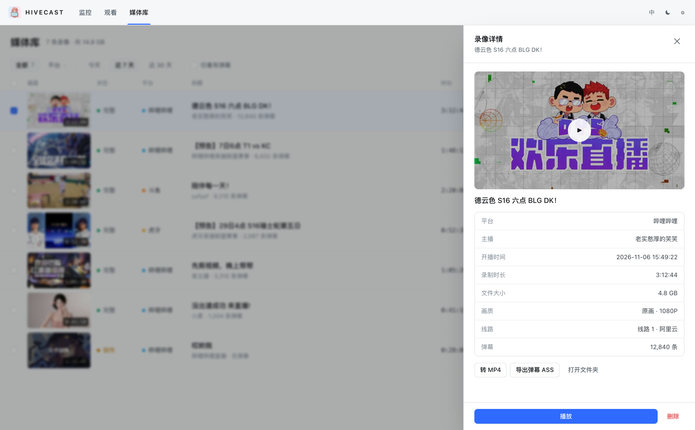
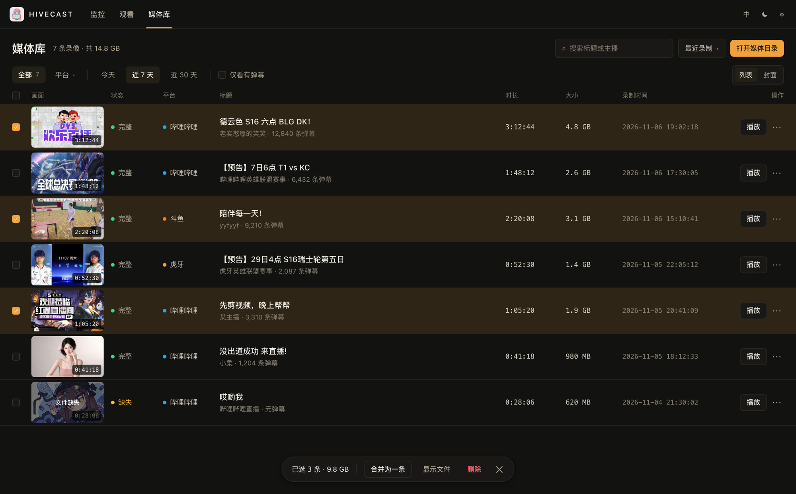

# 45 媒体库重构方案

状态：v0.1 · 2026-11-06 · 提案（待裁决）
关联：`40-UIUX-设计方案`（token 与组件）、`41-监控页重做`（表格工作台契约）、`43-M17-观看页分屏`（Player 与滑窗回放）

## 0 结论

媒体库现在的实现（`src/features/media/MediaPage.tsx`，521 行）功能其实齐了：搜索、平台筛选、排序、多选、批量删除、合并、滑窗回放、后处理。真正的问题有两个：

1. **形态与另两页不一致**：媒体库是「卡片墙 + 卡片内嵌播放器」，监控页是「表格工作台 + 右侧抽屉」，观看页是「深色画布 + 悬浮控件」。三页放在一起像是三个产品。
2. **三处真缺口**：没有缩略图（只能靠标题认录像）、没有分页与组合筛选（一次拉 200 条在前端筛）、播放只能在卡片里挤着看（一张卡片 1/3 宽，画面约 400×225）。

重做方案 = **换成列表骨架（与监控页同构）+ 播放改为整页回放态 + 补缩略图与分页**。封面墙保留为可切换视图，详情用抽屉。

## 1 现状盘点

| 能力 | 现在 | 后端是否已有 |
| --- | --- | --- |
| 列表 | 1/2/3 列卡片，卡片内嵌 Player | — |
| 搜索 | 标题 + 主播，纯前端 | media_list 无筛选参数 |
| 平台筛选 | 胶囊，前端过滤 | 同上 |
| 排序 | 最近/时长/大小，前端排序 | SQL 固定 ORDER BY started_at DESC |
| 多选 | 卡片左上勾选、全选 | — |
| 批量删除 | 逐条 media_delete，失败即中断 | media_delete(session_id, delete_file) |
| 合并 | sessions_merge(ids)，按录制时间排序 | 有 |
| 播放 | 卡片内嵌，滑窗 180 秒 + 整段进度条 | media_play(session_id, position_ms) |
| 后处理 | 转 MP4（session_remux） | 有；**截图与导出 ASS 没有命令** |
| 文件缺失 | has_file 字段，无视觉标记 | 有 |
| 缩略图 | **没有** | MediaItem 无字段 |
| 分页 | 一次 200 条 | limit 1..500，无 offset |
| 弹幕数 | 有 danmaku_count，只显示在卡片 | 有 |

## 2 功能清单

### P0 重构必须（R1 一起做）

- 列表为默认视图：缩略图 120×68、行高 76、固定列宽（与监控页同一套网格语言）。
- 缩略图：后端用 ffmpeg 从录像第 10% 位置抽一帧，落 `cache/thumbs/<session_id>.jpg`，缺失时用平台色占位。
- 搜索 + 平台下拉 + 时间范围（今天/近 7 天/近 30 天）+ 仅看有弹幕，全部走后端参数。
- 排序：最近录制、时长、大小（后端 ORDER BY）。
- 多选：首列复选框 + 表头全选 + 底部浮动操作条（合并、显示文件、删除、清除）。
- 播放：点播放进入**整页回放态**（顶部返回条 + 大画面 + 底部信息条 + 后处理按钮），复用观看页 Player 与滑窗缓存。
- 详情抽屉：元信息 8 行 + 预览 + 转 MP4/导出 ASS/打开文件夹 + 底部播放/删除。
- 空态（无录像 / 无匹配）、加载态、错误条、删除二次确认。

### P1 重构后补

- 分页或无限滚动（后端 offset + total）。
- 视图切换：列表 / 封面（封面墙作为第二种视图）。
- 按房间聚合：同一房间的多场录像折叠成一组。
- 播放进度记忆（记住看到哪，与滑窗起播位置联动）。
- 键盘：空格播放暂停、Delete 删除、Esc 退出回放态/关抽屉。
- 批量后处理：选中多条一次转 MP4 / 导出 ASS（串行队列 + 进度条）。
- 存储占用：按平台、按房间的体积汇总。

### P2 以后

- 切片/剪辑、B 站上传、网盘同步、弹幕预览、收藏与标签。

## 3 设计稿

### 3.1 A 表格工作台（推荐）

与监控页同构：工具行（H1 + 汇总 + 搜索 + 排序 + 主按钮）→ 筛选行（全部/平台下拉/时间范围/仅看有弹幕/视图切换）→ 表头 → 76px 行 → 底部浮动选择条。

列宽：复选框 20 / 画面 120 / 状态 74 / 平台 82 / 标题 1fr / 时长 88 / 大小 82 / 录制时间 152 / 操作 104。缩略图右下角压时长，缺文件的盖「文件缺失」。

### 3.2 B 封面墙

4 列卡片，封面 16:9，左上平台徽标，右下时长，底部两行标题 + 主播 + 体积 + 时间 + 弹幕数。适合「浏览找片」，不适合批量管理（一屏只能看 8 条，且没有体积/时间列的横向对齐）。

### 3.3 C 主从双栏

左侧 336px 分组列表（今天/昨天，行内 68×38 缩略图），右侧大播放器 + 底部信息条 + 后处理按钮。适合连续回看，但左侧列表一屏只有 6 条，且挤掉了筛选能力。

### 3.4 D 详情抽屉（可与 A/B 组合）

440px 右侧抽屉、满窗 portal、遮罩磨砂，与监控页「录制详情」完全一致：预览 + 8 行元信息 + 三个后处理按钮 + 底部播放/删除。

### 3.5 深色主题

同一套 token，深色为暖黑 + 琥珀，与监控/观看一致。

## 4 对比与推荐

| 维度 | A 表格 | B 封面墙 | C 主从双栏 |
| --- | --- | --- | --- |
| 一屏信息量 | 7 条 + 6 列数值 | 8 条 | 6 条 |
| 批量管理 | 好（复选框 + 底部条） | 一般 | 差 |
| 找片 | 一般 | 好 | 一般 |
| 播放体验 | 需另开回放态 | 需另开回放态 | 好（就地大画面） |
| 与另两页一致性 | 高 | 中 | 中 |
| 实现成本 | 低（复用监控表格） | 中 | 中高 |

**推荐组合**：A 作为默认骨架；播放点开进入 C 的「回放态」（整页大画面，不挤在 76px 行里）；详情用 D 抽屉；B 封面墙作为视图切换（P1）。

这样三页的关系变成：监控 = 表格管理房间，观看 = 深色画布看直播，媒体库 = 表格管理录像 + 整页回放看录像。三页共享同一套表头/工具行/抽屉/浮动条。

## 5 关键交互

- **选中**：点复选框选中；点行不选中（与监控页一致，避免误触）；Shift 连选（P1）。
- **播放**：单击「播放」按钮进回放态；回放态按 Esc 或返回条退出，回放缓存随即释放（复用 media_stop）。
- **删除**：底部条与抽屉里都是二次确认（第一次点变「再点一次确认」，失焦复位）。
- **缺失文件**：缩略图盖「文件缺失」，播放按钮禁用，只保留「从库中移除」。
- **空态**：无录像 → 引导去监控页添加房间；有录像但筛不出 → 「清除筛选」。
- **加载**：骨架行，不闪白。

## 6 后端缺口清单

| 缺口 | 改动 | 影响 |
| --- | --- | --- |
| 缩略图 | MediaItem 加 thumbnail_path；media_list 时若缓存不存在则排队抽帧（并发 2） | 需要新命令 media_thumbnail / 后台任务 |
| 分页与筛选 | media_list 加 offset、query、platform、since_days、only_danmaku、sort 参数；返回 total | 改 db.rs 的 SQL 与命令签名 |
| 导出 ASS | 把 postprocess::danmaku_to_ass 暴露成 session_export_danmaku | 已有实现，只差命令 |
| 截图 | 需要时再加（本次设计稿不放截图入口，与监控页设置里的取舍一致） | 可延后 |
| 按房间聚合 | 新查询 group by room_id（P1） | 可延后 |

## 7 待裁决

1. 默认视图：列表（推荐）还是封面墙？
2. 播放形态：整页回放态（推荐）/ 右侧抽屉内播放 / 保持卡片内嵌？
3. 详情抽屉要不要（A 的表格已展示大部分字段）？
4. 缩略图是否本期做（后端要加抽帧与缓存）？
5. 批量操作范围：删除 + 合并（现在）是否要加批量转 MP4 / 批量导出 ASS？
6. 封面墙是否保留为视图切换（P1）？

## 8 实施拆解

- **R1**：列表骨架 + 缩略图 + 后端筛选分页 + 多选批量条 + 回放态 + 详情抽屉。验收：真实录像 20 条下搜索/筛选/排序/播放/删除全通。
- **R2**：封面墙视图切换、按房间聚合、批量后处理队列。
- **R3**：播放进度记忆、键盘操作、存储占用统计。

每阶段：`node scripts/check-docs.mjs`、`node scripts/check-i18n.mjs`、`pnpm exec tsc -b`、`pnpm build`、`cargo test --lib` + 真机截图（浅色/深色各一张）。

## 9 验收

- 一屏能看到 7 条录像的缩略图、时长、体积、录制时间，列与表头严格对齐。
- 搜索 + 平台 + 时间 + 仅看有弹幕 四个条件可叠加，结果与后端一致。
- 选中 3 条 → 合并成功；选中 2 条 → 删除，计数与磁盘同步。
- 播放进入回放态，进度条可拖动、换窗无缝；退出后缓存目录被清空。
- 浅色/深色下与监控页并排看，表头高度、行高、圆角、边框粗细一致。

## 10 变更日志

- v0.1（2026-11-06）：功能盘点、三方向设计稿与推荐组合、后端缺口清单、待裁决 6 条。
