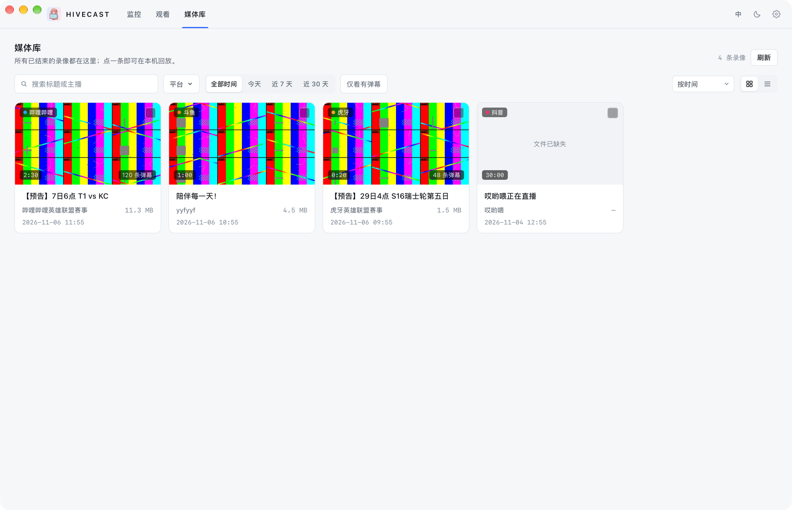
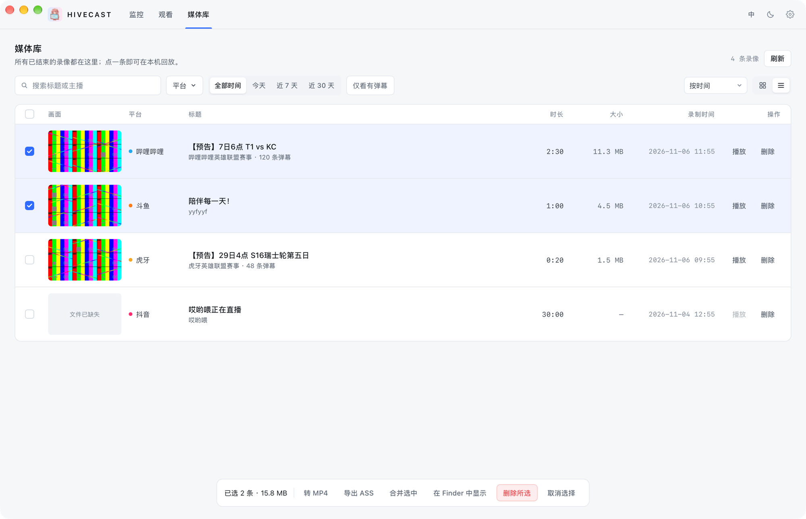
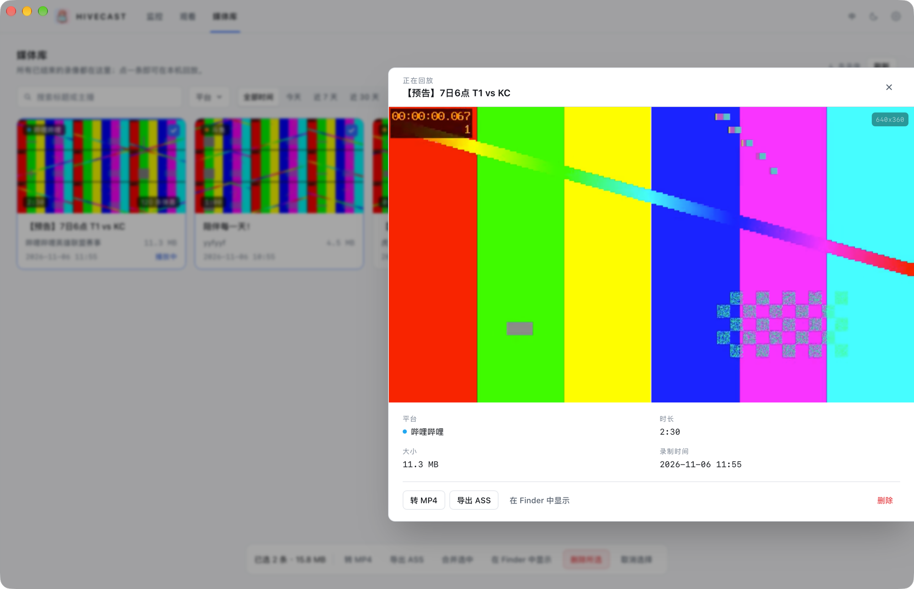
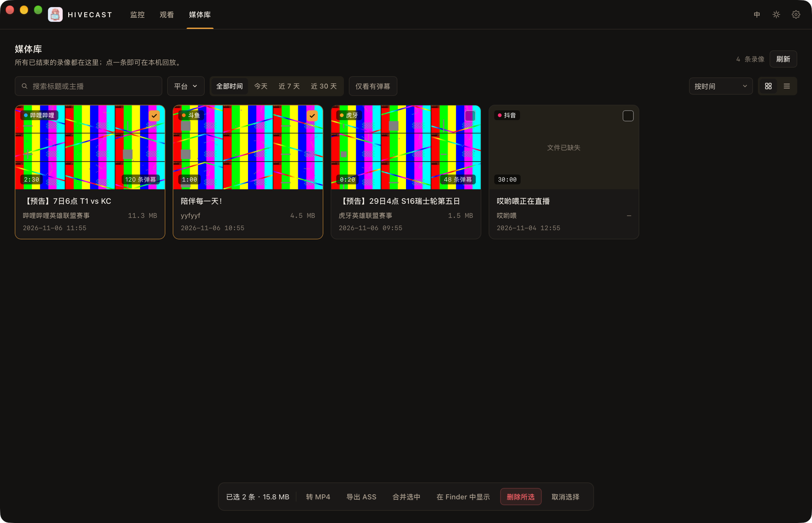

# 46 - 媒体库重构（封面墙 + 九宫格缩略图）

> 状态：v1.0（2026-11-06）· 关联：[45-媒体库重构方案](45-媒体库重构方案.md)、[41-监控页重做](41-监控页重做.md)、[43-M17-观看页分屏](43-M17-观看页分屏.md)、[38-M13-回放滑窗缓存](38-M13-回放滑窗缓存.md)
> 一句话：媒体库从「一张卡片一个播放器」重做成「封面墙 + 列表」双视图，缩略图改成按视频时长等距取 9 帧拼图，播放收进右侧抽屉，筛选/排序/批量全部补齐。
>
> **v1.1 更新（2026-11-06）**：列表视图已删除，媒体库现在只有封面墙；外层改成主播卡（见 [48](48-媒体库按主播归类.md)）。本文的列表视图、视图切换与「进详情才生成缩略图」属于 v1.0 留档。

## 0. 结论

用户裁决（m15774）后的形态：**默认封面墙**（2–4 列自适应），点封面在**右侧抽屉**里回放，**不做详情抽屉**，缩略图是**九宫格**（按视频时长平均切 9 段各取中点一帧），批量操作**全部放进底部条**，列表视图作为**视图切换**保留。

| 维度 | 重构前（v1.0 时代） | 重构后 |
| --- | --- | --- |
| 默认形态 | 单列卡片，每张卡内嵌一个播放器 | 封面墙网格，卡片只显示九宫格封面 + 元信息 |
| 缩略图 | 无（或取首帧） | 九宫格，9 段中点各一帧，`xstack` 拼 968x548 |
| 播放 | 卡片内直接起 hls，多实例 | 点封面 → 右侧抽屉，一次一路 |
| 筛选 | 搜索 + 平台胶囊 | 搜索 + 平台下拉（带全局计数）+ 时间范围 + 仅看弹幕 |
| 排序 | 时间/时长/大小 | 保留，下拉式 |
| 批量 | 无 | 全选/多选 + 转 MP4 / 导出弹幕 / 合并 / 显示 / 删除 |
| 分页 | 一次 200 条 | 每页 60，底部「加载更多」 |



## 1. 交付清单

| 文件 | 变化 | 说明 |
| --- | --- | --- |
| `src/features/media/MediaPage.tsx` | 重写（1062 行） | 封面墙/列表双视图、筛选栏、批量条、播放抽屉 |
| `src-tauri/src/thumbs.rs` | 重写（281 行） | 九宫格取帧（9 次 `-ss` + `xstack`），带兜底与 4 个单测 |
| `src-tauri/src/db.rs` | 改 | 抽出 `media_where(filter, include_platform)`；新增 `media_platform_counts()` |
| `src-tauri/src/commands.rs` | 改 | `media_list` 返回体加 `platform_counts` |
| `src-tauri/ipc-types/src/lib.rs` | 改 | 新增 `PlatformCount`，`MediaPage.platform_counts` |
| `src/lib/bindings/PlatformCount.ts` | 新增 | ts-rs 生成 |
| `src/lib/ipc.ts` | 改 | 导出 `PlatformCount` 类型 |

## 2. 两种视图

### 2.1 封面墙（默认）

- 网格：`grid gap-3 sm:grid-cols-2 xl:grid-cols-3 2xl:grid-cols-4`，卡片 `rounded-[8px] border border-line bg-surface`，hover 抬 1px 阴影。
- 卡片结构：封面（16:9，九宫格图）→ 标题 2 行截断 → 主播 + 体积 → 日期。
- 封面左上角平台徽标（平台色小圆点 + 名称），右上角悬停才出现的播放按钮，右下角弹幕数（有弹幕才显示）。
- 文件缺失的条目：封面位置显示灰底 + 「文件已缺失」，卡片不可播放，只能删除。
- 选中态：卡片外圈 `ring-2 ring-accent`，左上角出现对勾方块；点封面 = 播放，点对勾 = 选中（互不干扰）。

### 2.2 列表

- 列：画面 / 平台 / 标题 / 时长 / 体积 / 时间 / 操作，行高 76，缩略图 120x68。
- 列表里的缩略图同样用九宫格（等比缩到 120x68），不额外生成小图。
- 列表去掉了缩略图右下角的时长角标 —— 时长列已有，角标会挡住第 9 格画面。



## 3. 九宫格缩略图

### 3.1 为什么不用 `fps` 抽帧

第一版用 `-vf fps=9/<时长>,scale=...,tile=3x3`。实测 150 秒素材：最后一格落在 141.6s，尾部 8.6 秒完全没覆盖，中间间隔也不均匀。原因是 `fps` 滤镜按**帧序号**取帧，受起始时间戳与取整影响，跟「时间等分」不是一回事。

### 3.2 现行做法

对每个采样点单独 `-ss` 精确跳转，再 `xstack` 拼图：

- 采样点：`seek_points(duration_ms)` 取每段中点 `t = duration x (k + 0.5) / 9`，clamp 到 `[0, duration - 1]`；150000ms → `[8333, 25000, 41667, 58333, 75000, 91667, 108333, 125000, 141667]`。
- 每格滤镜：`scale=320:180:force_original_aspect_ratio=decrease` + `pad=320:180:(ow-iw)/2:(oh-ih)/2:color=0x101010` + `trim=end_frame=1` + `setpts=PTS-STARTPTS`（只留一帧，否则 xstack 会等最长的流）。
- 拼图布局 `0_0|324_0|648_0|0_184|324_184|648_184|0_368|324_368|648_368`：格子 320x180，间隔 4px，产物 968x548。
- 兜底：`duration_ms <= 0`（旧数据没时长）走 `tile_filter` 的 `fps` 方案，宁可不等距也要出图。

### 3.3 代价与收益

9 次 `-ss` 是**快速跳转**（关键帧 seek），不解码整段：150 秒素材单次生成 **0.62 秒**。产物 968x548 JPEG，`-q:v 4`，约 60–90 KB。生成结果落在 `~/Library/Caches/com.hivecast.desktop/thumbs/<session_id>.jpg`，前端按需请求、缺失才生成。

## 4. 抽屉内播放

- 点封面/播放 → `mediaPlay(id, positionMs)` → 后端滑窗转封装（见 [38](38-M13-回放滑窗缓存.md)）→ 抽屉内 `Player` 播放。
- 抽屉：`my-auto flex max-h-[94vh] w-[min(860px,92vw)] rounded-l-[10px] border border-r-0`，贴右边缘、垂直居中（v1.0 时是满高 `h-full`，下方留大片空白）。
- 抽屉头部显示「正在回放」+ 标题 + 主播 + 关闭 ✕；Esc 关闭；遮罩点击关闭；关闭时调 `mediaStop(sessionId)` 并清缓存。
- 进度条复用 `Player` 的 VOD 模式（窗口内拖动直接 seek，窗口外触发续窗）。
- 一次只播一路：开新的一条会先停掉旧的（避免多路 ffmpeg 抢占）。



## 5. 筛选、排序与分页

| 控件 | 行为 | 备注 |
| --- | --- | --- |
| 搜索框 | 300ms 防抖写 `keyword` | 匹配标题与主播（后端 LIKE，大小写不敏感） |
| 平台下拉 | 全部 / 哔哩哔哩 / 斗鱼 / 虎牙 / 抖音 | 每项带**全局计数**，选中后其它平台计数不变 0 |
| 时间范围 | 全部时间 / 今天 / 近 7 天 / 近 30 天 | 按 `started_at` |
| 仅看弹幕 | 开关 | `danmaku_count > 0` |
| 排序 | 按时间 / 按时长 / 按大小 | 时间倒序，其余从大到小 |
| 分页 | 每页 60，底部「加载更多」 | `total` 用于「共 N 条」 |

**平台计数的语义**：`media_platform_counts(filter)` 复用同一套 WHERE，但**忽略平台筛选**（`include_platform = false`），所以：

- 选「斗鱼」时，菜单仍是「全部 4 / 斗鱼 1 / 虎牙 1 …」，不会变成只剩斗鱼 1、其它 0。
- 搜索/时间范围/仅看弹幕**会**影响计数（搜「陪伴」后 全部 1、斗鱼 1）——这是刻意的：计数表达的是「在当前其它条件下，这个平台有多少条」。
- 「全部」的数字 = 各平台计数之和，不能用 `total`（`total` 是带平台筛选后的总数）。



## 6. 批量操作

多选后底部浮出批量条（`sticky bottom-3`）：
`
| 操作 | 前端调用 | 后端命令 | 说明 |
| --- | --- | --- | --- |
| 转 MP4 | `sessionRemux(id)` | `session_remux` | 逐条串行，完成后刷新体积 |
| 导出弹幕 | `sessionExportDanmaku(id)` | `session_export_danmaku` | 生成同名 `.ass`；无弹幕的条目会失败并提示 |
| 合并 | `roomMergeSessions(ids)` | `room_merge_sessions` | 必须同一房间，按开始时间排序后 concat；不同房间给 `media.mergeHint` |
| 在 Finder 中显示 | `mediaReveal(id)` | `media_reveal` | 文件缺失时给错误条 |
| 删除 | `mediaDelete(id, hasFile)` | `media_delete` | 二次确认（按钮变成「删除 N 条？再点一次」），删库 + 删文件 |
| 清除选择 | 本地 | — | 清空 `selected` |

- 批量执行期间按钮禁用，条上显示「正在处理 2/5」；单条转封装走 `post://progress` 事件，百分比实时刷新。
- 任一失败立即中断后续，并保留已成功的部分（提示语带成功条数）。
- 全选只选**当前页**（`items`），不是全部 `total`；跨页选择不做。

## 7. 后端与数据结构

```rust
pub struct MediaFilter {
    pub keyword: Option<String>,
    pub platform: Option<String>,
    pub range_days: Option<i64>,     // 1 / 7 / 30，None = 全部
    pub only_danmaku: bool,
    pub sort: MediaSort,             // Recent | Duration | Size
    pub limit: i64,
    pub offset: i64,
}

pub struct PlatformCount { pub platform: String, pub count: i64 }
pub struct MediaPage { pub items: Vec<MediaItem>, pub total: i64, pub platform_counts: Vec<PlatformCount> }
```

- `media_where(filter, include_platform)` 是唯一拼 WHERE 的地方：`media_list` 传 `true`，`media_platform_counts` 传 `false`。关键词转义用 `ESCAPE '\\'`（Rust 原始字符串里是单个反斜杠），否则用户输入 `%` 会变成通配符。
- 排序在 SQL 层完成（`ORDER BY started_at DESC` / `duration_ms DESC` / `size DESC`），前端不再对整页重排。
- 缩略图：`thumbs_get(session_id)` 命中缓存直接返回路径，否则后台生成并 emit `thumbs://ready`；前端 `thumbsRef` 记录已请求过的 id，避免重复触发。

## 8. 实测

| 项 | 数据 |
| --- | --- |
| 九宫格 | 150s / 968x548 / 单次 0.62s / 9 格时间戳严格等距（见 §3） |
| 生成产物 | `~/Library/Caches/com.hivecast.desktop/thumbs/sess-m*.jpg` |
| 封面墙 | 4 条录像 2 列排布，深/浅两套主题正常 |
| 列表 | 7 列对齐，2 条选中时批量条浮出，6 个按钮 |
| 筛选 | 选「斗鱼」→ 1 条；搜索「陪伴」→ 1 条，计数随之收敛（全部 1 / 斗鱼 1） |
| 抽屉回放 | hls 正常、进度条可拖动、关闭后缓存目录被清理 |
| 文件缺失 | 卡片灰底「文件已缺失」，删除可用，播放按钮禁用 |

## 9. 踩坑

1. **`fps` 抽帧不等距**：见 §3.1。别用 `fps` 做「等时间间隔」的取帧，它按帧序号走。
2. **HMR 不重跑 `useEffect([])`**：媒体库的初值与首屏效果在 HMR 后仍用旧 state，验证必须重启 app（`pkill -f target/debug/hivecast` + 重启 tauri dev）。
3. **HMR 留下孤儿遮罩**：抽屉（portal 到 body）打开时改组件，会在 body 留一个没有对应内容的遮罩，整页发灰模糊且点不动；判断方法就是「截图整页模糊但看不到抽屉」。
4. **结束 dev 要连 vite 一起杀**：只杀 `target/debug/hivecast` 会留下 `vite/bin/vite.js` 占着 1420，下次 `pnpm tauri dev` 直接报端口占用。
5. **测试房间必须 `auto_record=0`**：`is_live=1` + `auto_record=1` 会被监控自动开录，几分钟内产出真实录像和一堆脏会话。
6. **`rm -rf` 在 cwd 外会被安全网拦**：删缓存目录用 `node -e "fs.rmSync(p,{recursive:true,force:true})"`。
7. **列表缩略图别加时长角标**：会盖住九宫格右下那格，时长列已经有时长。

## 10. 缺口

| 缺口 | 影响 | 计划 |
| --- | --- | --- |
| 列表视图缩略图偏小 | 九宫格在 120x68 里看不清 | 列表 hover 时放大预览 |
| 合并要求同一房间 | 跨房间合并被拒 | 由用户在监控页按房间分组，暂不做跨房间 |
| 后处理没有全局队列 | 批量期间不能离开页面（离开会中断 UI 状态） | 后续把任务搬到后端队列 |
| 没有「继续观看」记忆 | 每次从 0 开始 | 记 `app_setting` 的 last position |
| 缩略图不含弹幕 | 封面看不到弹幕密度 | 可选叠加弹幕数徽标（已有数字，无图形） |
| 封面墙没有排序快捷键 | 只能下拉 | — |

## 11. 变更日志

| 版本 | 日期 | 变化 |
| --- | --- | --- |
| v0.1 | 2026-11-06 | [45](45-媒体库重构方案.md) 的功能盘点与三方向设计稿 |
| v1.0 | 2026-11-06 | 封面墙 + 列表双视图、九宫格缩略图（9 次 `-ss`）、抽屉内播放、平台计数、批量五项、分页 60 |
