# 49 - 设置页重做方案

> 状态：v1.0 已实施（2026-11-06）· 关联：[40-UIUX 设计方案](40-UIUX-设计方案.md)、[41-监控页重做](41-监控页重做.md)、[48-媒体库按主播归类](48-媒体库按主播归类.md)
> 一句话：设置从 440px 抽屉改成整窗「左栏分类 + 右侧内容」的专业设置页，六类导航、行式表单、内联账号登录、脏状态保存条；另给顶部 Tab 与图标栏两个备选方向。

## 0. 结论

三个方向都做了真机尺寸的稿（1320x818，2x）。推荐 **A 左栏分类**：桌面端设置的通行结构，分类始终可见，加分类不挤压正文；B 顶部 Tab 更像参考图（网易云），但分类超过 6 个或英文文案变长就会换行；C 图标栏最紧凑，可发现性最差，只适合分类固定且高频的小工具。

| 方向 | 结构 | 适合 | 结论 |
| --- | --- | --- | --- |
| A 左栏分类 | 208px 导航 + 720px 内容 | 6–10 类、桌面端 | **推荐** |
| B 顶部 Tab | 横向 Tab + 720px 单列 | ≤6 类、偏网页感 | 备选 |
| C 图标栏 | 64px 图标 + 720px 内容 | 分类固定、追求紧凑 | 不推荐 |

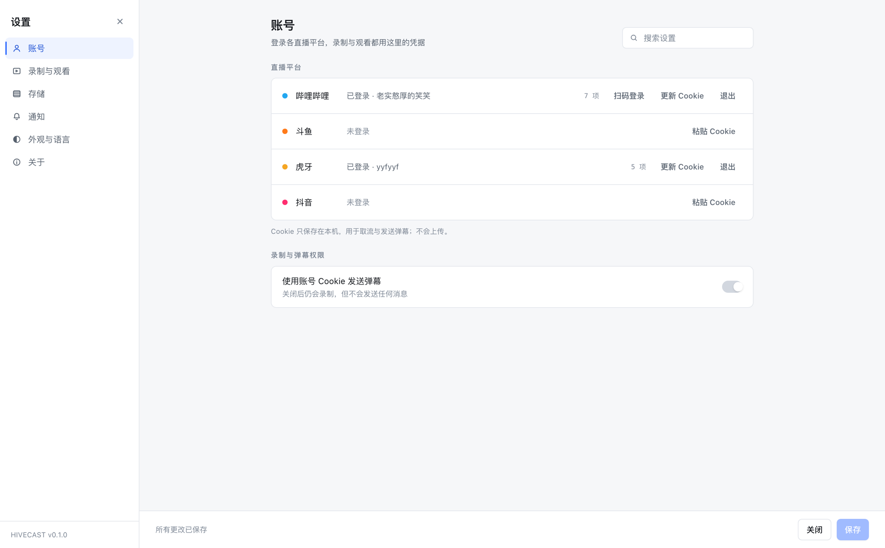

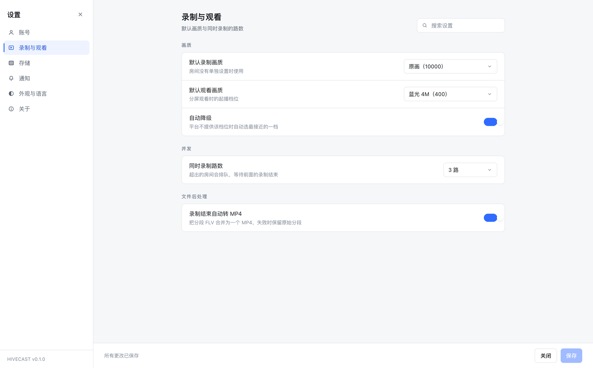

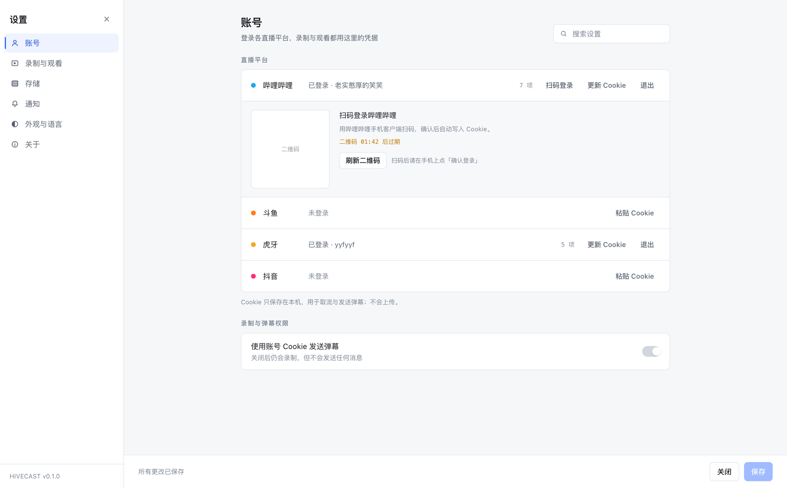

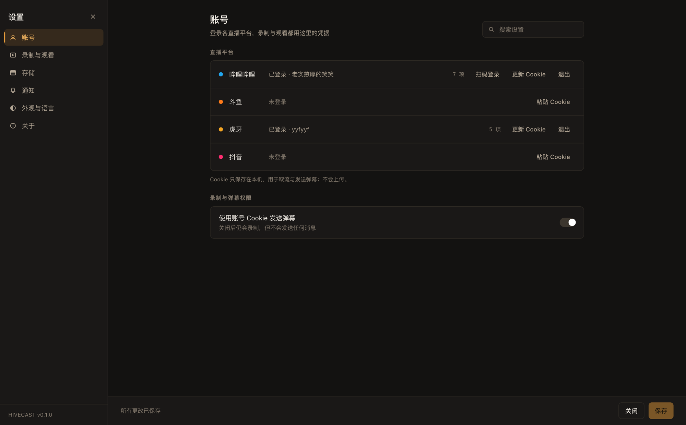

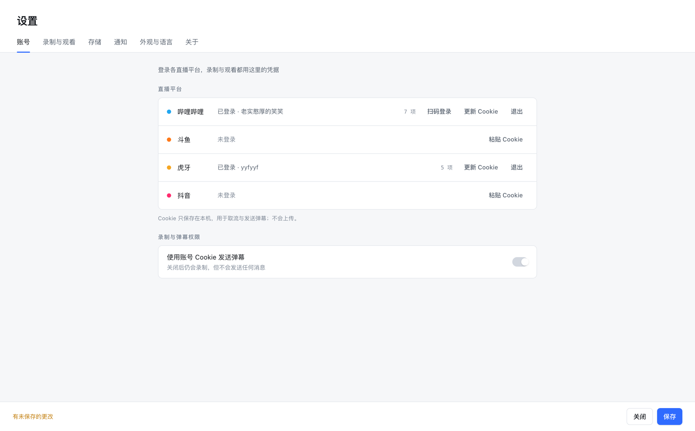

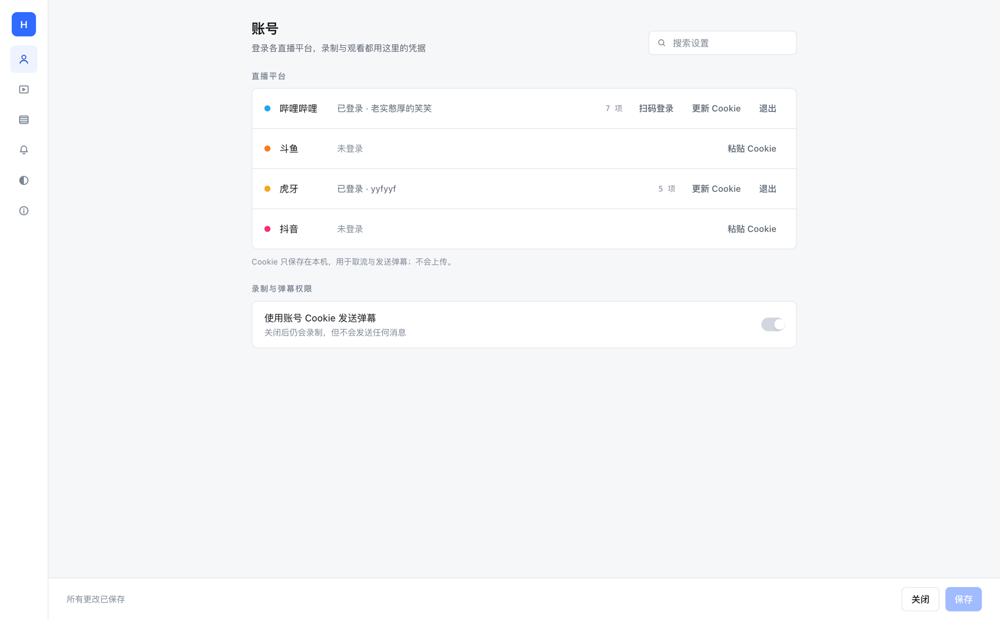

## 1. 现状盘点

现在的设置是右侧 440px 抽屉，六组内容纵向堆在一起：录制与观看、存储、文件后处理、界面、通知、关于，账号登录作为独立组件塞在最前面。问题不在配色，在结构与可达性：

| 问题 | 具体表现 | 后果 |
| --- | --- | --- |
| 没有分类导航 | 六组靠 `space-y-6` 分隔，滚动才能看全 | 找一个开关要通读整页 |
| 抽屉太窄 | 440px 里放 208px 的下拉与 3 个分段控件 | 标签与控件挤在一行，扫读困难 |
| 账号与设置混在一起 | 登录状态、Cookie、二维码与画质开关同屏 | 账号是低频但重要的操作，被淹没 |
| 没有搜索 | 10 个字段只能靠记位置 | 设置项继续增加后不可用 |
| 保存语义弱 | 底部「关闭 / 保存」，关闭即丢弃改动，无提示 | 误关丢改动 |
| 无键盘路径 | 只能鼠标点 | 桌面端体验缺失 |

现有字段一共 10 个（`Settings`）：`defaultRecordQn`、`defaultViewQn`、`mediaRoot`、`maxConcurrentRecords`、`notifyEnabled`、`language`、`theme`、`retentionDays`、`maxTotalGb`、`autoRemux`；账号侧是 `credential` 表（四平台）。

## 2. 信息架构

六类，顺序按使用频率排：账号 → 录制与观看 → 存储 → 通知 → 外观与语言 → 关于。

| 分类 | 内容 | 数据 |
| --- | --- | --- |
| 账号 | 四平台登录状态、扫码登录（B 站）、粘贴/更新 Cookie、退出；「使用账号 Cookie 发送弹幕」开关 | `credential` 表；弹幕开关为新增字段 |
| 录制与观看 | 默认录制画质、默认观看画质、同时录制路数、录制结束自动转 MP4 | 已有 4 个字段 |
| 存储 | 媒体目录 + 选择、保留天数、总量上限、打开媒体目录 | 已有 3 个字段；打开目录用 `media_reveal` 同款能力（新增命令） |
| 通知 | 录制开始/结束、播放异常、登录失效 | 现有 `notifyEnabled` 一个总开关；细分需新增 2–3 个布尔 |
| 外观与语言 | 主题（浅色/深色/跟随系统）、语言（跟随系统/中文/English）、关闭窗口留在托盘 | 已有 2 个字段；托盘开关需新增 |
| 关于 | 版本、构建信息、检查更新、打开日志目录、开源许可 | `app_info`；后三项需要新命令或静态文案 |

画质、并发这类「会影响后续行为」的字段放在第二类；目录、保留策略放第三类；纯展示信息收进关于。

## 3. 三个方向的差异

| 维度 | A 左栏 | B 顶部 Tab | C 图标栏 |
| --- | --- | --- | --- |
| 分类可见性 | 全部常驻 | 全部常驻 | 只有图标 |
| 扩展第 7、8 类 | 直接加一行 | 需要横向滚动或换行 | 加图标，含义靠 tooltip |
| 长英文文案 | 左栏 208px 够 | Tab 会挤 | 不受影响 |
| 与现有页面语言 | 与监控/观看的顶栏 + 工作区一致 | 与顶栏 Tab 重复一套 | 多一层视觉噪音 |
| 实现成本 | 中 | 低 | 中 |
| 窄窗口（<900px） | 左栏可折叠成图标 | 自动降级为横向滚动 | 天然窄 |

A 的宽度预算：208（栏）+ 720（正文）+ 左右各 32 留白 = 992，1320 窗口下正文还能居中，右侧留白不刺眼。B 的正文居中后左右留白各 300，空得更明显。

## 4. 规格

| 项 | 值 |
| --- | --- |
| 左栏 | 208px，`bg-surface`，右边 1px `border-line`；标题「设置」15px/600 + 关闭 ✕ |
| 导航项 | 高 32px、圆角 6px、字号 12.5px、图标 14px、间距 10px；选中 `bg-accent-soft` + `text-accent-text` + 左侧 2px 竖条 |
| 左栏底部 | `HIVECAST v0.1.0`，10.5px `text-faint` |
| 正文 | 720px 居中，上下 24px、左右 32px |
| 页头 | 标题 18px/600，说明 11.5px `text-muted`，右侧搜索框 196x32 |
| 分组标题 | 10.5px/600、大写、`tracking-[0.1em]`、`text-faint`，与卡片间距 8px |
| 分组卡 | 圆角 8px、1px `border-line`、`bg-surface`，行间 1px 分隔线 |
| 行 | 左右 16px、上下 12px，最小高 56px；标题 12.5px，说明 11px `text-faint`，行高 16px |
| 控件 | 下拉 208x32、数字输入 120x32、分段控件自适应、开关 36x20 |
| 保存条 | 高 56px、上边 1px；左「所有更改已保存 / 有未保存的更改」，右「关闭」「保存」 |
| 字号阶梯 | 18 / 15 / 12.5 / 11.5 / 11 / 10.5，不引入新字号 |

颜色全部走现有 token（`canvas` / `surface` / `raised` / `line` / `ink` / `muted` / `faint` / `accent` / `accent-soft` / `accent-text`），深色自动变成暖黑 + 琥珀，不需要单独一套。

## 5. 交互

| 场景 | 行为 |
| --- | --- |
| 打开 | 顶栏齿轮；快捷键 `Cmd/Ctrl + ,` |
| 关闭 | Esc、左栏 ✕、保存条「关闭」；有未保存改动时先弹确认 |
| 保存 | 保存条「保存」或 `Cmd/Ctrl + S`；成功后左侧文案变「所有更改已保存」，按钮置灰 |
| 切换分类 | 保留未保存草稿（状态在页面级，不随分类卸载） |
| 键盘 | 左栏 ↑/↓ 切换分类，Tab 在控件间移动，Enter 打开下拉 |
| 搜索设置 | 输入即过滤，跨分类命中时按分类分组显示结果；Esc 清空；首版可只做分类内过滤 |
| 危险操作 | 退出登录、清空 Cookie 需要二次确认（沿用现在的两段式按钮） |
| 加载/失败 | 首次进入骨架或「加载中」；读取失败显示错误条 + 重试，不阻塞其它分类 |

## 6. 账号页

四行平台列表，行内三段：平台名（64px）→ 状态（已登录 · 昵称 / 未登录 / 已过期）→ Cookie 项数 → 右侧动作（扫码登录 / 更新 Cookie / 退出）。

点击「扫码登录」或「更新 Cookie」在**该行下方内联展开**，不跳页、不弹窗：

- 扫码：132px 白底二维码 + 标题 + 说明 + 倒计时（`mm:ss`，≤30s 变 warn）+ 「刷新二维码」；
- Cookie：等宽字体 textarea（3 行）+ 说明 + 「保存」；
- 展开区背景 `bg-raised/60`，与行之间仍有 1px 分隔线，视觉上属于这一行。

## 7. 后端与字段缺口

| 需求 | 现状 | 处理 |
| --- | --- | --- |
| 六类导航、行式布局、保存条 | 纯前端 | S1 直接改 |
| 通知细分（录制 / 异常 / 登录失效） | 只有 `notify_enabled` | 已加 `notify_error`、`notify_auth` 两个布尔；录制沿用 `notify_enabled` |
| 关闭窗口留在托盘 | 行为固定（关窗即隐藏） | 新增 `tray_enabled`，`lib.rs` 的 `CloseRequested` 读它 |
| 发送弹幕开关 | 弹幕随录制自动发送 | 新增 `danmaku_send`，`danmaku.rs` 发送前判断 |
| 打开媒体目录 | 有 `media_reveal(session_id)`，没有「打开根目录」 | 新增 `media_open_root` 命令 |
| 检查更新 / 日志目录 | 无 | 首版不做，关于页只放版本与构建信息；预留按钮位置 |
| 搜索设置 | 无 | 纯前端，S3 做 |

字段一律加到 `Settings`（`app_setting` 表），不新建表；迁移沿用 `settings.rs` 的默认值合并，旧库读到缺键时补默认。

## 8. 实施拆解

| 阶段 | 范围 | 验收 |
| --- | --- | --- |
| S1 结构 | 整窗设置视图（替代抽屉）、左栏六类、页头、分组卡与行、保存条、现有 10 个字段全部接入、i18n 中英 | 每类都能改并保存；Esc/关闭/脏状态正确；深浅两套正常 |
| S2 账号 | 账号页四行 + 内联扫码/Cookie 展开 + 过期态 + 二次确认退出 | B 站扫码能出码、Cookie 能写入、退出后状态回到未登录 |
| S3 打磨 | 搜索设置、键盘导航、`Cmd+,` / `Cmd+S`、通知细分与托盘开关、打开媒体目录 | 搜索能跨类命中；快捷键可用；新字段落库 |

每阶段跑 `check-i18n` / `check-docs` / `tsc -b` / `pnpm build` / `cargo test --lib`，并用真机截图验收。

## 9. 验收清单

- [x] 1320x818 与 1100x760 两个窗口下正文不溢出，左栏不挤压；
- [x] 六类切换保留草稿，保存后按钮置灰、文案变「所有更改已保存」；
- [x] 有改动时点关闭/Esc 弹确认；
- [x] 深浅两套主题下分隔线、选中态、开关对比度正常；
- [x] 账号页扫码与 Cookie 两条路径都能完成登录；
- [x] 键盘可达：左栏 ↑↓、Tab 顺序、Esc 关闭；
- [x] 文案全部走 i18n，平台名不翻译。
## 10. 已裁决

| 问题 | 裁决 | 落地 |
| --- | --- | --- |
| 形态 | 整窗设置视图，替换原抽屉 | `SettingsView` 用 `fixed inset-0`，`SettingsPanel.tsx` 已删除 |
| 搜索 | 首版就做，跨分类 | 页头搜索框 + 13 条索引，结果按分类分组，标题变「搜索设置 · N 个匹配项」 |
| 通知细分 | 三个开关 | 新增 `notify_error`、`notify_auth`，`notify_enabled` 管录制开始/结束 |
## 11. 实施记录（v1.0）

### 11.1 文件

| 文件 | 作用 |
| --- | --- |
| `src/features/settings/SettingsView.tsx` | 整窗设置页：左栏六类、页头搜索、行式表单、保存条、放弃确认弹窗 |
| `src/features/settings/AccountSection.tsx` | 四平台行式列表；扫码与 Cookie 编辑器在该行下方内联展开 |
| `src/App.tsx` | 打开入口（齿轮 / `Cmd+,`）、保存回调、按事件类型门控系统通知 |
| `src-tauri/ipc-types/src/lib.rs` | `Settings` 新增 `notify_error`、`notify_auth` |
| `src-tauri/src/settings.rs` | 两个新键 `ui.notify_error`、`ui.notify_auth`，默认 true；保存与单测同步 |

### 11.2 结构落地

左栏 208px：macOS 用 Overlay 标题栏，头部标题按 `paddingLeft: 78` 让开红绿灯；导航六项 32px 高、选中 `bg-accent-soft` + `text-accent-text`；底部 `HIVECAST v0.1.0`。右侧页头 720px 居中（标题 18px、说明 11.5px、搜索框 196x32），内容区独立滚动，底部 56px 保存条固定。

| 页面 | 字段 |
| --- | --- |
| 账号 | 四平台登录状态、B 站扫码、粘贴/更新 Cookie、退出（二次确认） |
| 录制与观看 | 默认录制画质、默认观看画质、同时录制上限（1–8）、录制结束自动转 MP4 |
| 存储 | 媒体目录 + 选择目录、保留天数、总容量上限（GB） |
| 通知 | 录制开始与结束、播放与录制异常、登录失效 |
| 外观与语言 | 主题（浅色/深色/跟随系统）、语言（跟随系统/中文/English）、托盘说明 |
| 关于 | 48px 图标、版本号、构建信息、说明 |

数字输入统一用 120px（并发）与 72px（保留天数/容量）外层定宽包裹，单位「天」「GB」跟在输入框后；因为输入框自身的 `w-full` 在 `shrink-0` 容器里会塌成内容宽度。

### 11.3 搜索

`SEARCH_INDEX` 13 条，每条记录所属分类、标题键、说明键与中英关键词（cookie、画质、mp4、通知、theme 等）。输入即过滤，命中结果按六类分组，行右侧显示分类名；点结果跳到该分类并滚动到对应行，行背景高亮 1.6s 后恢复。搜索态页头标题换成「搜索设置」，说明显示「N 个匹配项」，左栏不保留选中项。

### 11.4 脏状态与快捷键

进入时把 `settings` 的 JSON 存为基线，之后每次改动与基线比较得到 `dirty`：保存条左侧「有未保存的更改」用 warn 色、右侧「保存」可点；保存成功回填返回值并重置基线。关闭路径（Esc、✕、关闭按钮）在 `dirty` 时先开 380px 确认弹窗（放弃更改 / 继续编辑），弹窗打开时 Esc 优先关弹窗。`Cmd/Ctrl + S` 保存，`Cmd/Ctrl + ,` 打开设置，`Cmd/Ctrl + F` 聚焦搜索。

### 11.5 通知细分与门控

`App.tsx` 的通知回调按事件类型分流：`credential_expired` 只看 `notifyAuth`；`started` / `ended` 只看 `notifyEnabled`；其余（取流失败、录制中断、磁盘写满、播放失败）看 `notifyError`。字段存在 `app_setting`，缺键时按默认 true 补。

### 11.6 实测

| 项 | 结果 |
| --- | --- |
| 账号页 | 四平台行式列表，B 站多出「扫码登录」，其余只有「粘贴 Cookie」；保存条初始置灰 |
| 录制与观看 | 三个分组卡；并发输入 120px；改值后出现「有未保存的更改」 |
| 存储 | 媒体目录 420px + 选择目录；保留「0 天」「总容量 0 GB」 |
| 通知 | 三个开关默认全开 |
| 外观与语言 | 主题与语言各三段，深色下为暖黑 + 琥珀 |
| 搜索 | 输入「通知」得到 3 条，按「通知」分组，标题变「搜索设置 · 3 个匹配项」 |
| 保存 | 改并发 4 → 6 后保存，`app_setting.record.max_concurrent` 落库为 6，保存条回到「所有更改已保存」 |

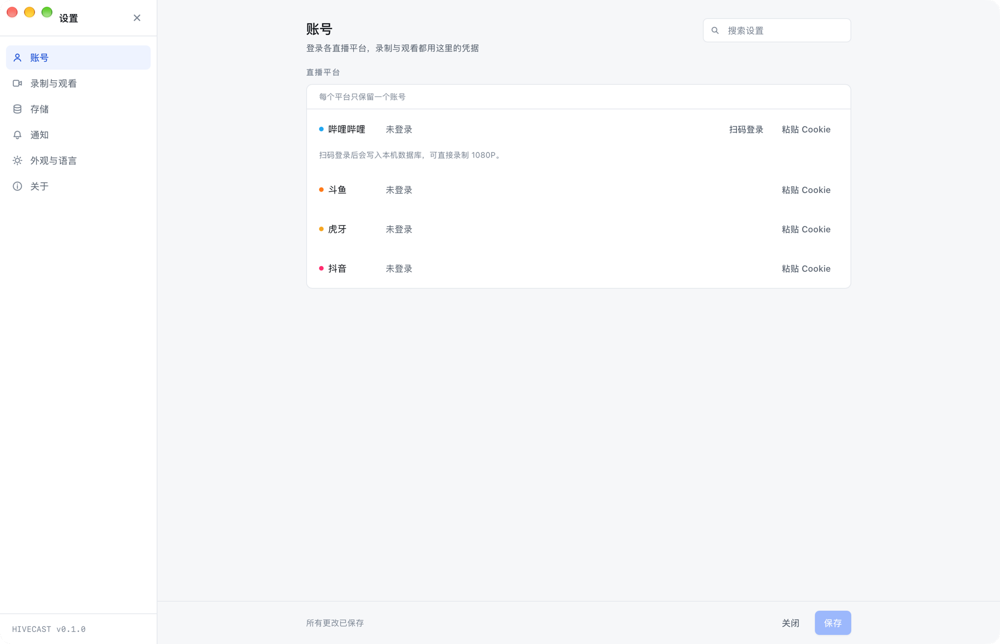

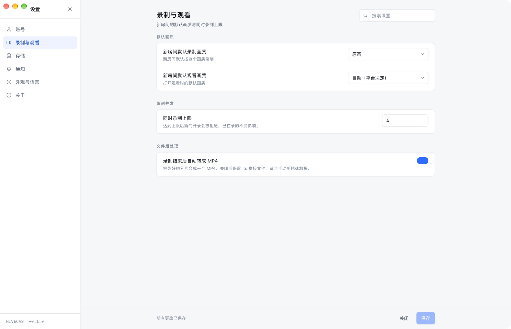

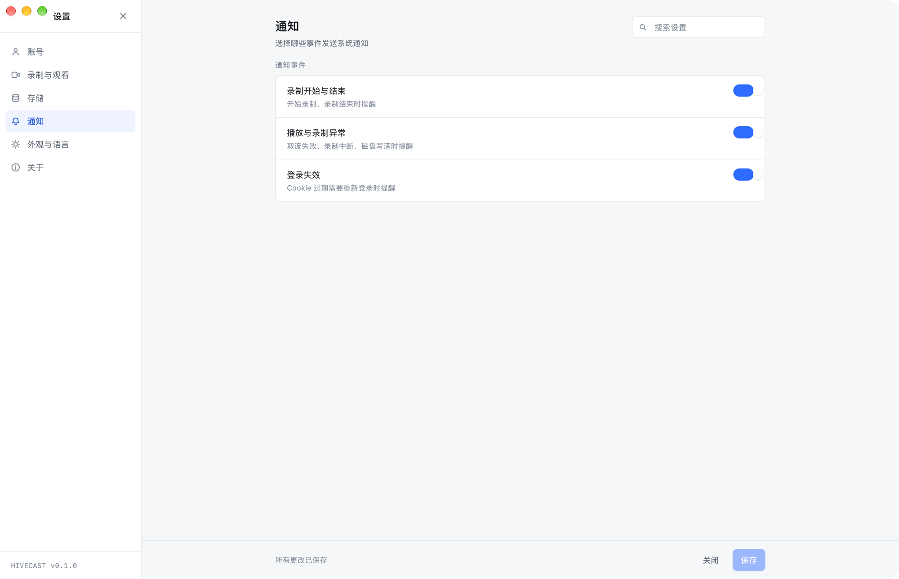

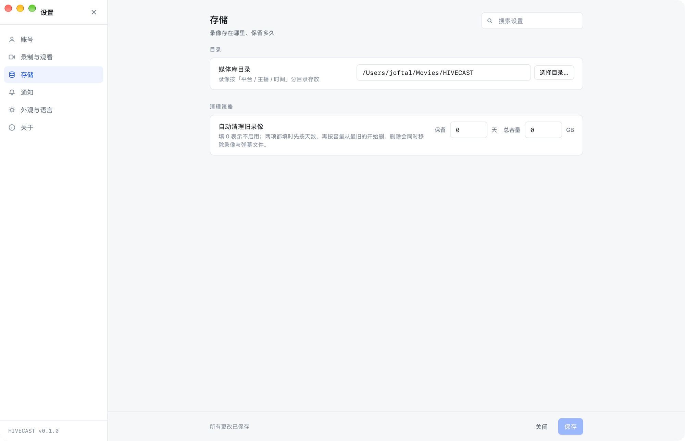

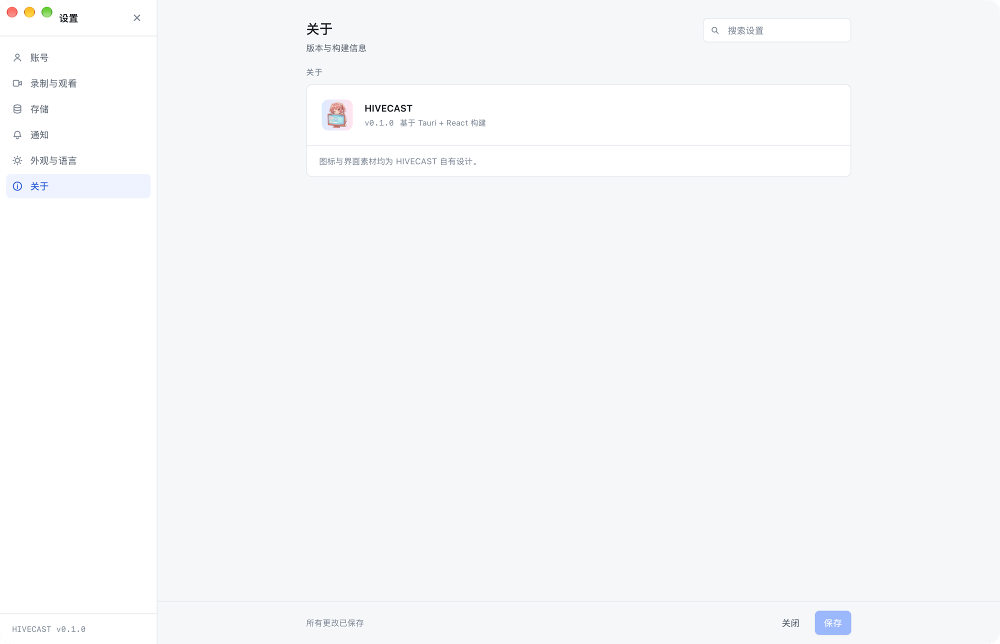

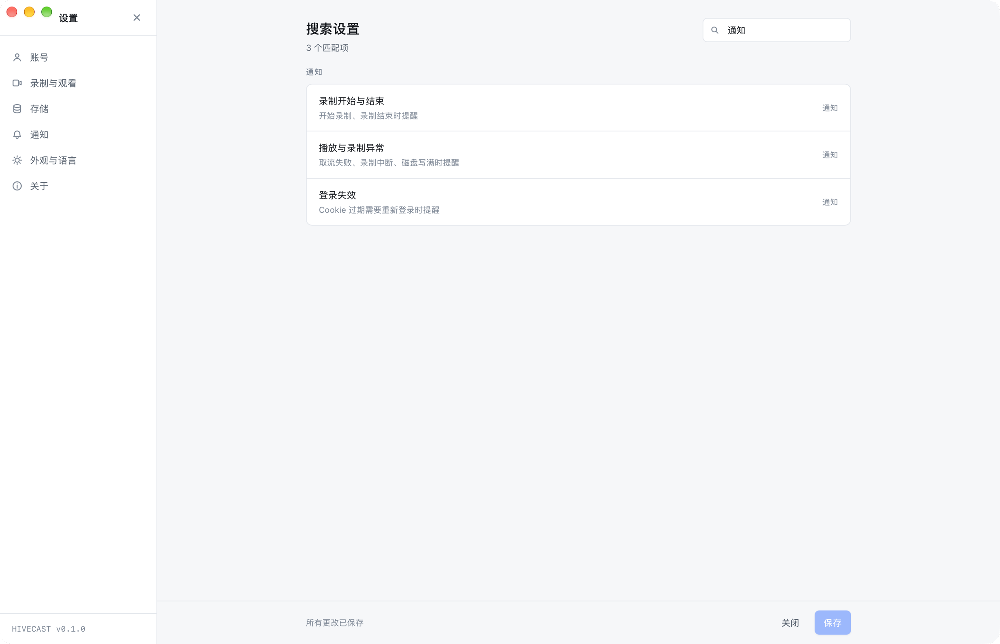

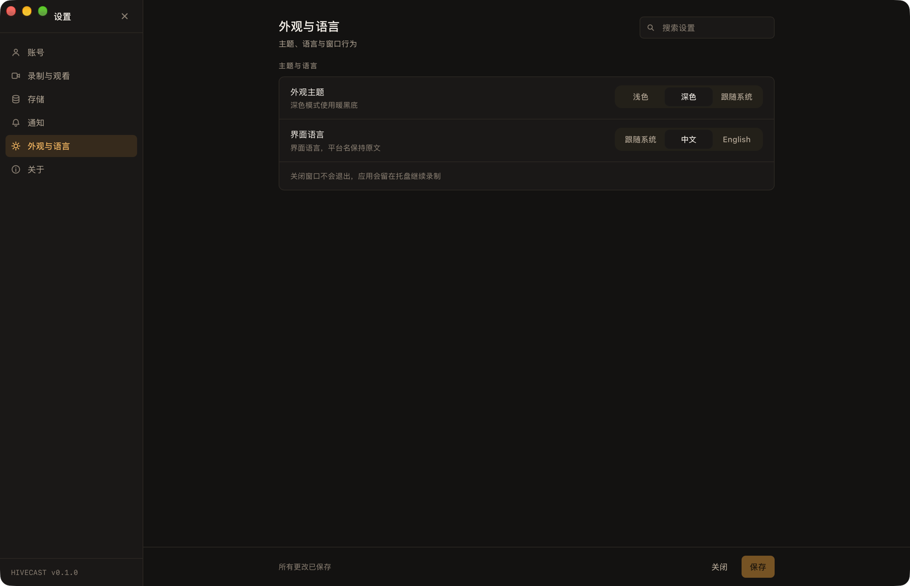

### 11.7 缺口

| 项 | 现状 |
| --- | --- |
| 托盘开关 | 未做，关闭窗口固定隐藏到托盘，外观页只给说明 |
| 发送弹幕开关 | 未做，弹幕仍随录制自动发送 |
| 打开媒体目录 | 未做，存储页只有目录选择 |
| 检查更新 / 日志目录 | 未做，关于页只放版本与构建信息 |
| 左栏键盘 ↑↓ | 未做，Tab 与快捷键可用 |

## 12. 变更日志

| 版本 | 日期 | 内容 |
| --- | --- | --- |
| v0.1 | 2026-11-06 | 三方向设计稿（A 左栏 / B 顶部 Tab / C 图标栏）与推荐；信息架构六类；规格、交互、字段缺口与 S1–S3 拆解 |
| v1.0 | 2026-11-06 | 按 A 方案实施整窗设置页：六类导航、搜索设置、通知细分、脏状态确认与快捷键；补实施记录、实测与缺口 |
