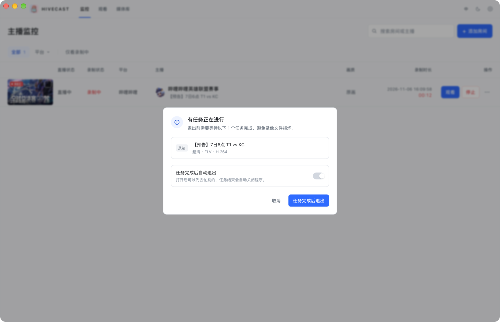
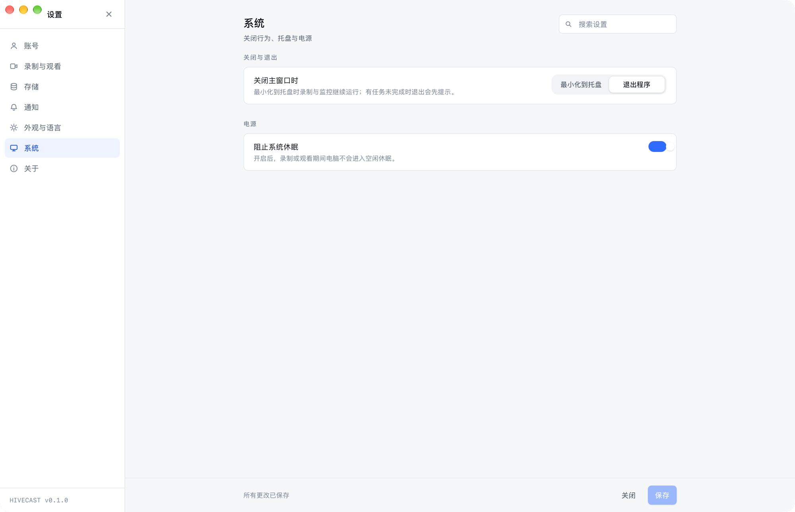

# 50 · 关闭行为与阻止休眠

> 状态：v1.0（2026-11-06）｜对应设置页「系统」分类（[49](49-设置页重做方案.md) 的第七类）

## 0. 结论

关闭窗口不再等于退出程序：默认最小化到托盘，录制、监控、观看继续跑；选择「退出程序」时，如果还有录制、转封装、合并、弹幕导出任务没结束，会先弹一个面板列出任务，让用户取消、等任务完成后再退出，或者打开「任务完成后自动退出」。另加一个全局的「阻止系统休眠」开关，开启期间 macOS 用 IOKit 电源断言、Windows 用 `SetThreadExecutionState` 让机器不进入空闲休眠。






## 1. 关闭流程

所有关闭入口最后都汇到 `lifecycle` 模块（`src-tauri/src/lifecycle.rs`），由它读设置、看任务表、决定隐藏还是退出。

| 入口 | 事件 | 处理 |
| --- | --- | --- |
| 点窗口红叉 | `WindowEvent::CloseRequested` | 一律 `api.prevent_close()`，交给 `on_close_requested` |
| Cmd+Q / Dock 退出 | `RunEvent::ExitRequested` | 未置 force 且任务非空时 `prevent_exit` 并弹面板 |
| 托盘菜单「退出 HIVECAST」 | `on_menu_event` | 直接走 `on_quit_requested`，与关窗退出共用同一套任务拦截 |
| 开发重启 / 系统注销（SIGTERM） | `tokio::signal::unix` | 先收尾录制与观看，再 `quit_now` |

`on_close_requested(app, tray_ready)` 的判定：

1. 读 `settings::load(&state.db).close_action`；
2. 值是 `tray` 且托盘建成功 → `hide_main`，进程留在后台；
3. 其余情况（`quit`、或托盘没建出来）→ `quit_or_warn`。

`quit_or_warn`：任务表为空就直接 `quit_now`（置 `FORCE_QUIT` 后 `app.exit(0)`，保证 `ExitRequested` 不再拦一次）；否则 `show_main` 把窗口叫回来、`emit(EVENT_CLOSE_BLOCKED, tasks)`、启动监听循环。

> 托盘没建出来时退化成「关窗即退出」是刻意的：隐藏到不存在的托盘会让用户再也找不到窗口。

## 2. 任务登记表

`src-tauri/src/jobs.rs` 是一个很小的登记表：`Jobs::begin(kind, title, detail)` 返回 `JobGuard`，guard 被 drop 时自动注销，所以后处理命令里只要 `let _job = state.jobs.begin(...)` 就能覆盖整个 await 区间，不会忘记配对。

| 来源 | id | kind | title | detail |
| --- | --- | --- | --- | --- |
| 录制中会话 | `record:{sessionId}` | `record` | 房间标题（回退 room_id） | 实际画质 |
| 单场转 mp4 | `job:{n}` | `remux` | 文件名 | 会话画质 |
| 房间合并 | `job:{n}` | `merge` | 房间标题 | — |
| 多场合并 | `job:{n}` | `merge` | 第一个文件名 | — |
| 弹幕导出 | `job:{n}` | `danmaku` | 文件名 | — |
| 录制收尾的自动转封装 | `job:{n}` | `remux` | 文件名 | 会话画质 |

最后一行是这次补的：`Recorder::finalize` 会先把房间从 active 表里摘掉，再做 `finish_file`（分片合并 + 自动转 mp4）。摘掉之后 `active_all()` 就查不到它了，如果不额外登记，用户恰好在这个窗口期点退出，ffmpeg 会被直接杀掉，留下的 mp4 是截断的。现在收尾转封装也走 `jobs`，退出面板里会显示成「转封装」。

`active_tasks` 把两部分拼起来：`recorder.active_all()` + `jobs.list()`，按这个顺序展示（录制在前）。

## 3. 退出拦截面板

`src/features/close/CloseDialog.tsx`，和设置抽屉同一套语言：460px 卡片、遮罩模糊、`animate-pop` 入场、Esc 关闭。

| 区域 | 内容 |
| --- | --- |
| 标题 | 有任务：`close.title`（还有任务没有完成）；任务清空：`close.readyTitle`（任务已全部完成） |
| 说明 | 有任务：`close.body` 带 `{{n}}`；清空：`close.readyBody`（可以安全退出） |
| 列表 | 最多 220px 滚动，每行 = 类型胶囊（录制/转封装/合并/弹幕导出）+ 标题 + 画质 |
| 开关 | `close.autoQuit`「任务完成后自动退出」+ 一行说明 |
| 底部 | 左「取消」，右「任务完成后退出」或「立即退出」 |

事件与命令：`app://close-blocked`（payload 是 `ActiveTask[]`）、`app://close-ready`（无 payload）；命令 `active_tasks` / `close_quit_now` / `close_arm_quit` / `close_cancel_quit`。前端另外挂了 2.5s 轮询兜底，只在面板打开时跑，防止事件漏收导致列表停在旧数据。

「取消」会把自动退出一起撤掉——用户关掉面板就是「我不退了」，不该留一个隐形的退出开关。

## 4. 任务完成后自动退出

面板上的开关是**临时**的：只对本次关闭有效，不写设置、重启即失效。后端 `arm_auto_quit` 置 `AUTO_QUIT` 并启动监听；`cancel_auto_quit` 清标记。

监听循环（`start_watch`）每 800ms 调一次 `active_tasks`：

- 还有任务 → 什么都不做；
- 任务清空 → `emit(EVENT_CLOSE_READY)`（面板切成「任务已全部完成」），如果 `AUTO_QUIT` 为真则 `quit_now`。

任务清空但没开开关时**不会**自动退出，面板停在那里等用户点「立即退出」——这样用户还能反悔。

## 5. 阻止系统休眠

设置项 `app.prevent_sleep`（默认关）。`settings::apply` 在启动与每次保存设置时调用 `power::apply`，失败只记 warn，不影响其他设置生效。

| 平台 | 实现 | 释放 |
| --- | --- | --- |
| macOS | `IOPMAssertionCreateWithName(PreventUserIdleSystemSleep, kIOPMAssertionLevelOn, name, &id)` | `IOPMAssertionRelease(id)` |
| Windows | 常驻线程 `hivecast-wake` 调 `SetThreadExecutionState(ES_CONTINUOUS \| ES_SYSTEM_REQUIRED)` 后阻塞在 channel 上 | 关闭时 send，让同一线程调 `SetThreadExecutionState(ES_CONTINUOUS)` 并退出 |
| 其它 | 空实现 | — |

Windows 必须让置位的线程常驻：这个 API 是按线程生效的，函数返回、线程结束标记就没了。

### 5.1 两个只有真机才会暴露的坑

1. **`IOPMAssertionID` 是 UInt32**。声明成 `c_ulong` 在 macOS 上是 64 位，写 `*mut` 会多写 4 字节，把栈写坏。必须是 `c_uint`。
2. **断言名称必须是 ASCII**。传中文名时 `IOPMAssertionCreateWithName` 照样返回 0，但 `pmset -g assertions` 里名字是空的——我一开始以为是 CFString 被提前 `CFRelease` 了，改成长生命周期后仍然是空，最后用一段独立 Rust 程序对比才发现是中文名本身的问题。现在名称固定为 `HIVECAST is recording or watching`。

```text
$ pmset -g assertions | grep hivecast
   pid 38837(hivecast): [0x001b18e200018865] 00:00:23 PreventUserIdleSystemSleep named: "HIVECAST is recording or watching"
```

> 名称的 CFString 仍然保留到断言释放为止（`NAME` 静态量），因为 IOKit 不保证拷贝它；这是防御性写法，和上面那个空名字的根因是两件事。

## 6. 设置页「系统」

在 [49](49-设置页重做方案.md) 的六类里插了第七类「系统」（`PageKey = "system"`，位置在外观与语言和关于之间）：

| 分组 | 行 | 控件 |
| --- | --- | --- |
| 关闭程序 | 关闭窗口时 | 分段控件：最小化到托盘 / 退出程序（`app.close_action`） |
| 阻止休眠 | 阻止系统休眠 | 开关（`app.prevent_sleep`） |

两行都进了跨分类搜索索引，搜索词补了「关闭 托盘 退出 close tray quit」和「休眠 睡眠 唤醒 sleep power wake」，搜「休眠」「托盘」都能直接命中。

## 7. 实测（macOS arm64，pnpm tauri dev）

| 场景 | 操作 | 结果 |
| --- | --- | --- |
| 最小化到托盘 | `close_action=tray`，探针调 `window.close()` | 窗口从 CGWindowList 消失，进程仍在，托盘图标仍在 |
| 退出被拦 | `close_action=quit` + 正在录制，关闭窗口 | 弹出面板，列表一行「录制 · 哔哩哔哩英雄联盟赛事 · 高清 · FLV · H.264」 |
| 任务清空 | 停录后不自动退出 | 面板切成「任务已全部完成」，按钮变「立即退出」 |
| 自动退出 | 开开关 → 停录 | 停录后约 1s 进程自行退出，退出码 0；会话落库 `finished/stopped`，2,086,335 字节 / 26s |
| 立即退出 | 无任务时关闭窗口 | 进程立即退出，退出码 0，无面板 |
| 托盘退出被拦 | `close_action=tray` + 录制中，先 `window.close()` 隐藏，再调 `on_quit_requested`（托盘菜单回调的同一入口） | 窗口从托盘状态恢复到前台，弹出面板并列出「录制 · 预告 7日6点 T1 vs KC · 高清 · FLV · H.264」；进程存活，录制继续 |
| 阻止休眠 | `app.prevent_sleep=true` 启动 | `pmset -g assertions` 出现 `PreventUserIdleSystemSleep`，名称为 HIVECAST is recording or watching |

截图：`docs/assets/ui-close-blocked.png`、`ui-close-ready.png`、`ui-close-tray-quit.png`（托盘退出把隐藏的窗口拉回前台并弹面板）、`ui-settings-system.png`。

## 8. 已知缺口

| 缺口 | 说明 |
| --- | --- |
| Windows 未真机验证 | `SetThreadExecutionState` 与关窗/托盘路径只做了编译检查，需要一台 Windows 机器过一遍 |
| 托盘菜单点击未自动化 | 菜单项本身靠人工点；脚本用 `on_quit_requested` 探针验证同一回调路径（`tray.rs:83`），点击与探针只差一次事件派发 |
| 防休眠是全局开关 | 打开就一直生效，不跟随「有没有在录制」自动开关；v1 按用户要求做成手动 |
| 自动退出不持久 | 每次关闭都要重新打开，符合「临时开关」的定位 |
| 收尾缩略图不拦退出 | 九宫格缩略图属于缓存，丢了会自动重生成，所以没有登记成任务 |

## 9. 变更日志

| 版本 | 日期 | 内容 |
| --- | --- | --- |
| v1.0 | 2026-11-06 | 关闭行为（托盘/退出）、退出前任务拦截与自动退出、阻止系统休眠、设置页系统分类；补上录制收尾转封装的任务登记 |