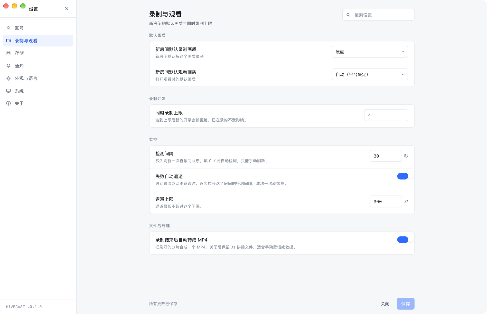
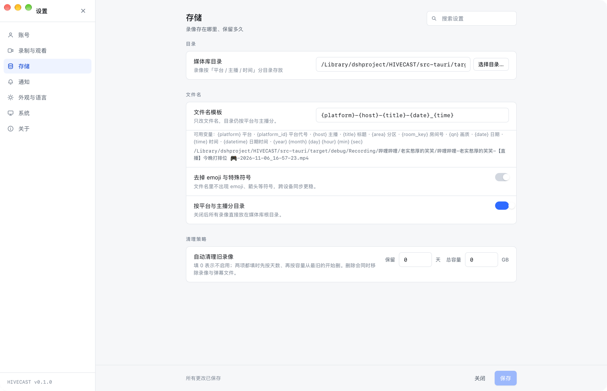
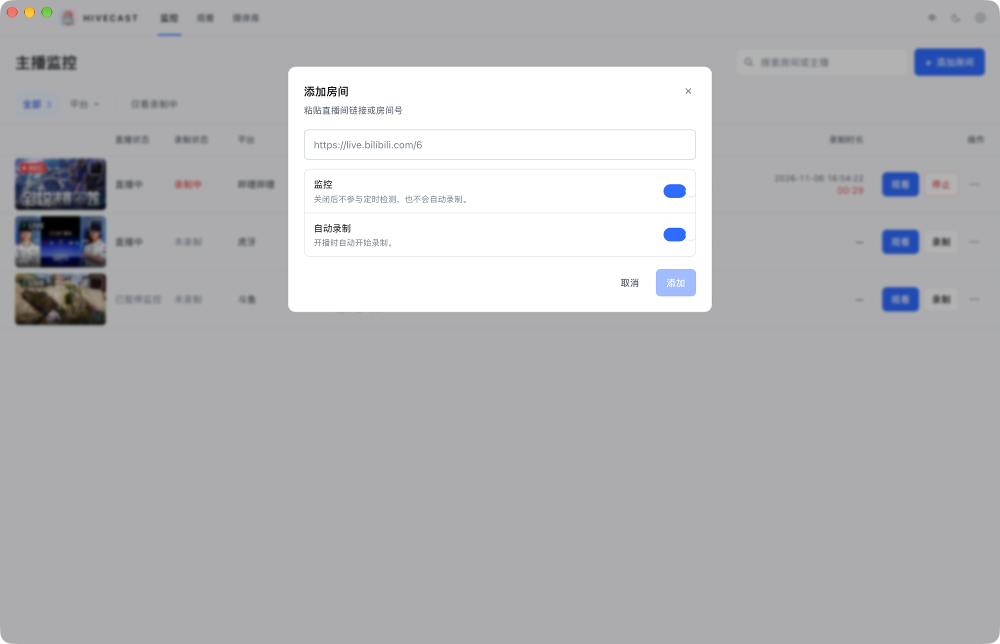

# 52 监控设置：检测间隔、失败退避、录制目录与文件名模板

> 状态：v1.0（2026-11-06）｜ 关联：[51-监控设置-需求评审](./51-监控设置-需求评审.md)、[19-产品蓝图与阶段计划](./19-产品蓝图与阶段计划.md) §5 M23

## 0 结论

这一版把「监控」从写死的 15/30 秒常量，变成用户可调的一条链路：间隔 → 失败退避 → 单个房间的排期；同时把录像落盘从固定路径改成「安装目录/Recording + 可编辑文件名模板」。四条需求全部落地：

| 需求 | 落地方式 | 默认值 |
| --- | --- | --- |
| 检测间隔 | 设置项 `monitor.interval_sec`，0 = 关闭自动检测 | 30 秒 |
| 限流退避 | 只对限流/网络错误按房间翻倍退避，上限可配 | 开启，上限 300 秒 |
| 录制目录 | 默认「程序安装目录/Recording」，可改；不可写自动回落 | 安装目录 |
| 文件名模板 | 16 个变量 + 实时预览 + 去 emoji + 平台/主播分目录 | `{platform}-{host}-{title}-{date}_{time}` |
| 添加房间开关 | 弹窗内「监控」「自动录制」两个开关，关监控即关自动录制 | 都开 |







## 1 交付清单

| 位置 | 内容 |
| --- | --- |
| `src-tauri/src/monitor.rs` | 全量重写：可配置间隔、按房间排期、并发 4、限流退避 |
| `src-tauri/src/filename.rs` | 新增：模板渲染/校验/清洗、去 emoji、唯一文件名、长度预算 |
| `src-tauri/src/settings.rs` | 6 个新设置项的读写与夹取；保存时把命名规则推给录制器 |
| `src-tauri/src/recorder.rs` | `Naming` 状态 + `set_naming`；落盘改用模板，同名自动加序号 |
| `src-tauri/src/state.rs` | 媒体库默认值改为安装目录下的 `Recording` |
| `src-tauri/src/commands.rs` | `room_add` 支持两个开关；新增 `filename_preview` |
| `src-tauri/src/broker.rs` | 新增 `room_info_fresh`，让监控不吃 15 秒信息缓存 |
| `src-tauri/ipc-types` | `Settings` 增 6 字段；新增 `FilenamePreview` |
| `src/features/settings/SettingsView.tsx` | 录制页「监控」段、存储页「文件名」段、搜索索引 |
| `src/features/monitor/MonitorPage.tsx` | 添加房间弹窗的两个开关与联动 |
| `src/lib/ipc.ts` | `roomAdd(input, monitor, autoRecord)`、`filenamePreview(...)` |

## 2 检测间隔

`monitor.interval_sec` 是**单个**间隔（不再保留「直播 15 秒 / 离线 30 秒」双档）。取值 0–86400：

- `0` = 关闭自动检测。监控循环每秒读一次设置，看到 0 就清空排期直接返回；界面上的房间状态停在最后一次结果，只能靠「刷新直播间信息」手动拉。把间隔改回正数后，所有房间会立即检测一次（排期已清空），再按新间隔走。
- 其余值 = 每个房间各自计时，到点就检测。循环本身仍然每秒醒一次，但不会因为「1 秒 tick」去请求平台。
- 检测并发上限 4（`CONCURRENCY`）：到期房间一次性进 `JoinSet`，用信号量压住，避免 50 个房间同时打同一个平台。
- 设置是热生效的：保存后下一次 tick 就换节奏，不需要重启。

举例：间隔 30 秒、10 个房间，某个 tick 全部到期 → 4 个在途、其余排队；每个房间下一次的时间各自从「检测完成时刻」开始算，不会因为排队而互相挤在一起。

## 3 失败退避

只有**限流/网络类**错误才退避，其它错误（房间不存在、解析失败等）保持原间隔重试，避免把一次平台改版放大成 5 分钟不刷新。

判定在 `PlatformError::is_throttle()`：网络错误，或上游错误码命中 `-352`、`-412`、`-429`、`412`、`429`。

退避公式（每个房间独立计失败次数 `failures`）：

```
wait = min(base × 2^min(failures, 5), cap)
```

- `base` = 检测间隔；`cap` = 「退避上限」（默认 300 秒，可设 60–3600）。
- 成功一次即 `failures = 0`，立刻回到基础间隔。
- 关闭「失败自动退避」后，限流也按基础间隔重试（只影响限流，不影响其它错误）。

举例：间隔 30 秒、上限 300 秒，连续被限流时下一次分别在 60 → 120 → 240 → 300 → 300 秒后。

注意这里**不叠加** `StreamBroker` 自己的取流退避：监控走 `room_info_fresh` 跳过 15 秒信息缓存，但房间级 1.5 秒闸门与取流失败退避仍然生效，两套退避不会相乘。

## 4 录制目录默认值

默认值是「程序装在哪，Recording 就在哪」：

| 运行形态 | 默认目录 |
| --- | --- |
| macOS 打包后 | `.app` 所在目录下的 `Recording`（装在 /Applications 就是 `/Applications/Recording`） |
| macOS 开发态 | `src-tauri/target/debug/Recording` |
| Windows 打包后 | `HIVECAST.exe` 同目录的 `Recording` |
| 安装目录不可写 | 回落 `~/Movies/HIVECAST`（Windows `%USERPROFILE%\Videos\HIVECAST`） |

判定方式是启动时真的建目录并写一个探针文件（`.hivecast-write-test`），写完就删；写不进去才回落，不会出现「设置里看着是安装目录、实际录到别处」。`HIVECAST_MEDIA_DIR` 环境变量仍可强制覆盖，方便测试。

已经保存过 `media.root` 的用户不会被改路径——默认值只在这个键不存在时生效。

## 5 文件名模板

### 5.1 变量

| 变量 | 含义 | 示例 |
| --- | --- | --- |
| `{platform}` | 平台中文名 | 哔哩哔哩 |
| `{platform_id}` | 平台代号 | bilibili |
| `{host}` | 主播名 | 老实憨厚的笑笑 |
| `{title}` | 直播间标题 | 【直播】今晚打排位 |
| `{area}` | 分区 | 英雄联盟 |
| `{room_key}` | 房间号 | 6 |
| `{qn}` | 录制画质值 | 10000 |
| `{date}` / `{time}` | 日期 / 时间 | 2026-11-06 / 17-00-15 |
| `{datetime}` | 日期+时间 | 2026-11-06_17-00-15 |
| `{year}` `{month}` `{day}` `{hour}` `{min}` `{sec}` | 拆分字段 | 2026 / 11 / 06 |

模板只决定**文件名**，目录结构由「按平台与主播分目录」开关控制（开 = `平台/主播/文件名`，关 = 全部平铺在媒体库根目录）。

### 5.2 清洗规则

- 非法字符 `/ \ : * ? " < > |` 与控制字符 → `_`；连续空白压成一个空格；首尾的点和空格去掉。
- Windows 保留名（`CON`、`PRN`、`AUX`、`NUL`、`COM1`–`COM9`、`LPT1`–`LPT9`，不区分大小写）前面加 `_`。
- 「去掉 emoji 与特殊符号」打开时，emoji、变体选择符、零宽连接符、旗帜、箭头等一并剔除；关闭时保留原样。
- 文件名过长会按目录长度动态截断（总路径预算 240 字符，主名 24–120 字符），不会出现「录到一半路径超限」。
- 同名时自动加序号：`xxx (2).mp4`、`xxx (3).mp4`……判定时连 `.jsonl` / `.ass` 旁挂文件一起看，所以弹幕文件永远和录像同名同序号。

### 5.3 预览

存储页的模板输入框下方实时显示一条**完整示例路径**（用固定示例房间，不需要真的添加房间），并列出全部变量；模板写错（未闭合的花括号、未知变量、空模板）时预览行直接变红报错，保存按钮会拦下并提示原因。预览有 200ms 防抖，敲字不会打满主线程。

## 6 添加房间的两个开关

添加直播间弹窗在输入框下方多了两行：

- **监控**（默认开）：关闭时 `monitor_paused = true`，这个房间不参与定时检测，也不会自动录制；界面状态列显示「已暂停监控」。
- **自动录制**（默认开）：关闭时开播不会自动开录，但仍可手动点录制。
- 联动：关掉「监控」会同时把「自动录制」关掉并置灰——不检测就永远不知道开播，留着这个开关只会误导。
- 重新添加一个已存在的房间时，按这次弹窗里的开关覆盖旧值（不是忽略）。

## 7 接口与字段

| 名称 | 说明 |
| --- | --- |
| `Settings.monitor_interval_sec` | 0–86400，0 = 关闭 |
| `Settings.monitor_backoff_enabled` / `monitor_backoff_cap_sec` | 退避开关 / 上限 60–3600 |
| `Settings.media_filename_template` / `media_strip_emoji` / `media_group_dirs` | 模板 / 去 emoji / 分目录 |
| `FilenamePreview { name, path, valid, error }` | 预览结果，`path` 是完整路径 |
| `room_add(input, monitor?, auto_record?)` | 两个开关，缺省都 true |
| `filename_preview(template, strip_emoji, group_dirs)` | 用示例房间渲染，不落库 |

`app_setting` 新增键：`monitor.interval_sec`、`monitor.backoff_enabled`、`monitor.backoff_cap_sec`、`media.filename_template`、`media.strip_emoji`、`media.group_dirs`。

## 8 实测

| 场景 | 结果 |
| --- | --- |
| 默认媒体库路径（开发态） | 启动后自动建出 `src-tauri/target/debug/Recording`，设置页显示同一路径 |
| 模板预览 | 输入 `{platform}-{host}-{title}-{date}_{time}`，预览显示 `.../Recording/哔哩哔哩/老实憨厚的笑笑/哔哩哔哩-老实憨厚的笑笑-【直播】今晚打排位 🎮-2026-11-06_16-57-23.mp4` |
| 间隔 0 | 把 `monitor.interval_sec` 改成 0，25 秒内三个房间的 `last_checked_at` 完全不变 |
| 间隔恢复 5 秒 | 改回 5 秒，15 秒内未暂停的两个房间 `last_checked_at` 都刷新到同一秒 |
| 暂停监控 | `monitor_paused = 1` 的斗鱼房间在恢复轮询后仍然不刷新 |
| 添加房间开关 | `(monitor=false, auto=true)` → `monitor_paused=1, auto_record=0`；`(true,false)` → `0,0`；`(true,true)` → `0,1` |
| 自定义模板落盘 | 保存 `{platform}-{host}-{date}_{time}` + 分目录 + 去 emoji 后录 17 秒，文件名 `哔哩哔哩-哔哩哔哩英雄联盟赛事-2026-11-06_17-00-15.mp4`，弹幕 `同名.jsonl`，2,673,909 字节 |

## 9 缺口

| 缺口 | 说明 |
| --- | --- |
| 没有平台级最小访问间隔 | 同一平台的多个房间仍按各自排期请求，只靠并发 4 压峰值 |
| 退避不区分错误来源 | 平台整体 429 时，每个房间各自翻倍，没有「整个平台暂停 1 分钟」 |
| 模板不支持子目录变量 | `{year}/{month}` 这类按日期分目录的需求，目前只能用「平台/主播」两层 |
| 预览用的是固定示例房间 | 不会用你真实房间的标题长度去估算截断效果 |
| 目录不可写只在启动时判定 | 运行中磁盘变成只读不会自动切换回落目录，只会在录制报错里体现 |

## 10 变更日志

| 版本 | 日期 | 内容 |
| --- | --- | --- |
| v1.0 | 2026-11-06 | 首版：间隔与退避、安装目录默认值、文件名模板与预览、添加房间开关 |