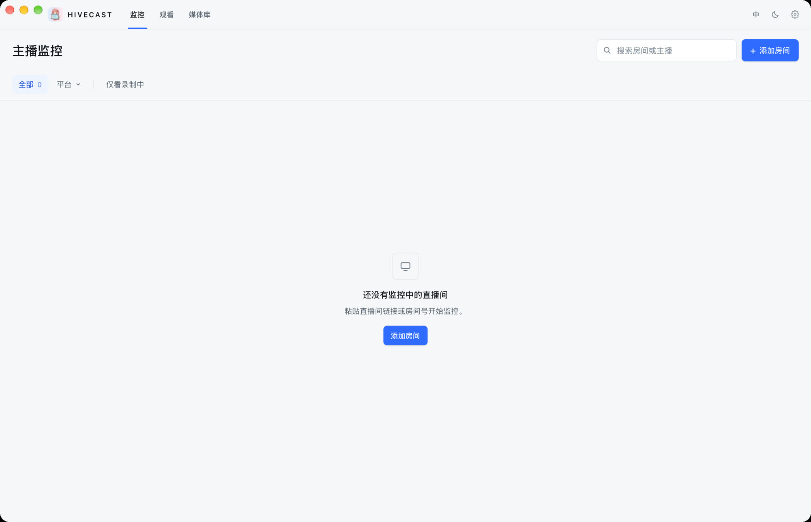
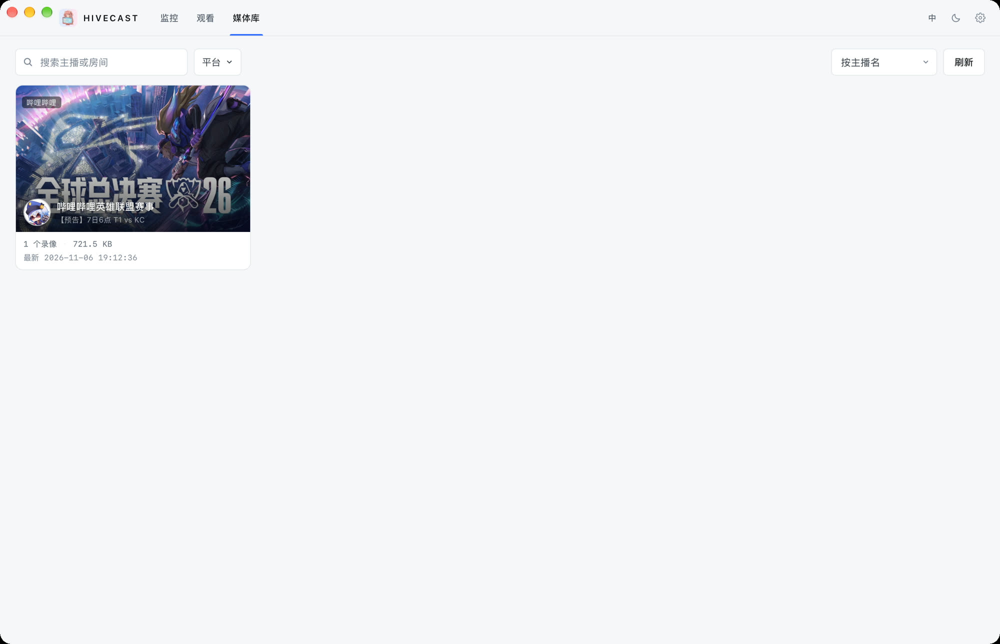

# 55 监控与录制联动修复

> 状态：v1.0（2026-11-06）｜前置：[54-监控与录制关系审查](54-监控与录制关系审查.md)｜范围：S1–S5 五个风险 + C3 冷却键｜结论：S1–S5 与 C3 全部修掉，录制链与监控彻底解耦。

## 0. 一句话结论

监控只做「刷新房间状态 + 决定开录 / 停录」，录制进程的生死由录制器自己的看门狗负责。这一轮把 54 里列出的 5 个会间接影响录制的场景补齐：录制加了读超时与假死重启，停录要连续两次离线确认，自然结束与手动停录的抑制按「场次」计，删房间改成软删除。

| 编号 | 改前 | 改后 |
| --- | --- | --- |
| S4 | 录制命令没有读超时；源「连着但不给数据」时 ffmpeg 永久阻塞，会话永远 recording | 传输层 @-rw_timeout 30000000@ + 应用层 60 秒无增长看门狗；kill 后在**同一会话**内重连续录，最多 2 次，仍无数据则 failed / stalled 并通知 |
| S1 | 一次成功响应报离线就停录；接口抖动或字段缺失会把健康录像截断成两条 | 连续两次成功检查都离线才停；两次间隔超过 180 秒重新计数 |
| S2 | 自然结束后无抑制；下播状态滞后时会立刻重开、秒退、留下一条 failed 会话 | 自然结束后静默 600 秒，或出现新开播时间即解除 |
| S3 | 抑制标记只在下播时清除，跨场残留会让下一场不自动录 | 抑制按场次存（开播时间），换场自动失效 |
| S5 | 删除房间是物理删除，@record_session@ 外键级联把历史一起删掉 | 软删除（@removed_at@），历史录像仍留在媒体库，重新添加即恢复 |
| C3 | 取流的冷却用裸 room_key、房间信息用 platform:room_key，两套键互不影响 | 统一为 @room_gate()@，一处冷却全房间生效，@invalidate@ 也能清干净 |

## 1. 改动一览

| 文件 | 改动 |
| --- | --- |
| [src-tauri/src/recorder.rs](../src-tauri/src/recorder.rs) | 读超时、假死看门狗与重启、离线二次确认、自然结束静默、抑制按场次 |
| [src-tauri/src/monitor.rs](../src-tauri/src/monitor.rs) | 开录条件加两道闸门；离线分支改二次确认 |
| [src-tauri/src/db.rs](../src-tauri/src/db.rs) | @removed_at@ 软删除、列表过滤、恢复、@room_removed@ |
| [src-tauri/src/commands.rs](../src-tauri/src/commands.rs) | @room_add@ 恢复分支、@room_remove@ 清抑制 |
| [src-tauri/src/broker.rs](../src-tauri/src/broker.rs) | 冷却 / 限速统一用 @room_gate()@ |
| [src/features/monitor/MonitorPage.tsx](../src/features/monitor/MonitorPage.tsx) | 移除房间后提示「历史录像仍保留在媒体库」 |
| [src/i18n/zh-CN.json](../src/i18n/zh-CN.json) / [en-US.json](../src/i18n/en-US.json) | 新增 @monitor.removedKept@，共 454 键 |

## 2. S4：录制假死看门狗（最重）

### 2.1 两层防护

| 层 | 实现 | 位置 | 覆盖场景 |
| --- | --- | --- | --- |
| 传输层 | @-rw_timeout 30000000@（30 秒） | recorder.rs:978 | 套接字读阻塞：源接受了连接但不再吐数据 |
| 应用层 | 每 1 秒看分片文件总量，60 秒一个字节都没涨即判假死 | recorder.rs:661-673 | ffmpeg 卡在重连、写盘或内部死循环，读超时也救不回来 |

只看传输层不够：@-rw_timeout@ 只对「读操作」生效，ffmpeg 在写盘阻塞或内部等待时不触发；只看应用层也不够：文件按分片落盘，粒度 2–10 秒，卡死到 60 秒才被发现，期间会话一直占着磁盘与退出拦截。

### 2.2 处理链

1. 判死（recorder.rs:617）→ 日志 @录制长时间没有新数据，重启 ffmpeg@；
2. @kill_and_wait@（recorder.rs:621）：SIGKILL 后最多等 6 秒回收，僵尸进程不会留在任务表里；
3. @bump_stall@ 计数 +1，重置增长基线；
4. @broker.invalidate(room)@：清掉这个房间的取流缓存与冷却，重连续录不会被 5–60 秒冷却挡住（C3 修完之后才真正有效）；
5. 等 3 秒后 @respawn@：重新解析签名地址（B 站 / 斗鱼 / 虎牙 / 抖音的地址都有时效），分片编号接续 @part0001@、@part0002@；
6. 计数超过 @MAX_STALL_RESTARTS = 2@（recorder.rs:39）仍无数据 → @finalize(..., Some("stalled"))@，会话记 @failed / stalled@，原因「直播流长时间没有数据」，并走失败通知。

### 2.3 为什么不新开会话

假死重启属于「同一场直播的同一个文件」：会话 id、文件名、弹幕文件都不变，分片编号接续，最终合并成一个 mp4。只有重试 2 次后仍然没有数据，才判定这一场录制失败。

## 3. S1：离线二次确认

| 项 | 规则 |
| --- | --- |
| 计数 | 每次成功请求且 @is_live = false@ 计一次 |
| 停录条件 | 连续两次（@confirm_offline@ 返回 true，recorder.rs:308） |
| 间隔 | 两次之间超过 @OFFLINE_CONFIRM_GAP_SECS = 180@ 秒就清零重计 |
| 复位 | 成功看到在线（monitor.rs:338）、或房间已不在录制（monitor.rs:361）、或手动停录时清空 |

举例：间隔 30 秒时，下播后第一次检测到离线（T+30）继续录，第二次（T+60）才停，多录 30 秒可接受的尾巴；接口抖动一次（一次误报离线后立刻恢复在线）不会停录。

## 4. S2：自然结束后的静默

| 项 | 规则 |
| --- | --- |
| 记录时机 | @finalize@ 里，只有 @finished + stream_ended@（ffmpeg 正常 EOF）才 @mark_ended@（recorder.rs:872） |
| 静默窗口 | @ENDED_BLOCK_SECS = 600@ 秒（recorder.rs:45） |
| 提前解除 | 平台给出不同的开播时间（新的一场），或成功看到离线，或手动开始录制 |
| 判定入口 | monitor.rs:344 的 @auto_blocked@ |

举例：主播下播，ffmpeg EOF 收尾，但平台状态页还没更新，监控仍报「直播中」——没有这道闸门时会在下一轮立刻重开，源已经没数据，秒退 → 续录 3 次失败 → 多一条 failed 会话与失败通知。现在 10 分钟内不会再自动开录，平台刷新出离线后解除。

## 5. S3：停录抑制按场次计

改前：@suppressed@ 是 @HashSet<String>@，只在「成功看到离线」时清除。下播后主播几秒内重开、而监控没捕捉到离线的那一瞬间，标记会留到下一场，导致下一场不自动录。

改后：@suppressed: Mutex<HashMap<String, Option<i64>>>@，值是停录那一刻的开播时间。

| 情况 | auto_suppressed(id, live_started) |
| --- | --- |
| 同一场（两个时间相等） | true，继续拦 |
| 新一场（时间不同） | 自动清标记并返回 false |
| 平台没给开播时间 | 保守拦截（返回 true） |
| @resume_auto@（离线 / 重新添加 / 删房间 / 新一场开始） | 同时清 suppressed 与 ended |

@start()@ 在插入会话后调用 @resume_auto@，所以「新一场开始」也会自动清掉上一场的标记。

## 6. S5：删房间改软删除

| 项 | 说明 |
| --- | --- |
| 表结构 | @room.removed_at INTEGER@（迁移时 @ALTER TABLE@ 补齐，db.rs:975） |
| 移除 | @UPDATE room SET removed_at = now, monitor_paused = 1@（db.rs:437）；不再物理删除 |
| 列表 | @list_rooms@ 只取 @removed_at IS NULL@（db.rs:266） |
| 媒体库 | 会话查询不按 removed_at 过滤，主播卡与主播页照常显示 |
| 重新添加 | @insert_room@ 的 @ON CONFLICT DO UPDATE@ 里 @removed_at = NULL@（db.rs:321）；@room_add@ 只有在房间未被移除时才提前返回（commands.rs:80） |
| 移除前 | 先 @resume_auto@（commands.rs:142），避免停录留下的抑制标记影响以后重新添加 |
| 界面 | 移除后绿条提示「已移除房间，历史录像仍保留在媒体库」（MonitorPage.tsx:493） |

为什么不改成「会话表不级联」：物理删除房间后，主播卡、主播名、封面都无从查起，媒体库会退化成一堆没有归属的文件；软删除一行只占几十字节。

实测三步（图 2、图 3）：移除后监控页回到空态，媒体库仍有 1 个主播 / 1 个录像 / 721.5 KB；重新添加同一个直播间，监控行回来，录制时长列显示的正是那条 2026-11-06 19:12:36 的历史会话。

## 7. C3：冷却键统一

@StreamBroker@ 里有两套键：房间信息用 @room_gate(room) = "platform:room_key"@，取流用 @StreamKey@（含画质）。旧代码在 @groups()@ 里把 @&key.room_key@（裸房间号）传给 @backoff_error / wait_turn / note_failure@，于是：

- 同一房间两个画质各自排队，限速形同虚设；
- @invalidate@ 清的是 @room_gate@ 的冷却，续录时 @groups()@ 仍被另一套键的 5–60 秒冷却挡着 → 会话记 failed，下一轮监控再开一条新会话。

现在 @groups()@ 先算 @gate_key = room_gate(room)@（broker.rs:85），冷却、限速、失败计数、@invalidate@ 全部走同一把键；单飞锁仍按画质分（并发的两个画质请求不必互相等）。

## 8. 单测

| 用例 | 覆盖 |
| --- | --- |
| @manual_stop_suppresses_auto_start@ | 手动停录拦同一场；平台无开播时间时保守拦；@resume_auto@ 解锁 |
| @manual_stop_only_blocks_the_same_live_session@ | 新一场的时间不同 → 自动放行 |
| @natural_end_blocks_auto_start_until_offline_or_new_live@ | 自然结束静默、离线解除、换场解除 |
| @offline_needs_two_successful_checks@ | 第二次才确认；确认后计数归零；@clear_offline@ 复位 |
| @removing_a_room_keeps_its_history_and_readding_revives_it@ | 软删除后列表减一、历史仍在、重新添加恢复 |
| @invalidate_clears_the_shared_room_cooldown@ | 一处失败进冷却，@invalidate@ 清干净 |

@cargo test --lib@：138 passed / 14 ignored；@cargo check --all-targets@ 零警告。

## 9. 真机实测（macOS arm64）

### 9.1 S4

| 时间 | 操作 | 结果 |
| --- | --- | --- |
| 19:33:16 | 斗鱼 9999 自动开录 | 会话 c435e3b8，分片 part0000 1.8 MB |
| 19:33:25 | @kill -STOP@ ffmpeg（模拟源假死） | 进程停住，文件不再增长 |
| 19:34:25 | 看门狗判定 60 秒无增长 | 日志 @WARN 录制长时间没有新数据，重启 ffmpeg room_id="rm-s4"@ |
| 19:34:25 | kill + 重解析 + 重启 | 旧 pid 52725 消失，新 pid 52774；同一会话、同一文件名，续写 part0001 6.3 MB |
| 19:34:46 | 停止应用 | 会话 @aborted / app_exit@，7,741,104 字节 / 93 秒（两个分片合并后） |

结论：源假死不再让会话永久停在 recording；重启在会话内部完成，历史里仍然只有一条记录。

### 9.2 S5

| 步骤 | 证据 |
| --- | --- |
| 移除有历史的房间 | @removed_at@ 落库、@monitor_paused = 1@；监控页「还没有监控中的直播间」（图 1） |
| 打开媒体库 | 主播卡仍在，1 个录像 / 721.5 KB / 最新 2026-11-06 19:12:36（图 2） |
| 重新添加同一链接 | 监控行恢复为「直播中」，录制时长列显示那条历史会话 19:12:36 / 00:05 |

## 10. 缺口

| 缺口 | 说明 |
| --- | --- |
| S1 只防单次抖动 | 平台连续两次错误地报离线（例如接口降级返回默认值）仍会停录 |
| S4 以文件增长为判据 | 极端慢盘或超长缓冲（超过 60 秒不落盘）会被误杀；当前平台分片 2–10 秒，风险低 |
| 软删除只增不减 | room 表会累积已移除的行（每条几十字节）；没有「清理已移除房间」的维护入口 |
| 没有恢复入口 | 只能重新添加直播间来恢复；kid 提示文案已说明历史保留 |
| S2 是时间兜底 | 平台若超过 10 分钟仍报在播且主播确实连播，会尝试再开一次，秒退后按失败收尾 |
| Windows 未真机验证 | 本轮的读超时、看门狗、软删除都是平台无关逻辑，但只在 macOS 上跑过 |

## 11. 变更日志

| 版本 | 日期 | 内容 |
| --- | --- | --- |
| v1.0 | 2026-11-06 | S1–S5 与 C3 落地；6 个单测；S4 与 S5 真机实测 |
