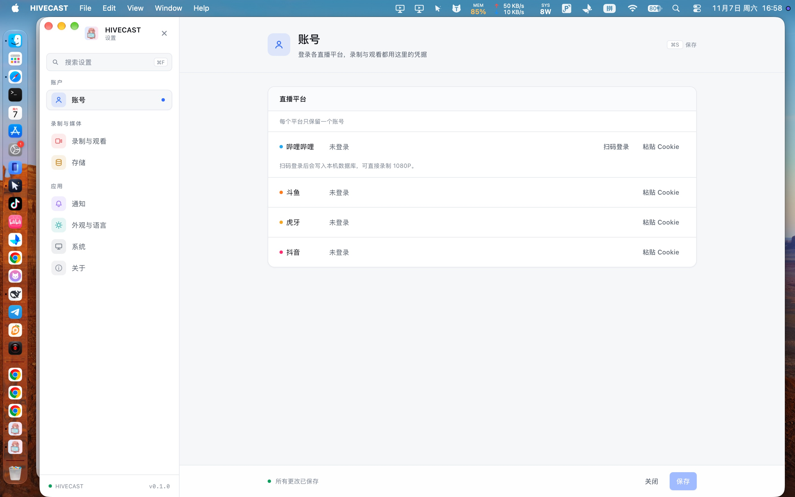
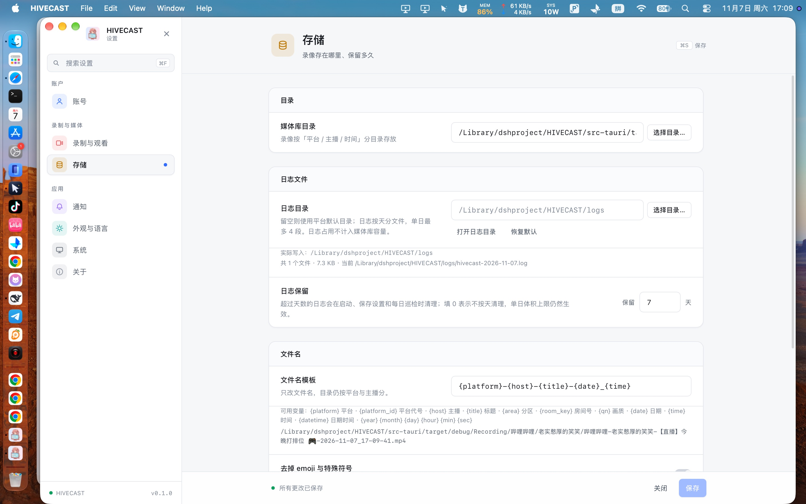
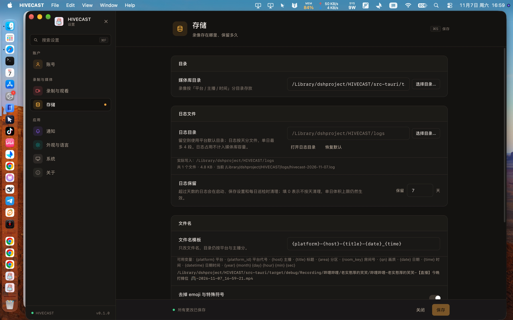

# 71-设置界面重做二

> 版本：v1.0（2026-11-07）
> 范围：仅前端设置页的布局、视觉与导航；设置项、IPC 契约与后端行为不变。
> 前作：`49-设置页重做方案.md`（把抽屉改成整窗左栏 + 内容）。本篇是在其上的第二次视觉与信息架构重做。

## 1. 目标与结果

旧版已经是「左侧分类 + 右侧内容」，但导航平铺、卡片层级弱、搜索在内容区、页面头部信息少，整体更像一组表单而不是系统设置。本次按专业桌面应用的设置中心重做：

- 左侧 248px 固定栏：品牌区、全局搜索、三组导航、版本信息；
- 右侧独立滚动：页面图标 + 标题 + 描述 + 未保存标记，正文限宽 760px，底部固定保存栏；
- 导航按「账户 / 录制与媒体 / 应用」分组，每个页面有固定色相的图标底；
- 内容统一为 12px 圆角卡片 + 58px 行高，危险/成功状态仍沿用现有语义色；
- 搜索变成全局入口，结果按页面分组，点结果直达对应行并短暂高亮。

截图（浅色账号页、浅色存储页、深色存储页、搜索结果）：

## 2. 信息架构

| 分组 | 页面 | 标题 | 说明 |
| --- | --- | --- | --- |
| 账户 | 账号 | 账号 | 平台登录、扫码、Cookie |
| 录制与媒体 | 录制与观看 | 录制与观看 | 画质、并发、监控节奏、后处理 |
| 录制与媒体 | 存储 | 存储 | 媒体目录、日志、命名、保留策略 |
| 应用 | 通知 | 通知 | 录制、异常、登录失效三类开关 |
| 应用 | 外观与语言 | 外观与语言 | 主题、语言 |
| 应用 | 系统 | 系统 | 关闭行为、防休眠 |
| 应用 | 关于 | 关于 | 版本、构建信息 |

分组只影响左侧导航和搜索结果的排序，不改变页面内部结构。新增页面时在 `PAGES` 里补一条 `group` 与 `tint` 即可自动进入导航。

## 3. 布局规格

### 3.1 左侧栏

- 宽度 248px，`border-r`，背景与窗口一致，不再使用独立深色侧栏。
- 顶部 58px 品牌区：28px 应用图标 + 「HIVECAST / 设置」+ 右侧关闭按钮；macOS 上保留 78px 左侧安全区避开红绿灯。
- 搜索框高 32px，位于品牌区下方，占满侧栏内宽；右侧显示 `⌘F`，有内容时变成清空按钮。
- 导航项高 36px，圆角 8px，左图标 26px（14px 线性图标 + 彩色底），右侧当前项圆点。
- 当前项：白底 + 1px 边框 + 轻阴影；非当前项透明底，悬停用 `bg-raised/70`。
- 底栏显示运行状态点、HIVECAST 与版本号。

### 3.2 右侧内容

- 顶部 header 高约 88px（`px-10 py-6`），内容限宽 760px：
  - 40px 页面图标（搜索态换成放大镜）；
  - 20px 半粗标题，字距 `-0.01em`；
  - 11.5px 描述，单行截断；
  - 有改动时标题右侧出现「未保存」胶囊；
  - 最右侧 `⌘S` 保存提示。
- 正文 `overflow-auto`，`px-10 py-6`，限宽 760px，卡片间距 20px（`space-y-5`）。
- 底部 footer 固定，左侧状态点 + 「已保存 / 有未保存的更改」，右侧「关闭 / 保存」。

## 4. 视觉规格

- 卡片：`rounded-[12px]`、1px `border-line`、`bg-surface`、极轻阴影；卡片头 `bg-raised/35`、`px-5 py-3`，标题 12px 半粗，可选描述 11px。
- 行：最小高 58px、`px-5 py-3.5`、`gap-6`；标题 12.5px 中等字重，说明 11.5px/18px；悬停 `bg-raised/45`；行间用 `divide-y`。
- 控件：输入/下拉统一高 36px、圆角 7px、12.5px 字号、`px-3`；文件名与路径用 11px 等宽字体。
- 页面色相：账号 `--c-accent`、录制 `--c-rec`、存储 `--c-warn`、通知 `#8b5cf6`、外观 `#0f9f9a`、系统 `--c-muted`、关于 `--c-faint`。
- 图标底：`color-mix(in oklab, tint 13%, transparent)`，图标本身用 tint 实色；深色主题下仍保持低饱和底。
- 字体与颜色全部复用 `src/styles/index.css` 的 token，没有新增全局变量。

## 5. 关键组件

- `PageIcon`：根据 `PageKey` 取图标与 tint，输出统一尺寸的彩色图标块；导航、页面头、搜索结果、搜索空态共用。
- `Section`：卡片容器，负责卡片头、描述、`divide-y` 内容区。
- `Row`：左标题/说明 + 右控件的标准行；`focus` 为搜索命中时的高亮态。
- `FIELD` / `HINT`：输入框与说明文字的统一样式常量，避免各页面各写一套。
- `NAV_GROUPS`：导航分组元数据；`PAGES` 同时是页面元数据与搜索分组依据。

## 6. 搜索与键盘

- `SEARCH_INDEX` 仍是单一索引，新增 `group` 后按页面分组渲染；每条结果带页面图标、标题、说明、页面标签与箭头。
- 搜索命中数显示在标题下方；无结果显示放大镜图标 + 标题 + 提示。
- 点击结果：切到目标页 → 清空搜索 → 滚动到目标行并高亮 1.6 秒。
- `⌘F` 聚焦搜索框，`Esc` 先清空搜索，再关闭设置；`⌘S` 保存。
- 有未保存改动时关闭会弹确认，行为沿用旧版。

## 7. 改动文件

| 文件 | 改动 |
| --- | --- |
| `src/features/settings/SettingsView.tsx` | 信息架构、导航分组、页面头、卡片/行样式、搜索分组、图标体系与整体壳层 |
| `src/features/settings/AccountSection.tsx` | 行间距、内边距与分隔线对齐新卡片 |
| `src/i18n/zh-CN.json`、`src/i18n/en-US.json` | 新增三个导航分组名、搜索空态、清空、未保存短标签 |
| `docs/assets/settings-redesign/*.jpg` | 本次验收截图 |

## 8. 验证

- `./node_modules/.bin/tsc -b` 通过。
- `node scripts/check-i18n.mjs`：479 keys，通过。
- `./node_modules/.bin/vite build` 通过（仅有既有的大 chunk 警告）。
- 真机：浅色账号页、浅色存储页、深色存储页、搜索「日志」结果均正常；窗口缩放后正文保持限宽与滚动。
- 截图取自 2816×1762 的 macOS 窗口，Retina 缩放在文档中按 2x 记录。

## 9. 后续

- 页面内仍有少量 `px-4` 的历史间距，已统一为 `px-5`；新增设置项请直接使用 `Row`，不要再手写行布局。
- 如果后续页面超过 8 个，可把「应用」组再拆成「通知」与「系统」，或把搜索升级为命令面板（支持上下键与回车）。
- 本次没有改设置项语义；日志目录/保留策略仍属于「存储」页，若后续独立成「日志」页，需要在 `PAGES` 与 `SEARCH_INDEX` 同时加条目。
