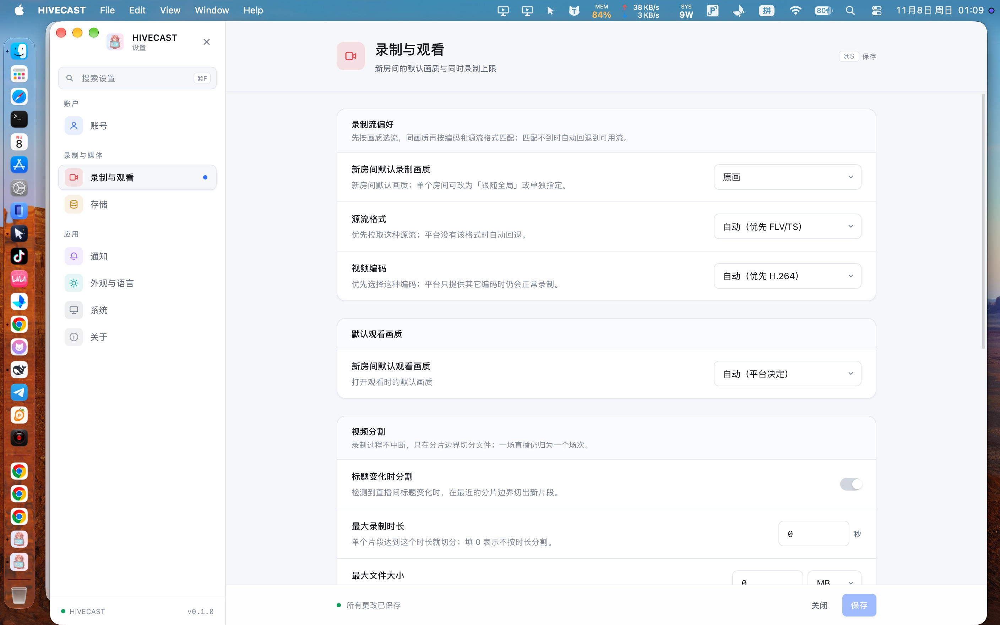

# 74 录制流偏好与视频分割

> 状态：v1.2（2026-11-08）。对应设置页「录制与观看」里的全局录制流偏好、视频分割与世界模型调整。

## 1. 目标与已确认的取舍

| 需求 | 实现取舍 |
| --- | --- |
| 画质偏好：默认最高，可选指定档位 | 全局默认「最高可用」，单个房间可「跟随全局」或单独指定 |
| 源流格式：FLV / HLS / TS 自动选优 | 只影响**拉流源格式**，不改变输出容器；录制仍统一进 MP4/TS 后处理 |
| 编码偏好：H.264 / H.265 | 同画质下优先指定编码；平台没有时自动回退 |
| 标题变化分割 | 录制期间每 5 秒查一次标题，只记变化时刻，不打断 ffmpeg |
| 时长分割 / 大小分割 | 0 表示不限；边界落在已有分片边界上，不制造 1–5 秒空窗 |
| 分割后的媒体库 | 一场直播一个场次，卡片下挂多个片段，不拆成多个独立场次 |
| 冲突优先级 | 画质 > 编码 > 格式 |

关键原则：**录制过程始终是一条连续 ffmpeg**；分割发生在收尾阶段，按分片范围合成多个文件，所以不会像「停旧起新」那样丢画面。

## 2. 设置项与默认值

设置页「录制与观看」新增两张卡片，不新增左侧分类：

- 录制流偏好：新房间默认录制画质、源流格式、视频编码。
- 视频分割：标题变化时分割、最大录制时长（秒）、最大文件大小（MB/GB）。

| 字段 | 默认 | 取值 |
| --- | --- | --- |
| `default_record_qn` | `40000` | `0` 跟随平台 / `40000` 最高可用 / 80/150/250/400/10000 等档位 |
| `record_source_format` | `auto` | `auto` / `flv` / `hls` / `ts` |
| `record_codec` | `auto` | `auto` / `h264` / `h265` |
| `split_on_title` | `false` | 布尔 |
| `split_max_duration_sec` | `0` | `0` 不限；否则夹到 60 秒–24 小时 |
| `split_max_size_mb` | `0` | `0` 不限；否则夹到 64 MiB–1 TiB；界面按 1024 进制换算 MB/GB |

兼容策略：

- 老配置的 `record.default_qn` 原样保留，不强行改成 `40000`。
- 老房间的 `record_qn` 原样保留；新建房间写 `0`，表示跟随全局。
- 单个房间仍可在监控页覆盖画质；把房间值改成 0 即恢复「跟随全局」。
- `settings::effective_record_qn(global, room)` 负责合并：房间 0 用全局，否则用房间值。

## 3. 选流：画质 > 编码 > 格式

入口在 `src-tauri/src/recorder.rs` 的 `StreamPrefs` 与 `pick_candidate`。

1. **画质**：候选 qn 优先取平台 `attrs.qn`；缺失时按高度映射到统一档位（`>=2160→40000`、`>=1440→10000`、`>=1080→250`、`>=720→150`、其余 `80`，见 `qn_from_height`），不再用 `height * 10`，避免 1080p 被当成 10800 而误判超档。目标为 0 或 `>=40000` 时直接按 qn 从高到低；指定档位时优先「不超过目标的最高档」，没有低档才取最接近的高档。
2. **编码**：指定 H.264/H.265 时优先精确匹配；没有时另一种编码作为次选；`auto` 下 H.264 优先，兼容性最好。
3. **格式**：指定格式时优先精确匹配；选择 HLS 时同时接受 HLS 与 HTTP-TS（B 站的 HLS/TS 源流本质都是 MPEG-TS，`map_format` 把 `ts` 映射为 `HttpTs`），`auto` 下 FLV > HTTP-TS > HLS > DASH。
4. **同分**：码率高者优先，最后看平台给的 weight。

线路（CDN 组）先按用户选择的线路取组内最优；该线路没有可用地址时回退到全局最优，避免「手动选到挂掉的线路」直接开录失败。

平台映射：

| 平台 | 40000 的处理 |
| --- | --- |
| 哔哩哔哩 | 直接把 `qn=40000` 发给 playurl，平台按账号能力返回 `current_qn` |
| 斗鱼 | `rate_for_qn` 落到最高档（0） |
| 虎牙 | `target_bitrate` 落到最高档（0） |
| 抖音 | 取最接近 origin 的档位 |

兜底原则：任何偏好匹配失败都只是排序降级，**不会因为偏好不存在而拒绝开录**。

### 3.1 登录态、画质降级与失败处理

选中档位不等于平台一定给该档，尤其 Cookie 失效/未登录时哔哩哔哩会静默按游客档返回：

- 实测无 Cookie 或伪造 `SESSDATA` 时 playurl 仍返回 `code=0`，所有候选 `current_qn=250`，不会 403；有效 Cookie 时房间 6 的 `qn=400` 精确返回 400，`qn=40000` 返回 15000（2K）。
- 开录日志记录 `requested_qn` 与 `actual_qn`；显式档位（0 与 40000 除外）实际低于请求时打 WARN「实际画质低于所选档位，已按可用画质开录」，并发送 `quality_fallback` 通知，**仍然继续录制**，不会因为降档拒绝开录。续录只打 WARN，避免每几秒刷通知。
- 文件名模板里的 `{qn}` 使用实际档位（实际 qn > 0 时），不会把请求的 400 写进游客画质的文件名。
- B 站登录态启动时立即复验，之后每 30 分钟复验一次（`account::REVALIDATE_INTERVAL`）。只有 `code=-101` 这类明确失效才标 `expired`；网络/平台临时错误保留原状态，避免误报。
- 复验只更新 `status/account_name/avatar`，不写回 Cookie；若请求期间用户已重新登录/删除账号，丢弃这次结果，避免旧 Cookie 覆盖新 Cookie。
- 登录态变化（成功或标记过期）后清空取流缓存，避免继续使用旧画质/旧 Cookie 换来的候选地址。
- 续录使用首段实际的编码与源流格式（`respawn_prefs`）：平台仍有同编码/同格式线路时优先保持；只剩不同线路时继续录并 WARN「本场可能混入不同编码的分片」，记录优先于格式一致。
- 斗鱼/虎牙/抖音没有类似 nav 的登录态校验接口，Cookie 失效只能通过取流结果或画质降级间接观察；斗鱼候选不提供 codec、虎牙固定 H.264，选择 H.265 时可能实际仍是 H.264，目前只有 WARN 级别的推断。

## 4. 分割策略

### 4.1 录制阶段

- `SplitPolicy::from_settings` 计算 ffmpeg 的 `-segment_time`：
  - 只按时长：在 60–300 秒里选一个让总时长最贴近上限、且并列时更大的分片长度（400 秒→200，997 秒→111 之类由 `segment_for_duration` 计算）。
  - 同时有标题/大小分割：默认 60 秒；若还设了最大时长，改用 `segment_for_duration_between(limit, 15, 60)`，在 15–60 秒里选最贴近上限的粒度（90 秒→45，100 秒→50），避免 90 秒目标被 60 秒粒度拖到 120 秒。
  - 都没开：沿用历史默认 300 秒。
  - 最终粒度至少 15 秒，避免用户把时长设成 60 秒时被切成 60 个 1 秒分片。
- 标题变化由 `track_title` 每 5 秒检查一次，写入 `title_changes` 时间点，只打 INFO，不重启 ffmpeg。
- 录制文件仍是 `.partNNNN.ts`，进程崩溃时与普通录制共用恢复路径。

### 4.2 收尾阶段

`plan_clips` 只看分片之间的边界，按顺序判断：

1. 标题变化时间点落在当前分片内 → `title`
2. 当前片段按标称分片长度累计达到上限 → `duration`
3. 当前片段累计大小达到上限 → `size`

时长边界不再使用分片 mtime：ffmpeg 关闭分片文件有延迟，mtime 常比真实结束早 5–6 秒，按它判断会把 60 秒目标拖成 120 秒。现在用 `分片数 × segment_secs` 推进，`ended_at` 也写标称边界。

标题边界仍用 mtime 匹配，但判断上界取 `max(mtime, 标称结束)`（`title_end`）：标题在分片最后几秒变化时，mtime 偏早会把变化推到下一片；取标称结束可以把它留在本片。实测开录后 56.5 秒的标题变化能在 60 秒分片处切开，而不是拖到 120 秒。最后几秒的标题变化若在收尾前还没被 5 秒轮询看到，仍会错过，属于已知限制。

新片段的 `split_reason` 记录**为什么从这里切开**；第一段没有原因。文件命名：首段沿用原文件名，后续为 `原文件名.clipNN.mp4`，通过 `reserve_unique_path` 原子占位避免撞名。

分割边界决定后，每段用 `finish_range` 合成：`-c copy` 合并该范围分片，失败退化为字节拼接 `.ts`；不会重新编码。大小上限按分片粒度累计，因此单段最多比目标多一个分片的体积；时长上限同理最多多一个分片长度。

## 5. 崩溃恢复：SplitManifest

收尾开始前写 `原文件名.split.json`；即使只有一段也写，单段收尾失败（磁盘满、合并与拼接都失败）时保留清单和分片现场，交给下次启动重试。正常成功后删除清单，不留下日常残留。

- 记录每段的计划输出、实际路径、分片范围、原因、起止时间、remux 开关、状态/错误。
- 每完成一段更新 `rendered` 和 `path`，再写回清单（先写 `.split.tmp` 再 rename）。
- DB 的 `record_session.split_manifest` 登记清单路径；全部片段写库后标记 `completed`、删清单、清登记。

启动时 `recover_parts` 先处理带清单的会话：

- 已渲染且产物存在 → 直接复用，不重复合并。
- `finish_range` / `finish_file` 的兜底拼接失败时不再把分片总字节当成成品大小，而是返回 0 并保留分片/清单，恢复时可以重试；`fallback_concat_range` 失败或产物为空会删掉半截 `.ts`，不会留下伪成品。
- 计划输出（或 `.ts` 兜底产物）非空 → 即使范围分片还在也优先沿用成品，并清掉这些分片；合并先写 staging 再 rename，成品出现时一定是完整的。
- 某个片段既没有成品也没有分片 → 记录失败并继续处理后面的片段，不整体退出。
- 其余情况按范围重跑 `finish_range`，逐段补 DB 行；任一段 DB 写入失败都保留清单。
- 首段使用原 session id，后续片段使用清单里预生成的 id，避免恢复时重复插入；首段行不存在时用 `create_clip` 补建。

只有「所有片段都恢复成功且 DB 全部写入」才标记 `completed`、删清单、清登记。这样「合并完成但清单未更新」或「某段写库失败」都不会把整场录像卡死。

## 6. 数据模型与媒体库

`record_session` 新增：

- `group_id`：同一场直播的所有片段共享首段 session id。
- `clip_index`：0 开始。
- `split_reason`：`title` / `duration` / `size`，首段为空。
- `split_manifest`：收尾中的清单路径，完成后清空。

聚合规则：

- 媒体库卡片按 `COALESCE(group_id, id)` 聚合；一场直播一张卡。
- 卡片显示总时长、总体积、总弹幕数、片段数；片段按钮直接播放对应片段。
- 分页仍按片段返回，卡片上「+N」通过 `media_group_clips` 补齐整组。
- 删除整组用 `media_delete_group`：组内任一片段还在录制就拒绝；否则逐段停本地播放、删文件/弹幕/缩略图/DB 行。选择「同时删除文件」时还会清理 `.ass`/`.jsonl`/`.split.json`/`.ffmpeg.pid`/`clip.partNNNN.ts`/`.merging.*` 等伴随文件；只删记录时保留这些现场。
- 单片段删除只允许用于单片段场次；多片段场次必须整场删除，避免留下悬空 `group_id`。
- 主播墙的录像数改为 `COUNT(DISTINCT COALESCE(group_id, id))`，按「场」计数；平台计数与媒体库总数仍按片段计数。

## 7. 改动文件

| 文件 | 内容 |
| --- | --- |
| `src-tauri/ipc-types/src/lib.rs` | Settings 六个新字段；MediaItem 分组字段 |
| `src-tauri/src/settings.rs` | 读写白名单、默认值、夹取、`effective_record_qn` |
| `src-tauri/src/recorder.rs` | 选流、SplitPolicy、plan_clips、finish_range、manifest、恢复 |
| `src-tauri/src/segment.rs` | 范围分片收集/合并/兜底、下一分片编号 |
| `src-tauri/src/db.rs` | 新列与迁移、create_clip、group_sessions、media_group_items |
| `src-tauri/src/commands.rs` | media_delete_group、media_group_clips 与注册 |
| `src/features/settings/SettingsView.tsx` | 录制流偏好与视频分割卡片、搜索索引 |
| `src/features/media/MediaPage.tsx` | 场次聚合、片段按钮、整组选择/删除、+N 补齐 |
| `src/i18n/zh-CN.json`、`en-US.json` | 新增文案；check:i18n 511 keys |

## 8. 验证

单元测试：

- `stream_choice_prefers_quality_then_codec_then_format`
- `segment_for_duration` 边界用例
- `split_plan_honors_title_duration_and_size_boundaries`
- `split_manifest_round_trips_and_can_be_completed`
- `recovery_finishes_split_manifest_without_overwriting_the_first_clip`
- `recovery_reuses_a_finished_clip_when_its_parts_are_already_gone`
- `quality_fallback_only_when_an_explicit_target_is_missed`
- `height_fallback_uses_quality_tiers_not_raw_height_times_ten`
- `format_preference_distinguishes_ts_from_flv_and_hls`
- `respawn_keeps_the_first_segments_codec_and_format`
- `combined_split_rules_align_the_duration_cap_with_fine_segments`
- `split_plan_uses_nominal_segment_length_for_duration`、`split_plan_honors_title_duration_and_size_boundaries`
- `next_part_index_continues_after_the_highest_remaining_part`
- `settings::tests::save_clamps_and_roundtrips` 覆盖新字段的夹取与读写

平台实测（2026-11-08，哔哩哔哩，房间 6，使用本地 `Cookie.txt`）：

- 请求 `qn=40000`，平台返回 `current_qn=15000`（2K），FLV/H.264 地址可拉流；
- ffmpeg 录制 6 秒，ffprobe：`h264 / 2560x1440 / 60fps`，文件 3,726,366 字节；
- 有效 Cookie、`qn=400`：日志 `requested_qn=400 actual_qn=400`，成品 13,755,459 B，ffprobe `h264/1920x1080/30fps`，没有降档告警；
- 伪造过期 Cookie、`qn=400`：复验标记 `expired` 后开录 `actual_qn=250` 且 WARN 降档，成品 2,503,571 B，录像未中断；
- 无 Cookie、`qn=400`：同样 `actual_qn=250`，按 60 秒切成 5 段（60/60/60/60/16 秒），`group_id` 均为首段，`clip_index` 0–4；
- HLS+HEVC：日志 `quality=超清 · HLS/fMP4 · HEVC`，ffprobe `hevc/1280x720/30fps`，39.07 秒 4,133,889 B；
- TS 源流：日志 `quality=超清 · TS · H.264`，成品 1,913,406 B；
- 标题在开录后 56.5 秒变化：切成 60 秒 + 16 秒两段，第二段 `split_reason=title`；
- 单段正常停止：成品 3,674,947 B，DB `status=aborted`、`duration_ms=17000`，无 `.split.json` 残留。
- 结论：「最高可用」不是硬写 4K/HDR，平台给什么档就用什么档；降档、Cookie 失效都不会导致开录失败或丢已录内容。

构建验证：

- `cargo fmt --check`
- `cargo check --all-targets`（0 警告）
- `cargo test --lib`（230 passed / 15 ignored，总 245）
- `pnpm build`、`pnpm check:i18n`（513 keys）、`pnpm check:docs`（77 files）

## 9. 已知限制

- 分割只能落在分片边界；同时开标题/大小时默认 60 秒分片（有最大时长时 15–60 秒自适应），标题变化最多延迟一个分片才切开；收尾前最后几秒的变化可能因 5 秒轮询错过。
- 标题变化检测每 5 秒查一次本地 DB，而房间标题由监控约 30 秒更新一次，实际边界可能比平台真实改名晚最多约 30 秒。
- 登录态复验只覆盖哔哩哔哩；斗鱼/虎牙/抖音的 Cookie 失效只能通过取流结果间接发现，没有周期校验。
- 编码/格式降级只有日志 WARN，没有系统通知；斗鱼候选无 codec、虎牙固定 H.264，选 H.265 可能实际是 H.264。
- 续录会钉住首段编码/格式；平台只剩不同线路时仍继续录制，单场可能混入不同编码/封装的分片，播放器兼容性需自行承担。
- 大小/时长上限是「至少一个分片粒度」的软上限，单段可能超出目标最多一个分片；64 MiB 目标在高码率下可能产出约 150 MiB 的单段。
- 录制开始后修改画质/格式/编码/分割设置不会影响当前会话，下一次开录才生效；续录沿用首段快照。
- 分割片段是独立文件；弹幕只挂首段，后续片段暂时没有独立弹幕。
- 媒体库平台计数与卡片按场；分页/总数仍按片段，用于保证“加载更多”不漏半组，极端情况下数量口径不同。
- 删除录像只清理已知伴随文件；崩溃残留的 `.split.json` 若对应的成品与分片都被手工删掉，会在下次启动被读取后放弃，不会复活 DB 行，但日志会出现恢复告警。
- 末段 DB `duration_ms` 是墙钟时间，ffmpeg 停止后刷缓冲可能让容器时长多几秒。
- 清单只在 DB 登记成功后才会被启动恢复扫描；写清单与登记之间崩溃的极小窗口仍可能留下孤儿清单。
- 单段也会写清单；若收尾在「清单已写、首段 DB 行已 finish、清单未删」之间崩溃，恢复会走 existing 分支修正文件大小/状态，不会重复插入。
