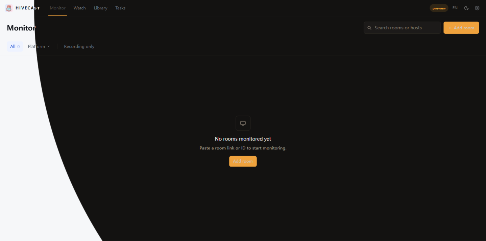
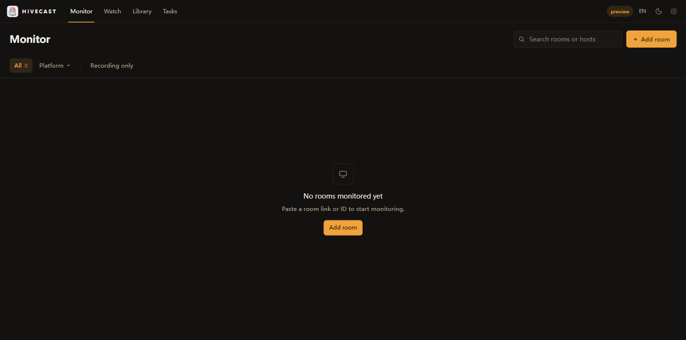

# 86-Arc UI 控件环境

> 状态：环境就绪（2026-11-08）；首个控件 ThemeSwitch 已替换顶栏明暗按钮（见 §6）。
> 范围：uiarc.dev（Arc）免费组件的安装方式、设计 token 桥接、开发期预览台与验证命令。
> 前置阅读：`40-UIUX-设计方案.md`（现有 token 与组件层）、`49-设置页重做方案.md`。

## 0. 结论速览

- Arc 是 **shadcn 兼容 registry**，不是 npm 组件库：组件源码装进仓库，样式走 **CSS Modules + CSS 变量**，不写 Tailwind 类。
- 已装好 `components.json`（含 `@uiarc` registry）、`@/` 路径别名、`clsx` / `tailwind-merge` / `lucide-react` / `motion` 依赖。
- 已装 `arc-foundation`（`src/components/arc/foundation.css`）与首个示例组件 `theme-switch`（连带 `button`、motion tokens）。
- 新增 `src/styles/arc-bridge.css`，把 Arc 的语义 token 映射到 HIVECAST 的 `--c-*` 面板，并统一控制高度与控件字号。
- 开发期预览台：`pnpm dev` 后访问 `http://localhost:1420/?arc-lab=1`，文件 `src/features/design/ArcLab.tsx`。
- 未做：没有引入 Pro 组件，其余页面与控件仍是原实现。

## 1. 安装与目录

注册表已写入 `components.json`：

```json
{ "registries": { "@uiarc": "https://uiarc.dev/r/{name}.json" } }
```

安装一个免费组件：

```bash
pnpm dlx shadcn@latest add @uiarc/switch
# 等价的完整 URL
pnpm dlx shadcn@latest add https://uiarc.dev/r/switch.json
```

- 文件落在 `src/components/arc/<name>/<name>.tsx` 与同名 `.module.css`；
- 组件按需自动带上依赖项（`arc-motion-tokens`、`button` 等），不重复安装 foundation；
- 导入方式：`import { Switch } from "@/components/arc/switch/switch";`；
- Pro 组件需要 `ARC_PRO_TOKEN`，v1 不引入，也不根据截图重建源码。

## 2. 主题与 token 桥接

Arc 用 `<html data-theme="dark">` 切暗色，**与现有 `applyTheme()` 完全一致**，不需要改主题实现。
强调色可用 `data-accent`（neutral / violet / blue / green / amber / orange / coral / rose），本项目不使用它，统一走桥接。

`src/styles/arc-bridge.css` 做的事：

| Arc token | 映射到 | 说明 |
| --- | --- | --- |
| `--background` / `--surface` / `--surface-muted` | `--c-canvas` / `--c-surface` / `--c-raised` | 页面、卡片、悬浮层 |
| `--foreground` / `--text-secondary` / `--text-muted` | `--c-ink` / `--c-muted` / `--c-faint` | 三级文字 |
| `--border` / `--border-strong` | `--c-line` / `--c-line-strong` | 描边 |
| `--accent` / `--accent-subtle` / `--accent-foreground` | `--c-accent` / `--c-accent-soft` / `--c-accent-ink` | 浅色蓝、深色琥珀自动跟随 |
| `--control-on` / `--control-glyph` / `--control-track` | 强调色 / 强调色前景 / 强描边 | 开关、勾选、单选、滑杆 |
| `--success` / `--warning` / `--danger` | `--c-ok` / `--c-warn` / `--c-rec` | 状态色 |
| `--radius-control` / `--radius-panel` / `--radius-surface` | 6 / 10 / 8px | 对齐 `rounded-ctl` / `rounded-panel` / `rounded-card` |
| `--control-height-*` | 28 / 32 / 36px | 对齐现有 `h-7` / `h-8` / `h-9` |
| `--text-xs` / `--text-sm` / `--text-base` | 11 / 12 / 13px | 对齐桌面端紧凑字号 |

导入顺序固定在 `src/main.tsx`：`foundation.css` → `styles/index.css` → `styles/arc-bridge.css`。
桥接文件只放全局语义映射；单个控件的尺寸、间距、字体在迭代该控件时再改，不改 foundation。

## 3. 开发期预览台

`src/features/design/ArcLab.tsx` 是临时控件台，只在开发环境生效：

```tsx
const lab = import.meta.env.DEV && new URLSearchParams(window.location.search).has("arc-lab");
```

- `pnpm dev` → `http://localhost:1420/?arc-lab=1`；
- 当前放 `ThemeSwitch`（reveal / eclipse / iconOnly）与 `Button`（四种 variant、三种 size、loading），用于核对浅色/深色下的 token；
- 迭代新控件时直接加一段预览，验收后再决定是否搬进正式页面；
- 生产构建不会渲染它。

## 4. 已知取舍

- **Button primary 与品牌色**：Arc 原生 `.primary` 用 `--foreground` 当底色（黑白/米白）。已单独新增 `.accent` 变体承载品牌强调色，项目 `Button primary` 映射到 `accent`；Arc 原生 primary 保留在预览台对照，不改桥接层。详见 `94-按钮统一为Arc-Button.md`。
- **组件源码可改但要留痕**：Arc 是 copy-paste 模式，改 `src/components/arc/**` 属于本项目代码；重新执行 `shadcn add --overwrite` 会覆盖，改动前先记录。
- **shadcn CLI 依赖根 `tsconfig.json` 的 paths**：根配置原本只有 references，CLI 解析不到 `@/` 会真的创建 `@/components/...` 目录。已在根 `tsconfig.json` 补 `baseUrl` 与 `paths`，后续安装不会再跑偏。
- **CSS Modules 与 Tailwind 并存**：Arc 组件内部不认 Tailwind 类，外层容器仍然用现有 Tailwind；不要在 Arc 组件上叠 `className` 期望改内部样式。
- **Windows 字体**：foundation 的 display/body 字体已指向 `--font-sans`，不会去加载 Geist / Inter Variable。

## 5. 验证

```bash
pnpm exec tsc -b          # 组件源码与类型
pnpm build                # 构建
pnpm run check:i18n       # 621 keys
pnpm run check:docs       # 文档表格 / 链接 / 代码围栏
```

- 浅色/深色实测：`?arc-lab=1` 下 ThemeSwitch 切换 `data-theme`，页面、按钮、卡片、强调色同步。
- 本轮 `tsc -b`、`pnpm build` 通过；`check:i18n` 621 keys、`check:docs` 88 files 通过。

## 6. 首个落地控件：ThemeSwitch（顶栏明暗切换）

- **位置**：`src/App.tsx` 顶栏右侧，替换原来的自绘月亮/太阳 IconButton。
- **用法**：`<ThemeSwitch theme={appearance} iconOnly bare label=… onThemeChange={changeTheme} />`，variant 用默认 `reveal`。
- **无底板**：`bare` 是本项目给 Arc 组件加的适配属性（改在 `src/components/arc/theme-switch/**`）。去掉 secondary 的背景、边框、阴影，命中区 28px、图标 14px，和设置齿轮一致；默认 `text-muted`，hover 才用 `--surface-muted` 浅底。后续 Arc 控件沿用这个原则：先看能不能只留内容，再考虑加表面。
- **状态**：新增 `appearance`（实际生效的明暗），修掉 `theme="system"` 时旧图标判断错误；启动、系统主题变化、设置页保存三处都会同步。
- **过渡**：`changeTheme` 把按钮中心写进 `--x` / `--y`；先让图标 spring 跑完（260ms），320ms 后再调用 `document.startViewTransition` 切 `data-theme`，`::view-transition-new(root)` 用 `circle()` 从按钮扩散 480ms。不支持 View Transition 或 reduced motion 时直接切换。
- **修过的抖动**：View Transition 会把整页冻结成快照。如果图标 spring / nudge 在过渡期间才跑，快照只会拍到初始帧，过渡结束的一瞬间才落到终态，看起来像图标抖一下。现在把图标动画放在扩散之前，`arc-bridge.css` 的 `--duration-spring` 也从 580ms 收到 260ms，快照里的图标已经是终态。
- **持久化**：仍写 `settings.theme`；顶栏只做 light/dark 互换，「跟随系统」留在设置页。
- **无障碍**：`aria-pressed` 由组件维护；`label` 用新增的 `app.themeSwitchDark` / `app.themeSwitchLight`。
- **实测**：浏览器预览（Chromium）点击后 `data-theme=dark`、`aria-pressed=true`，图标从太阳换成月亮；切换中点能看到圆形扩散边界；再点回浅色正常。Tauri 用同一 WebView2 内核，未单独复验。





第二个落地控件是 `DropdownMenu`：13 处选择菜单统一成同一套浮层，详见 `88-DropdownMenu统一选择菜单.md`。

第三个落地控件是 `Switch`：应用内全部二元开关（设置 13、添加房间 2、关闭拦截 1）统一使用 Arc 的 42×24 轨道与弹簧 thumb，`Controls.Switch` 作为适配层保留旧 API；预览台新增开/关/只读/禁用四种形态。详见 `91-开关统一为Arc-Switch.md`。

第四个落地控件是 `Checkbox`：监控行与媒体卡的多选改为 Arc 的 18px 方块 + 32px 命中区，勾线/横杠用同一路径 morph；视频封面使用本地 `tone="overlay"` 半透明深底 + 白描边。详见 `93-复选框统一为Arc-Checkbox.md`。

第五个落地控件是 `Button`：`Controls.Button` / `IconButton` 改为 Arc Button 适配层，覆盖 92 处标准操作按钮；新增 `accent`（品牌色）、`recording`（红色实心）变体与 `icon` 尺寸，`primary` 仍映射品牌强调色。详见 `94-按钮统一为Arc-Button.md`。

第六个落地控件是 `FloatingButtonGroup`：监控行「观看 / 录制」改成 muted/sm 托盘，共享高亮在按钮间按 morph 弹簧滑动，按下加深并缩到 96.5%；本地扩展 item `loading` 与 `tone`，配套接入 Arc `Tooltip` 与 `@radix-ui/react-tooltip`。详见 `95-监控行浮动按钮组.md`。

第七个落地控件是 `ToastStack`：全局 `ToastStackProvider` + 顶部中间唯一 viewport，本地新增 `top-center` 位置（从上方落入、向上收起）；`useNotify` 统一 error/warning/info/success，页面内的临时错误、成功、提示横条全部收口到 toast；ffmpeg 缺失改为持久 warning + 「去设置」action，系统通知事件同时发 OS 通知与 toast。详见 `96-统一顶部Toast提示.md`。
