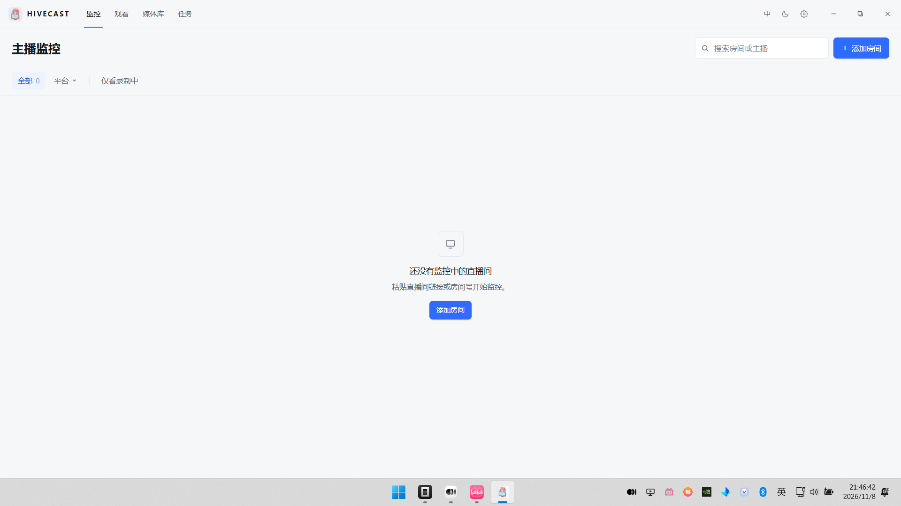

# 87-统一顶栏（Windows 自绘标题栏）

> 状态：v1 已实施，Windows 真机验证（2026-11-08）；macOS 继续用 Overlay 红绿灯，未改。
> 范围：把 Windows 的原生标题栏与应用顶栏合并成一条，右侧自绘最小化 / 最大化 / 还原 / 关闭。
> 前置阅读：`44-图标与托盘.md`、`50-关闭行为与防休眠.md`、`86-Arc-UI控件环境.md`。

## 0. 结论速览

- **问题**：`tauri.conf.json` 的 `titleBarStyle: "Overlay"` 只对 macOS 生效。Windows 上仍是「原生标题栏 + 应用自绘顶栏」两条栏，看起来不像一个整体。
- **做法**：Windows 启动时调用 `set_decorations(false)` 去掉原生边框，顶栏右端自绘三枚窗口按钮；macOS 保持原样。
- **拖拽**：顶栏的 `data-tauri-drag-region` 补上 `core:window:allow-start-dragging` 权限；双击最大化沿用 Tauri 内置的 `internal_toggle_maximize`。
- **关闭**：自绘的关闭按钮调用 `window.close()`，继续走 `CloseRequested` → 隐藏到托盘 / 退出拦截，不另开一条退出路径。
- **不动**：顶栏高度仍是 48px，导航、语言、主题、设置的位置不变；全屏沉浸时顶栏整体隐藏，Esc / F11 退出。

## 1. 代码位置

| 文件 | 改动 |
| --- | --- |
| `src-tauri/src/lib.rs` | Windows 下 `window.set_decorations(false)`，在托盘图标同步之前执行 |
| `src-tauri/capabilities/default.json` | 新增 `allow-start-dragging`、`allow-start-resize-dragging`、`allow-minimize`、`allow-toggle-maximize`、`allow-close` |
| `src/components/WindowControls.tsx` | 新增：最小化 / 最大化 / 还原 / 关闭，46×48，关闭悬停红底 |
| `src/components/ResizeHandles.tsx` | 新增：四边 + 右下角缩放热区，调用 `startResizeDragging` |
| `src/lib/useMaximized.ts` | 新增：`isMaximized` + `onResized` 的共享 hook，窗口按钮与缩放热区共用 |
| `src/App.tsx` | 顶栏右侧接入控件、根节点接入缩放热区；`isWin` 同时要求 `isTauri()`，浏览器预览不渲染；Windows 下顶栏右内边距为 0 |
| `src/i18n/zh-CN.json`、`en-US.json` | `app.windowMinimize` / `windowMaximize` / `windowRestore` / `windowClose` |

细节：

- 最大化状态用 `win.isMaximized()` 初始化，并监听 `onResized` 同步图标（最大化显示「还原」双框，还原显示单框）。
- 三个按钮都在拖拽区之外：`data-tauri-drag-region` 只标在 `<header>` 与 logo/标题上，按钮是普通 `<button>`，点击不会拖动窗口。
- 分隔线用 `border-l border-line`，关闭按钮悬停 `bg-rec`，和现有录制红一致。
- **缩放热区是必需的**：tao 0.37 在「无边框 + 阴影」下 `WM_NCHITTEST` 只处理上边缘，左右下三边不会自动缩放。热区为 5px，右侧从顶栏下方开始，避免盖住关闭按钮；最大化时整组隐藏。

## 2. 行为矩阵

| 场景 | Windows | macOS |
| --- | --- | --- |
| 窗口边框 | 无原生标题栏，单条顶栏 | Overlay 标题栏 + 原生红绿灯 |
| 拖拽 | 顶栏空白处可拖（真实位移验证通过） | 同左，沿用原实现 |
| 边缘缩放 | 上边缘 tao 原生；左右下与右下角由 5px 自绘热区调用 `startResizeDragging` | 系统原生 |
| 双击顶栏 | 最大化 / 还原（Tauri 内置） | 缩放（系统行为） |
| 最小化 | 顶栏按钮 → `IsIconic=true` | 红绿灯 |
| 最大化 / 还原 | 顶栏按钮，图标随状态切换 | 红绿灯 |
| 关闭 | `window.close()` → 隐藏托盘 / 退出拦截 | 红绿灯，同一套拦截 |
| 全屏沉浸 | 顶栏隐藏，Esc / F11 退出 | 同左 |
| 浏览器预览 | 不渲染窗口按钮，右内边距恢复 12px | 同左 |

## 3. 验证记录

- Windows 11 真机 `pnpm tauri dev`：窗口只剩一条 48px 顶栏，右侧三枚按钮与分隔线位置正常。
- 拖拽：在顶栏空白处按下并移动，窗口位置从 `(224, 0)` 变到 `(85, 42)`，位移 `(-139, +42)`，没有 `start_dragging not allowed` 日志。
- 最小化：点击后 `IsIconic=true`；`ShowWindow(SW_RESTORE)` 后恢复。
- 最大化：点最大化后窗口铺满工作区，按钮图标变为「还原」；再点恢复为 1320×860 的窗口，图标变回单框。
- 缩放：在右侧边缘（顶栏下方）向左拖 120px，窗口宽度 1668 → 1548 物理像素，确认热区生效；未加 `startResizeDragging` 前同一手势宽度不变。

- `pnpm exec tsc -b`、`pnpm build`、`cargo check --all-targets`、`cargo fmt --check` 通过；`check:i18n` 619 keys、`check:docs` 88 files。
- 未在 macOS 真机复验（本轮未改 macOS 分支）。

## 4. 已知限制

- **没有 Windows 11 原生 Snap Layouts**：悬停最大化按钮不会弹出分屏菜单，因为按钮是自绘的。
- **没有原生圆角与 DWM 阴影**：`decorations: false` 后由系统决定，当前看到的是直角；需要的话后续用 `DwmSetWindowAttribute(DWMWA_WINDOW_CORNER_PREFERENCE)` 补。
- **边缘缩放由自绘热区接管**：5px 热区覆盖窗口最外圈；右侧热区从顶栏下方开始，所以顶栏右端的关闭按钮不会被抢点击。若后续把热区调宽，需要同时检查滚动条与关闭按钮的命中。
- **关闭不是直接退出**：与原来标题栏 X 一样，先进入隐藏托盘 / 任务拦截流程；这是刻意保留的行为。
- **顶栏仍是 48px**：没有照搬参考图更高的工作台头部；导航、搜索等布局留到后续迭代。
