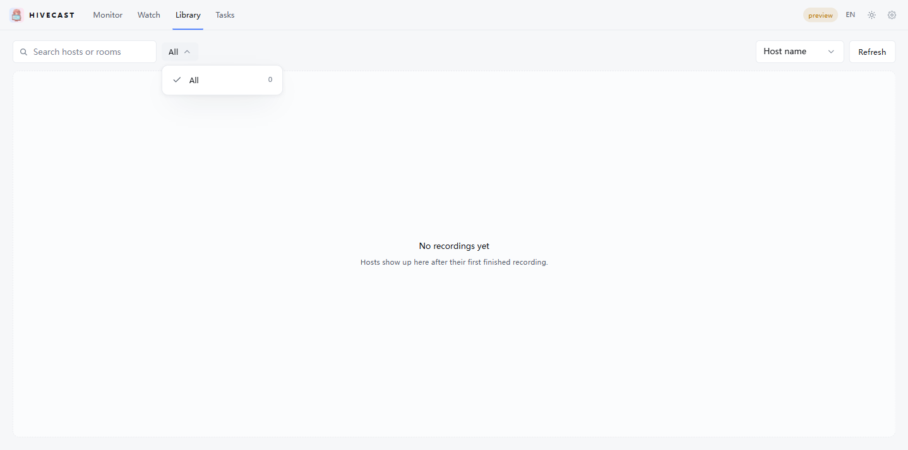
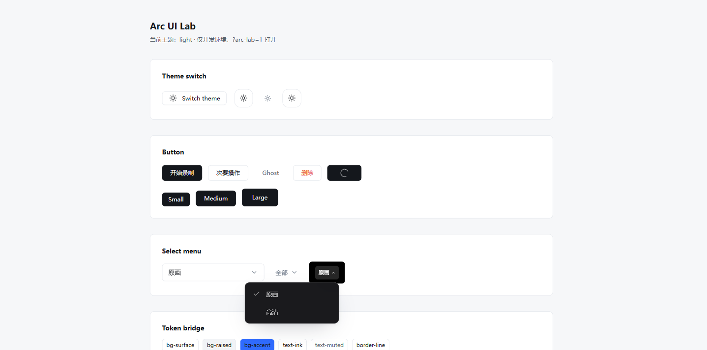

# 88-DropdownMenu 统一选择菜单

> 状态：v1 已实施（2026-11-08）；浏览器预览验收媒体页与控件台，设置/监控/播放器需真机补点。
> 范围：把「点击后展开、选中一个值」的菜单全部换成 Arc `DropdownMenu`；动作菜单不在此列。
> 前置阅读：`86-Arc-UI控件环境.md`、`40-UIUX-设计方案.md`。

## 0. 结论速览

- 共替换 **13 处选择菜单**：监控 3、媒体 3、设置 6、播放器 1。
- Arc 原组件只有 `label + items`；本次在本地副本上补了 `variant`（default / bare / dark）、`size`、`align`、`side`、`disabled`、`active`、`ariaLabel`，以及 item 的 `key`、`hint`。
- 新增 `src/components/ui/SelectMenu.tsx`：把「当前值 + 选项」收口成带勾选、可带计数 hint 的选择菜单，页面只传值/选项/onChange。
- 默认无底板原则继续生效：工具栏过滤器用 `bare`（无边框、无背景、仅 hover 浅底），设置字段用 `default`（36px、208px 宽，跟原 `select` 对齐），播放器用 `dark`（黑色浮层 + 白字）。
- 未替换：监控行尾 `⋯` 动作菜单、观看格 `⋯` 动作菜单（命令而不是选择，且触发器是图标，Arc 触发器要求文字 label）。

## 1. 替换清单

| # | 位置 | 原实现 | 现在 | 变体 |
| --- | --- | --- | --- | --- |
| 1 | 监控 · 平台筛选 | 自绘按钮 + 浮层 | `SelectMenu`（勾选 + 计数 hint） | bare |
| 2 | 监控 · 详情 · 画质 | 原生 `Select` | `SelectMenu` | default md |
| 3 | 监控 · 详情 · 线路 | 原生 `Select` | `SelectMenu` | default md |
| 4 | 媒体 · 平台筛选 | 自绘按钮 + 浮层（带计数） | `SelectMenu` | bare |
| 5 | 媒体 · 主播墙排序 | 原生 `Select` | `SelectMenu` | default md |
| 6 | 媒体 · 主播页录像排序 | 原生 `Select` | `SelectMenu` | default md |
| 7 | 设置 · 默认录制画质 | 原生 `select` | `SelectMenu` | default md |
| 8 | 设置 · 源流格式 | 原生 `select` | `SelectMenu` | default md |
| 9 | 设置 · 录制编码 | 原生 `select` | `SelectMenu` | default md |
| 10 | 设置 · 默认观看画质 | 原生 `select` | `SelectMenu` | default md |
| 11 | 设置 · 分割大小单位 MB/GB | 原生 `select` | `SelectMenu` | default md |
| 12 | 设置 · 转封装格式 MP4/MKV/TS | 原生 `select` | `SelectMenu` | default md |
| 13 | 观看 · 播放器画质/线路 | 自绘深色浮层（线路胶囊 + 画质列表） | `DropdownMenu`（线路项 + 画质项 + 自动档，勾选） | dark |

顺带删除：`src/components/ui/Controls.tsx` 的原生 `Select` 导出（已无引用）、`SettingsView` 的 `CHEVRON` 常量、监控/媒体两处 `platformOpen` 状态与自绘浮层。

## 2. 组件适配

`src/components/arc/dropdown-menu/dropdown-menu.tsx` + `.module.css` 的本地改动：

| 能力 | 说明 |
| --- | --- |
| `variant="default"` | Arc 原始带边框表面，字号/高度走 token；设置字段用 |
| `variant="bare"` | 透明底、无边框、无阴影，30px 高、12.5px 字；`active` 时文字用 `accent-text`；hover 才有 `surface-muted` |
| `variant="dark"` | 播放器专用：透明触发器 + 白色文字；菜单 `rgba(17,17,20,.96)`、白字、白 10% 分隔线，chevron 缩到 9px |
| `size="md"` | 36px 高、13px 字，用于设置字段 |
| `align` / `side` | 左对齐过滤器传 `align="start"`；其余默认 `end` / `bottom` |
| `disabled` / `active` | 过滤器无选项时禁用；有筛选值时 `active` 用强调色 |
| `ariaLabel` | `SelectMenu` 会拼成「排序：最新」这类可读名称 |
| `morphLabel` | 关闭触发器宽度的弹簧变形。Arc 默认让宽度从旧文案弹簧到新文案，长文案在 `overflow-x: clip` 里会被逐字裁开，看起来像在打印；选择菜单统一关闭，只保留文字淡入 |
| 最小宽度 | `.trigger` 增加 `min-width: 0`；监控画质/线路额外用 `min-w-0 flex-1`。超长线路名在抽屉里按省略号截断，不再把容器撑开 |
| item `hint` | 右侧次要信息（平台计数），`margin-left:auto` |
| item `key` | 允许选项 label 重复（例如线路和画质都有「自动」） |

`src/components/ui/SelectMenu.tsx`：

- 输入 `value` / `options` / `onChange` / `placeholder`；
- 选中项渲染 `Check` 图标，未选中项留同宽空位，标签不会左右跳；
- `hint` 原样透传；其余 `DropdownMenu` 属性（variant/size/align/disabled/active/ariaLabel/className）全部透传。

## 3. 验证

- `pnpm exec tsc -b`、`pnpm build` 通过；`check:i18n` 621 keys、`check:docs` 88 files；`cargo fmt --check` 通过。
- 浏览器预览实测：
  - 媒体页平台筛选：bare 触发器无底板，菜单显示勾选 + 计数，点击可关闭；
  - 媒体页排序：4 个选项、首项勾选、触发器宽度 140px；
  - `?arc-lab=1`：default / bare / dark 三种触发器与菜单均正常，dark 菜单背景 `rgba(17,17,20,0.96)`、白字。

- 未实测（浏览器预览无 IPC 数据）：
  - 设置页 6 个选择菜单：浏览器里设置页停在 `Loading…`，无法点开；组件与 lab 用的是同一个 `SelectMenu`，需真机补点；
  - 监控详情画质/线路：需要至少一个房间，真机补点；
  - 播放器画质/线路：需要直播中的观看槽，真机补点。
- 长文案专项：在 lab 里选中「蓝光 1080P 60帧 高码率（大会员）」后，标签宽度从 32ms 起就恒定为 159.4px，不再随旧文案弹簧增长；208px 字段里超长部分按 ellipsis 截断，文字整体淡入，没有逐字打印。
- 超长线路专项：在 360px 宽、左侧 62px 标签的 flex 行里放「d1--cn-gotcha209.bilivideo.com · 超清 · HLS/fMP4 · 60帧」，字段宽度 290px、行的 `scrollWidth = clientWidth = 360`，长文案省略号截断，没有横向溢出。

## 4. 未替换与原因

| 位置 | 原因 |
| --- | --- |
| 监控表格行尾 `⋯` 菜单 | 已统一：给 Arc DropdownMenu 补 `iconOnly` 与 `keepOpen`，详见 `98-监控行菜单统一为Arc-DropdownMenu.md` |
| 观看格 `⋯` 菜单 | 同上（铺满/换位/移除），且是视频上的深色浮层 |
| 添加房间、放弃修改、关闭拦截弹窗 | 模态框，不是下拉选择 |
| 主题切换 | 已在 `docs/86` 换成 Arc `ThemeSwitch` |
| 中/EN 语言按钮 | 单击直接切换，不展开 |
| 设置里的主题/语言分段控件 | 选项全部平铺，不需要展开 |

监控行尾 `⋯` 动作菜单已补「图标触发器」模式并统一成 Arc；观看格上的深色 `⋯` 动作菜单仍保持自绘，等待后续单独接 `variant="dark"` + `iconOnly`。

## 5. 已知取舍

- **线路 hint 丢失**：原播放器线路胶囊的 `title` 提示没有进菜单 label；线路名本身通常够用。
- **设置页宽度**：Arc 触发器按文字宽度弹簧变化，设置字段外面固定 `w-[208px]` + `justify-between`，和原 `select` 的视觉占位一致。
- **菜单最小宽度 12rem**：比原来的 168px 稍宽，平台计数和长选项更宽松。
- **观看格动作菜单仍是自绘**：监控行已统一；观看格因为嵌在视频深色浮层里，需要复用 `variant="dark"` 并补 `iconOnly` 后再迁移。
