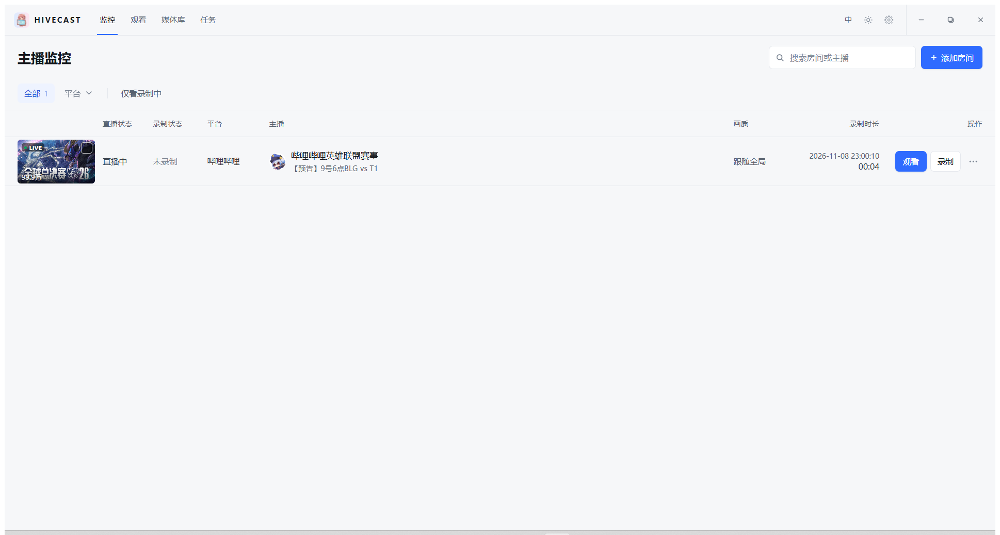

# 89-桌面壳守卫

> 状态：v1 已实施，Windows 真机验证（2026-11-08）。
> 范围：去掉 WebView2 的浏览器默认行为：右键菜单、调试快捷键、刷新/打印/查看源码、页面缩放、键盘焦点框。
> 前置阅读：`40-UIUX-设计方案.md`、`87-统一顶栏.md`。

## 0. 结论速览

- 右键不再弹出 WebView2 菜单（返回/刷新/另存为/打印/检查）。
- 桌面端不再显示 `:focus-visible` 的蓝色焦点框；输入框仍用边框颜色提示焦点。
- F12 / Ctrl+Shift+I/J/C、Ctrl+R / F5、Ctrl+P、Ctrl+U、Ctrl+±0 与 Ctrl+滚轮缩放全部拦截。
- 实现只有前端：`src/lib/desktopShell.ts` 在 Tauri 环境安装守卫，CSS 用 `html[data-desktop]` 收掉焦点框。
- 浏览器预览保持原样，开发时仍可用浏览器的右键与 DevTools。

## 1. 实现

`src/main.tsx` 在渲染前调用：

```ts
installDesktopShellGuards();
```

`src/lib/desktopShell.ts`：

| 行为 | 处理 |
| --- | --- |
| 右键菜单 | 捕获阶段 `contextmenu` → `preventDefault()` |
| DevTools | F12、Ctrl/Cmd+Shift+I/J/C |
| 刷新 | Ctrl/Cmd+R、F5 |
| 打印 / 查看源码 | Ctrl/Cmd+P、Ctrl/Cmd+U |
| 页面缩放 | Ctrl/Cmd+加号/减号/0、Ctrl/Cmd+滚轮（`passive: false`） |
| 环境标记 | `document.documentElement.dataset.desktop = ""` |

`src/styles/index.css`：

```css
html[data-desktop] {
  --focus-outline: transparent;
}
html[data-desktop] :focus-visible {
  outline: none !important;
}
```

- `--focus-outline: transparent` 覆盖 Arc foundation 的统一焦点外框；
- `outline: none` 覆盖应用自己的 `.focus-ring` 和 WebView 默认外框；
- 输入框的焦点提示仍来自原有规则：`outline: none` + `border-color: var(--c-line-strong)`，不影响键入。

## 2. 验证

- 右键页面：无任何菜单弹出。
- Tab 到行尾 `⋯` 按钮：没有蓝色焦点框；截图里残留的黑框是按钮 `title` 的 WebView 原生 tooltip，不是焦点框。
- 焦点移到输入框：边框变成 `line-strong`，仍能看出焦点。
- `pnpm exec tsc -b`、`pnpm build` 通过；`check:i18n` 621 keys、`check:docs` 90 files。



## 3. 已知限制

- **title tooltip 仍是 WebView 原生样式**：图标按钮的 `title` 在 hover/键盘聚焦时会出现系统 tooltip；要统一成应用内浮层需要另做 Tooltip 组件。
- **DevTools 的 release 行为依赖 Tauri**：发布构建默认不启用 devtools；开发态由前端快捷键拦截。若后续发现 WebView2 在宿主层仍响应某个快捷键，再补 `AreBrowserAcceleratorKeysEnabled` 等原生设置。
- **焦点框全部移除是产品决定**：键盘用户不再看到按钮焦点位置；输入框仍有边框提示。若以后要恢复可访问性，可只对 `:focus-visible` 恢复一个低对比 outline。
- **右键粘贴**：输入框右键菜单一并屏蔽，粘贴走 Ctrl/Cmd+V。
