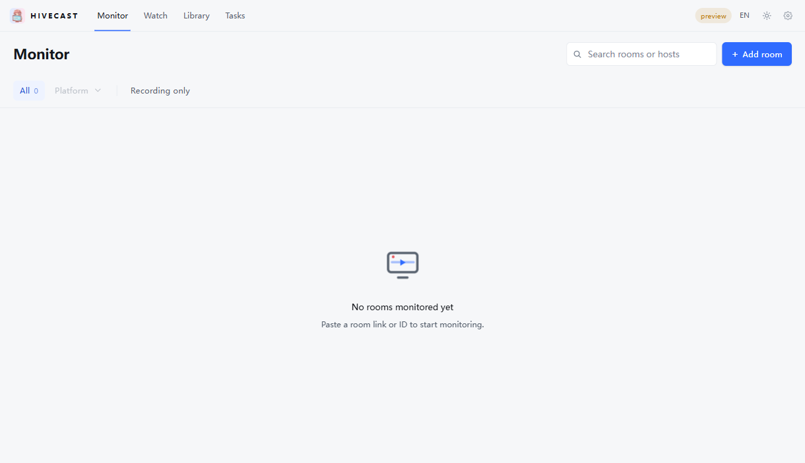
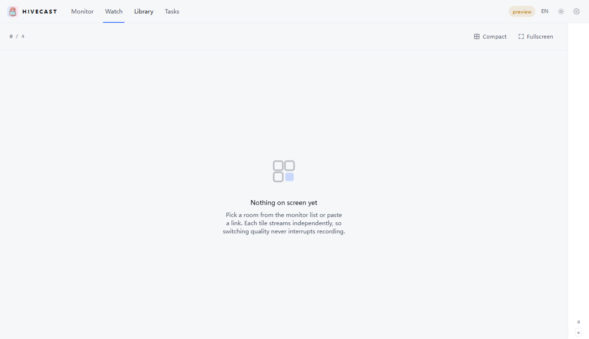
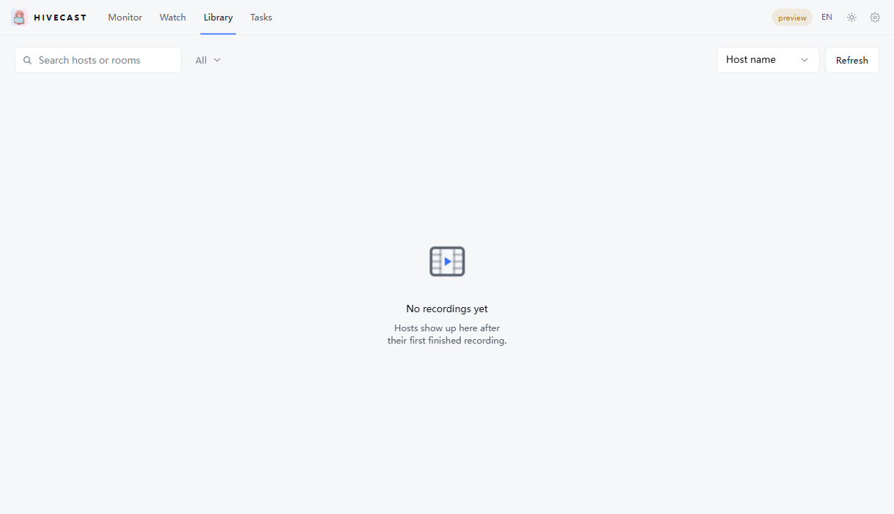
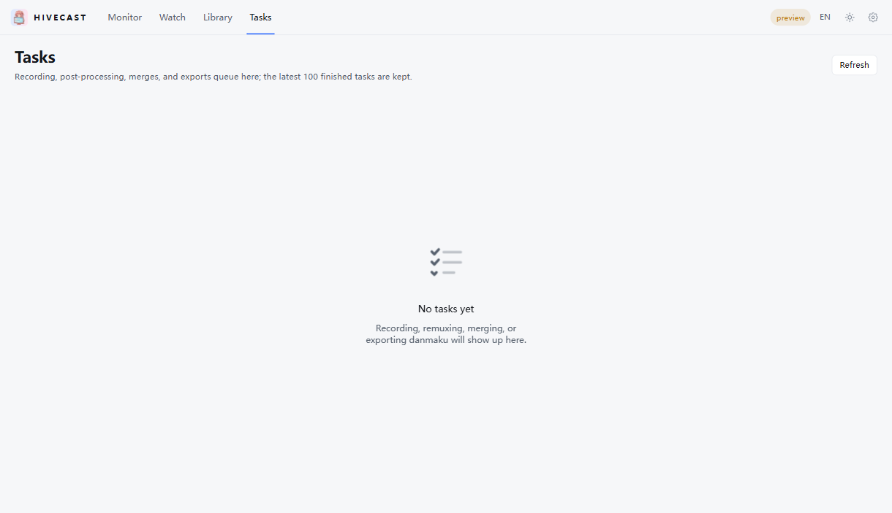

# 90-空态与 Tab 切换

> 状态：v1 已实施（2026-11-08）；浏览器预览完成视觉验收，Tauri 独占的「添加直播间」按钮待真机点。
> 范围：四个主 Tab 的空态换成 Arc `EmptyState` + 每页定制动画插画；顶部 Tab 切换改为纯淡入，下划线用共享布局滑动。
> 前置阅读：`40-UIUX-设计方案.md`、`86-Arc-UI控件环境.md`、`88-DropdownMenu统一选择菜单.md`。

## 0. 结论速览

- 参考 `uiarc.dev/components/blocks/empty-states` 的版式与动效，但按 Arc 文档建议**不引入整块四场景画廊**，改用它的 `empty-state` 组件：顶部 72px 透明图标区（56px 插画）+ 标题 + 说明 + 可选操作，图标不再带底板。
- 插画由本地 `EmptyArt` 绘制：24px 线性图标，内部用呼吸、扫描线、画勾等轻动画；监控、观看、媒体、任务各有一套，不再共用同一个通用图标。
- 覆盖 8 个空态：监控无房间/无匹配、媒体主播墙空/主播页空/主播消失/录像无匹配、观看无画面、任务全空。
- Tab 切换：页面内容 160ms 纯淡入（不做位移，避免切换时抖动）；顶部下划线用 `layoutId` 弹簧跟随。
- 减少动态效果时：页面切换时长归零，插画动画关闭，下划线直接到位。

## 1. 空态清单

| 位置 | 图标 | 标题 / 说明 |
| --- | --- | --- |
| 监控 · 无房间 | `EmptyArt monitor`（屏幕 + 扫描线 + 呼吸直播点） | `monitor.emptyTitle` / `emptyBody` |
| 监控 · 筛选无结果 | `EmptyArt search` | `monitor.noMatch` / 新增 `noMatchBody` |
| 媒体 · 主播墙空 | `EmptyArt media`（胶片 + 呼吸播放） | `media.hosts.emptyTitle` / `emptyBody` |
| 媒体 · 主播页无录像 | `EmptyArt media` | `media.emptyTitle` / `emptyBody` |
| 媒体 · 主播已消失 | `EmptyArt gone`（胶片划斜线） | `media.hosts.goneTitle` / `goneBody` |
| 媒体 · 录像筛选无结果 | `EmptyArt search` | `media.noMatchTitle` / `noMatchBody` |
| 观看 · 无画面 | `EmptyArt watch`（2×2 网格 + 呼吸格） | `watch.emptyTitle` / `emptyBody` |
| 任务 · 全空 | `EmptyArt tasks`（逐条画勾） | 新增 `tasks.emptyTitle` / `emptyBody` |

- **空态不再放操作按钮**：图标下方只有标题和说明；添加房间、刷新、返回等操作保留在页面工具栏或原位置，避免空态里重复出现同一个按钮。
- 任务页只有「运行中 + 历史」都为空时才换成整页空态；只有一段为空时仍保留原来的分区小提示。
- 所有空态都包一层 `PageEmpty`（`flex items-center justify-center`）：监控/观看/任务用 `h-full`，媒体用 `flex-1`，保证图标、文案在剩余空间里垂直居中。
- 图标不再使用 Arc 的底板：72px 透明区域里直接放 56px 插画，靠尺寸和动画成为视觉锚点，同时与页面融为一体。
- 任务页空态能真正为空：启动时的「恢复上次录制」维护任务改为 silent job（只进运行表、不写 `task_history`），空库启动时任务历史保持 0 条。

## 2. Tab 切换

`src/App.tsx`：

- 内容用 `<motion.main key={tab} initial={{ opacity: 0 }} animate={{ opacity: 1 }} transition={{ duration: 0.16 }}>`；
- 切 Tab 时旧页立即卸载、新页淡入，**不做水平/垂直位移**，也不使用 `mode="wait"` 的空白间隔，避免页面内容切换时抖动；
- `prefers-reduced-motion` 时时长为 0；
- 顶部下划线从每个激活按钮里的 `` 换成 `<motion.span layoutId="tab-underline">`，Tab 切换时用 `spring(stiffness 420, damping 36)` 滑到新位置；
- 页面仍然在切换时卸载（观看页离开停流的既有行为不变）。

## 3. 验证

- 浏览器预览四个 Tab 空态截图：监控、观看、媒体、任务都只有图标 + 标题 + 说明，并在各自剩余空间里垂直居中；媒体页的长说明不会再顶到工具栏下方。
- 插画动画：监控的直播点/扫描线、观看的呼吸格、媒体的播放三角、任务的逐条画勾都只动 `transform`/`opacity`，不参与布局。
- Tab 切换：纯淡入，没有位移或空白间隔，下划线滑到目标 Tab 后稳定。
- 任务历史：清空后重启，`task_history` 保持 0 条，「恢复上次录制」不再写历史。
- `pnpm exec tsc -b`、`pnpm build` 通过；`check:i18n` 624 keys、`check:docs` 91 files。

## 4. 已知限制

- **任务分区空态**：只清空「运行中」或「历史」时，保留原来的紧凑提示，不换成整页空态，避免一页出现两个大图标。
- **设置页搜索无结果**仍是原来的两行文本，不在本次四个主 Tab 范围内。
- **图标已去底板**：56px 插画直接放在 72px 透明区域里，不再有 `surface-muted` 圆角块；如果还想更大，可以继续调 `.icon svg` 尺寸。
- **页面切换会卸载旧页**：和原来一致，筛选/滚动等局部状态不跨 Tab 保留。
