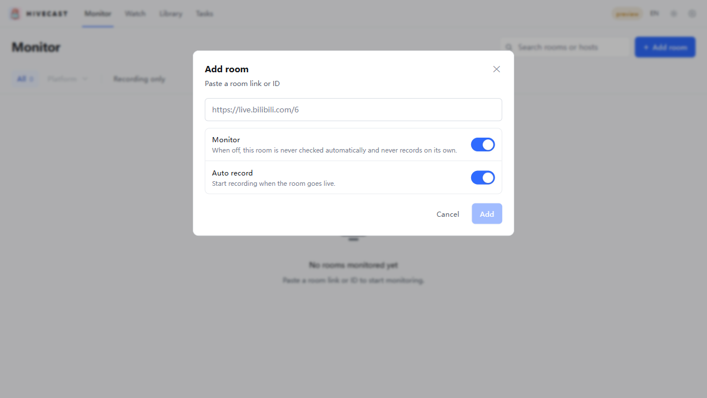
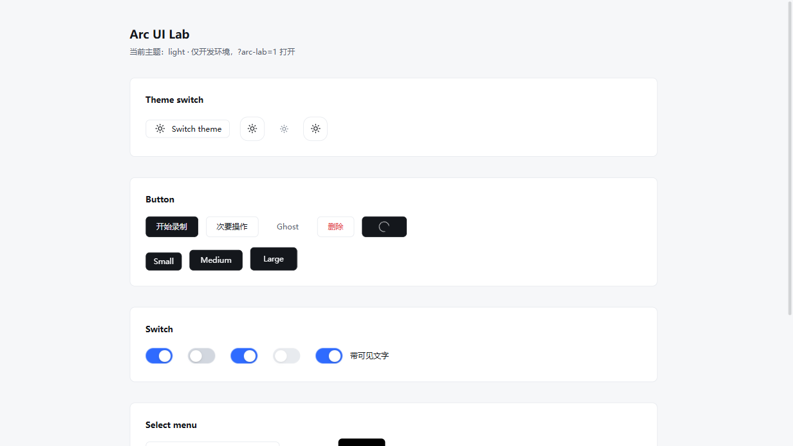
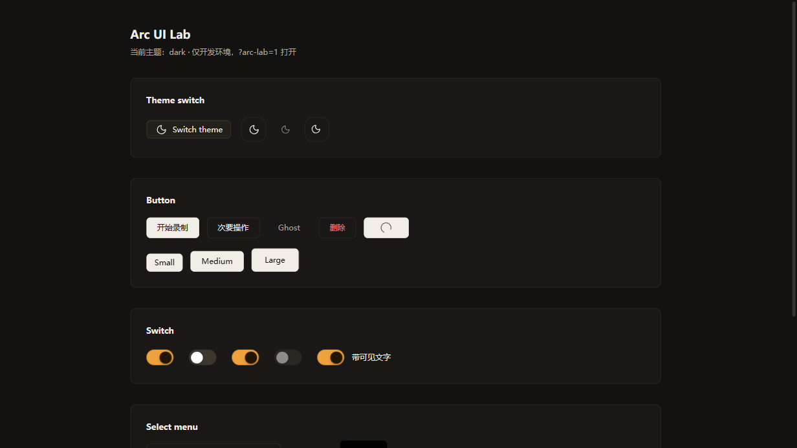

# 91-开关统一为 Arc Switch

> 状态：v1 已实施（2026-11-08）；浏览器预览完成视觉与结构验收，Tauri 真机待点。
> 范围：应用内所有二元开关统一使用 Arc（uiarc.dev）的 `Switch`，替换原来的自绘 30×18 轨道。
> 前置阅读：`86-Arc-UI控件环境.md`、`88-DropdownMenu统一选择菜单.md`、`90-空态与Tab切换.md`。

## 0. 结论速览

- 新增 `src/components/arc/switch/switch.tsx` 与 `switch.module.css`，源码来自 Arc 免费组件 `@uiarc/switch`，保留它的按下拉伸与弹簧归位动效。
- 新增依赖 `@radix-ui/react-switch`；`motion` 与 `arc-foundation` token 已在 Arc 环境中就绪。
- `src/components/ui/Controls.tsx` 的 `Switch` 改为 Arc Switch 的薄适配层：调用方继续使用 `checked / onChange / label / disabled`，不用改 16 处业务代码。
- 轨道 42×24、thumb 18px，按压缩放 1.16× 并沿轨道拉伸 5px，松开后用临界阻尼弹簧归位；`prefers-reduced-motion` 下取消拉伸与过渡，thumb 直接到位。
- 无障碍仍是 Radix 的 `role="switch"` + `aria-checked`；`label` 作为 `aria-label`，不会在轨道旁重复显示文字。
- `?arc-lab=1` 预览台新增 Switch 段，包含开、关、只读、禁用与带可见文字五种形态。

## 1. 组件与适配层

| 文件 | 作用 |
| --- | --- |
| `src/components/arc/switch/switch.tsx` | Arc Switch 源码：Radix Root + motion thumb，支持受控/非受控、按压拉伸、Space/Enter 键盘操作 |
| `src/components/arc/switch/switch.module.css` | 轨道/thumb 尺寸与状态色，使用 Arc token（`--control-on/track/thumb`） |
| `src/components/ui/Controls.tsx` | 保留原 `Switch` API，内部渲染 `<ArcSwitch checked onCheckedChange aria-label />` |

适配层只做一件事：把旧的 `onChange(next)` 映射到 Arc 的 `onCheckedChange(next)`，并把 `label` 只作为无障碍名称。业务代码无需感知 Arc 的 API。

## 2. 覆盖范围

| 区域 | 处数 | 说明 |
| --- | --- | --- |
| 设置 · 录制/弹幕/存储/通知/系统/外观 | 13 | 录制偏好、弹幕事件、按平台分目录、通知三开关、托盘、减少动态效果等 |
| 监控 · 添加房间弹窗 | 2 | 监控、自动录制，保留原有联动（关闭监控同时关闭自动录制） |
| 关闭拦截弹窗 | 1 | 「任务完成后自动退出」 |
| 设计预览 `SettingsDesign.tsx` | 8 | 静态演示页，随 `Controls.Switch` 自动切换，无需单独改 |

所有开关都经过 `Controls.Switch`，仓库内不再有第二套 `role="switch"` 实现。

## 3. 视觉与动效

- **尺寸**：轨道 42×24、圆角胶囊、内边距 3、thumb 18；外层保留 32px 最小点击高度，和 `row`、工具栏的 32px 控件同高。
- **开启态**：轨道底色用 `--control-on`（本项目强调色），thumb 用 `--control-thumb-on`；浅色主题是蓝轨白 thumb，深色主题是琥珀轨暖黑 thumb。关闭态轨道用 `--control-track`，hover 时略深。
- **深色桥接修正**：`arc-bridge.css` 从只写 `:root` 改为 `:root, :root[data-theme="dark"]`。foundation 的暗色块选择器权重更高，之前会盖掉桥接值，导致 Arc 开关在深色下用回中性白轨；现在开关和其它 Arc 控件都跟随 HIVECAST 的暖黑 + 琥珀。
- **按压**：按住指针或 Space 时 thumb 向对侧加宽 5px，松开后回弹；状态切换后再叠加一次 1.16×/1× 的横向弹性，让 thumb 像一个有质量的滑块。
- **减少动态效果**：取消按压拉伸与状态过渡，thumb 立即落到目标位置。
- **焦点**：Arc 组件自身 `focus-visible` 不画 outline；桌面壳守卫已全局关闭蓝色焦点框，输入框仍靠边框提示焦点。

## 4. 验证

- 浏览器预览打开「监控 → 添加房间」，两个开关渲染为 Arc 轨道：测到轨道 42×24、外层 42×32，`role="switch"`、`aria-checked`、`aria-label` 均正确。
- 点击监控开关：`data-state` 在 `checked/unchecked` 间切换，自动录制跟随联动；点击和按住时 thumb 的位移/拉伸可见，松开后稳定，不抖动。
- `?arc-lab=1` 下 Switch 段可同时看到开、关、只读、禁用、带可见文字五种形态。
- `pnpm exec tsc -b`、`pnpm build` 通过；`check:i18n` 624 keys、`check:docs` 92 files。
- 设置页 13 处开关在浏览器预览中因 IPC 缺失停在 Loading，未逐点；它们共用同一 `Controls.Switch`，Tauri 真机验收时按设置项逐项点。

## 5. 已知限制

- **尺寸比旧开关大**：从 30×18 改为 Arc 的 42×24，这是组件原生尺寸；设置行与弹窗行高足够容纳，表格/紧凑工具栏若后续出现拥挤，优先调整容器间距而不是缩小组件。
- **`label` 不显示为可见文字**：适配层把 `label` 只当 `aria-label`，避免与设置行的标题重复；需要可见文字的场合可直接用 Arc 组件并传 `label`（预览台有示例）。
- **Radix 新增运行时依赖**：`@radix-ui/react-switch` 会进入打包产物；它只负责键盘/表单语义，体积很小。
- **设置页未逐点**：浏览器预览没有 IPC，设置页开关的真实读写需要 `pnpm tauri dev` 后验收。
