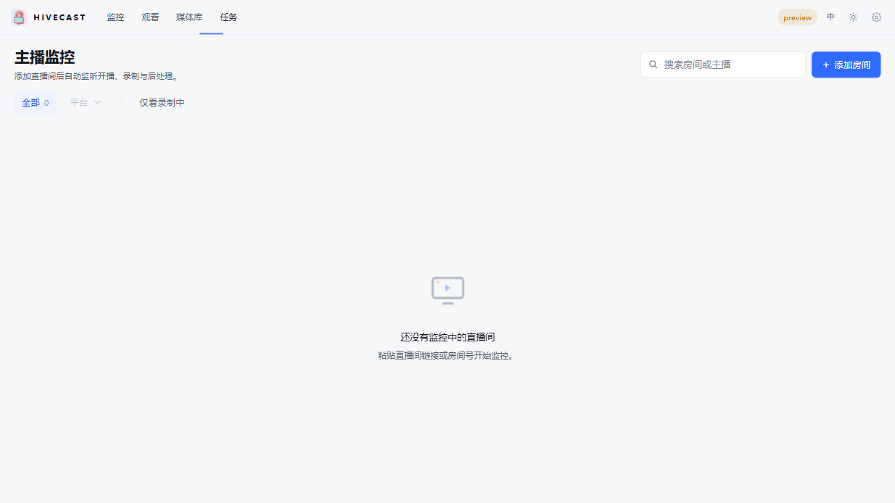
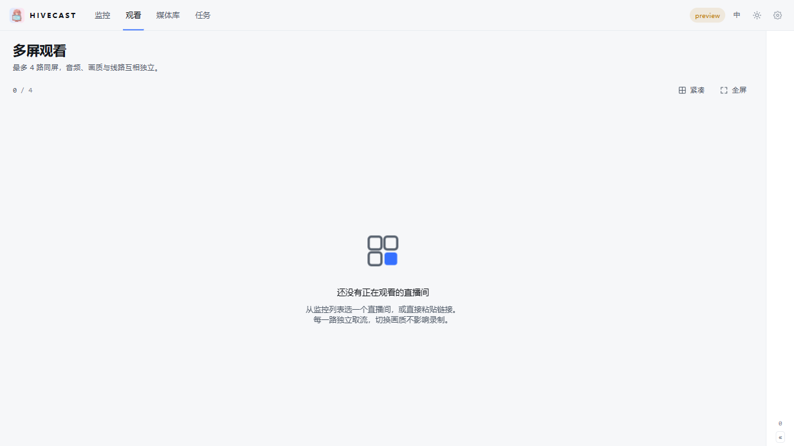
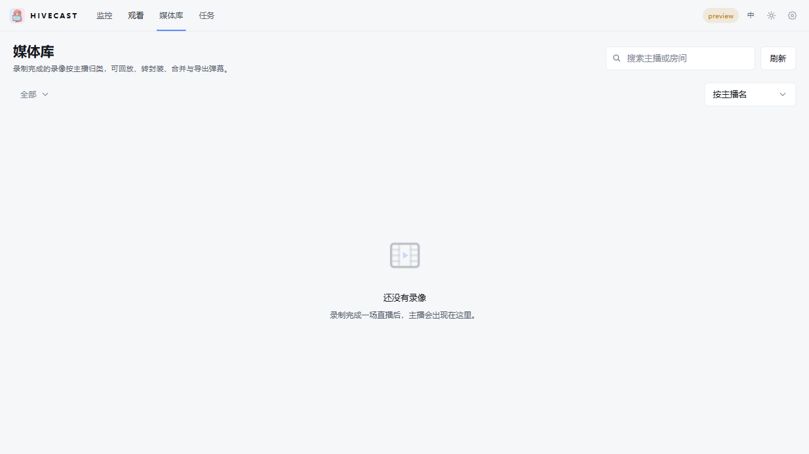
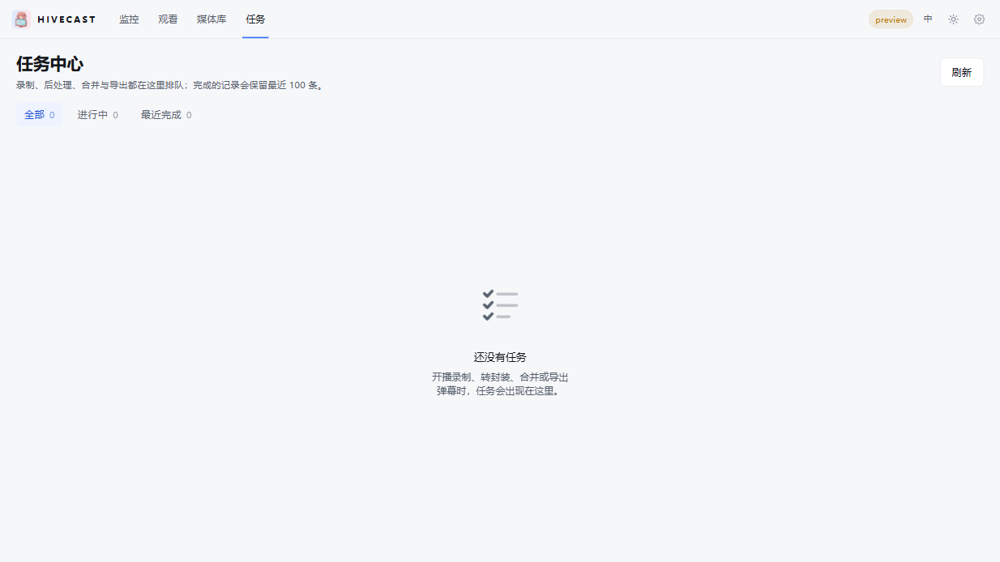

# 92-四页结构统一

> 状态：v1 已实施（2026-11-09）；浏览器预览完成四页视觉验收，Tauri 真机与有数据状态待补。
> 范围：监控 / 观看 / 媒体库 / 任务四个主 Tab 共用同一套页面骨架：标题区、工具栏、内容区。
> 前置阅读：`40-UIUX-设计方案.md`、`86-Arc-UI控件环境.md`、`90-空态与Tab切换.md`、`91-开关统一为Arc-Switch.md`。

## 0. 结论速览

- 新增 `src/components/ui/PageShell.tsx`：`PageShell` / `PageHeader` / `PageToolbar` / `PageBody` / `PageChip` / `PageSearch`。
- 四个页面现在都有同一套 **标题 + 一句话说明**，标题 21px、说明 11.5px；页面级操作（搜索、添加、刷新）统一在标题右侧。
- 筛选、排序、分段、布局等控件统一放在第二行工具栏；内容区独立滚动，空态在内容区垂直居中。
- 监控补上原有但未使用的 `monitor.subtitle`；媒体库新增 `media.title` / `media.subtitle`；观看补上 `watch.title` / `watch.subtitle`；任务新增 `tasks.filterAll` 并增加「全部 / 进行中 / 最近完成」筛选。
- 媒体库不再由 `App.tsx` 外层包滚动容器，改由 `PageBody` 自己滚动，和监控、任务一致。
- 观看页全屏时隐藏标题区，工具栏变成原来的顶部悬浮 chrome；退出全屏后恢复完整页面结构。

## 1. 统一页面骨架

```text
┌──────────────────────────────────────────────────────────────┐
│ 标题（21/28）                          [页面级操作]          │  PageHeader
│ 一句话说明（11.5/20）                                        │
├──────────────────────────────────────────────────────────────┤
│ [筛选] [下拉] [分段]                              [排序]     │  PageToolbar
├──────────────────────────────────────────────────────────────┤
│                                                              │
│ 内容 / 空态（独立滚动）                                      │  PageBody
│                                                              │
└──────────────────────────────────────────────────────────────┘
```

| 组件 | 规格 |
| --- | --- |
| `PageShell` | `flex min-h-0 flex-1 flex-col`，作为页面根节点；可加 `relative` 等类 |
| `PageHeader` | `px-5 pt-4 pb-3`，`items-center`；标题 21px/28 semibold，说明 11.5px/20 muted |
| `PageToolbar` | `px-5 pb-3`、`min-h-9`、`flex-wrap gap-2`；不再给整行加底边 |
| `PageBody` | `flex min-h-0 flex-1 flex-col`；默认 `overflow-auto px-5 pb-6`，`scroll={false}` 交给页面自己控制 |
| `PageChip` | 圆角筛选胶囊；激活 `bg-accent-soft text-accent-text`，未激活 `text-muted hover:bg-raised` |
| `PageSearch` | 228×36，左侧放大镜，和 Arc 下拉/按钮同高 |

`PageHeader` 还支持：

- `leading`：标题上方的返回/面包屑；
- `prefix`：标题前的主播头像等；
- `actions`：右侧搜索、主操作、刷新。

## 2. 四页对齐方式

| 页面 | 标题 / 说明 | 标题右侧 | 工具栏 | 内容 |
| --- | --- | --- | --- | --- |
| 监控 | `monitor.title` / `monitor.subtitle` | 搜索 + 添加房间 | 全部 / 平台 / 仅录制中 | 表格，表头固定，行区滚动 |
| 观看 | `watch.title` / `watch.subtitle` | 无（全屏控件在工具栏） | 路数 + 布局 + 紧凑/全屏/弹幕/静音 | 分屏舞台，占满剩余空间 |
| 媒体库 | 新增 `media.title` / `media.subtitle` | 搜索 + 刷新 | 平台 + 排序 | 主播墙 / 录像网格，`PageBody` 滚动 |
| 任务 | `tasks.title` / `tasks.subtitle` | 刷新 | 全部 / 进行中 / 最近完成 | 进行中与历史分区，`PageBody` 滚动 |

- **媒体主播页**：返回链接作为 `leading`，36px 主播头像作为 `prefix`，主播名作为标题，条数/体积/最新时间/房间名作为说明；「全选 / 刷新」固定到标题右侧。
- **任务筛选**：默认「全部」；选择「进行中」或「最近完成」时只显示对应分区。两区都为空时仍显示整页空态。
- **观看全屏**：`fullscreen` 时 `PageHeader` 不渲染，工具栏改为 `absolute top-0` 的 48px 悬浮条，鼠标靠近顶部才出现；退出全屏恢复标题区。

## 3. 滚动与空态

- 监控：`PageBody` 不滚动，表格行区自己 `overflow-auto`，表头保持固定。
- 媒体：`PageBody` 负责滚动；空态用 `flex-1` 在内容区居中，不再出现「空态顶在工具栏下」的问题。
- 任务：`PageBody` 滚动，空态 `flex-1` 居中。
- 观看：内容区 `flex-1` 占满，空态在舞台区域居中。
- 所有空态仍是 `PageEmpty`（`flex items-center justify-center`），不因新增骨架改变动画与尺寸。

## 4. 验证

- 浏览器预览四个 Tab 截图：标题、说明、工具栏起止高度一致；监控/观看/任务空态中心基本在同一条水平线上，媒体空态修正后也对齐。
- 任务筛选：三个胶囊切换时只显示对应分区，计数随轮询更新；全空时仍显示整页动画空态。
- 媒体：外层滚动已移除，页面内容在 `PageBody` 内滚动；主播墙/录像网格的加载更多仍在内容底部。
- 观看：非全屏显示标题与工具栏；全屏隐藏标题、工具栏悬浮在顶部；空态仍在舞台中央。
- `pnpm exec tsc -b`、`pnpm build` 通过；`check:i18n` 627 keys、`check:docs` 93 files。









## 5. 已知限制

- **标题字号统一为 21px**：媒体主播页的主播名也从 18px 提到 21px，和页面标题同级；如果后续觉得主播页过重，可以给 `PageHeader` 加 `compact` 变体，而不是单独改一页。
- **观看页标题在系统全屏时隐藏**：这是刻意保持沉浸；全屏退出按钮仍在顶部悬浮条与 `Esc` / `F11` 快捷键里。
- **任务筛选不持久化**：切 Tab 会卸载页面，筛选回到「全部」，与其它页的局部筛选行为一致。
- **媒体搜索仍只筛主播**：主播页没有搜索框，这是原有行为，本次只调整位置与骨架。
- **浏览器预览无 IPC**：有数据状态（主播卡、录像网格、任务列表）需要在 `pnpm tauri dev` 下复验。
