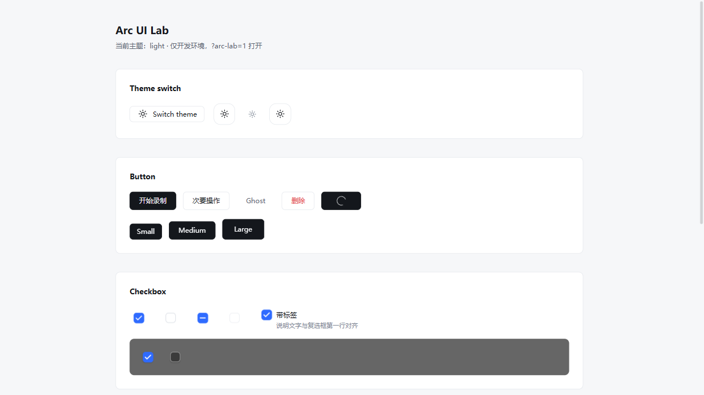
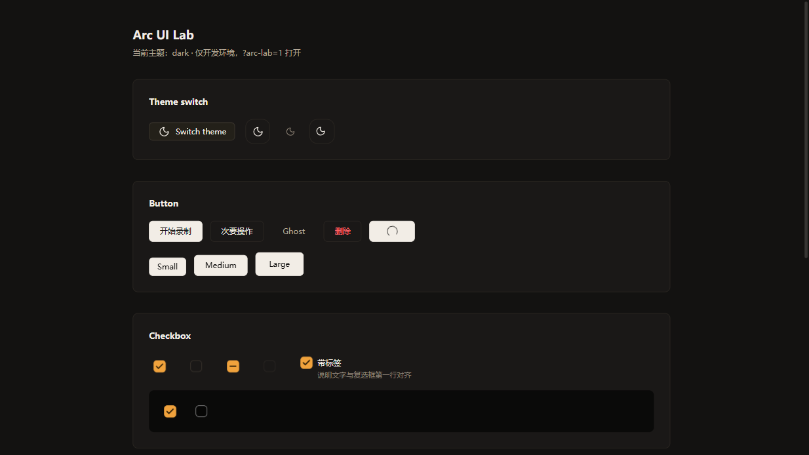

# 93-复选框统一为 Arc Checkbox

> 状态：v1 已实施（2026-11-09）；浏览器预览完成组件与深浅色验收，Tauri 有数据状态待补。
> 范围：应用内所有复选/多选控件统一使用 Arc（uiarc.dev）的 `Checkbox`，替换监控行与媒体卡上的自绘勾选方块。
> 前置阅读：`86-Arc-UI控件环境.md`、`91-开关统一为Arc-Switch.md`、`92-四页结构统一.md`。

## 0. 结论速览

- 新增 `src/components/arc/checkbox/checkbox.tsx` 与 `checkbox.module.css`，源码来自 Arc 免费组件 `@uiarc/checkbox`。
- 新增依赖 `@radix-ui/react-checkbox`；`motion` 与 Arc token 已就绪。
- 覆盖两处多选：
  - 监控表格缩略图右上角的「选择直播间」；
  - 媒体库录像卡片右上角的「选择整场」。
- Arc Checkbox 原生行为：32px 命中区、18px 方块，选中时方块填充弹簧放大、勾线绘制；切到 `indeterminate` 时同一路径 morph 成横杠；Space 切换。
- 新增本地 `tone="overlay"` 变体：未选中方块使用半透明深底 + 白色描边，选中仍用强调色填充，保证在视频缩略图上可读。
- `?arc-lab=1` 新增 Checkbox 段：勾选、未勾选、部分选中、禁用、带标签/说明，以及封面上的 overlay 变体。

## 1. 组件与适配

| 文件 | 作用 |
| --- | --- |
| `src/components/arc/checkbox/checkbox.tsx` | Arc Checkbox 源码 + `tone` 变体；Radix Root、motion fill/path |
| `src/components/arc/checkbox/checkbox.module.css` | 命中区/方块尺寸、状态色、overlay 描边 |
| `src/features/monitor/MonitorPage.tsx` | 行缩略图上的直播选择改为 `<Checkbox tone="overlay">` |
| `src/features/media/MediaPage.tsx` | 录像卡片选择改为 `<Checkbox tone="overlay">`，删除本地 `IconCheck` |

调用方式：

```tsx
<Checkbox
  checked={isPicked}
  onCheckedChange={() => togglePick(view)}
  aria-label={t("monitor.selectHint")}
  tone="overlay"
/>
```

## 2. 视觉与动效

- **默认变体**：18px 方块、5px 圆角、`--surface` 底、`--border-strong` 描边；选中后 `--control-on` 填充、`--control-glyph` 勾线。
- **overlay 变体**：仅用于视频封面/缩略图。未选中为 `rgba(0,0,0,.42)` 半透明深底 + `rgba(255,255,255,.55)` 描边；hover 提升到 `.9` 描边与 `.62` 深底；选中后仍是强调色填充。
- **动效**：填充 scale 用 snappy 弹簧，勾线 pathLength 绘制；勾与横杠共享三个锚点，切换时直接 morph，不是两张图交叉淡入。
- **减少动态效果**：填充、勾线、按压缩放全部立即到位。
- **命中区**：root 32px，方块 18px；视觉尺寸与旧自绘方块一致，点击区更大，但不会挤动周围布局。

## 3. 无障碍

- Radix 渲染真实 `role="checkbox"`，`aria-checked` 为 `true` / `false` / `mixed`。
- 两处调用都传 `aria-label`，读屏名分别是「选择直播间」与「选择整场」。
- `label` / `description` 是真实 `<label>` 与 `aria-describedby` 关联；预览台有示例。
- 键盘 Space 可切换。

## 4. 验证

- 浏览器预览 `?arc-lab=1`：默认、勾选、部分选中、禁用、带标签/说明与 overlay 变体均正常；测到 root 32×32、visual 18×18，`aria-checked` 分别为 `true / false / mixed`。
- 浅色：默认勾选为蓝底白勾；overlay 已选中为蓝底白勾，未选中为深色半透明方块。
- 深色：默认勾选为琥珀底暖黑勾；overlay 未选中为白描边深底，选中为琥珀底暖黑勾。
- `pnpm exec tsc -b`、`pnpm build` 通过；`check:i18n` 627 keys、`check:docs` 94 files。
- 监控行与媒体卡的真实缩略图状态需要 `pnpm tauri dev` 下补点。





## 5. 已知限制

- **`tone="overlay"` 是本项目扩展**：Arc 原组件只有默认表面样式；封面上的白描边是本地 CSS 变体，重新执行 `shadcn add --overwrite` 会覆盖，需保留。
- **命中区 32px 比视觉大**：这是 Arc 的设计（整块控件高度可点）；在缩略图右上角会覆盖约 32px 区域，若后续觉得误触，可另加 `size="sm"`，不要直接缩 `.visual`。
- **监控只允许直播中的房间被选**：offline 行不显示复选框，这是原有业务规则，本次未改。
- **选中态仍由页面状态控制**：`picked`（监控）与 `selected`（媒体）的集合逻辑不变，Arc Checkbox 只负责表现与键盘语义。
