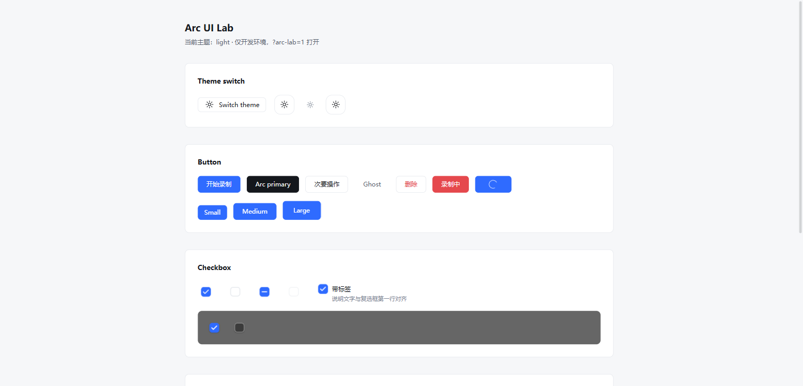
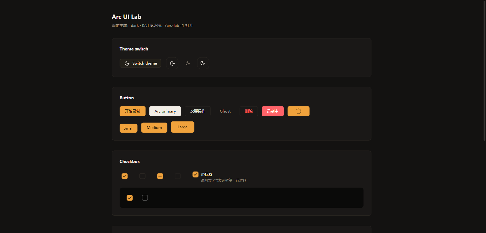

# 94-按钮统一为 Arc Button

> 状态：v1 已实施（2026-11-09）；浏览器预览完成四页、设置、弹窗与深浅色验收，Tauri 真机待点。
> 范围：应用内标准操作按钮统一使用 Arc（uiarc.dev）的 `Button`，替换项目原来的 Tailwind 自绘按钮。
> 前置阅读：`86-Arc-UI控件环境.md`、`91-开关统一为Arc-Switch.md`、`92-四页结构统一.md`、`93-复选框统一为Arc-Checkbox.md`。

## 0. 结论速览

- `src/components/ui/Controls.tsx` 的 `Button` 和 `IconButton` 改为 Arc Button 适配层；业务调用方继续使用原来的 `variant / size / disabled / title / type`，不用改 92 处调用。
- 保留项目语义：`primary / secondary / ghost / danger / recording`，分别映射到 Arc 的 `accent / secondary / ghost / danger / recording`。
- 新增 Arc Button 变体 `accent`（品牌强调色，浅色蓝 / 深色琥珀）与 `recording`（红色实心），新增 `icon` 尺寸（28×28 正方形命中区）。
- Arc 原生 `primary`（黑白）仍保留，用于需要纯黑白层次的场景；应用主按钮走 `accent`，保持现有品牌色。
- 按钮尺寸与旧实现一致：sm 28、md 32、lg 36；按下有轻微缩放，标签变化时宽度用弹簧收放，加载时显示 spinner。
- 顶栏语言切换、设置页侧栏关闭按钮也改用 Arc Button / IconButton。

## 1. 组件与映射

| 项目 API | Arc Button | 说明 |
| --- | --- | --- |
| `variant="primary"` | `accent` | 品牌强调色：浅色蓝底白字、深色琥珀底暖黑字 |
| `variant="secondary"` | `secondary` | 表面 + 描边 + hover 浅底 |
| `variant="ghost"` | `ghost` | 无底色，hover 才出现浅底 |
| `variant="danger"` | `danger` | 表面 + 描边 + 红色文字，hover 红描边 |
| `variant="recording"` | `recording` | 红色实心，用于录制中/停止录制 |
| `size="sm" / "md" / "lg"` | 同名 | 28 / 32 / 36px 高 |
| `IconButton` | `size="icon"` + ghost/secondary | 28×28 正方形，用于工具图标 |

适配层仍默认 `type="button"`，保留 `title`、`onBlur`、`className`、`disabled`；提交按钮显式传 `type="submit"` 时照常提交。

## 2. 动效与视觉

- **按下**：Arc 按宽度选择 `.985/.97/.96` 的缩放，图标按钮按得更深。
- **标签变化**：Arc 用 `AnimatePresence` + 宽度弹簧把旧标签换出、新标签换入；「全选 / 取消全选」「开始 / 停止」这类切换会平滑过渡。
- **加载**：Arc Button 原生 `loading` 显示 spinner 并隐藏标签；项目 API 暂未暴露，ArcLab 可直接用。
- **禁用**：secondary/danger 保持外形并降低文字与底色对比；accent/recording 只降透明度，仍能看出这是一个关闭的按钮。
- **焦点**：沿用 Arc foundation 的 `:focus-visible` 描边；桌面壳守卫在 Tauri 下把 `--focus-outline` 设为透明。

## 3. 保留原生的按钮

以下不是通用操作按钮，继续使用各自的专用样式，不强行套 Arc Button：

- 顶栏 Tab、窗口最小化/最大化/关闭、设置侧栏导航；
- `PageChip` 筛选胶囊、`Segmented` 分段控件、下拉菜单项；
- 播放器深色控制条（播放/静音/画中画/全屏/弹幕），需要黑底半透明样式；
- 封面播放按钮、录像卡/主播卡整卡点击、缩略图整块点击；
- 行尾 `⋯` 动作菜单触发器、输入框内清除按钮等图标热区。

判断标准：有独立语义（导航/菜单/分段/卡片/深色 overlay）的保留专用样式；承担「提交、取消、刷新、添加、删除、全选」等标准动作的都用 Arc Button。

## 4. 验证

- 浏览器预览四页：监控「添加房间」为蓝色 accent；观看「紧凑 / 全屏」为 ghost；媒体「刷新」为 secondary；任务「刷新」为 secondary；尺寸 28/32/36 与旧实现一致。
- 设置页：底部「关闭」ghost、「保存」accent；禁用保存按钮透明度正确；侧栏关闭按钮为 28×28 Arc icon 按钮。
- 添加房间弹窗：「取消」ghost、「添加」accent；提交按钮仍为 `type="submit"`。
- 顶栏语言切换为 28px Arc ghost；主题按钮与设置按钮同高。
- ArcLab `Button` 段：accent、Arc primary、secondary、ghost、danger、recording、loading 与三种尺寸；浅色/深色均正常。
- `pnpm exec tsc -b`、`pnpm build` 通过；`check:i18n` 627 keys、`check:docs` 95 files。

## 5. 已知限制

- **主按钮保留品牌色**：Arc 原生 primary 是黑白；本项目把 `primary` 映射到新增的 `accent` 变体，避免整页主操作从蓝/琥珀变成黑/白。ArcLab 仍保留原生 `primary` 做对照。
- **`danger` 改为 Arc 风格**：从浅红底改为表面 + 红字 + 红描边；如果想恢复更重的警示底，可再加 `dangerSoft`，不要在业务里手写红色按钮。
- **标签弹簧会动**：这是 Arc Button 的表现；如果某个高频变化的按钮不需要宽度动画，应给组件加 `morph={false}`，而不是改回原生 `<button>`。
- **IconButton 只收口了标准图标按钮**：播放器、窗口控制、卡片点击等专用按钮不在此列。
- **有数据状态待真机**：媒体批量操作条、任务取消、关闭拦截弹窗等需要在 `pnpm tauri dev` 下再点一遍。
